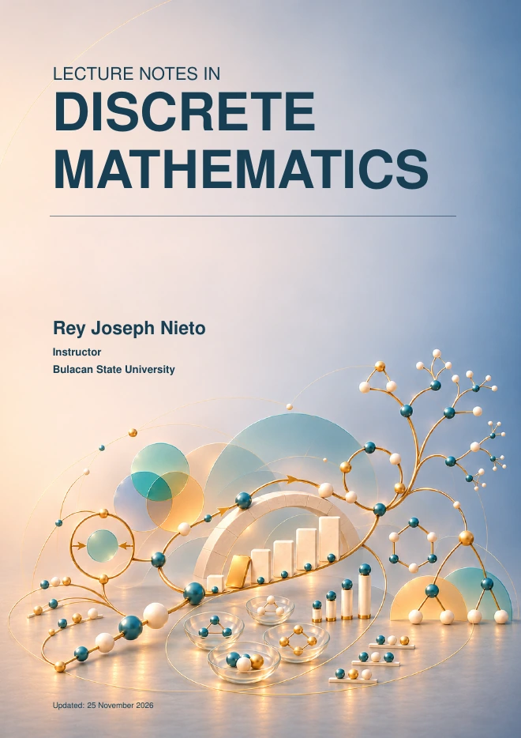

{fig-alt="Blue, teal and gold mathematical sculptures combining logical paths, sets, graphs, induction steps, modular rings, counting patterns and recursive trees" width=1672 height=941 style="width:100%; height:auto;"}

## Course information {#logistics}

**IT 104** · 2nd Semester, A.Y. ’26 – ’27

- **Instructor:** Rey Joseph Nieto.
- **Email:** reyjoseph [dot] nieto [at] bulsu [dot] edu [dot] ph
- **Last day to drop subjects:** 22 January 2027.
- **Assumed background:** completion of, or familiarity with, *Mathematics
  in the Modern World* (MMW).

::: {.callout-important title="First meeting: 28 November 2026"}

- **We will not meet on 21 November 2026**, to allow time for students
  registering late to complete their enrolment.
- **Before our first meeting on 28 November 2026, read
  the [Introduction](bulsu/discrete-math/lecture-notes/chapter_00.pdf),
  [Chapter 1](bulsu/discrete-math/lecture-notes/chapter_01.pdf) and
  [Chapter 2](bulsu/discrete-math/lecture-notes/chapter_02.pdf) carefully.**
- Chapters 1 and 2 revisit mathematical language and logic from MMW and
  develop the ideas further.
- **Bring a recent 1×1 photo to our first meeting on 28 November.** I will
  attach it to our fixed seating plan so I can identify you, check attendance
  more quickly and record your recitation marks.

:::

### No-class Saturdays {#no-class-saturdays}

- **21 November 2026:** no face-to-face class; Chapter 1 is assigned for self-study.
- **26 December 2026:** Christmas break.
- **2 January 2027:** Christmas break.
- **23 January 2027:** First Philippine Republic anniversary (assumed holiday).
- **6 February 2027:** Chinese New Year.
- **27 March 2027:** Black Saturday.

## Course outline and printable lecture notes {#course-outline}

- I have planned twelve self-contained chapters across thirteen teaching
  weeks, including the opening self-study week, to allow for class
  suspensions and catch-up work. Chapter numbers match the numbered
  teaching weeks.
- If we stay on schedule, we may also discuss introductory automata theory
  and mathematical ways of describing computer programs and their behaviour.
- There are no coding assignments; pseudocode may be used.

::: {.discrete-chapter-list}

::: {.discrete-chapter}

[{.nolightbox width=512 height=512 fig-alt="" loading="lazy" decoding="async"}](bulsu/discrete-math/lecture-notes/chapter_00.pdf){.discrete-chapter-thumbnail aria-label="Open Introduction (PDF)"}

::: {.discrete-chapter-details}

### [Introduction](bulsu/discrete-math/lecture-notes/chapter_00.pdf) {#chapter-00 .unlisted}

[Read before <time datetime="2026-11-28">28 November 2026</time>]{.discrete-chapter-date}

- Discrete mathematics
- Using the notes
- Course outline
- Abstraction and computing

[Download PDF](bulsu/discrete-math/lecture-notes/chapter_00.pdf){.discrete-chapter-pdf .btn .btn-outline-primary .btn-sm aria-label="Download Introduction (PDF)"}

:::

:::

::: {.discrete-chapter}

[{.nolightbox width=512 height=512 fig-alt="" loading="lazy" decoding="async"}](bulsu/discrete-math/lecture-notes/chapter_01.pdf){.discrete-chapter-thumbnail aria-label="Open Chapter 1: Statements and quantifiers (PDF)"}

::: {.discrete-chapter-details}

### [Chapter 1: Statements and quantifiers](bulsu/discrete-math/lecture-notes/chapter_01.pdf) {#chapter-01 .unlisted}

[<time datetime="2026-11-21">21 November 2026</time> · Self-study.]{.discrete-chapter-date}

- Sets and notation
- Functions
- Expressions and statements
- Compound statements
- Predicates and domains
- Quantifiers
- Witnesses and counterexamples
- Quantifier order

[Download PDF](bulsu/discrete-math/lecture-notes/chapter_01.pdf){.discrete-chapter-pdf .btn .btn-outline-primary .btn-sm aria-label="Download Chapter 1: Statements and quantifiers (PDF)"}

:::

:::

::: {.discrete-chapter}

[{.nolightbox width=512 height=512 fig-alt="" loading="lazy" decoding="async"}](bulsu/discrete-math/lecture-notes/chapter_02.pdf){.discrete-chapter-thumbnail aria-label="Open Chapter 2: Propositional logic (PDF)"}

::: {.discrete-chapter-details}

### [Chapter 2: Propositional logic](bulsu/discrete-math/lecture-notes/chapter_02.pdf) {#chapter-02 .unlisted}

[<time datetime="2026-11-28">28 November 2026</time>]{.discrete-chapter-date}

- Conditional rules
- Converse, inverse and contrapositive
- Logical equivalence
- Negation and rewriting
- Quantifier negation
- Valid arguments
- Invalid arguments

[Download PDF](bulsu/discrete-math/lecture-notes/chapter_02.pdf){.discrete-chapter-pdf .btn .btn-outline-primary .btn-sm aria-label="Download Chapter 2: Propositional logic (PDF)"}

:::

:::

::: {.discrete-chapter}

[{.nolightbox width=512 height=512 fig-alt="" loading="lazy" decoding="async"}](bulsu/discrete-math/lecture-notes/chapter_03.pdf){.discrete-chapter-thumbnail aria-label="Open Chapter 3: Proof methods (PDF)"}

::: {.discrete-chapter-details}

### [Chapter 3: Proof methods](bulsu/discrete-math/lecture-notes/chapter_03.pdf) {#chapter-03 .unlisted}

[<time datetime="2026-12-05">5 December 2026</time>]{.discrete-chapter-date}

- Mathematical proof
- Parity and divisibility
- Direct proof
- Proof by contrapositive
- Proof by contradiction
- Proof construction and checking

[Download PDF](bulsu/discrete-math/lecture-notes/chapter_03.pdf){.discrete-chapter-pdf .btn .btn-outline-primary .btn-sm aria-label="Download Chapter 3: Proof methods (PDF)"}

:::

:::

::: {.discrete-chapter}

[{.nolightbox width=512 height=512 fig-alt="" loading="lazy" decoding="async"}](bulsu/discrete-math/lecture-notes/chapter_04.pdf){.discrete-chapter-thumbnail aria-label="Open Chapter 4: Sets and mappings (PDF)"}

::: {.discrete-chapter-details}

### [Chapter 4: Sets and mappings](bulsu/discrete-math/lecture-notes/chapter_04.pdf) {#chapter-04 .unlisted}

[<time datetime="2026-12-12">12 December 2026</time>]{.discrete-chapter-date}

- Subsets and set operations
- Set inclusion
- Set equality
- Injectivity
- Images of subsets
- Relations and transitivity
- Proof checking

[Download PDF](bulsu/discrete-math/lecture-notes/chapter_04.pdf){.discrete-chapter-pdf .btn .btn-outline-primary .btn-sm aria-label="Download Chapter 4: Sets and mappings (PDF)"}

:::

:::

::: {.discrete-chapter}

[{.nolightbox width=512 height=512 fig-alt="" loading="lazy" decoding="async"}](bulsu/discrete-math/lecture-notes/chapter_05.pdf){.discrete-chapter-thumbnail aria-label="Open Chapter 5: Induction (PDF)"}

::: {.discrete-chapter-details}

### [Chapter 5: Induction](bulsu/discrete-math/lecture-notes/chapter_05.pdf) {#chapter-05 .unlisted}

[<time datetime="2026-12-19">19 December 2026</time>]{.discrete-chapter-date}

- Indexed claims
- Ordinary (weak) induction
- Sums, divisibility and inequalities
- Strong induction
- Recursive rules
- Choice of hypothesis
- Errors in induction

[Download PDF](bulsu/discrete-math/lecture-notes/chapter_05.pdf){.discrete-chapter-pdf .btn .btn-outline-primary .btn-sm aria-label="Download Chapter 5: Induction (PDF)"}

:::

:::

::: {.discrete-chapter}

[{.nolightbox width=512 height=512 fig-alt="" loading="lazy" decoding="async"}](bulsu/discrete-math/lecture-notes/chapter_06.pdf){.discrete-chapter-thumbnail aria-label="Open Chapter 6: Graphs (PDF)"}

::: {.discrete-chapter-details}

### [Chapter 6: Graphs](bulsu/discrete-math/lecture-notes/chapter_06.pdf) {#chapter-06 .unlisted}

[<time datetime="2027-01-09">9 January 2027</time>]{.discrete-chapter-date}

- Graph representations
- Vertex degrees
- Paths and connectedness
- Trees and unique paths
- Leaves and induction
- Spanning trees
- Rooted trees

[Download PDF](bulsu/discrete-math/lecture-notes/chapter_06.pdf){.discrete-chapter-pdf .btn .btn-outline-primary .btn-sm aria-label="Download Chapter 6: Graphs (PDF)"}

:::

:::

::: {.discrete-chapter}

[{.nolightbox width=512 height=512 fig-alt="" loading="lazy" decoding="async"}](bulsu/discrete-math/lecture-notes/chapter_07.pdf){.discrete-chapter-thumbnail aria-label="Open Chapter 7: Equivalence relations (PDF)"}

::: {.discrete-chapter-details}

### [Chapter 7: Equivalence relations](bulsu/discrete-math/lecture-notes/chapter_07.pdf) {#chapter-07 .unlisted}

[<time datetime="2027-01-16">16 January 2027</time>]{.discrete-chapter-date}

- Relations
- Inverse relations and composition
- Reflexivity, symmetry and antisymmetry
- Transitivity
- Equivalence relations
- Equivalence classes
- Partitions

[Download PDF](bulsu/discrete-math/lecture-notes/chapter_07.pdf){.discrete-chapter-pdf .btn .btn-outline-primary .btn-sm aria-label="Download Chapter 7: Equivalence relations (PDF)"}

:::

:::

::: {.discrete-chapter}

[{.nolightbox width=512 height=512 fig-alt="" loading="lazy" decoding="async"}](bulsu/discrete-math/lecture-notes/chapter_08.pdf){.discrete-chapter-thumbnail aria-label="Open Chapter 8: Modular arithmetic (PDF)"}

::: {.discrete-chapter-details}

### [Chapter 8: Modular arithmetic](bulsu/discrete-math/lecture-notes/chapter_08.pdf) {#chapter-08 .unlisted}

[<time datetime="2027-02-13">13 February 2027</time>]{.discrete-chapter-date}

- Divisibility
- Quotients and remainders
- Congruence
- Residue classes
- Arithmetic with congruences
- Modular systems

[Download PDF](bulsu/discrete-math/lecture-notes/chapter_08.pdf){.discrete-chapter-pdf .btn .btn-outline-primary .btn-sm aria-label="Download Chapter 8: Modular arithmetic (PDF)"}

:::

:::

::: {.discrete-chapter}

[{.nolightbox width=512 height=512 fig-alt="" loading="lazy" decoding="async"}](bulsu/discrete-math/lecture-notes/chapter_09.pdf){.discrete-chapter-thumbnail aria-label="Open Chapter 9: Counting principles (PDF)"}

::: {.discrete-chapter-details}

### [Chapter 9: Counting principles](bulsu/discrete-math/lecture-notes/chapter_09.pdf) {#chapter-09 .unlisted}

[<time datetime="2027-02-20">20 February 2027</time>]{.discrete-chapter-date}

- Counting outcomes
- Sum rule
- Product rule
- Counting by cases
- Counting complements
- Two overlapping sets
- Three overlapping sets

[Download PDF](bulsu/discrete-math/lecture-notes/chapter_09.pdf){.discrete-chapter-pdf .btn .btn-outline-primary .btn-sm aria-label="Download Chapter 9: Counting principles (PDF)"}

:::

:::

::: {.discrete-chapter}

[{.nolightbox width=512 height=512 fig-alt="" loading="lazy" decoding="async"}](bulsu/discrete-math/lecture-notes/chapter_10.pdf){.discrete-chapter-thumbnail aria-label="Open Chapter 10: Permutations and combinations (PDF)"}

::: {.discrete-chapter-details}

### [Chapter 10: Permutations and combinations](bulsu/discrete-math/lecture-notes/chapter_10.pdf) {#chapter-10 .unlisted}

[<time datetime="2027-02-27">27 February 2027</time>]{.discrete-chapter-date}

- Factorials and arrangements
- Permutations
- Combinations
- Counting via subsets
- Combinatorial proofs
- Row sums by induction
- Binomial expansions

[Download PDF](bulsu/discrete-math/lecture-notes/chapter_10.pdf){.discrete-chapter-pdf .btn .btn-outline-primary .btn-sm aria-label="Download Chapter 10: Permutations and combinations (PDF)"}

:::

:::

::: {.discrete-chapter}

[{.nolightbox width=512 height=512 fig-alt="" loading="lazy" decoding="async"}](bulsu/discrete-math/lecture-notes/chapter_11.pdf){.discrete-chapter-thumbnail aria-label="Open Chapter 11: Sequences (PDF)"}

::: {.discrete-chapter-details}

### [Chapter 11: Sequences](bulsu/discrete-math/lecture-notes/chapter_11.pdf) {#chapter-11 .unlisted}

[<time datetime="2027-03-06">6 March 2027</time>]{.discrete-chapter-date}

- Sequences and indices
- Explicit and recursive descriptions
- Arithmetic sequences
- Geometric sequences
- Further recurrence relations
- Verification and comparison

[Download PDF](bulsu/discrete-math/lecture-notes/chapter_11.pdf){.discrete-chapter-pdf .btn .btn-outline-primary .btn-sm aria-label="Download Chapter 11: Sequences (PDF)"}

:::

:::

::: {.discrete-chapter}

[{.nolightbox width=512 height=512 fig-alt="" loading="lazy" decoding="async"}](bulsu/discrete-math/lecture-notes/chapter_12.pdf){.discrete-chapter-thumbnail aria-label="Open Chapter 12: Recursion (PDF)"}

::: {.discrete-chapter-details}

### [Chapter 12: Recursion](bulsu/discrete-math/lecture-notes/chapter_12.pdf) {#chapter-12 .unlisted}

[<time datetime="2027-03-13">13 March 2027</time>]{.discrete-chapter-date}

- Injectivity and surjectivity
- Images and inverses
- Full binary trees
- Recursive counting functions
- Structural induction

[Download PDF](bulsu/discrete-math/lecture-notes/chapter_12.pdf){.discrete-chapter-pdf .btn .btn-outline-primary .btn-sm aria-label="Download Chapter 12: Recursion (PDF)"}

:::

:::

::: {#entire-book .discrete-book-download}

[{.nolightbox width=660 height=934 fig-alt="Cover of Lecture Notes in Discrete Mathematics by Rey Joseph Nieto" loading="lazy" decoding="async"}](bulsu/discrete-math/lecture-notes/Nieto_DS.pdf){.discrete-book-thumbnail aria-label="Open the entire Discrete Mathematics book (PDF)"}

::: {.discrete-book-details}

**Entire book** · Updated 19 November 2026 · 188 pages
[Download PDF](bulsu/discrete-math/lecture-notes/Nieto_DS.pdf){.discrete-chapter-pdf .btn .btn-outline-primary .btn-sm aria-label="Download the entire Discrete Mathematics book (PDF)"}

:::

:::

:::

## Class format

**Saturday Meeting Timetable**

- **10:30 a.m.–12 noon:** lecture on the current chapter.
- **12 noon–1:00 p.m.:** lunch break.
- **1:00–1:30 p.m.:** recap of the previous chapter.
- **1:30–2:30 p.m.:** problems on the previous chapter.

**20 March 2027** is reserved for the Chapter 12 problem class and course revision.

**Preparation and participation**

- **Read the assigned chapter before class** and attempt the previous
  chapter's problems. You need not have mastered the material; identify
  where you need help. Questions will draw on the reading, with guidance
  as needed.
- **Recitation** is graded at every meeting on the quality of your
  reasoning, rather than how often you speak. There are no traditional quizzes.
- **Consultations:** I am available after class; if nobody approaches
  within five minutes of dismissal, I will leave. You may also email questions.

## Assessment

::: {.discrete-grading-table}

| Component | Weight |
|---|---:|
| Problem sets (best four of five) | 50% |
| Attendance | 5% |
| Recitation | 15% |
| Midterm examination | 15% |
| Final examination | 15% |
| **Total** | **100%** |

:::

- Problem-set scores are converted to percentages. The lowest is dropped;
  the remaining four are averaged, with each retained set accounting for
  **12.5%** of the course mark.
- Term examinations use **zero-based grading**.
- The minimum passing percentage is **75%**, equivalent to **3.00**
  ([Student Manual, Part II, Section K](https://drive.google.com/file/d/1ew8hDsW_anZjLsZJKI3rEKAnhT1K4OTd/view)).

### Assessment dates {#assessment-dates}

::: {.discrete-dates-table}

| Date | Assessment |
|---|---|
| 19 December 2026 | Problem Set 1 due |
| 9 January 2027 | Problem Set 2 due |
| 30 January 2027 | Midterm examination |
| 13 February 2027 | Problem Set 3 due |
| 27 February 2027 | Problem Set 4 due |
| 13 March 2027 | Problem Set 5 due |
| 3 April 2027 | Final examination |

:::

### Bonus for Mathematical Corrections {#mathematical-corrections}

- Question my reasoning and raise suspected mistakes.
- Each confirmed significant error in the notes or lectures earns **five
  percentage points on one examination mark** (for example, 70% becomes 75%).
- A significant error affects a claim, calculation or reasoning; harmless
  typographical errors do not qualify.
- I will choose the examination and redirect any credit above 100% to
  other components in whichever way benefits you most.
- Raw marks and bonus adjustments are recorded separately.

### Final examination exemption

To qualify:

- **Pre-final standing:** 1.50 or better.
- **Coursework:** all course requirements completed.
- **Attendance:** perfect attendance, as an additional course condition;
  valid excused absences do not count against this requirement.

The academic conditions follow the
[Student Manual, Part II, Section J.5](https://drive.google.com/file/d/1ew8hDsW_anZjLsZJKI3rEKAnhT1K4OTd/view).

Let $P$ be your best-four problem-set average, $A$ your attendance score,
$R$ your recitation score and $M$ your midterm score, all percentages after
any bonus credit. Your pre-final percentage is

$$
S=\frac{50P+5A+15R+15M}{85}.
$$

- Convert $S$ using the University's grading scale to obtain your pre-final
  standing.
- **If exempt and not taking the final:** I will record the exemption and
  use $S$ as the placeholder for its 15% component, preserving your pre-final
  percentage and grade.
- **If exempt and choosing to take the final:** You waive the exemption.
  I will record your actual examination score, including any bonus credit,
  and use it at the usual 15% weight to calculate your course grade, as for
  a student without an exemption. Your final course grade may be better or
  worse than your pre-final standing.

## Problem sets {#problem-sheets}

- **All submissions must be handwritten.**
- Each problem set will allow **at least two weeks** for completion.
- Late or missing submissions receive **zero** unless an accepted excuse
  or university-approved arrangement applies.
- An unexcused absence does not extend a deadline or entitle you to a
  make-up assessment.

**AI and face-to-face checks**

- You may use AI for revision, but not to solve assigned problem sets.
- Examinations and recitations require independent answers without AI.
- I may ask you to explain your submitted solution in person: your approach,
  notation and reasons for particular steps.
- These discussions will not include unrelated or trick questions, or
  require a different solution.
- If you cannot give even a basic account of your own reasoning, the
  problem set receives **zero**.

Problem sets will be posted here when issued.

## Course policies

The approved syllabus and university rules take precedence. See the
[Student Manual, Part II, Sections F–G and J–L](https://drive.google.com/file/d/1ew8hDsW_anZjLsZJKI3rEKAnhT1K4OTd/view)
and the
[Student Conduct, Discipline and Grievance Guidelines](https://drive.google.com/file/d/1FA3IPniUsXfeqscEyS_FdN356I_EwxGm/view)
(BOR Resolution No. 34, series of 2022).

**Devices and notes**

- Phones and other personal electronic devices must be switched off and
  put away, including when consulting notes.
- If you have a device out or in use, you will be marked absent for that class.
- Approved accessibility arrangements and university-required exceptions
  take precedence.
- Use printed notes or, preferably, your own handwritten notes; bring
  paper and a pen or pencil.

**Participation and conduct**

- Difficulty understanding is not a reason for exclusion; ask for help.
- A clear and persistent unwillingness to engage will lead to being asked
  to step outside and return when ready to participate.
- Disruptive behaviour will be addressed under university disciplinary
  procedures. Participation marks follow the approved assessment criteria.

**Attendance and punctuality**

- Attend regularly. Arrival **15 minutes** after the start is recorded as
  tardy; arrival **20 minutes** after the start is recorded as absent.
- Being marked absent does not prevent attendance at the lesson.
- Before midterms, unexcused absences exceeding **20% of required semester
  contact hours** trigger automatic dropping, recorded as **FDA (failure due
  to absences) or UD (unofficially dropped)**.
- The absence total does not reset after midterms. These classifications
  are distinct from a numerical grade of 5.0.
- If absent, read the missed notes and attempt the problems before the
  next class; seek help promptly if needed.

**Excused absences**

Recognised grounds:

- Official university representation in curricular, co-curricular or
  extracurricular activities.
- Illness certified by your attending doctor or the University physician.
- *Force majeure*: unavoidable extraordinary events beyond your control.

Other absence rules:

- Weddings, parties and similar personal commitments do not qualify.
- Notify me promptly with supporting documentation and arrange to complete
  missed work.
- The handbook sets a **30% limit on excused absences**.

**Missed examinations**

- For an excused absence, contact me promptly with supporting documentation.
- Special examinations require the instructor's recommendation and unit
  head's approval under the manual's Section J.
- The final is **not automatically double-weighted**.
- An unexcused missed examination receives **zero**, subject to university rules.

**Marks and concerns**

- You may request an explanation or review of your marks and use the
  university grievance procedure.
- I may consider perfect attendance and meaningful participation when
  reviewing borderline marks, within university rules. Neither guarantees
  a pass or replaces required coursework.

**Commitment**

- Speak with me early if you anticipate difficulty meeting the requirements.
- If you cannot commit to preparation, attendance, participation and
  coursework, I recommend official withdrawal under university procedures
  and deadlines.

**Proofwriting and abstraction**

- This is a **proof-based course**.
- The aim is to reason precisely about objects, assumptions and relationships,
  as you would with code modules, interfaces and network configurations.
- You will practise explaining why a method works, justifying a claim and
  finding counterexamples.

## About me

- **Education:** first-class BSc in Mathematics, University of Bristol, England (2026).
- **Teaching:** previously taught Mathematics in the Modern World and Living
  in the IT Era at BulSU San Rafael; formerly a teaching assistant for
  Mathematical Programming at Bristol.
- **Work:** Assistant Secretary at the Office of the Cabinet Secretary,
  Office of the President, working on policy analytics during weekdays.
- **Interests:** probability, topological data analysis, AI and machine
  learning, network science and combinatorics, with applications in
  healthcare, industry and public policy.
