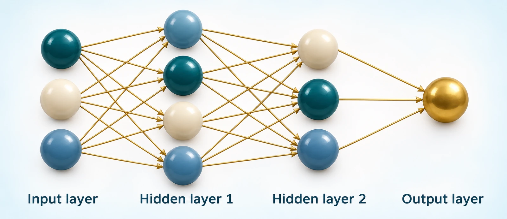

---
{
  "title": "Introduction",
  "subtitle": "Discrete Mathematics · Rey Joseph Nieto",
  "description": "Introduction. HTML edition of Lecture Notes in Discrete Mathematics.",
  "canonical-url": "https://rjnieto.com/teaching/notes/chapter-00/",
  "header-includes": "<meta name=\"robots\" content=\"index, follow, max-image-preview:large\">\n<meta property=\"og:url\" content=\"https://rjnieto.com/teaching/notes/chapter-00/\">\n<meta property=\"og:type\" content=\"article\">",
  "image": "/teaching/bulsu/discrete-math/images/thumbnails/chapter_00.webp",
  "body-classes": "ds-lecture-notes",
  "toc": true,
  "toc-depth": 2,
  "number-sections": false,
  "format": {
    "html": {
      "css": [
        "/assets/css/discrete-notes.css"
      ]
    }
  },
  "execute": {
    "eval": false
  }
}
---

<!-- Generated from the corresponding chapter LaTeX. Run scripts/build-discrete-html.py to refresh. -->

[Course page](/teaching/){.btn .btn-outline-secondary .btn-sm} [PDF](/teaching/bulsu/discrete-math/lecture-notes/chapter_00.pdf){.btn .btn-outline-primary .btn-sm aria-label="Open Introduction as PDF"}

Tell someone in the Philippines that you are studying Information Technology, and you may be asked whether you can fix a computer, install software or get a printer working. Hardware maintenance and technical support are valuable parts of IT, and you may eventually choose to specialise in them. The difficulty arises when this becomes our entire picture of the field.

Information Technology concerns how people and organisations use computing systems to work with information. The University of Cincinnati's overview describes a field involving hardware, software, networks, data management and information security, and includes artificial intelligence and machine learning among its areas.[^1] Maintaining equipment is one way to contribute. Designing an application, organising a database, connecting services and deciding who should have access to a record are other ways. These tasks require us to understand what a system is meant to do and how its parts fit together.

Consider a university enrolment system. The computers and network must work, but the system also needs a way to identify each student, record completed subjects, check prerequisites and allocate places. If Alice has completed the required subjects, should she be allowed to enrol? What if a class is full? Can two students be assigned the same student number? A fast computer will faithfully execute a badly specified rule. Before choosing how to implement a system, we need to say clearly what its rules mean.

## Discrete mathematics {#discrete-mathematics .unnumbered}

The word **discrete** refers to distinct, separately identifiable objects. A student record, a file, a network connection and a step in a procedure can each be considered individually. Discrete mathematics studies structures built from such objects and the relationships between them. Its collections need not be small or even finite: the integers, for example, form an infinite discrete collection.

These notes introduce discrete mathematics at an early undergraduate level for Information Technology and Computer Science majors. They support IT 104, *Discrete Mathematics*, at Bulacan State University.

For comparison, a model of temperature may allow every real value in an interval. A model of enrolment may instead ask which students belong to a class and which pairs of subjects stand in a prerequisite relationship. The questions call for different mathematical descriptions. In this course, we concentrate on the descriptions useful for objects, connections, rules and successive steps.

The renewed prominence of **artificial intelligence (AI)**[^2] makes this broader understanding of IT especially relevant. AI concerns computing methods for tasks such as recognising patterns, reasoning and generating language. Its growing use in organisations brings questions about data, software and system behaviour into more areas of work.[^3]

**Machine learning** is an approach within AI in which models are developed using data.[^4] For example, a system might use previously labelled messages to learn to classify new messages as spam or legitimate mail. People still have to decide which messages to collect, what the labels mean, how to test the model and what should happen when it makes a mistake. Integrating such a model into a useful service also requires storage, permissions and a clear account of its inputs and outputs.

Mathematical reasoning helps us ask precise questions about these systems. If a spam classifier labels twenty test messages correctly, what does that establish about messages it has never seen? It provides evidence about those twenty cases; it does not prove that every future classification will be correct. Statistical methods help us assess performance beyond those test cases. Here we begin with the logical distinction between checking some examples and establishing a claim about every permitted case.

Discrete mathematics helps us describe objects and relationships, express conditions, analyse choices and justify conclusions.

:::: {.ds-box .ds-enrichment}
::: {#ai-assisted-proofs-and-code .ds-box-title}
**AI-assisted proofs and code**
:::

AI systems already produce proofs that can be checked by formal tools. AlphaProof, for example, produced formal solutions to three problems from the 2024 International Mathematical Olympiad using Lean, software that checks proofs written in a precise formal language.[^5]

There is also the claimed solution to the Navier--Stokes Millennium Prize Problem, announced by OpenAI in September 2026 with a Lean formalisation. An October paper challenged whether that formalisation corresponds to the mathematical proof being claimed.[^6] A machine may check an argument for a precisely stated claim, while we still need to establish that this is the claim we intended to prove.

The same care is needed in AI-assisted coding, including what is often called "vibe coding". Generated code can contain logical errors even when it runs and produces plausible results.[^7] You need enough understanding to examine the reasoning behind its steps, choose tests that could expose a mistake and judge whether it does what was intended. This course will develop that judgment through proofs that you can read, write and discuss yourself.
::::

## Using the notes {#using-the-notes .unnumbered}

Our primary textbook is Oscar Levin's *Discrete Mathematics: An Open Introduction*, fourth edition. These lecture notes are the authoritative reference for the course's coverage, notation and conventions. Use Levin for further explanations, examples and practice.

I may make minor revisions as the course progresses to reflect the needs of the discipline. Substantive changes are unlikely.

The chapters may look long because I have been generous with worked examples. Much of that space explains and applies the same ideas in different situations, showing the steps of the reasoning rather than adding more topics for you to learn.

I have included definitions, explanations and worked steps so that you can follow the arguments on your own. You are welcome to study further ahead of the class and email me when a step is unclear. We will still develop the material together in lectures and problem classes.

The notes contain more examples and exercises than you are likely to need. Beyond the work I assign, they are available for enrichment, revision and further practice; I do not expect you to work through everything each week.

The short Python illustrations are optional and **non-examinable**. You will not be assessed on writing, reading or running Python code. All Python-specific explanations, code and output are contained in boxes headed *Python (non-examinable)*; the label is repeated if a box continues onto another page. You can skip these boxes without missing any steps in the mathematical discussion. The mathematics they illustrate remains examinable unless separately marked otherwise. Each illustration includes its input, output and the syntax needed to follow it, so no prior knowledge of Python is assumed. You can trace the steps on paper or run them independently using Python 3.

Working through varied problems and understanding why your solutions work help you recognise familiar patterns and decide how to proceed with less hesitation. This can improve your speed in time-limited examinations and other situations where you need to work efficiently. With this kind of practice, your mathematical reasoning can become increasingly instinctive, rather than depending only on memorised steps.

## Course outline {#course-outline .unnumbered}

The course has twelve chapters.

Chapters 1--4 develop mathematical language and proof. We learn to say exactly which objects a claim concerns, what its conditions mean and why a conclusion follows. An enrolment rule may require a completed prerequisite *and* an available place; changing "and" to "or" changes who qualifies. Sets and functions help us describe the objects and assignments; logic and proof help us interpret and check the rules.

Chapter 5 completes this initial toolkit with weak and strong induction. These methods let us prove suitable claims across all natural-number indices by establishing starting cases and showing how later cases follow from earlier ones.

Chapters 6--7 study graphs, trees and relations. A network can be described through its devices and connections, while a folder hierarchy can be represented by a tree. A relation records which objects are linked in a specified way, such as which students are enrolled in which subjects.

Chapter 8 follows equivalence classes with divisibility, remainders and modular arithmetic. We group integers by the remainder left on division by a fixed positive integer, then calculate with the resulting classes. For example, a system with twelve positions might cycle from $0$ through $11$ and then return to $0$.

Chapters 9--10 develop counting. If a system offers several choices, how many possible outcomes are there? When do two descriptions count the same outcome twice? Such questions help us organise possibilities and understand why listing every case can quickly become impractical.

Chapter 11 develops our work on sequences and recursive rules. A rule may describe a later stage using earlier stages; we can use induction from Chapter 5 to verify formulas for these sequences.

Chapter 12 brings together functions, recursive structures and structural induction, building on the earlier work on functions, trees and recursion. We specify what a procedure takes as input, what it returns and how its base cases and recursive rules determine its behaviour. Structural induction then helps us prove properties of objects built by repeated construction rules. We will develop one family of full binary trees and the functions that count their leaves and internal vertices, then prove a relationship between those counts.

## Abstraction and computing {#abstraction-and-computing .unnumbered}

The most important skill I want you to gain from proofwriting is **abstraction**: identifying the objects, rules and relationships that matter, and organising them clearly in your mind. Instead of reasoning only about one example, you learn to work with a description that applies to many cases.

Suppose the spam classifier uses an **artificial neural network**, one of the models used in AI. Its interconnected computational units transform numerical inputs into outputs. In a simple feedforward network, information moves through successive layers without feeding back. Numbers called *parameters* control the transformations and are adjusted during training.[^8]

{.ds-note-image fig-alt="A layered artificial neural network, with connections carrying information from input through hidden layers to output." loading="lazy" decoding="async"}

A feedforward neural network with three inputs, two hidden layers and one output.

Read the illustration from left to right. The three inputs could record a message's length, number of links and number of occurrences of a chosen word. Units in the hidden layers perform intermediate calculations; each combines numbers from the preceding layer and transforms the result. The output is a single score. A connection's *weight*, one of the parameters adjusted during training, controls its contribution to the receiving unit's calculation.

The spheres are vertices and the arrows are directed edges: together they form a **graph**. Sets describe the permitted inputs and outputs. With the parameters fixed, each hidden layer and the output layer define a **function**; applying these in turn composes the functions. The calculation has a recursive description: each list of numbers is computed from the list at the preceding layer.

**Counting** tells us that the illustrated network has $3\cdot4+4\cdot3+3\cdot1=27$ connections: every unit in one column is connected to every unit in the next.

We could label a message as spam when its output score is at least a chosen cutoff, and as legitimate otherwise. **Logic** lets us state that condition precisely. With the network and cutoff fixed, messages receiving the same predicted label form **equivalence classes**.

During training, an update rule uses the current parameter settings and training data to obtain the next settings. Tracking one parameter across these updates gives a numerical **sequence**. A routine could cycle through ten examples numbered $0$ to $9$. Adding $1$ to the current index and taking the remainder on division by $10$ returns it to $0$ after $9$, an application of **modular arithmetic**.

**Induction** can help justify that a layer-by-layer evaluation follows the specified composition of functions. Such a proof concerns the computation; it does not establish that every new message will be classified correctly.

A fuller mathematical study of neural networks usually assumes **linear algebra**, **calculus** and **probability**, alongside statistics. Linear algebra organises lists of numbers and their weighted transformations. Calculus describes how outputs change as parameters change, guiding many training methods. Probability and statistics help us model uncertainty and assess predictions using data.[^9]

Our work supplies some of the foundations used in those subjects. Sets, functions and proofs provide a language for their definitions and arguments. Linear algebra studies particular kinds of functions; probability assigns numbers to sets of outcomes; and sequences help calculus describe how values approach a limit. Counting supports probability models with finitely many outcomes.

I have designed this module as a foundation for later AI study, particularly for computing students whose programmes do not include the extensive sequence of mathematics modules taken by mathematics majors.

In a **graph neural network**, graph structure also describes the data being processed.[^10] For example, we might represent devices as vertices carrying measurements and their connections as edges. A model can then combine a device's measurements with information from its neighbours, using graph structure alongside the numerical methods of neural networks.[^11]

The same ideas prepare you for other BS IT modules, whether or not you choose to study AI.[^12] In *Data Structures and Algorithms*, trees organise data, recursion describes procedures, and proofs help us check that they work for every permitted input. *Fundamentals of Database Systems* uses sets and relations to describe data, and logic to formulate query conditions. In *Networking 1*, graphs help us model connections and trace possible routes. *Information Assurance and Security 1* needs precise rules about identity and access; logic helps us express and check those conditions.

Modelling a network, specifying a database query and checking a recursive calculation are exercises in abstraction. Stating assumptions, tracking definitions and justifying each step also help us write correct, efficient code. Drawing a model, trying a case, finding a counterexample and revising an explanation are all part of that practice. In Chapter 1, we begin by identifying objects and stating claims about them precisely.

[^1]: University of Cincinnati Online, [*What is information technology? An in-depth guide*](https://www.online.uc.edu/blog/what-is-information-technology.html).

[^2]: Earlier waves included symbolic AI, or "Good Old-Fashioned AI" (GOFAI), based on explicit symbols and rules. Today's resurgence centres largely on deep neural networks, especially large language models (LLMs). Neural-network research is itself decades old. See [Stanford's *A Short History of AI*](https://ai100.stanford.edu/reports/2016-report/appendix-i-short-history-ai) (2016) and Bommasani et al., [*On the Opportunities and Risks of Foundation Models*](https://crfm.stanford.edu/report.html) (2021).

[^3]: Stanford Institute for Human-Centered Artificial Intelligence, [*The 2026 AI Index Report*, Economy chapter](https://hai.stanford.edu/ai-index/2026-ai-index-report/economy), on the increase in organisational AI use during 2025.

[^4]: The US National Institute of Standards and Technology describes machine learning in terms of systems that learn and adapt from data: [*Machine Learning*, CSRC Glossary](https://csrc.nist.gov/glossary/term/machine_learning).

[^5]: Hubert et al., [*Olympiad-Level Formal Mathematical Reasoning with Reinforcement Learning*](https://research.google/pubs/olympiad-level-formal-mathematical-reasoning-with-reinforcement-learning/), *Nature* (2025).

[^6]: OpenAI, [*On the Navier--Stokes Millennium Prize Problem*](https://openai.com/index/navier-stokes-solution/) (2026); Bastounis, Circelli and Hansen, [*Navier--Stokes lost in translation: Why Lean verification of AI autoformalisation does not guarantee correct natural language proofs*](https://arxiv.org/abs/2610.08144) (2026), a preprint challenging the correspondence between the formalisation and the announced proof.

[^7]: GitHub, [*Review AI-generated code*](https://docs.github.com/en/copilot/tutorials/review-ai-generated-code), especially "Verify context and intent" and "Spot AI-specific pitfalls".

[^8]: Ian Goodfellow, Yoshua Bengio and Aaron Courville, *Deep Learning* (2016), [Chapter 6: Deep Feedforward Networks](https://www.deeplearningbook.org/contents/mlp.html).

[^9]: See Goodfellow, Bengio and Courville, *Deep Learning* (2016), [Chapter 1](https://www.deeplearningbook.org/contents/intro.html) and [Part I: Applied Math and Machine Learning Basics](https://www.deeplearningbook.org/contents/part_basics.html).

[^10]: William L. Hamilton, Rex Ying and Jure Leskovec, [*Inductive Representation Learning on Large Graphs*](https://cs.stanford.edu/people/jure/pubs/graphsage-nips17.pdf) (2017), on learning from node features and neighbouring nodes.

[^11]: My undergraduate thesis on topology-informed machine learning involved counting blobs and holes in retinal images. Selecting pixels at or below a brightness cutoff and including their edges and vertices gives a cubical complex; selected pixels touching at a corner count as connected in this model. Persistent cubical homology tracks connected regions and holes as the cutoff changes, giving numerical summaries for machine learning. Much of the difficulty for me was combinatorial bookkeeping: tracking pixels, edges and vertices, and organising the associated sequences of vector spaces and maps. Graph theory helped me read category-theoretic diagrams, with vertices for vector spaces, arrows for maps and paths for compositions. This helped me understand the problem in a principled way, including the objects involved and the conditions a solution had to satisfy. I knew what needed to be solved; knowing exactly what it meant to solve it was another matter. For the diagrams, see Vidit Nanda, *Computational Algebraic Topology*, [Chapter 6: Persistence](https://people.maths.ox.ac.uk/nanda/cat/Lecture%2006%20Persistence.pdf), §6.1.

[^12]: The course titles here are drawn from CHED's model BS IT curriculum: [CMO No. 25, series of 2015](https://cms-cdn.e.gov.ph/CHED/pdf/2015-CMO-NO25.pdf), pp. 17--18.

::: {.ds-chapter-navigation}

[Chapter 1 →](../chapter-01/index.qmd)

:::
