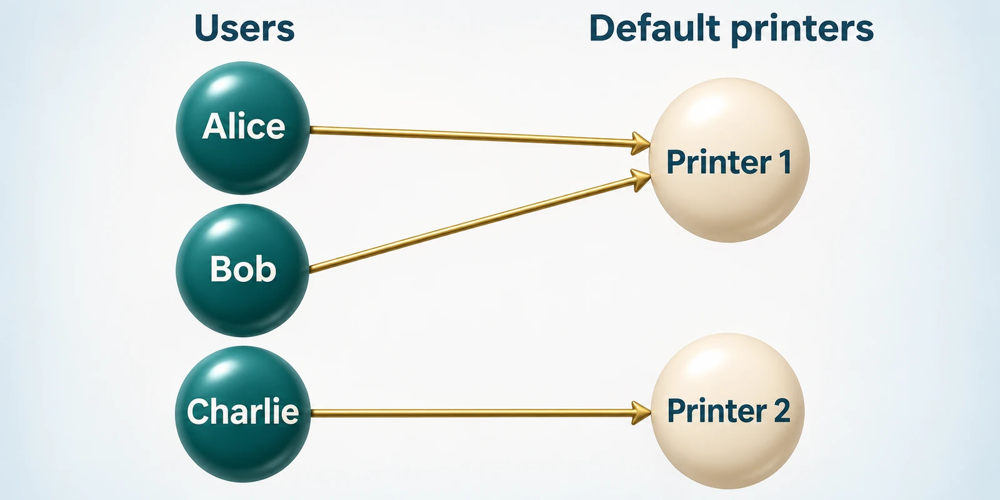
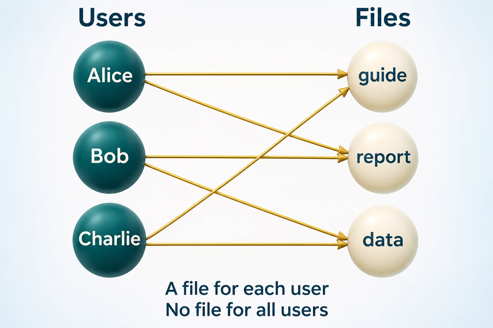

---
{
  "title": "Chapter 1: Statements and quantifiers",
  "subtitle": "Discrete Mathematics · Rey Joseph Nieto",
  "description": "Chapter 1: Statements and quantifiers. HTML edition of Lecture Notes in Discrete Mathematics.",
  "canonical-url": "https://rjnieto.com/teaching/notes/chapter-01/",
  "header-includes": "<meta name=\"robots\" content=\"index, follow, max-image-preview:large\">\n<meta property=\"og:url\" content=\"https://rjnieto.com/teaching/notes/chapter-01/\">\n<meta property=\"og:type\" content=\"article\">",
  "image": "/teaching/bulsu/discrete-math/images/thumbnails/chapter_01.webp",
  "body-classes": "ds-lecture-notes",
  "toc": true,
  "toc-depth": 2,
  "number-sections": false,
  "format": {
    "html": {
      "css": [
        "/assets/css/discrete-notes.css"
      ]
    }
  },
  "execute": {
    "eval": false
  }
}
---

<!-- Generated from the corresponding chapter LaTeX. Run scripts/build-discrete-html.py to refresh. -->

[Course page](/teaching/){.btn .btn-outline-secondary .btn-sm} [PDF](/teaching/bulsu/discrete-math/lecture-notes/chapter_01.pdf){.btn .btn-outline-primary .btn-sm aria-label="Open Chapter 1: Statements and quantifiers as PDF"}

[]{#ch:statements label="ch:statements"}

Common sense is a prized commodity, and it seems to be getting rarer by the day. You may reasonably ask what mathematical language adds when a claim can already be understood through common sense. Consider the following calculations: $$\begin{aligned}
0.9&<1,\\
0.99&<1,\\
0.999&<1.
\end{aligned}$$ The same inequality holds after any finite number of nines. Now suppose the nines repeat without end. We write this as $0.\overline{99}$, where the bar means that the block $99$ repeats forever. Would you expect this number to be smaller than $1$, equal to $1$, or greater than $1$? Make a guess before reading on.

We interpret an infinite decimal as the real number approached by its finite decimal approximations; it has no final digit. Let $$x=0.\overline{99}.$$ Multiplying by $10$ shifts the decimal point one place to the right. The digits after the decimal point are still all nines, so $$10x=9.\overline{99}=9+x.$$ Subtracting $x$ from both sides gives $$10x-x=9.\overline{99}-0.\overline{99}=9.$$ Thus $9x=9$, so $x=1$. Therefore $0.\overline{99}=1$.

The three finite inequalities remain correct. The mistake is the inference from "every finite approximation is less than $1$" to "the infinite decimal is less than $1$". The infinite decimal and $1$ are two representations of the same real number.

[**A common language.**]{#a-common-language.} Before we develop more advanced results, we need a common mathematical language in which to reason together. We must agree on what our objects, symbols and statements mean, so that we can follow one another's arguments and check whether a conclusion follows.

A rule such as "Every user can access a file" may sound clear until we try to apply it. Does it mean that each user has some accessible file, possibly a different one for each person? Or must there be one particular file that every user can access? These are different requirements. A system can satisfy the first while failing the second.

Mathematical language helps us make that difference explicit. This chapter introduces the objects we talk about, the statements we make about them and the notation used to say exactly what is being claimed. We begin with sets and functions because they give us a language for specifying the users, files, numbers and other objects under discussion.

:::: {.ds-box .ds-learningoutcomes}
::: {#what-you-should-be-able-to-do .ds-box-title}
**What you should be able to do**
:::

After working through this chapter, you should be able to:

- read basic set and function notation, including domains and codomains;

- distinguish expressions, statements and open sentences;

- interpret the five logical connectives and construct short truth tables;

- translate claims using predicates, explicit domains and quantifiers;

- test claims using witnesses, counterexamples and complete finite checks;

- interpret the scope of quantifiers and explain why their order matters.
::::

:::: {.ds-box .ds-studybox}
::: {#using-this-self-study-chapter .ds-box-title}
**Using this self-study chapter**
:::

This chapter assumes familiarity with the topics covered in *Mathematics in the Modern World* (MMW). The discussion and exercises marked non-examinable are optional enrichment. All Python examples are non-examinable; no coding is required. The only numerical prerequisites are familiar number systems and elementary algebra; the mathematical language needed here is developed in the chapter.
::::

## 1.1 Sets and notation {#sec:sets}

Before writing a rule about "every user", we must say which users count. One way to do this is to collect the relevant objects into a set.

:::: {.ds-box .ds-definition}
::: {#definition-1.1-set-and-membership .ds-box-title}
**Definition 1.1: Set and membership**
:::

A **set** is a well-defined collection of distinct objects, called its **elements**. The notation $x\in A$ means that $x$ is an element of the set $A$; $x\notin A$ means that it is not.
::::

"Well-defined" means that membership is determined by the description of the set. "The users registered in the practice system at noon today" can specify a set once the system and date are fixed.

By contrast, "the tall students in this class" and "the pretty people in this class" are **ill-defined descriptions** as they stand. What counts as tall or pretty? Two readers could disagree about whether Alice belongs because no precise criterion has been specified.

We could make the height example precise by saying "the students in this class whose recorded height is at least $170$ cm", using a fixed height record. A recorded height of $170$ cm meets the rule; $169$ cm does not. A membership criterion need not be numerical: the fixed registration list above also determines who belongs.

Throughout several examples, we will use $$U=\{\text{Alice},\text{Bob},\text{Charlie}\},\qquad
 F=\{\text{guide},\text{report},\text{data}\}.$$ Here $U$ is a set of users and $F$ is a set of files. The braces delimit a set, while commas separate its listed elements. Thus $\text{Bob}\in U$ and $\text{report}\in F$. If David is not one of these three users, then $\text{David}\notin U$.

[**Set descriptions.**]{#set-descriptions.} We can describe a set in words, by listing its elements or by stating a condition that determines membership. Using $\mathbb{N}=\{0,1,2,3,\ldots\}$ for the natural numbers, the set of natural numbers from $1$ through $4$ can be written as $$D=\{1,2,3,4\}=\{n\in\mathbb{N}:1\leq n\leq4\}.$$ The second description is **set-builder notation**. Read it as "the set of natural numbers $n$ such that $1\leq n\leq4$". The colon means "such that". It separates the kind of object being considered from the condition it must satisfy.

[**Set equality.**]{#set-equality.} A set records membership, so changing the order in which its elements are listed does not change the set. Repeating a listed element does not add a new one. For instance, $$\{2,5,8\}=\{8,2,5\}=\{2,2,5,8\}.$$ Two sets are equal when they contain exactly the same elements. The symbol $=$ expresses equality; $\in$ expresses membership. In particular, $2\in\{2,5,8\}$ is true, but $\{2\}=\{2,5,8\}$ is false. The first says that one object belongs to a collection. The second says that two collections are identical, which they are not. The number $2$ and the set $\{2\}$ containing that number are different objects in this notation; we must not substitute one for the other.

[**Example 1.1.**]{#example-1.1.} Let $B=\{n\in\mathbb{N}:2<n\leq6\}$. List its elements and decide whether $2\in B$ and $6\in B$.

The inequality $2<n$ excludes $2$, while $n\leq6$ includes $6$. Since $n$ must be a natural number, the permitted values are $3,4,5,6$. Therefore $B=\{3,4,5,6\}$, $2\notin B$ and $6\in B$.

[**Number sets.**]{#number-sets.} We use $\mathbb{N}=\{0,1,2,3,\ldots\}$ for the **natural numbers**. The **integers** include negative whole numbers as well: $$\mathbb{Z}=\{\ldots,-2,-1,0,1,2,\ldots\}.$$ We write $\mathbb{R}$ for the **real numbers**, the numbers represented on the usual number line. In particular, negative integers belong to $\mathbb{Z}$ but not $\mathbb{N}$. Some books start the natural numbers at $1$. In these notes, as in Levin, $0\in\mathbb{N}$. When we need the positive integers, we will say so explicitly.

## 1.2 Functions {#sec:functions}

A set can identify the objects in a system. A function describes a precise assignment from one set of objects to another. For example, a practice system might assign each registered user one default printer.

:::: {.ds-box .ds-definition}
::: {#def:function .ds-box-title}
**Definition 1.2: Function, domain and codomain**
:::

A **function** $f:A\to B$ assigns to **every** element of $A$ **exactly one** element of $B$. The set $A$ is its **domain**, and the set $B$ is its **codomain**. The notation $f(x)$ denotes the output assigned to an input $x\in A$.
::::

The expression $f:A\to B$ tells us the function's name and its permitted inputs and outputs. It does not, by itself, tell us which output belongs to each input. We also need a rule, a table or some other unambiguous description of the assignment.

[**Example 1.2.**]{#example-1.2.} Let $L=\{\text{Printer 1},\text{Printer 2}\}$. Define $d:U\to L$ by

::: ds-table
  User $u$                    Alice        Bob       Charlie
  ------------------------ ----------- ----------- -----------
  Default printer $d(u)$    Printer 1   Printer 1   Printer 2
:::

This is a function. Every user in $U$ appears, and each is assigned exactly one printer in $L$. It is acceptable for Alice and Bob to have the same output: the definition restricts the number of outputs for each input, not the number of inputs that may share an output.

{.ds-note-image fig-alt="Students assigned to default printers, illustrating one output for each input." loading="lazy" decoding="async"}

Each user has exactly one default printer; Alice and Bob may share the same printer.

If the assignment omitted Charlie, it would not define a function on all of $U$. If it gave Bob two different default printers, it would also fail. An output outside the stated codomain would fail the description $d:U\to L$ as well.

[**Example 1.3.**]{#example-1.3.} Define $f:\mathbb{N}\to\mathbb{N}$ by $f(n)=2n+1$. To evaluate the function, substitute the input into its rule: $$f(0)=2(0)+1=1,\qquad f(4)=2(4)+1=9.$$ Every natural-number input gives exactly one natural-number output, so the rule fits its stated domain and codomain. The output $f(4)$ is $9$; the notation $f(4)$ does not mean that $f$ is multiplied by $4$.

The outputs actually attained form the function's **range**. Every element of this set belongs to the codomain; we say that the range is a **subset** of the codomain. For the last example, the range consists of the positive odd integers $1,3,5,\ldots$. We will examine further properties of functions later; for now, focus on the domain, the permitted outputs and the exactly-one-output requirement.

## 1.3 Expressions and statements {#sec:statements}

Compare $7+4$ with $7+4=12$. The first represents a number. The second makes a claim about that number. Although the claim is false, it is still the kind of sentence that can be judged true or false.

:::: {.ds-box .ds-definition}
::: {#definition-1.3-expression-and-statement .ds-box-title}
**Definition 1.3: Expression and statement**
:::

A **mathematical expression** denotes an object or value. A **statement**, also called a **proposition**, makes a definite claim that is either true or false under the interpretation being used. Its truth or falsity is its **truth value**: `TRUE` or `FALSE`.
::::

Thus $7+4$, $f(4)$ and the set $U$ are expressions. The sentences "$7+4=11$" and "$\text{Charlie}\in U$" are true statements, while "$7+4=12$" and "$-2\in\mathbb{N}$" are false statements. A false statement still makes a definite claim; its truth value is `FALSE`.

A question such as "Which file is accessible?" does not assert an answer. A command such as "Open the guide" tells someone what to do. Neither is a statement in our mathematical sense. Similarly, $5+$ is an incomplete expression: it has not supplied a second quantity to add.

Suppose $b$ has been defined as the fixed byte count of a particular saved file. The sentence "$b>1000$" has a definite truth value even if we have not inspected the file. Our lack of information does not prevent it from being a statement. The file and the time at which its size is recorded must be fixed; otherwise the intended claim may change.

[**Open sentences.**]{#open-sentences.} Now consider $n+4=12$ without assigning $n$ a value. It is true for $n=8$ and false for $n=3$. We call this an **open sentence**: its truth value depends on an unspecified variable. Substituting a value can turn it into a statement. So can specifying how the claim is to range over its possible inputs, which is the purpose of quantifiers in Section [1.6](#sec:quantifiers).

[**Example 1.4.**]{#example-1.4.} Suppose $n$ ranges over the integers but has not been assigned a value. First identify what each item does; then, if it makes a complete claim, decide whether that claim is true or false where the information allows.

::: ds-table
  Item             Classification and reason
  ---------------- --------------------------------------------------------------------
  $n+4$            Expression: it denotes a value once $n$ is specified.
  $n+4=12$         Open sentence if $n$ has not been assigned or quantified.
  $8+4=12$         True statement: substitution has fixed the input.
  $8+4=13$         False statement: it makes a complete claim, but $8+4$ equals $12$.
  "Is $n+4=12$?"   Question: it asks for a truth value rather than asserting one.
:::

Now fix $n=8$. In this context, $n+4=12$ is a true statement even though it is written with a letter. Without that assignment, the same condition is open. Quantifiers can also turn the condition into a complete claim, as we will see in Section [1.6](#sec:quantifiers). We must read the complete claim and its context.

## 1.4 Compound statements {#sec:connectives}

Statements can be combined to make other statements. Suppose $P$ means "Alice is registered in the practice system" and $Q$ means "Alice has a current access permission". Then $P$ and $Q$ are **propositional variables**: letters standing for statements. They are not numbers to be added or multiplied.

An **atomic** statement is treated as a single claim in the logical analysis at hand. A **compound** (or **molecular**) statement is built from statements using logical connectives. A connective specifies how the component truth values determine the truth value of the result.

::::: {.ds-box .ds-definition}
::: {#definition-1.4-the-five-logical-connectives .ds-box-title}
**Definition 1.4: The five logical connectives**
:::

::: ds-table
  Notation               Name            Reading
  ---------------------- --------------- ---------------------------
  $\neg P$               Negation        Not $P$
  $P\land Q$             Conjunction     $P$ and $Q$
  $P\lor Q$              Disjunction     $P$ or $Q$, allowing both
  $P\to Q$               Implication     If $P$, then $Q$
  $P\leftrightarrow Q$   Biconditional   $P$ if and only if $Q$
:::
:::::

The negation $\neg P$ reverses the truth value of $P$. A conjunction is true only when both components are true. A disjunction is true when at least one component is true, including the case where both are true. This is the **inclusive** meaning of "or" used in these notes. If a rule intends "one or the other but not both", it must say so.

An implication $P\to Q$ is false exactly when $P$ is true and $Q$ is false. Here $P$ is the **antecedent** and $Q$ is the **consequent**. An implication says that the case "$P$ `TRUE` but $Q$ `FALSE`" does not occur. It does not, by its notation alone, say that $P$ causes $Q$.

A biconditional $P\leftrightarrow Q$ is true when $P$ and $Q$ have the same truth value. It requires both directions: $P$ holds if $Q$ holds, and $Q$ holds if $P$ holds. It is therefore false when exactly one component is true.

[**Example 1.5. Negating an inequality.**]{#example-1.5.-negating-an-inequality.} Fix a saved file and a recorded time, and let $b$ be the file's size in bytes at that time. Let $P$ be the statement $b>1000$, meaning "The file exceeds 1000 bytes." Its negation $\neg P$ says that the recorded size is *at most* 1000 bytes, written $b\leq1000$.

Suppose the recorded size is exactly 1000 bytes. Then $P$ is false because $1000>1000$ is false. Its negation is true because $1000\leq1000$ is true. The equality case belongs in the negation: a file of exactly 1000 bytes does not exceed 1000 bytes.

The condition $b<1000$ would also be false at this size, so it cannot be the negation of $b>1000$. Negation must reverse the truth value in every case, including the boundary.

[**Example 1.6. Conjunction and disjunction.**]{#example-1.6.-conjunction-and-disjunction.} Let $P$ mean "David has a laptop" and $Q$ mean "David has a tablet", referring to his devices at one fixed time.

Suppose David has both devices. Then $P$ and $Q$ are both true, so $P\land Q$ is true: both required claims hold. The disjunction $P\lor Q$ is also true, because at least one claim holds; having both devices satisfies that requirement too.

Now consider a situation in which David has a laptop but no tablet. Then $P$ is true and $Q$ is false. The conjunction $P\land Q$ is false because one required claim fails, while $P\lor Q$ remains true because the laptop claim holds. If he has neither device, both compound statements are false.

[**Truth tables.**]{#truth-tables.} A **truth table** lists the truth value of a compound statement for every possible combination of truth values of its components. Write $\text{\texttt{T}}$ for `TRUE` and $\text{\texttt{F}}$ for `FALSE`. Two components have four combinations:

::: ds-table
           $P$                   $Q$                $\neg P$             $P\land Q$             $P\lor Q$             $P\to Q$         $P\leftrightarrow Q$
  --------------------- --------------------- --------------------- --------------------- --------------------- --------------------- ----------------------
   $\text{\texttt{T}}$   $\text{\texttt{T}}$   $\text{\texttt{F}}$   $\text{\texttt{T}}$   $\text{\texttt{T}}$   $\text{\texttt{T}}$   $\text{\texttt{T}}$
   $\text{\texttt{T}}$   $\text{\texttt{F}}$   $\text{\texttt{F}}$   $\text{\texttt{F}}$   $\text{\texttt{T}}$   $\text{\texttt{F}}$   $\text{\texttt{F}}$
   $\text{\texttt{F}}$   $\text{\texttt{T}}$   $\text{\texttt{T}}$   $\text{\texttt{F}}$   $\text{\texttt{T}}$   $\text{\texttt{T}}$   $\text{\texttt{F}}$
   $\text{\texttt{F}}$   $\text{\texttt{F}}$   $\text{\texttt{T}}$   $\text{\texttt{F}}$   $\text{\texttt{F}}$   $\text{\texttt{T}}$   $\text{\texttt{T}}$
:::

:::: {.ds-box .ds-python}
::: {#python-non-examinable .ds-box-title}
**Python (non-examinable)**
:::

We can generate the same four rows in Python. The values `True` and `False` are Boolean truth values. The square brackets form a list of choices. A `for` loop repeats its indented lines for each choice; the two loops below consider every pair of truth values.

``` python
for p in [True, False]:
    for q in [True, False]:
        print(p, q, not p, p and q, p or q,
              (not p) or q, p == q)
```

**Output.**

``` text
True True False True True True True
True False False False True False False
False True True False True True False
False False True False False True True
```

The seven columns are $P$, $Q$, $\neg P$, $P\land Q$, $P\lor Q$, $P\to Q$ and $P\leftrightarrow Q$, in that order. Here `not`, `and` and `or` act on Boolean values. The expression `(not p) or q` represents $P\to Q$, and `p == q` compares their truth values for the biconditional. Python uses `==` for comparison; a single `=` assigns a value to a name. Each comma in `print` separates one output column.
::::

[**Example 1.7.**]{#example-1.7.} Let $P$ mean "Alice is registered" and $Q$ mean "Alice has permission". The claim $P\to Q$ says, "If Alice is registered, then Alice has permission."

If Alice is registered but lacks permission, the implication is false. If Alice is registered and has permission, it is true. If Alice is not registered, neither truth value of $Q$ produces the forbidden combination, so the implication is true in either case. This last conclusion does not tell us whether Alice has permission: it says that Alice's case does not violate the particular implication being checked.

To assert a system-wide rule, we would need a claim about all relevant users, not just Alice. Quantifiers will let us express that later in the chapter.

[**Example 1.8.**]{#example-1.8.} Consider one completed integrity check and its status indicator at a fixed recorded time. Let $P$ mean "The indicator is green" and $Q$ mean "The check passed". We want to evaluate the claim "The indicator is green if and only if the check passed", written $P\leftrightarrow Q$.

If the check passed and the indicator is green, both components are true, so the biconditional is true. If the check did not pass and the indicator is not green, both components are false, and the biconditional is still true: the two truth values match. This second case does not assert that the check passed or that the indicator is green.

If the check passed but the indicator is not green, $P$ is false and $Q$ is true, so the biconditional is false. It is also false if the indicator is green although the check did not pass. In each of these cases, the truth values disagree.

[**Parentheses and scope.**]{#parentheses-and-scope.} Parentheses indicate which statements a connective combines. For example, $\neg(P\lor Q)$ negates the whole disjunction, while $(\neg P)\lor Q$ negates $P$ alone. The **scope** of a connective is the part of the expression it acts on. We use parentheses whenever grouping could be unclear.

To see the effect, take $P$ `FALSE` and $Q$ `TRUE`. For $\neg(P\lor Q)$, first evaluate the expression inside parentheses. The disjunction $P\lor Q$ is true because $Q$ is true. Negating that result makes $\neg(P\lor Q)$ false.

For $(\neg P)\lor Q$, first negate $P$. Since $P$ is false, $\neg P$ is true. The outer disjunction then has two true components, $\neg P$ and $Q$, so $(\neg P)\lor Q$ is true. The same values of $P$ and $Q$ give different results because the negation acts on different parts.

[**Example 1.9.**]{#example-1.9.} Fix one report and a recorded time. Let $P$ mean "Bob uploaded the report" and $Q$ mean "Judy approved the report", referring to what has happened by that time. Translate and evaluate the sentence "Bob uploaded the report, but Judy has not approved it."

The first part asserts $P$. The second part denies $Q$, so it is $\neg Q$. Here "but" joins the two claims with the logical meaning of "and", while suggesting a contrast in ordinary English. The compound statement is therefore $P\land\neg Q$.

Suppose the recorded information shows that Bob's upload is complete and Judy's approval is still pending. Then $P$ is true and $Q$ is false. First negate $Q$: $\neg Q$ is true. Both components of the conjunction $P\land\neg Q$ are now true, so the whole statement is true.

[**Example 1.10.**]{#example-1.10.} Construct the truth table for $(P\lor Q)\land\neg Q$.

::: ds-table
           $P$                   $Q$                $P\lor Q$             $\neg Q$         $(P\lor Q)\land\neg Q$
  --------------------- --------------------- --------------------- --------------------- ------------------------
   $\text{\texttt{T}}$   $\text{\texttt{T}}$   $\text{\texttt{T}}$   $\text{\texttt{F}}$    $\text{\texttt{F}}$
   $\text{\texttt{T}}$   $\text{\texttt{F}}$   $\text{\texttt{T}}$   $\text{\texttt{T}}$    $\text{\texttt{T}}$
   $\text{\texttt{F}}$   $\text{\texttt{T}}$   $\text{\texttt{T}}$   $\text{\texttt{F}}$    $\text{\texttt{F}}$
   $\text{\texttt{F}}$   $\text{\texttt{F}}$   $\text{\texttt{F}}$   $\text{\texttt{T}}$    $\text{\texttt{F}}$
:::

The intermediate columns make the reasoning checkable. For example, in the third row, $P\lor Q$ is true because $Q$ is true, but $\neg Q$ is false. Their conjunction is therefore false. Only the second row makes both components of the final conjunction true.

For a further grouping check, take $P$ `TRUE` and $Q,R$ `FALSE`. Then $P\lor(Q\land R)$ is true, while $(P\lor Q)\land R$ is false. The same component truth values have produced different results because the grouping changed. Detailed implication analysis and logical equivalence belong to Chapter 2; here we are learning to read and evaluate the expressions.

## 1.5 Predicates and domains {#sec:predicates}

An open sentence can be treated as a condition applied to an input. This lets us use one concise description for many related statements.

:::: {.ds-box .ds-definition}
::: {#definition-1.5-predicate-and-domain-of-discourse .ds-box-title}
**Definition 1.5: Predicate and domain of discourse**
:::

A **predicate** is a condition involving one or more variables that becomes a statement when suitable values are assigned to all its unspecified variables. Its **domain of discourse** specifies the objects that a variable is allowed to represent.
::::

For example, let the domain be $\mathbb{Z}$ and define $E(n)$ to mean "$n$ is even". An integer is **even** when it equals $2k$ for some integer $k$. Thus $E(6)$ is true because $6=2(3)$, and $E(5)$ is false because no integer $k$ satisfies $5=2k$. Negative integers and zero can be even too: $E(-4)$ and $E(0)$ are true.

Predicate notation is a convenient name for a condition. Writing $E(n)$ does not by itself assert that every $n$ satisfies it. Substitution supplies a particular input: $E(6)$ is one statement, and $E(5)$ is another.

[**Example 1.11. Functions and predicates.**]{#example-1.11.-functions-and-predicates.} Let $f:\mathbb{N}\to\mathbb{N}$ have rule $f(n)=2n+1$, and let $H(n)$ mean "$n>4$" for $n\in\mathbb{N}$. Then $$f(3)=7,\qquad H(3)\text{ is \texttt{FALSE}},\qquad H(7)\text{ is \texttt{TRUE}}.$$ The numerical function $f$ produces a number; the predicate $H$ tests a condition and produces a truth value once its input is supplied. The similar notation should not lead us to confuse $7$ with `TRUE`. Functions need not always have numerical outputs: in particular, a predicate can itself be viewed as a function with truth values as outputs.

Consider the condition $n<0$. It is satisfied by some integers, such as $-2$, but by no natural number under our convention. A claim about its possible solutions therefore depends on whether $n$ is allowed to range over $\mathbb{Z}$ or only $\mathbb{N}$. We must specify that domain before deciding what the claim means.

Likewise, solving $2x=1$ gives $x=\tfrac12$. This is an allowed input if the domain is $\mathbb{R}$, but not if it is $\mathbb{Z}$, since $\tfrac12$ is not an integer. Changing the permitted inputs changes what we can conclude, even though the written equation is unchanged.

[**Several variables.**]{#several-variables.} Let $A(u,f)$ mean "user $u$ is permitted to access file $f$", where $u\in U$ and $f\in F$. Fix the permissions as follows for the remainder of the worked examples. A $\text{\texttt{T}}$ entry means permission is granted, and an $\text{\texttt{F}}$ entry means it is not.

::: ds-table
                    guide                report                 data
  --------- --------------------- --------------------- ---------------------
  Alice      $\text{\texttt{T}}$   $\text{\texttt{T}}$   $\text{\texttt{F}}$
  Bob        $\text{\texttt{F}}$   $\text{\texttt{T}}$   $\text{\texttt{T}}$
  Charlie    $\text{\texttt{T}}$   $\text{\texttt{F}}$   $\text{\texttt{T}}$
:::

For instance, $A(\text{Bob},\text{report})$ is true and $A(\text{Bob},\text{guide})$ is false. Both inputs matter. The expression $A(u,\text{report})$ still depends on the user: it is true for Alice and Bob but false for Charlie. Supplying one input has not fixed the other.

## 1.6 Quantifiers {#sec:quantifiers}

Often we want a claim about a whole domain, not a list of unrelated substitutions. A **quantifier** specifies how a predicate is being asserted across that domain.

:::: {.ds-box .ds-definition}
::: {#definition-1.6-universal-and-existential-quantification .ds-box-title}
**Definition 1.6: Universal and existential quantification**
:::

Let $P(x)$ be a predicate whose inputs belong to a specified domain $D$.

- $\forall x\in D\,P(x)$ means that $P(x)$ is true for **every** element of $D$. This is a **universal** claim.

- $\exists x\in D\,P(x)$ means that $P(x)$ is true for **at least one** element of $D$. This is an **existential** claim.
::::

Read $\forall$ as "for every" or "for all", and $\exists$ as "there exists". If there are two or ten successful inputs, an existential claim is still true: it does not require exactly one. In the quantified examples below, the domains are nonempty. When several domains are in use, each quantifier will specify its own domain.

[**Example 1.12.**]{#example-1.12.} Take $D=\{0,1,2,3\}$ and let $P(n)$ mean "$n<3$". The claim $\exists n\in D\,P(n)$ is true: $n=0$ supplies one successful input. The claim $\forall n\in D\,P(n)$ is false, since $P(3)$ is false. The same predicate has produced different claims because the quantifier changed.

[**Domain restrictions.**]{#domain-restrictions.} "Every user is registered" can be written as $\forall u\in U\,R(u)$ when $U$ is already the set of users and $R(u)$ means "$u$ is registered". If our domain instead includes objects of other kinds, we must identify which objects the claim is about.

Suppose $D$ is a set of records, $S(x)$ means "record $x$ is a student record", and $C(x)$ means "record $x$ is complete". Then $$\forall x\in D\,\bigl(S(x)\to C(x)\bigr)$$ says that every student record is complete. A record that is not a student record does not violate this rule. Writing $\forall x\in D\,(S(x)\land C(x))$ would make the stronger claim that every record is both a student record and complete.

By contrast, $$\exists x\in D\,\bigl(S(x)\land C(x)\bigr)$$ says that some student record is complete. We need one record satisfying *both* conditions. An implication inside this existential claim would not express the same requirement: a non-student record could make $S(x)\to C(x)$ true even if no student record were complete.

For example, suppose $r\in D$ is an incomplete staff record and is not a student record. Both $S(r)$ and $C(r)$ are `FALSE`, so $S(r)\to C(r)$ is `TRUE`, while $S(r)\land C(r)$ is `FALSE`. This record does not violate the universal rule and does not provide the complete student record required by the existential claim.

[**Quantifier scope.**]{#quantifier-scope.} The **scope** of a quantifier is the part of the expression to which it applies. Parentheses make that scope visible. In $\forall x\in D\,(S(x)\to C(x))$, the quantifier applies to the whole implication $S(x)\to C(x)$ inside the parentheses.

::::: {.ds-box .ds-enrichment}
::: {#non-examinable-free-and-bound-variables .ds-box-title}
**(Non-examinable) Free and bound variables**
:::

This optional discussion introduces formal terminology for describing variable occurrences. It will not be assessed in this course. Interpreting quantifiers, their scope and their order remains core material.

In $\forall x\in D\,P(x)$, the quantifier tells us how $x$ is used. We call the occurrences of $x$ that it controls **bound**; a variable occurrence not controlled by a quantifier is **free**.

Compare the following expressions, with $x,y\in\mathbb{Z}$:

::: ds-table
  Expression                                                  What remains unspecified?
  ----------------------------------------------------------- ---------------------------------------------------
  $x+y=5$                                                     Both $x$ and $y$ are free.
  $\exists y\in\mathbb{Z}\,(x+y=5)$                           $y$ is bound; $x$ is still free.
  $\forall x\in\mathbb{Z}\,\exists y\in\mathbb{Z}\,(x+y=5)$   Both variables are bound, so this is a statement.
:::

We have not removed the free variable from the second expression merely because the condition happens to have a solution for every integer $x$. As written, $x$ is still free; its role in the claim must be specified. The third expression supplies that specification and is true: after an integer $x$ is given, $y=5-x$ is an integer that works.

The words "free" and "bound" describe occurrences within an expression, not permanent properties of a letter. For example, in $$\bigl(\forall x\in D\,P(x)\bigr)\land Q(x),$$ the $x$ in $P(x)$ is bound, but the $x$ in $Q(x)$ is free: it is outside the quantifier's parentheses. We can make the separation easier to see by renaming the bound variable to a fresh letter $z$: $$\bigl(\forall z\in D\,P(z)\bigr)\land Q(x).$$ The quantifier and the variable it controls in $P$ now use $z$; the free $x$ in $Q(x)$ is unchanged. Renaming this bound variable does not change the claim.
:::::

[**Implicit universal quantification.**]{#implicit-universal-quantification.} Mathematical writing sometimes leaves a universal quantifier unstated. For example, "For real $x$, $x+1>x$" is normally read as $\forall x\in\mathbb{R}\,(x+1>x)$. This is a writing convention, supported by the context. It does not mean that a bare open sentence has automatically become a statement without any interpretation. In your own translations, write the quantifiers and domains explicitly until the intended claim is unambiguous.

## 1.7 Witnesses and counterexamples {#sec:testing}

A quantifier tells us what kind of evidence would establish or refute the claim. Checking a convenient input is useful only if we understand what that check allows us to conclude.

:::: {.ds-box .ds-definition}
::: {#definition-1.7-witness-and-counterexample .ds-box-title}
**Definition 1.7: Witness and counterexample**
:::

A **witness** for $\exists x\in D\,P(x)$ is an element $a\in D$ for which $P(a)$ is true. A **counterexample** to $\forall x\in D\,P(x)$ is an element $b\in D$ for which $P(b)$ is false.
::::

[**Example 1.13.**]{#example-1.13.} The claim $\exists n\in\mathbb{Z}\,(n+3=1)$ is true. The integer $-2$ is a witness because $-2+3=1$. However, $\exists n\in\mathbb{N}\,(n+3=1)$ is false: the equation forces $n=-2$, and $-2\notin\mathbb{N}$. A value satisfying the equation outside the permitted domain does not witness the stated claim.

[**Example 1.14.**]{#example-1.14.} Consider $\forall n\in\mathbb{N}\,(n^2>n)$. It holds for $n=2$ and $n=3$, but it fails for $n=0$, since $0^2=0$ is not greater than $0$. It also fails for $n=1$. Either failed case alone disproves the universal claim; we do not have to find every failed case.

For a finite domain such as $D=\{1,2,3\}$, we can establish $\forall n\in D\,(n^2\geq n)$ by checking all three inputs. They give $1\geq1$, $4\geq2$ and $9\geq3$. There are no unexamined elements of $D$ left.

:::: {.ds-box .ds-python}
::: {#python-non-examinable-1 .ds-box-title}
**Python (non-examinable)**
:::

For the complete domain $D=\{1,2,3\}$, we can record the truth value of $n^2\geq n$ for each input. The assignment `domain = [1, 2, 3]` stores these three inputs in a list. The empty list `[]` initially contains no results; `append` adds one result on each pass through the indented loop. Python writes multiplication as `*` and "greater than or equal to" as `>=`.

``` python
domain = [1, 2, 3]
checks = []
for n in domain:
    checks.append(n * n >= n)
print(checks)
print(all(checks))
print(any(checks))
```

**Output.**

``` text
[True, True, True]
True
True
```

The function `all` returns `True` when every recorded condition is true; `any` returns `True` when at least one is true. Thus the last two lines check the universal and existential claims on this stated finite domain. Every input in $D$ has been checked.
::::

For the infinite domain $\mathbb{N}$, those three checks are not a complete verification. Even a computer calculation checking a million inputs leaves infinitely many others unexamined. Examples may suggest a general claim, but establishing an infinite universal claim requires reasoning that covers an arbitrary permitted input. We begin the systematic study of such proofs in later chapters.

::: ds-table
  What you found                                    What this establishes
  ------------------------------------------------- -----------------------------------------------------------------------------------------------
  One successful permitted input                    An existential claim is true. This fact alone does not generally establish a universal claim.
  One failed permitted input                        A universal claim is false. This fact alone does not generally refute an existential claim.
  Every input succeeds in a complete finite check   The universal claim is true.
  Every input fails in a complete finite check      The existential claim is false.
:::

If the domain has only one element, checking that element is already a complete check. In the last two rows, "every input" means every element of the stated domain, not every element we happened to test. To explain why a claim is false, identify the relevant failed case or explain why no permitted witness can work. Formal laws for negating quantified claims follow in Chapter 2.

## 1.8 Quantifier order {#sec:multiple}

When a predicate has more than one input, a claim may need more than one quantifier. Read the quantifiers from left to right. Their order determines which choices may depend on earlier choices.

Return to the permission table for $A(u,f)$ in Section [1.5](#sec:predicates). $$\forall u\in U\,\exists f\in F\,A(u,f)$$ says: "For each user, there is at least one file that the user can access." Choose a user first, then find a suitable file. For Alice we may choose guide; for Bob we may choose report; for Charlie we may choose data. We have considered every user in this finite domain, so the claim is true. There is no requirement to choose the same file for all three users.

Now reverse the quantifiers: $$\exists f\in F\,\forall u\in U\,A(u,f).$$ This says: "There is a file that every user can access." We must choose one file that works for all users. Guide fails for Bob, report fails for Charlie, and data fails for Alice. Since those are all the files in $F$, no file works, and the claim is false.

{.ds-note-image fig-alt="User and folder permissions illustrating how changing the order of quantifiers changes a claim." loading="lazy" decoding="async"}

Every user has access to a file, but no file can be accessed by all three users.

:::: {.ds-box .ds-caution}
::: {#quantifier-order .ds-box-title}
**Quantifier order**
:::

The statement $\forall u\,\exists f\,A(u,f)$ allows the file choice to depend on the user. The statement $\exists f\,\forall u\,A(u,f)$ requires one file chosen before the user is considered. Exchanging these quantifiers changes the requirement; the permission table shows that one claim can be true while the other is false.
::::

[**Example 1.15.**]{#example-1.15.} The statement $\forall x\in\mathbb{Z}\,\exists y\in\mathbb{Z}\,(y>x)$ is true. Once an integer $x$ has been given, choose $y=x+1$. This is an integer larger than $x$.

The statement $\exists y\in\mathbb{Z}\,\forall x\in\mathbb{Z}\,(y>x)$ is false. Suppose someone proposes a fixed integer $y$. The universal claim must include the permitted input $x=y$, but then it would require $y>y$, which is false. Therefore no proposed integer can be the required witness. The first claim offers a choice depending on $x$; the second asks for a single choice that works for all $x$.

The expression $\exists f\in F\,A(u,f)$ quantifies over files but does not specify which user $u$ we mean or how the claim ranges over users. It describes a property of a user rather than stating how that property holds across $U$. Substituting a specific user, as in $\exists f\in F\,A(\text{Alice},f)$, gives a statement. Alternatively, adding $\forall u\in U$ gives the first system-wide claim above.

The four common combinations have different readings:

::: ds-table
  Claim                                      Reading
  ------------------------------------------ --------------------------------------------------------------------------
  $\forall u\in U\,\forall f\in F\,A(u,f)$   Every user can access every file.
  $\forall u\in U\,\exists f\in F\,A(u,f)$   Each user can access at least one file; the file may depend on the user.
  $\exists u\in U\,\forall f\in F\,A(u,f)$   At least one user can access every file.
  $\exists u\in U\,\exists f\in F\,A(u,f)$   At least one user--file pair has access permission.
:::

In each of these four claims, both the user and the file are quantified. If the domains and predicate are fixed, each complete claim has a truth value. The exercises ask you to make that judgment with evidence that matches the quantifiers.

## 1.9 Exercises {#sec:exercises}

::: {.ds-exercises style="--ds-chapter: '1';"}
1.  []{#ex:membership label="ex:membership"} Let $B=\{2,4,6\}$. Decide whether each statement is true or false. Explain the distinction between an element and a set of elements where relevant.

    a)  $4\in B$.

    b)  $5\notin B$.

    c)  $\{4\}\in B$.

    d)  $B=\{6,4,2,4\}$.

2.  []{#ex:set-description label="ex:set-description"}

    a)  List $\{n\in\mathbb{N}:n<11\text{ and }n\text{ is a multiple of }3\}$. Here a multiple of $3$ means a number $3k$ for an integer $k$.

    b)  Describe $\{0,2,4,6,8\}$ precisely in words.

    c)  Write $\{1,2,3,4\}$ in set-builder notation, using $\mathbb{N}$ and inequalities.

3.  []{#ex:reading-function label="ex:reading-function"} Let $D=\{0,1,2,3\}$ and $C=\{0,1,4,9,16\}$. Define $f:D\to C$ by $f(n)=n^2$.

    a)  State the domain and codomain.

    b)  Find $f(0)$ and $f(3)$.

    c)  List the outputs actually obtained from inputs in $D$.

    d)  No input in $D$ has output $16$. Does this prevent $f$ from being a function $D\to C$? Explain using the definition.

4.  In each case, the proposed domain is $\{a,b,c\}$ and the proposed codomain is $\{0,1\}$. Decide whether the displayed assignments define a function with that domain and codomain. If not, identify the precise failure. The notation $a\mapsto0$ means that input $a$ is assigned output $0$.

    a)  $a\mapsto0$, $b\mapsto1$, $c\mapsto0$.

    b)  $a\mapsto0$, $b\mapsto1$, with no assignment for $c$.

    c)  $a\mapsto0$, $a\mapsto1$, $b\mapsto0$, $c\mapsto1$.

    d)  $a\mapsto0$, $b\mapsto1$, $c\mapsto2$.

5.  []{#ex:expressions label="ex:expressions"} Classify each item as an expression denoting a value, a complete statement, an open sentence, a question or a command. For complete statements, give the truth value where possible. In part (c), $m$ ranges over $\mathbb{Z}$ but has not been assigned a value.

    a)  $7+5$.

    b)  $7+5=13$.

    c)  $m+2=6$.

    d)  Is $3$ smaller than $5$?

    e)  Delete the old file.

    f)  $3^2\geq8$.

6.  Fix one campus computer, identified as Lab-PC-07. Consider the sentence: "The most recent successful backup of Lab-PC-07 before 11:00 a.m. on 21 November 2026 finished on 20 November 2026." Assume such a backup exists.

    a)  Is this a statement even if you cannot inspect the backup records? Explain.

    b)  A classmate says that $2^3=6$ cannot be a statement because it is false. Identify the mistake.

7.  []{#ex:connective-reading label="ex:connective-reading"} Let $P$ mean "The backup completed" and $Q$ mean "The integrity check passed". Translate each formula into a clear English sentence, retaining its meaning.

    a)  $\neg Q$.

    b)  $P\land Q$.

    c)  $P\lor Q$.

    d)  $P\to Q$.

    e)  $P\leftrightarrow Q$.

8.  Let $P$ mean "A valid local copy exists" and $Q$ mean "A valid remote copy exists".

    a)  If both copies exist, is $P\lor Q$ true or false?

    b)  A message says "Exactly one of the two copies exists". Is that message true in the same situation? Explain why it differs from $P\lor Q$.

9.  Suppose $P$ is `FALSE` and $Q$ is `TRUE`. Find the truth value of each formula, using the truth condition for its connective.

    a)  $\neg P$.

    b)  $P\land Q$.

    c)  $P\lor Q$.

    d)  $P\to Q$.

    e)  $P\leftrightarrow Q$.

10. []{#ex:truth-table label="ex:truth-table"} Construct the truth table for $(P\land Q)\lor\neg P$. Use the row order $(P,Q)=(\text{\texttt{T}},\text{\texttt{T}}),(\text{\texttt{T}},\text{\texttt{F}}),(\text{\texttt{F}},\text{\texttt{T}}),(\text{\texttt{F}},\text{\texttt{F}})$, and show intermediate columns for $P\land Q$ and $\neg P$ before the final column.

11. Let $P$ and $Q$ be `TRUE` and $R$ `FALSE`.

    a)  Evaluate $(P\lor Q)\land R$, showing the value inside parentheses.

    b)  Evaluate $P\lor(Q\land R)$, again showing the inner value.

    c)  Can the parentheses in these two expressions be ignored? Use your answers.

12. Let $P$ mean "The file has been checked", $Q$ mean "The file has been cleared", and $R$ mean "The file is released". Write each sentence symbolically, using parentheses where needed.

    a)  The file has been checked and has been cleared.

    b)  The file has been checked or has been cleared, or both.

    c)  If the file has been checked, then it is released.

    d)  The file is released exactly when it has been checked and cleared.

13. For $n\in\mathbb{Z}$, let $f(n)=n^2$ and let $P(n)$ be the predicate $n^2\leq10$.

    a)  Find $f(-3)$ and state the truth value of $P(-3)$.

    b)  Find $f(-4)$ and state the truth value of $P(-4)$.

    c)  Explain why the numerical function $f$ and the predicate $P$ are different, even though both definitions contain $n^2$.

14. Let $B(x,y)$ mean $x+2=y$, with $x,y\in\mathbb{Z}$.

    a)  Give the truth values of $B(3,5)$ and $B(5,3)$.

    b)  Write out $B(x,6)$. Which variable remains unspecified?

    c)  Write out $B(4,y)$. Which variable remains unspecified?

    d)  Is $B(4,6)$ a complete statement? If so, give its truth value.

15. []{#ex:domain-matters label="ex:domain-matters"} Let $D_1=\{0,1,2\}$ and $D_2=\{-2,-1,0,1,2\}$. Evaluate each claim once with $D=D_1$ and once with $D=D_2$. Give a witness or counterexample where one settles the claim.

    a)  $\forall x\in D\,(x\geq0)$.

    b)  $\exists x\in D\,(x^2=4)$.

    c)  $\exists x\in D\,(x+2=0)$.

16. []{#ex:quantified-writing label="ex:quantified-writing"} For parts (a)--(d), write each claim with an explicit quantifier and domain, then state whether it is true. Supply a witness for each true existential claim.

    a)  Every integer has a non-negative square.

    b)  There is a negative integer.

    c)  Some integer has square $9$.

    d)  In a discussion where $n$ ranges over $\mathbb{N}$, an author writes "$n+1>n$" as an assertion about every allowed $n$. Make the implicit quantifier explicit.

    For parts (e) and (f), let $D$ be a fixed set of users, some registered and some unregistered. Let $R(u)$ mean "$u$ is registered" and $G(u)$ mean "$u$ has permission to access the guide". Translate each claim using $D$, $R$ and $G$, and explain your choice of connective.

    e)  Every registered user has permission to access the guide.

    f)  At least one registered user has permission to access the guide.

17. []{#ex:free-scope label="ex:free-scope"} *Optional; non-examinable.* All variables below range over $\mathbb{Z}$. Identify the free variables, if any, in each formula, and state which variable is bound by each quantifier. Is each entire formula a complete statement?

    a)  $\forall x\in\mathbb{Z}\,(x+y=0)$.

    b)  $\bigl(\forall x\in\mathbb{Z}\,(x^2\geq0)\bigr)\land(y>2)$.

    c)  $\exists y\in\mathbb{Z}\,(x=y+1)$.

    d)  $\forall x\in\mathbb{Z}\,\exists y\in\mathbb{Z}\,(x=y+1)$.

18. []{#ex:finite-check label="ex:finite-check"} Let $D=\{-2,-1,0,1,2\}$. Make a two-row table listing $x$ and $x^2$, then decide each claim. For a true existential claim give a witness, and for a false universal claim give a counterexample. Explain what justifies the other two kinds of conclusion when the domain is finite.

    a)  $\exists x\in D\,(x^2=1)$.

    b)  $\forall x\in D\,(x^2\leq2)$.

    c)  $\forall x\in D\,(x^2\geq0)$.

    d)  $\exists x\in D\,(x^2<0)$.

19. Assess each conclusion. Explain what the stated checks do or do not establish.

    a)  Eve checks $n=0,1,2$ in $\forall n\in\mathbb{N}\,(n^2\geq n)$. All three checks succeed, so Eve says the universal claim has been proved.

    b)  Faith checks $n=0,1,2$ in $\exists n\in\mathbb{N}\,(n^2=16)$. All three checks fail, so Faith says the existential claim is false.

    c)  Grace checks $n=4$ in the same existential claim. Since $4^2=16$, Grace says the existential claim is true.

    d)  A classmate finds $n=10$ when checking $\forall n\in\mathbb{N}\,(n<10)$ and concludes that the universal claim is false.

20. Decide each claim. Give a witness for a true existential claim, a counterexample for a false universal claim, or a brief explanation otherwise. Listing a few failed candidates cannot rule out an existential claim over an infinite domain.

    a)  $\forall n\in\mathbb{N}\,(n<100)$.

    b)  $\exists n\in\mathbb{N}\,(n+7=3)$.

    c)  $\exists n\in\mathbb{Z}\,(n+7=3)$.

    d)  $\forall n\in\mathbb{Z}\,(n^2\geq0)$.

21. []{#ex:dependent label="ex:dependent"} Let $E(x,y)$ mean $y=x+2$, with $x,y\in\mathbb{Z}$. Read each claim in words and decide whether it is true. For a true claim explain how to choose $y$; for a false claim explain why no fixed choice of $y$ works.

    a)  $\forall x\in\mathbb{Z}\,\exists y\in\mathbb{Z}\,E(x,y)$.

    b)  $\exists y\in\mathbb{Z}\,\forall x\in\mathbb{Z}\,E(x,y)$.

22. Let $D=\{0,1,2\}$ and let $H(x,y)$ mean $y\geq x$, with $x,y\in D$.

    a)  Is $\forall x\in D\,\exists y\in D\,H(x,y)$ true? Give an allowed choice of $y$ for each $x$.

    b)  Is $\exists y\in D\,\forall x\in D\,H(x,y)$ true? If so, give one fixed witness $y$.

    c)  Do these answers mean that reversing quantifiers always preserves truth? Explain using Exercise [1.21](#ex:dependent).

23. []{#ex:permissiontable label="ex:permissiontable"} Use the following *new* data for this exercise and Exercise [1.24](#ex:translations). Let $U=\{\text{Alice},\text{Bob},\text{Charlie}\}$ and $F=\{\text{guide},\text{report},\text{ledger},\text{notes}\}$. Let $A(u,f)$ mean "user $u$ is permitted to access file $f$". The table specifies all the permissions: $1$ means permitted and $0$ means not permitted.

    ::: ds-table
                 guide   report   ledger   notes
      --------- ------- -------- -------- -------
      Alice        1       1        0        0
      Bob          0       1        1        0
      Charlie      1       0        1        0
    :::

    a)  Evaluate $A(\text{Alice},\text{ledger})$, $A(\text{Bob},\text{report})$ and $A(\text{Charlie},\text{notes})$.

    b)  Evaluate $\forall u\in U\,\exists f\in F\,A(u,f)$. If true, give a suitable file for each user.

    c)  Evaluate $\exists f\in F\,\forall u\in U\,A(u,f)$. Explain your answer for every candidate file.

    d)  Evaluate $\forall f\in F\,\exists u\in U\,A(u,f)$. If false, identify a counterexample file.

    e)  Evaluate $\exists u\in U\,\forall f\in F\,A(u,f)$. If false, explain why every user fails.

    f)  *Optional; non-examinable.* In $\exists u\in U\,A(u,f)$, identify the free variable. State which allowed values make the formula true and which make it false.

    g)  *Optional; non-examinable.* In $\forall f\in F\,A(u,f)$, identify the free variable. Evaluate the resulting statement for each allowed value of that variable.

    h)  Translate "There is a file that no user is permitted to access" into symbols and decide whether it is true.

24. []{#ex:translations label="ex:translations"} Keep the domains and predicate from Exercise [1.23](#ex:permissiontable). Decide whether each proposed formula faithfully expresses its English claim, and correct it if necessary. Judge the meaning: an incorrect translation may accidentally have the same truth value as the intended claim.

    a)  "Every user can access at least one file." Proposed formula: $\exists f\in F\,\forall u\in U\,A(u,f)$.

    b)  "Alice can access every file." Proposed formula: $\forall u\in U\,A(u,f)$.

    c)  "At least one user can access report." Proposed formula: $\forall u\in U\,A(u,\text{report})$.

    d)  "For every file there is a user who can access it." Proposed formula: $\forall f\in F\,\exists u\in U\,A(u,f)$.
:::

::: {.ds-chapter-navigation}

[← Introduction](../chapter-00/index.qmd) · [Chapter 2 →](../chapter-02/index.qmd)

:::
