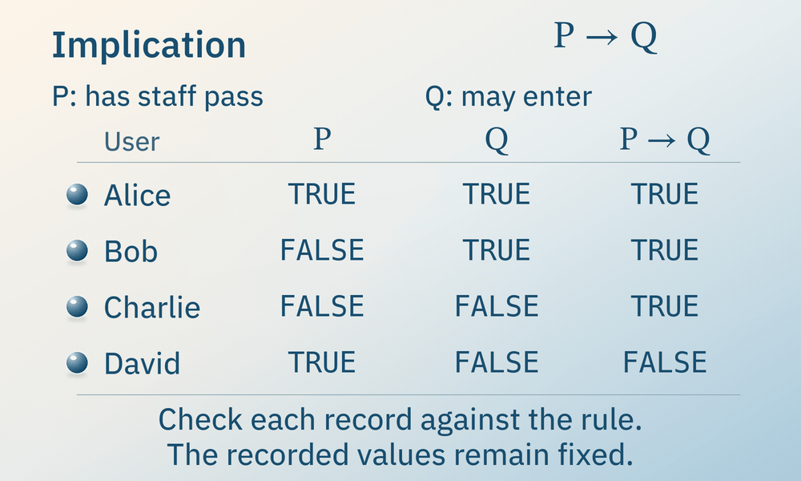

---
{
  "title": "Chapter 2: Propositional logic",
  "subtitle": "Discrete Mathematics · Rey Joseph Nieto",
  "description": "Chapter 2: Propositional logic. HTML edition of Lecture Notes in Discrete Mathematics.",
  "canonical-url": "https://rjnieto.com/teaching/notes/chapter-02/",
  "header-includes": "<meta name=\"robots\" content=\"index, follow, max-image-preview:large\">\n<meta property=\"og:url\" content=\"https://rjnieto.com/teaching/notes/chapter-02/\">\n<meta property=\"og:type\" content=\"article\">",
  "image": "/teaching/bulsu/discrete-math/images/thumbnails/chapter_02.webp",
  "body-classes": "ds-lecture-notes",
  "toc": true,
  "toc-depth": 2,
  "number-sections": false,
  "format": {
    "html": {
      "css": [
        "/assets/css/discrete-notes.css"
      ]
    }
  },
  "execute": {
    "eval": false
  },
  "resources": [
    "../assets/chapter-02/01-implication-truth-conditions.gif",
    "../assets/chapter-02/01-implication-truth-conditions-poster.png"
  ]
}
---

<!-- Generated from the corresponding chapter LaTeX. Run scripts/build-discrete-html.py to refresh. -->

[Course page](/teaching/){.btn .btn-outline-secondary .btn-sm} [PDF](/teaching/bulsu/discrete-math/lecture-notes/chapter_02.pdf){.btn .btn-outline-primary .btn-sm aria-label="Open Chapter 2: Propositional logic as PDF"}

[]{#ch2:chapter label="ch2:chapter"}

In high-school algebra, a letter such as $x$ could stand for a number. The identity $x+x=2x$ holds for every real number $x$: the letter lets us state a rule once and use it for different numbers.

Here we use letters such as $P$ and $Q$ as placeholders for whole *statements*: ideas expressed as claims that are true or false. Using letters makes it easier to see which claims are being used and whether a conclusion follows from them.

For example, fix one data link between two devices. Let $P$ mean "This link uses Wi-Fi" and $Q$ mean "This link uses no data cable between the devices". The rule "If this link uses Wi-Fi, it uses no data cable" has the form $P\to Q$. If we also know $P$, we can conclude $Q$: this link uses no data cable.

The same deduction pattern can be used with statements about laboratory access or numbers. It guarantees a true conclusion whenever its starting claims are true. We must keep each letter's meaning consistent within an argument, but we can use the same reasoning rule with different statements.

Chapter 1 gave us the ingredients of this language: statements, connectives, predicates and quantifiers, together with sets and functions. Chapter 2 develops the recipes for working with them: rewriting conditions, forming negations and drawing conclusions. We will use these tools when writing proofs in Chapter 3.

This may feel abstract or even bizarre at first. With practice, familiar patterns become easier to recognise, and structuring your reasoning this way becomes increasingly instinctive.

:::: {.ds-box .ds-learningoutcomes}
::: {#what-you-should-be-able-to-do .ds-box-title}
**What you should be able to do**
:::

After working through this chapter, you should be able to:

- translate conditional rules, including "if", "only if", and necessary and sufficient conditions;

- form the converse, inverse and contrapositive of an implication;

- establish logical equivalence by a truth table or justified rewriting;

- negate compound and quantified claims without changing their domains;

- justify elementary deductions from stated premises;

- demonstrate an invalid argument by making its premises true and its conclusion false.
::::

## 2.1 Conditional rules {#ch2:conditionals}

Suppose a practice laboratory displays this rule:

> You may use the laboratory only if you have completed its safety briefing.

Alice has completed the briefing. Does the rule guarantee that she may use the laboratory? It does not. The rule makes the briefing a requirement; there could still be another requirement, such as a booking. Someone who has completed the briefing but has no booking would not contradict the displayed rule.

Now replace "only if" with "if":

> You may use the laboratory if you have completed its safety briefing.

Under this second rule, completing the briefing is enough to establish permission. The two sentences use almost the same words but commit the laboratory to different rules.

Recall that $P\to Q$ is false exactly when $P$ is true and $Q$ is false. Here $P$ is the antecedent and $Q$ is the consequent. Thus the first laboratory rule, with $P$ meaning "Alice may use the laboratory" and $Q$ meaning "Alice has completed the briefing", says $P\to Q$. It rules out permission without the briefing. It does not rule out a completed briefing without permission.

[**Example 2.1.**]{#example-2.1.} In a practice access system, suppose the rule is "If a user has a staff pass, then the user may enter." For each user let $P$ mean "the user has a staff pass" and $Q$ mean "the user may enter". Consider these records:

::: ds-table
  User               $P$                   $Q$                $P\to Q$
  --------- --------------------- --------------------- ---------------------
  Alice      $\text{\texttt{T}}$   $\text{\texttt{T}}$   $\text{\texttt{T}}$
  Bob        $\text{\texttt{F}}$   $\text{\texttt{T}}$   $\text{\texttt{T}}$
  Charlie    $\text{\texttt{F}}$   $\text{\texttt{F}}$   $\text{\texttt{T}}$
  David      $\text{\texttt{T}}$   $\text{\texttt{F}}$   $\text{\texttt{F}}$
:::

David's record violates the rule: he has a staff pass, but entry is denied. Bob's record does not violate it. The rule has not said that a staff pass is the only route to permission; Bob might have a visitor pass. Charlie's record does not violate it either, because the rule has made no promise of entry for someone without a staff pass.

Bob's and Charlie's records illustrate the two cases with a false antecedent. We are checking whether this conditional rule is violated, not claiming that the consequent has happened. In particular, $P\to Q$ does not by itself assert $P$ or $Q$, and it does not assert that $P$ causes $Q$.

<figure id="ch02-implication-truth-conditions" class="ds-animation">
  <picture>
    <source media="print, (prefers-reduced-motion: reduce)" srcset="/teaching/notes/assets/chapter-02/01-implication-truth-conditions-poster.png">
    
  </picture>
  <figcaption>The conditional fails only when a staff-pass holder is denied entry.</figcaption>
</figure>

[**"If" and "only if".**]{#if-and-only-if.} The part after "if" gives a sufficient starting condition. The part after "only if" gives a requirement on what precedes it. Compare:

::: ds-table
  Wording             Logical form
  ------------------- --------------
  If $P$, then $Q$.   $P\to Q$
  $Q$ if $P$.         $P\to Q$
  $P$ only if $Q$.    $P\to Q$
  $P$ if $Q$.         $Q\to P$
  $Q$ only if $P$.    $Q\to P$
:::

For example, "A file is released only if it has been checked" says released $\to$ checked. A released but unchecked file would violate that rule. A checked file that remains a draft would not.

:::: {.ds-box .ds-definition}
::: {#definition-2.1-necessary-and-sufficient-conditions .ds-box-title}
**Definition 2.1: Necessary and sufficient conditions**
:::

For the implication $P\to Q$, we say that $P$ is a **sufficient condition for** $Q$, and that $Q$ is a **necessary condition for** $P$. The condition $P$ is enough to ensure $Q$; the condition $Q$ is required whenever $P$ holds.
::::

Consequently, "$P$ is necessary for $Q$" means $Q\to P$, whereas "$P$ is sufficient for $Q$" means $P\to Q$. The direction depends on which condition is being described as necessary or sufficient, rather than its position at the beginning of the sentence.

[**Example 2.2.**]{#example-2.2.} Suppose a practice portal grants access exactly when an account is verified *and* its payment is recorded. For one account, let $V$ mean "the account is verified", $C$ mean "its payment is recorded" and $A$ mean "access is granted". The complete rule is $$A\leftrightarrow(V\land C).$$ Verification is necessary for access: $A\to V$. It is not sufficient on its own. If $V$ is `TRUE` but $C$ is `FALSE`, then $V\land C$ is false, so access is not granted. The same reasoning shows that payment is necessary but is not sufficient on its own.

Together, verification and payment are sufficient: $(V\land C)\to A$. They are also necessary: $A\to(V\land C)$. The biconditional records both directions, which is what "exactly when" expresses here.

## 2.2 Converse, inverse and contrapositive {#ch2:related}

Reversing a rule or negating its components produces a new statement. We must specify which operation has been performed.

:::: {.ds-box .ds-definition}
::: {#definition-2.2-related-implications .ds-box-title}
**Definition 2.2: Related implications**
:::

Starting from $P\to Q$, its

- **converse** is $Q\to P$;

- **inverse** is $\neg P\to\neg Q$;

- **contrapositive** is $\neg Q\to\neg P$.

The contrapositive both reverses the direction and negates the two components.
::::

Their truth values can be compared in one table:

::: ds-table
           $P$                   $Q$                $P\to Q$              $Q\to P$          $\neg P\to\neg Q$     $\neg Q\to\neg P$
  --------------------- --------------------- --------------------- --------------------- --------------------- ---------------------
   $\text{\texttt{T}}$   $\text{\texttt{T}}$   $\text{\texttt{T}}$   $\text{\texttt{T}}$   $\text{\texttt{T}}$   $\text{\texttt{T}}$
   $\text{\texttt{T}}$   $\text{\texttt{F}}$   $\text{\texttt{F}}$   $\text{\texttt{T}}$   $\text{\texttt{T}}$   $\text{\texttt{F}}$
   $\text{\texttt{F}}$   $\text{\texttt{T}}$   $\text{\texttt{T}}$   $\text{\texttt{F}}$   $\text{\texttt{F}}$   $\text{\texttt{T}}$
   $\text{\texttt{F}}$   $\text{\texttt{F}}$   $\text{\texttt{T}}$   $\text{\texttt{T}}$   $\text{\texttt{T}}$   $\text{\texttt{T}}$
:::

The original implication and its contrapositive agree in every row. The converse and inverse also agree with each other, but their columns do not match the original implication. We may therefore replace an implication by its contrapositive without changing its truth value. Reversing it alone does not have this guarantee.

[**Example 2.3.**]{#example-2.3.} Let $x\in\mathbb{R}$. Consider the true claim "If $x>5$, then $x>2$." Its related statements are:

::: ds-table
  Name             Statement
  ---------------- -----------------------------
  Converse         If $x>2$, then $x>5$.
  Inverse          If $x\leq5$, then $x\leq2$.
  Contrapositive   If $x\leq2$, then $x\leq5$.
:::

The value $x=3$ refutes both the converse and the inverse: it is greater than $2$ without being greater than $5$, and it is at most $5$ without being at most $2$. The contrapositive is true for every real $x$, just as the original implication is.

Here "if $x>5$, then $x>2$" is understood as a claim about every $x\in\mathbb{R}$. Forming its contrapositive retains that domain and the universal quantifier. We have not negated the whole quantified claim.

A statement and its converse can both be true. For instance, for an integer $n$, "$n=0$" and "$n^2=0$" imply each other. The table says that a true implication does not *guarantee* a true converse; it does not say that the converse must be false.

[**Biconditionals.**]{#biconditionals.} The claim $P\leftrightarrow Q$ requires $P\to Q$ and $Q\to P$ together. It can therefore be written as $$(P\to Q)\land(Q\to P).$$ If $P$ is both necessary and sufficient for $Q$, the relationship is $P\leftrightarrow Q$. Establishing only one direction leaves half of this requirement unchecked.

## 2.3 Logical equivalence {#ch2:equivalence}

Two descriptions may use different connectives yet impose exactly the same condition. The matching columns for an implication and its contrapositive give one example.

:::: {.ds-box .ds-definition}
::: {#definition-2.3-logical-equivalence .ds-box-title}
**Definition 2.3: Logical equivalence**
:::

Two propositional expressions are **logically equivalent** when they have the same truth value for every assignment of truth values to their component propositional variables. We use $\equiv$ to record this relationship. For example, $$P\to Q\ \equiv\ \neg Q\to\neg P.$$
::::

In a truth table, equivalence means that the two final columns agree in *every* row. One differing row disproves equivalence. The letters $P,Q,R$ below may stand for compound statements as well as atomic ones, provided we substitute the same statement consistently wherever its letter occurs.

[**Example 2.4.**]{#example-2.4.} Compare $P\to Q$ with $\neg P\lor Q$:

::: ds-table
           $P$                   $Q$                $\neg P$              $P\to Q$           $\neg P\lor Q$
  --------------------- --------------------- --------------------- --------------------- ---------------------
   $\text{\texttt{T}}$   $\text{\texttt{T}}$   $\text{\texttt{F}}$   $\text{\texttt{T}}$   $\text{\texttt{T}}$
   $\text{\texttt{T}}$   $\text{\texttt{F}}$   $\text{\texttt{F}}$   $\text{\texttt{F}}$   $\text{\texttt{F}}$
   $\text{\texttt{F}}$   $\text{\texttt{T}}$   $\text{\texttt{T}}$   $\text{\texttt{T}}$   $\text{\texttt{T}}$
   $\text{\texttt{F}}$   $\text{\texttt{F}}$   $\text{\texttt{T}}$   $\text{\texttt{T}}$   $\text{\texttt{T}}$
:::

The final columns agree throughout, so $P\to Q\equiv\neg P\lor Q$. Saying "Either the requirement is not met, or the promised outcome holds" excludes exactly the failed case $P$ `TRUE` and $Q$ `FALSE`. The "or" remains inclusive.

The symbol $\leftrightarrow$ is a connective within an expression. We can evaluate $P\leftrightarrow Q$ in one particular situation. By contrast, $P\equiv Q$ asserts agreement across all truth assignments. Two expressions are logically equivalent exactly when the biconditional between them is true in every row.

[**Example 2.5.**]{#example-2.5.} Suppose $P$ is `TRUE` and $Q$ is `FALSE`. Then $P\lor Q$ and $P$ are both true, so $(P\lor Q)\leftrightarrow P$ is true in this situation. However, if $P$ is `FALSE` and $Q$ is `TRUE`, then $P\lor Q$ is true while $P$ is false. Their values now differ. Consequently, $P\lor Q$ and $P$ are not logically equivalent.

:::: {.ds-box .ds-definition}
::: {#definition-2.4-tautology-contradiction-and-contingency .ds-box-title}
**Definition 2.4: Tautology, contradiction and contingency**
:::

A propositional expression is a **tautology** if it is true for every truth assignment, a **contradiction** if it is false for every truth assignment, and **contingent** if it is true for some assignments and false for others.
::::

For example, $P\lor\neg P$ is a tautology: one of $P$ and $\neg P$ is always true. The expression $P\land\neg P$ is a contradiction, because they cannot both be true. The expression $P\to Q$ is contingent: its truth table contains both truth values. One false row does not make a form a contradiction, just as one true row does not make it a tautology; the classification depends on all permitted assignments.

[**Equivalence laws.**]{#equivalence-laws.} The following laws let us replace an expression by an equivalent one. Parentheses specify the part being replaced; they may not be moved or discarded arbitrarily.

::: ds-table
  -----------------------------------------------------------------------
  Law                Equivalent expressions
  ------------------ ----------------------------------------------------
  Double negation    $\neg\neg P\equiv P$

  Commutativity      $P\land Q\equiv Q\land P$; $P\lor Q\equiv Q\lor P$

  Associativity      $(P\land Q)\land R\equiv P\land(Q\land R)$;\
                     $(P\lor Q)\lor R\equiv P\lor(Q\lor R)$

  Idempotence        $P\land P\equiv P$; $P\lor P\equiv P$

  Distributivity     $P\land(Q\lor R)\equiv(P\land Q)\lor(P\land R)$;\
                     $P\lor(Q\land R)\equiv(P\lor Q)\land(P\lor R)$

  De Morgan's laws   $\neg(P\land Q)\equiv\neg P\lor\neg Q$;\
                     $\neg(P\lor Q)\equiv\neg P\land\neg Q$

  Implication        $P\to Q\equiv\neg P\lor Q$

  Biconditional      $P\leftrightarrow Q\equiv(P\to Q)\land(Q\to P)$
  -----------------------------------------------------------------------
:::

These are laws of classical two-valued logic. They can be checked by complete truth tables, as we did for the implication law. Commutativity changes the order of two components; associativity changes grouping among repeated uses of the same connective. Neither permits changing "and" into "or". Distributivity explains when changing the outer connective is justified.

## 2.4 Negation and rewriting {#ch2:negation}

Negation must reverse the truth value of the *whole* claim. Adding "not" to one convenient word does not necessarily achieve that.

[**Example 2.6.**]{#example-2.6.} Fix one account. Let $P$ mean "the account is verified" and $Q$ mean "the account has a recorded payment". The claim "It is not the case that the account is both verified and paid" is $\neg(P\land Q)$. De Morgan's law gives $$\neg(P\land Q)\equiv\neg P\lor\neg Q.$$ At least one condition fails; both might fail. Replacing the claim by $\neg P\land\neg Q$ would wrongly insist that both fail. For a verified account without a recorded payment, $P$ is true and $Q$ is false. The original negation is true, but $\neg P\land\neg Q$ is false.

By comparison, "Neither verified nor paid" means $\neg(P\lor Q)\equiv\neg P\land\neg Q$. Here both conditions must fail.

The two De Morgan laws can also be read directly. An "and" claim fails when at least one component fails. An inclusive "or" claim fails only when both components fail. This reasoning explains why the connective changes when the negation is moved inside.

[**Example 2.7.**]{#example-2.7.} Let $V$ mean "the account is verified", $S$ mean "it has a staff pass" and $G$ mean "it has a guest pass". The eligibility condition is $V\land(S\lor G)$: verification is required together with at least one kind of pass. Distributivity gives $$V\land(S\lor G)\equiv(V\land S)\lor(V\land G).$$ The right-hand form lists the two qualifying alternatives: verified with a staff pass, or verified with a guest pass. Verification must appear in both alternatives. The shorter-looking expression $(V\land S)\lor G$ would allow an unverified guest account to qualify.

To express failure of the original eligibility condition, we can write $$\begin{aligned}
 \neg\bigl(V\land(S\lor G)\bigr)
 &\equiv\neg V\lor\neg(S\lor G)
 &&\text{(De Morgan)}\\
 &\equiv\neg V\lor(\neg S\land\neg G)
 &&\text{(De Morgan).}
\end{aligned}$$ Eligibility fails if verification is missing, or if both kinds of pass are missing. Each line replaces the previous condition by one with the same truth value under every assignment.

[**Example 2.8.**]{#example-2.8.} Let $P$ mean "Faith submitted the required file" and $Q$ mean "Faith received an acknowledgement". The promise is $P\to Q$. Its failure is $$\begin{aligned}
 \neg(P\to Q)
 &\equiv\neg(\neg P\lor Q) &&\text{(implication law)}\\
 &\equiv\neg\neg P\land\neg Q &&\text{(De Morgan)}\\
 &\equiv P\land\neg Q &&\text{(double negation).}
\end{aligned}$$ Faith submitted the file *and* did not receive an acknowledgement. This is exactly the failed row of the implication truth table. The inverse $\neg P\to\neg Q$ is a different claim about what happens when Faith does not submit; it is not the negation of the promise.

For a biconditional, failure means that the components have different truth values: either $P$ holds without $Q$, or $Q$ holds without $P$. Thus $$\neg(P\leftrightarrow Q)
 \equiv(P\land\neg Q)\lor(\neg P\land Q).$$ For example, "The indicator is on if and only if the check passed" fails either when the indicator is on after a failed check, or when it is off after a successful check. Both kinds of mismatch must be included.

## 2.5 Quantifier negation {#ch2:quantified}

A universal claim fails when it has a counterexample. An existential claim fails when it has no witness. This gives the formal negation laws corresponding to the checks in Chapter 1.

:::: {.ds-box .ds-definition}
::: {#definition-2.5-negation-laws-for-quantifiers .ds-box-title}
**Definition 2.5: Negation laws for quantifiers**
:::

For a predicate $P(x)$ on a fixed domain $D$, $$\neg\bigl(\forall x\in D\,P(x)\bigr)
 \equiv\exists x\in D\,\neg P(x),$$ and $$\neg\bigl(\exists x\in D\,P(x)\bigr)
 \equiv\forall x\in D\,\neg P(x).$$ Negate the condition and switch the quantifier, retaining the domain.
::::

The first equivalence says "not every object has the property" exactly when "at least one object lacks it". The second says "no object has the property" exactly when "every object lacks it". This reasoning applies to all permitted elements, rather than treating a quantifier as an extra propositional variable in a truth table. The examples below use nonempty domains.

[**Example 2.9.**]{#example-2.9.} Let $D=\{\text{Alice},\text{Bob},\text{Charlie}\}$ and let $C(x)$ mean "$x$ has completed the practice task". Suppose Alice and Bob have completed it, but Charlie has not. Then $$\neg\bigl(\forall x\in D\,C(x)\bigr)
 \equiv\exists x\in D\,\neg C(x)$$ is true, with Charlie as the witness on the right. However, $\forall x\in D\,\neg C(x)$ is false, because Alice and Bob have completed the task. One incomplete task refutes "everyone completed"; it does not establish "nobody completed".

The negation of "someone completed" would instead be $\forall x\in D\,\neg C(x)$. These are different starting claims, so their negations should be different too.

The negation of $\forall n\in\mathbb{N}\,(n\geq4)$ is $\exists n\in\mathbb{N}\,(n<4)$. We still choose a natural number, and the negation of $n\geq4$ is $n<4$, not $n\leq4$. Here $n=0$ is a witness for the negation. The negation of $\exists x\in\mathbb{R}\,(x^2<0)$ is $\forall x\in\mathbb{R}\,(x^2\geq0)$. Forming the negation and deciding whether it is true are separate tasks; in this second example the existential claim is false and its negation is true.

[**Example 2.10.**]{#example-2.10.} Let $D$ be a set of records. Write $S(x)$ for "$x$ is a student record" and $C(x)$ for "$x$ is complete". The rule that every student record is complete is $$\forall x\in D\,\bigl(S(x)\to C(x)\bigr).$$ Its negation is obtained in two stages: $$\begin{aligned}
 \neg\Bigl(\forall x\in D\,(S(x)\to C(x))\Bigr)
 &\equiv\exists x\in D\,\neg(S(x)\to C(x))\\
 &\equiv\exists x\in D\,\bigl(S(x)\land\neg C(x)\bigr).
\end{aligned}$$ First the universal quantifier becomes existential. Then we negate the implication using the law from Section [2.4](#ch2:negation). The result says that some student record is incomplete. An incomplete staff record that is not a student record does not witness this failure, because it does not satisfy $S(x)$.

The contrapositive rule would be $\forall x\in D\,(\neg C(x)\to\neg S(x))$. It retains the universal quantifier and has the same meaning as the original rule. It must not be confused with the existential statement that refutes the rule.

[**Multiple quantifiers.**]{#multiple-quantifiers.} Negate a statement from the outside in, applying one law at a time. For sets of users $U$ and files $F$, and the predicate $A(u,f)$ meaning "user $u$ may access file $f$", $$\begin{aligned}
 \neg\Bigl(\forall u\in U\,\exists f\in F\,A(u,f)\Bigr)
 &\equiv\exists u\in U\,\neg\Bigl(\exists f\in F\,A(u,f)\Bigr)\\
 &\equiv\exists u\in U\,\forall f\in F\,\neg A(u,f).
\end{aligned}$$ The original says that each user can access at least one file. Its negation says that there is a user who cannot access *any* file. Each quantifier changes type, but the order of the variables remains user first, file second.

[**Example 2.11.**]{#example-2.11.} Use the following new data: $U=\{\text{Alice},\text{Bob}\}$, $F=\{\text{guide},\text{report}\}$, and these permissions:

::: ds-table
                  guide                report
  ------- --------------------- ---------------------
  Alice    $\text{\texttt{T}}$   $\text{\texttt{F}}$
  Bob      $\text{\texttt{F}}$   $\text{\texttt{T}}$
:::

The claim $\forall u\in U\,\exists f\in F\,A(u,f)$ is true: Alice can access guide and Bob can access report. Its negation $\exists u\in U\,\forall f\in F\,\neg A(u,f)$ is false, because neither user is denied every file.

The tempting replacement $\forall u\in U\,\exists f\in F\,\neg A(u,f)$ is true in this same table: each user has an inaccessible file. It therefore cannot be the negation of the original, which is also true. Negating only the predicate while leaving both quantifiers unchanged has produced a different condition.

For comparison, the negation of "There is one file that every user may access" is $$\neg\Bigl(\exists f\in F\,\forall u\in U\,A(u,f)\Bigr)
 \equiv\forall f\in F\,\exists u\in U\,\neg A(u,f).$$ Every file has at least one user who cannot access it; the user may depend on the file. In the last table, Bob supplies that failure for guide, and Alice supplies it for report. The two quantified negations answer different questions, just as the original claims do.

## 2.6 Valid arguments {#ch2:validity}

An argument starts with claims that are being assumed and offers a conclusion. We need to check whether those assumptions are enough for that conclusion.

:::: {.ds-box .ds-definition}
::: {#definition-2.6-premises-conclusion-and-validity .ds-box-title}
**Definition 2.6: Premises, conclusion and validity**
:::

The **premises** are an argument's stated assumptions. Its **conclusion** is the claim it asks us to infer. An argument form is **valid** if there is no truth assignment in which all its premises are true and its conclusion is false. Such an assignment is a **countervaluation**; finding one establishes invalidity.
::::

Validity concerns the connection between the premises and conclusion. It does not assert that the premises describe the actual situation. An argument is called **sound** when it is valid and its premises are in fact true.

[**Example 2.12. Truth-table verification.**]{#example-2.12.-truth-table-verification.} Consider the argument with premises $P\to Q$ and $P$, and conclusion $Q$. This pattern is called **modus ponens**. The extra column below records whether both premises are true together.

::: ds-table
           $P$                   $Q$                $P\to Q$          $(P\to Q)\land P$
  --------------------- --------------------- --------------------- ---------------------
   $\text{\texttt{T}}$   $\text{\texttt{T}}$   $\text{\texttt{T}}$   $\text{\texttt{T}}$
   $\text{\texttt{T}}$   $\text{\texttt{F}}$   $\text{\texttt{F}}$   $\text{\texttt{F}}$
   $\text{\texttt{F}}$   $\text{\texttt{T}}$   $\text{\texttt{T}}$   $\text{\texttt{F}}$
   $\text{\texttt{F}}$   $\text{\texttt{F}}$   $\text{\texttt{T}}$   $\text{\texttt{F}}$
:::

Only the first row makes both premises true, and in that row the conclusion $Q$ is true. No countervaluation exists, so the argument is valid. The second row has a false conclusion, but it does not refute the argument: one premise, $P\to Q$, is false there.

If the premises are $A_1,\ldots,A_k$ and the conclusion is $C$, this test amounts to asking whether $$(A_1\land\cdots\land A_k)\to C$$ is a tautology. It fails exactly in a row where every premise is true and the conclusion is false. An argument with inconsistent premises has no all-true premise row and is valid under this definition, but it cannot be sound: its premises cannot all be true together.

[**Deduction rules.**]{#deduction-rules.} Each row below is a valid pattern. All listed premises must be available before the conclusion can be used.

::: ds-table
  Pattern                    Premises              Conclusion
  -------------------------- --------------------- ----------------
  Modus ponens               $P\to Q$, $P$         $Q$
  Modus tollens              $P\to Q$, $\neg Q$    $\neg P$
  Chaining implications      $P\to Q$, $Q\to R$    $P\to R$
  Disjunctive syllogism      $P\lor Q$, $\neg P$   $Q$
  Conjunction introduction   $P$, $Q$              $P\land Q$
  Conjunction elimination    $P\land Q$            $P$ (also $Q$)
:::

For the next two examples, fix one data link between two devices. Let $P$ mean "This link uses Wi-Fi" and $Q$ mean "This link uses no data cable between the devices". Our recurring implication is $$P\to Q:\quad\text{If this link uses Wi-Fi, it uses no data cable.}$$ The claim concerns this particular link. Other parts of the network may still contain cables.

[**Example 2.13. Modus ponens.**]{#example-2.13.-modus-ponens.} Suppose we know both of the following:

> If this link uses Wi-Fi, it uses no data cable.\
> This link uses Wi-Fi.

We can conclude that this link uses no data cable. In symbols, $$P\to Q,\qquad P,\qquad\therefore Q.$$ Here $\therefore$ means "therefore". The second premise establishes the condition required by the first. Modus ponens lets us infer its stated consequence.

[**Example 2.14. Modus tollens.**]{#example-2.14.-modus-tollens.} Keep the same rule, but suppose we now know that this link uses a data cable:

> If this link uses Wi-Fi, it uses no data cable.\
> This link uses a data cable.

The second premise is $\neg Q$. We conclude that this link does not use Wi-Fi, which is $\neg P$: $$P\to Q,\qquad\neg Q,\qquad\therefore\neg P.$$ If $P$ were true, the first premise would require $Q$ to be true as well. That is incompatible with the given $\neg Q$. This is modus tollens.

[**Example 2.15. Chaining implications.**]{#example-2.15.-chaining-implications.} Let $x\in\mathbb{R}$. We have the two rules

> If $x>10$, then $x>5$.\
> If $x>5$, then $x>0$.

Combining them gives "If $x>10$, then $x>0$." The intermediate condition $x>5$ connects the first rule to the second. With $A$ meaning $x>10$, $B$ meaning $x>5$ and $C$ meaning $x>0$, the pattern is $$A\to B,\qquad B\to C,\qquad\therefore A\to C.$$ The conclusion is still conditional. We have not been told that $x>10$, so we cannot conclude that $x>0$ without a further premise.

[**Example 2.16. Disjunctive syllogism.**]{#example-2.16.-disjunctive-syllogism.} Suppose a laptop has a usable Wi-Fi connection or a usable Ethernet connection, possibly both. It has no usable Wi-Fi connection. It must therefore have a usable Ethernet connection.

Let $W$ mean "The laptop has usable Wi-Fi" and $E$ mean "The laptop has usable Ethernet". The argument is $$W\lor E,\qquad\neg W,\qquad\therefore E.$$ At least one alternative must hold, and the Wi-Fi alternative has been ruled out. This leaves Ethernet. If instead we knew $W$, we could not infer $\neg E$: the inclusive "or" also permits both connections to be usable.

[**Example 2.17. Conjunction introduction.**]{#example-2.17.-conjunction-introduction.} Alice has a laptop. Alice also has a charger. We can combine these two facts into "Alice has a laptop and a charger." Let $L$ mean "Alice has a laptop" and $C$ mean "Alice has a charger". Then $$L,\qquad C,\qquad\therefore L\land C.$$ Both components have already been established separately. Conjunction introduction allows us to state them together; either fact on its own would not establish the whole conjunction.

[**Example 2.18. Conjunction elimination.**]{#example-2.18.-conjunction-elimination.} Now suppose the given premise is "Alice has a laptop and a charger." With the same meanings of $L$ and $C$, we have $L\land C$. We may conclude that Alice has a laptop, and we may also conclude that she has a charger: $$L\land C\ \therefore L,\qquad\text{and}\qquad
 L\land C\ \therefore C.$$ An "and" claim requires both components to be true. Each component is therefore available for use on its own in a later step.

[**Example 2.19.**]{#example-2.19.} For one application, let $P$ mean "its identity check is complete", $Q$ mean "its payment is recorded", $R$ mean "it is ready for review" and $S$ mean "it is sent to the reviewer". Suppose the premises are $$P\land Q,\qquad (P\land Q)\to R,\qquad R\to S.$$ The first two premises give $R$ by modus ponens. Combining this result with the third gives $S$ by modus ponens again. Alternatively, chaining the two implications first gives $(P\land Q)\to S$, to which the first premise can be applied.

If the recorded fact had been $P\lor Q$ instead of $P\land Q$, the first application would not be justified. A completed identity check without a recorded payment makes the "or" true but does not supply the required "and". A rule must be applied to the condition it actually requires.

[**Universal premises.**]{#universal-premises.} A universal premise may supply the conditional needed in a particular case. If $\forall x\in D\,(V(x)\to A(x))$ is a premise and $\text{Alice}\in D$, it gives $V(\text{Alice})\to A(\text{Alice})$. Together with $V(\text{Alice})$, modus ponens yields $A(\text{Alice})$. Membership in the stated domain is part of this justification. Applying the rule to an object outside $D$ would not be licensed by the universal premise.

## 2.7 Invalid arguments {#ch2:invalid}

A conclusion can happen to be true even when an argument for it is invalid. To assess the argument, we examine what its premises require across all possible assignments, rather than checking only the situation we already know. A countervaluation must make every premise true in the same assignment and the conclusion false. Making different premises true in different assignments, or choosing a row with a false premise, does not refute the form.

[**Example 2.20.**]{#example-2.20.} Consider this argument:

> If $8>3$, then $8>1$. Also, $8>1$. Therefore $8>3$.

All three numerical statements are true. Its proposed argument form, however, has premises $P\to Q$ and $Q$, with conclusion $P$. Take $P$ `FALSE` and $Q$ `TRUE`. Both premises are then true, but the conclusion is false. The form does not guarantee its conclusion, even though this particular numerical conclusion happens to be correct.

[**Example 2.21. Affirming the consequent.**]{#example-2.21.-affirming-the-consequent.} Return to the link between two devices: $P$ means "This link uses Wi-Fi" and $Q$ means "This link uses no data cable between the devices". The attempted argument is $$P\to Q,\qquad Q,\qquad\text{therefore }P.$$ This failed pattern is called **affirming the consequent**. A countervaluation is $P$ `FALSE`, $Q$ `TRUE`:

::: ds-table
           $P$                   $Q$                $P\to Q$           Conclusion $P$
  --------------------- --------------------- --------------------- ---------------------
   $\text{\texttt{F}}$   $\text{\texttt{T}}$   $\text{\texttt{T}}$   $\text{\texttt{F}}$
:::

The premise $Q$ is true in this row, as is the conditional. The devices could be communicating using Bluetooth: the link uses no data cable, but it does not use Wi-Fi. The absence of a cable therefore does not establish Wi-Fi. Replacing the original premise by a biconditional would supply the missing converse, but that would be an additional assumption, not a deduction from the given rule.

:::: {.ds-box .ds-python}
::: {#python-non-examinable .ds-box-title}
**Python (non-examinable)**
:::

To test the argument $P\to Q,\ Q,\ \therefore P$, let `p` and `q` represent the truth values of $P$ and $Q$. The two `for` loops consider `True` and `False` for each name, listing every assignment. The assignment to `premise` stores the truth value of $P\to Q$. An `if` statement runs its indented line only when its condition is true: here, when both premises hold and the conclusion $P$ fails.

``` python
for p in [True, False]:
    for q in [True, False]:
        premise = (not p) or q
        if premise and q and not p:
            print(p, q)
```

**Output.**

``` text
False True
```

The output gives $P$ false and $Q$ true. Both premises hold while the conclusion $P$ fails, so this countervaluation establishes invalidity.
::::

{.ds-note-image fig-alt="An implication and its converse compared using connections and cables." loading="lazy" decoding="async"}

Wi-Fi links lie within the no-data-cable case; a Bluetooth link satisfies the consequent without satisfying the antecedent.

[**Example 2.22. Denying the antecedent.**]{#example-2.22.-denying-the-antecedent.} Using the same meanings, suppose someone argues $$P\to Q,\qquad\neg P,\qquad\text{therefore }\neg Q.$$ This is **denying the antecedent**. Again set $P$ `FALSE` and $Q$ `TRUE`. The conditional is true and $\neg P$ is true, while the conclusion $\neg Q$ is false. A link that does not use Wi-Fi need not use a data cable: a Bluetooth link again gives a counterexample.

Compare this with modus tollens: that valid pattern starts from $\neg Q$ and concludes $\neg P$. Negating both letters without reversing their roles does not reproduce the same argument.

## 2.8 Exercises {#ch2:exercises}

::: {.ds-exercises style="--ds-chapter: '2';"}
1.  []{#ch2ex:conditional-language label="ch2ex:conditional-language"} Fix one request and a recorded time. Let $P$ mean "The request is verified" and $Q$ mean "The request is authorised". Translate each claim into symbols.

    a)  If the request is verified, then it is authorised.

    b)  The request is verified only if it is authorised.

    c)  The request is verified if it is authorised.

    d)  Verification is sufficient for authorisation.

    e)  Verification is necessary for authorisation.

    f)  The request is authorised if and only if it is verified.

2.  []{#ch2ex:release-audit label="ch2ex:release-audit"} For each saved file, let $C$ mean "The file has been checked" and $R$ mean "The file has been released". The following are the recorded values.

    ::: ds-table
      File             $C$                   $R$
      ------- --------------------- ---------------------
      alpha    $\text{\texttt{T}}$   $\text{\texttt{T}}$
      beta     $\text{\texttt{T}}$   $\text{\texttt{F}}$
      gamma    $\text{\texttt{F}}$   $\text{\texttt{T}}$
      delta    $\text{\texttt{F}}$   $\text{\texttt{F}}$
    :::

    a)  Write "A file is released only if it has been checked" symbolically.

    b)  Which file violates that rule? Explain the failed condition.

    c)  Does the rule require every checked file to be released? Use one row of the table to explain your answer.

3.  []{#ch2ex:related-conditionals label="ch2ex:related-conditionals"} Let $D=\{0,1,2,3,4,5\}$. Consider the claim $\forall n\in D\,(n>4\to n>2)$.

    a)  Write its converse, inverse and contrapositive, retaining the domain.

    b)  Decide which of the original claim and the three claims in part (a) are true. Give a counterexample to each false claim.

    c)  Negate the original claim, leaving no negation outside a quantifier or implication. Is this negation the same claim as the contrapositive?

4.  []{#ch2ex:criterion label="ch2ex:criterion"} Let $R$ mean "Bob is registered" and $L$ mean "Bob may enter the laboratory". Suppose the stated rule is $R\to L$.

    a)  Which condition is sufficient for the other, and which is necessary?

    b)  If $L$ is true, must $R$ be true? Give truth values showing what the stated rule allows.

    c)  What additional conditional would turn the rule into $R\leftrightarrow L$?

    d)  If both $R$ and $L$ are false, does the biconditional in part (c) hold? Explain using its two conditional directions.

5.  []{#ch2ex:propositional-negations label="ch2ex:propositional-negations"} Negate each formula. Give an equivalent formula in which every negation applies directly to a propositional variable.

    a)  $P\land Q$.

    b)  $P\lor\neg Q$.

    c)  $P\to Q$.

    d)  $(P\land Q)\to R$.

6.  []{#ch2ex:classification label="ch2ex:classification"} Classify each formula as a tautology, a contradiction or contingent. For each contingent formula, give one assignment making it true and one making it false.

    a)  $P\lor\neg P$.

    b)  $P\land\neg P$.

    c)  $(P\to Q)\land P$.

    d)  $(P\land Q)\to P$.

7.  []{#ch2ex:equivalence-tables label="ch2ex:equivalence-tables"} For each pair, construct a truth table with a column for each complete formula, then decide whether the formulas are logically equivalent.

    a)  $P\to Q$ and $\neg Q\to\neg P$.

    b)  $P\to Q$ and $Q\to P$.

8.  []{#ch2ex:non-equivalence label="ch2ex:non-equivalence"} For each pair, give one assignment of truth values making the formulas different, and evaluate both formulas on that assignment.

    a)  $\neg(P\land Q)$ and $\neg P\land\neg Q$.

    b)  $P\lor(Q\land R)$ and $(P\lor Q)\land R$.

    c)  $P\to Q$ and $\neg P\to\neg Q$.

9.  []{#ch2ex:equivalence-chains label="ch2ex:equivalence-chains"} Show each equivalence by a short chain of equivalent formulas. Give the reason for each substantive step.

    a)  $\neg(P\to\neg Q)\equiv P\land Q$.

    b)  $\neg(\neg P\lor Q)\lor(P\land R)
         \equiv P\land(\neg Q\lor R)$.

10. []{#ch2ex:law-reasons label="ch2ex:law-reasons"} Supply a justification for each of the three equivalence steps: $$\begin{aligned}
    \neg\bigl(P\land(Q\lor R)\bigr)
     &\equiv\neg P\lor\neg(Q\lor R)\\
     &\equiv\neg P\lor(\neg Q\land\neg R)\\
     &\equiv(\neg P\lor\neg Q)\land(\neg P\lor\neg R).
    \end{aligned}$$

11. []{#ch2ex:quantifier-negations label="ch2ex:quantifier-negations"} Write the negation of each claim, with explicit domains and no negation outside a quantifier. Simplify the numerical conditions as well.

    a)  $\forall n\in\mathbb{Z}\,(n\geq-2)$.

    b)  $\exists n\in\mathbb{Z}\,(n^2=3)$.

    c)  $\forall x\in\mathbb{R}\,(x<1\lor x>4)$.

    d)  $\exists n\in\mathbb{N}\,(n>2\land n<5)$.

12. []{#ch2ex:record-negations label="ch2ex:record-negations"} Let $D$ be a set of records. Let $S(r)$ mean "$r$ is a student record" and $C(r)$ mean "$r$ is complete".

    a)  Negate $\forall r\in D\,(S(r)\to C(r))$ and express the result in English.

    b)  Negate $\exists r\in D\,(S(r)\land C(r))$ and express the result in English.

    c)  Hannah proposes $\forall r\in D\,(S(r)\to\neg C(r))$ as the answer to part (a). Give a two-record example in which your answer to part (a) is true but Hannah's proposed answer is false.

13. []{#ch2ex:permission-negations label="ch2ex:permission-negations"} For this exercise, use the following new permission data. Let $U=\{\text{Alice},\text{Bob},\text{Grace}\}$ and $F=\{\text{guide},\text{report},\text{ledger}\}$. Let $A(u,f)$ mean "user $u$ may access file $f$". The table lists all permissions: $1$ means permitted and $0$ means not permitted.

    ::: ds-table
               guide   report   ledger
      ------- ------- -------- --------
      Alice      1       1        0
      Bob        0       1        0
      Grace      1       0        0
    :::

    a)  Negate $\forall u\in U\,\exists f\in F\,A(u,f)$, with no negation outside a quantifier. Express your answer in English.

    b)  Do the same for $\exists f\in F\,\forall u\in U\,A(u,f)$.

    c)  Use the table to decide the truth value of each negated claim. Explain which users or files establish your answers.

14. []{#ch2ex:truth-validity label="ch2ex:truth-validity"} For each argument, identify its propositional form and decide whether that form is valid. Separately, state the actual truth values of its premises and conclusion. In judging the form, treat its component statements as propositional variables.

    a)  If $3$ is even, then $4$ is even. The number $3$ is even. Therefore $4$ is even.

    b)  If $4$ is even, then $4^2$ is even. The number $4^2$ is even. Therefore $4$ is even.

15. []{#ch2ex:argument-forms label="ch2ex:argument-forms"} Decide whether each argument form is valid. Name a rule that justifies a valid form. For an invalid form, give truth values making every premise true and the conclusion false.

    a)  Premises: $P\to Q$, $P$. Conclusion: $Q$.

    b)  Premises: $P\to Q$, $\neg Q$. Conclusion: $\neg P$.

    c)  Premises: $P\to Q$, $Q$. Conclusion: $P$.

    d)  Premises: $P\to Q$, $\neg P$. Conclusion: $\neg Q$.

16. []{#ch2ex:chaining label="ch2ex:chaining"} For one fixed file, let $C$ mean "The file has been checked", $L$ mean "The file has been logged", and $A$ mean "The file has been archived". Assume $C\to L$ and $L\to A$.

    a)  If $\neg A$ is also known, derive $\neg C$ through an intermediate conclusion. Justify each step.

    b)  If instead $\neg C$ is known, may we conclude $\neg A$? Either justify the inference or give truth values satisfying the premises and refuting the conclusion.

17. []{#ch2ex:disjunctive-reasoning label="ch2ex:disjunctive-reasoning"} Let $P$ mean "A usable primary backup exists" and $M$ mean "A usable mirror backup exists". The only general requirement is $P\lor M$.

    a)  If $\neg P$ is known, what follows about $M$? Name the inference rule.

    b)  If $P$ is known instead, can we infer $\neg M$? Explain with a truth assignment that respects the general requirement.

18. []{#ch2ex:repair-argument label="ch2ex:repair-argument"} Let $C$ mean "The request was checked" and $L$ mean "The request was logged". A classmate argues: "$C\to L$; $L$; therefore $C$."

    a)  Identify the invalid form and give a countervaluation.

    b)  Suppose the intended policy actually says that a request is logged if and only if it was checked. Write the two conditional directions of that policy, and explain how they now justify $C$ from $L$.

19. []{#ch2ex:integrated-policy label="ch2ex:integrated-policy"} Let $U=\{\text{Alice},\text{Bob},\text{Grace}\}$. For $u\in U$, let $R(u)$ mean "$u$ is registered", $C(u)$ mean "$u$ completed the practical", and $A(u)$ mean "$u$ is permitted to enter". The policy is $$\forall u\in U\,\bigl(A(u)\leftrightarrow(R(u)\land C(u))\bigr).$$ The known facts are $A(\text{Alice})$, $\neg C(\text{Bob})$ and $R(\text{Grace})$.

    a)  What follows about Alice's registration and completion of the practical?

    b)  What follows about Bob's permission to enter? Identify the necessary condition that determines your answer.

    c)  Do the known facts settle whether Grace may enter? If not, describe two possibilities for her record, each consistent with the policy and the facts.

    d)  Negate "Every registered user is permitted to enter", first writing the claim and then its negation symbolically with domain $U$.

    e)  Do the known facts settle whether "Every registered user is permitted to enter" is true? If not, complete the unspecified facts in two ways: one in which that claim is true and one in which it is false, while retaining the policy and every known fact.
:::

::: {.ds-chapter-navigation}

[← Chapter 1](../chapter-01/index.qmd)
[Next chapter →](../chapter-03/index.qmd){.btn .btn-primary rel="next" aria-label="Next chapter: Chapter 3 (HTML)"}

:::
