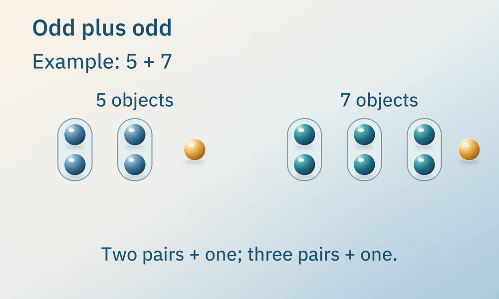

---
{
  "title": "Chapter 3: Proof methods",
  "subtitle": "Discrete Mathematics · Rey Joseph Nieto",
  "description": "Chapter 3: Proof methods. HTML edition of Lecture Notes in Discrete Mathematics.",
  "canonical-url": "https://rjnieto.com/teaching/notes/chapter-03/",
  "header-includes": "<meta name=\"robots\" content=\"index, follow, max-image-preview:large\">\n<meta property=\"og:url\" content=\"https://rjnieto.com/teaching/notes/chapter-03/\">\n<meta property=\"og:type\" content=\"article\">",
  "image": "/teaching/bulsu/discrete-math/images/thumbnails/chapter_03.webp",
  "body-classes": "ds-lecture-notes",
  "toc": true,
  "toc-depth": 2,
  "number-sections": false,
  "format": {
    "html": {
      "css": [
        "/assets/css/discrete-notes.css"
      ]
    }
  },
  "execute": {
    "eval": false
  },
  "resources": [
    "../assets/chapter-03/01-odd-plus-odd-pairing.gif",
    "../assets/chapter-03/01-odd-plus-odd-pairing-poster.png",
    "../assets/chapter-03/01-odd-plus-odd-pairing.webp"
  ]
}
---

<!-- Generated from the corresponding chapter LaTeX. Run scripts/build-discrete-html.py to refresh. -->

[Course page](/teaching/){.btn .btn-outline-secondary .btn-sm} [PDF](/teaching/bulsu/discrete-math/lecture-notes/chapter_03.pdf){.btn .btn-outline-primary .btn-sm aria-label="Open Chapter 3: Proof methods as PDF"}

[]{#ch3:chapter label="ch3:chapter"}

Alice claims that the square of every odd integer is odd. She tries $3^2=9$, $5^2=25$ and $(-7)^2=49$. Bob checks another thousand odd integers, and every result agrees. Have they proved the claim?

Their calculations give examples, but infinitely many integers remain unchecked. A proof must explain why an odd integer cannot produce an even square. We will return to Alice's claim and give an argument that works for every odd integer, including negative ones.

Chapter 2 supplied rules for drawing conclusions from premises. We now use those rules together with mathematical definitions to construct complete arguments. Instead of being handed both the premises and the next step, we must decide how to begin, what information a definition provides and what would establish the conclusion.

Our three main methods are direct proof, proof by contrapositive and proof by contradiction. We will practise them on elementary number properties so that the reasoning remains visible. Finding a proof can take several attempts; the finished argument usually reads more smoothly than the work that led to it. With practice, choosing a useful starting point becomes easier.

:::: {.ds-box .ds-learningoutcomes}
::: {#what-you-should-be-able-to-do .ds-box-title}
**What you should be able to do**
:::

After working through this chapter, you should be able to:

- identify a claim's domain, hypotheses and required conclusion;

- use the definitions of even, odd and divisibility in an argument;

- construct short direct proofs, contrapositive proofs and contradiction proofs;

- explain why an argument covers an arbitrary permitted input;

- disprove a universal claim with a permitted counterexample;

- locate and repair missing assumptions, unjustified steps and wrong proof directions.
::::

## 3.1 Mathematical proof {#ch3:proofs}

Recall the distinction from Chapter 2: a valid argument form guarantees its conclusion when its premises are true. A mathematical proof must also supply the mathematical reasons that make its steps available. For example, knowing the form $P\to Q,\ P,\ \therefore Q$ does not by itself tell us whether a square is even. We must connect the numerical claim to definitions and established facts.

:::: {.ds-box .ds-definition}
::: {#definition-3.1-proof .ds-box-title}
**Definition 3.1: Proof**
:::

A **proof** is a mathematical argument that establishes a claim from its hypotheses, definitions and previously established facts, using valid reasoning. Each step must be justified, and the argument must cover the cases required by the claim.
::::

A proved result may be called a **theorem** or a **proposition**. A **lemma** is a result proved for use in another argument.

[**Hypotheses and conclusions.**]{#hypotheses-and-conclusions.} Consider $$\forall x\in D\,\bigl(P(x)\to Q(x)\bigr).$$ The **hypothesis** is $P(x)$ and the required conclusion is $Q(x)$, with $x$ belonging to $D$. In a direct proof, we choose an arbitrary $x\in D$, assume $P(x)$ and derive $Q(x)$. We are establishing what happens *if* the hypothesis holds; we do not have to show that every element satisfies the hypothesis.

"Arbitrary" means that we have not selected an input with extra helpful properties. If a claim concerns all integers, beginning with $n=3$ would restrict the argument to one input. Beginning with "Let $n$ be an integer" leaves it available for every integer allowed by the claim. We may then impose exactly the hypotheses the claim gives us.

[**Example 3.1.**]{#example-3.1.} Prove that for every real number $x$, if $x>7$, then $2x+1>15$.

The claim has domain $\mathbb{R}$, hypothesis $x>7$ and conclusion $2x+1>15$. We need no numerical value for $x$.

*Proof.* Let $x\in\mathbb{R}$ and suppose that $x>7$. Multiplication by the positive number $2$ preserves the inequality, so $2x>14$. Adding $1$ gives $2x+1>15$, as required. $\square$

The argument applies to every real $x$ satisfying the hypothesis. The small square marks the end of the proof. The reason for multiplying by a *positive* number was stated because multiplying an inequality by a negative number would reverse its direction.

Trying values can suggest a claim, reveal a counterexample or help us find the calculation to use. The final proof must explain what covers the untested inputs. A complete check of a finite domain can do that, as in Chapter 1. For an infinite domain, a finite collection of successful tests alone does not.

You can also work backwards while searching. If the goal is to show that a number equals twice an integer, it is reasonable to ask which integer would work. When presenting the proof, establish that representation from the hypotheses. Simply assuming the desired conclusion and obtaining a true statement does not show that the conclusion follows.

## 3.2 Parity and divisibility {#ch3:definitions}

We need a small amount of arithmetic vocabulary for our proof examples. Throughout the core examples, our number variables range over the integers unless a different domain is specified. Sums, differences and products of integers are integers. A quotient of two integers need not be an integer: for instance, $5/2\notin\mathbb{Z}$.

:::: {.ds-box .ds-definition}
::: {#definition-3.2-even-and-odd-integers .ds-box-title}
**Definition 3.2: Even and odd integers**
:::

An integer $n$ is **even** if $n=2k$ for some integer $k$. It is **odd** if $n=2k+1$ for some integer $k$. The integer $k$ is a witness to the stated representation.
::::

An integer's **parity** is whether it is even or odd. The definitions turn these familiar labels into forms we can use in algebra. To use the hypothesis "$n$ is even", we may write $n=2k$ for some $k\in\mathbb{Z}$. To prove that a quantity is even, we must show it equals twice an *integer*. For oddness, the target is twice an integer plus $1$.

[**Example 3.2.**]{#example-3.2.} The number $-10$ is even because $-10=2(-5)$, with integer witness $-5$. The number $-7$ is odd because $-7=2(-4)+1$, with witness $-4$. Zero is even because $0=2(0)$.

We do not require $k$ in the definitions to be positive. Restricting it to positive integers would exclude valid negative examples and zero.

We use the familiar fact that every integer is either even or odd. Dividing an integer by $2$ leaves remainder $0$ or $1$, giving precisely the forms $2k$ and $2k+1$. We will study remainders systematically in Chapter 8.

The alternatives cannot both hold. If $2k=2\ell+1$ for integers $k,\ell$, then $k-\ell=\tfrac12$, but an integer difference cannot equal $\tfrac12$. Thus, for an integer, "not even" means odd, and "not odd" means even. These conclusions depend on the integer domain; a real number such as $\tfrac12$ is neither an even nor an odd integer.

:::: {.ds-box .ds-definition}
::: {#definition-3.3-divisibility .ds-box-title}
**Definition 3.3: Divisibility**
:::

For integers $d,n$ with $d\ne0$, write $d\mid n$ if $n=dq$ for some integer $q$. Read this as "$d$ divides $n$" or "$n$ is a multiple of $d$". Write $d\nmid n$ when no such integer $q$ exists. The divisors used in this chapter are nonzero.
::::

The notation $d\mid n$ makes a claim; it is not a request to carry out a division. In particular, $d\mid n$ and $n\mid d$ have different meanings. The witness $q$ must be an integer.

[**Example 3.3.**]{#example-3.3.} We have $6\mid42$ because $42=6(7)$. However, $6\nmid20$: the equation $20=6q$ forces $q=10/3$, which is not an integer. Writing $20=6(10/3)$ does not establish divisibility.

Also, $6\mid0$ because $0=6(0)$. The number being divided may be zero even though we have required the divisor to be nonzero.

Evenness is divisibility by $2$. More generally, the definition of divisibility tells us both how to unpack a hypothesis and what kind of witness to construct for a conclusion. We use only this elementary meaning here; the number-theory chapter develops it further.

## 3.3 Direct proof {#ch3:direct}

In a direct proof, we begin with what is given and work towards what is required. Definitions often supply the first useful equation.

:::: {.ds-box .ds-definition}
::: {#definition-3.4-direct-proof-of-an-implication .ds-box-title}
**Definition 3.4: Direct proof of an implication**
:::

To prove $P\to Q$ directly, assume $P$ and deduce $Q$ using definitions and established results. For a universally quantified claim, first fix an arbitrary object in the stated domain and retain its hypotheses throughout the argument.
::::

[**Example 3.4.**]{#ch3:even-sum} Prove that the sum of two even integers is even.

The hypotheses concern two numbers, so use two representations: $a=2r$ and $b=2s$. The goal is to write $a+b$ as twice an integer.

*Proof.* Let $a,b\in\mathbb{Z}$ and suppose both are even. There are integers $r,s$ such that $a=2r$ and $b=2s$. Therefore $$a+b=2r+2s=2(r+s).$$ Since $r+s$ is an integer, this represents $a+b$ as twice an integer. Hence $a+b$ is even. $\square$

The witness for the conclusion is $r+s$. We have explained why it belongs to $\mathbb{Z}$, rather than merely pointing to a factor of $2$.

:::: {.ds-box .ds-caution}
::: {#separate-witnesses .ds-box-title}
**Separate witnesses**
:::

Writing $a=2k$ and $b=2k$ with the same $k$ would assume $a=b$. The original claim allows different even integers, such as $6$ and $10$, whose witnesses are $3$ and $5$. Use separate letters when the hypotheses do not require the witnesses to agree. They may turn out to be equal in a particular case, but the proof must not impose that restriction.
::::

[**Example 3.5.**]{#example-3.5.} Prove that the sum of two odd integers is even.

*Proof.* Let $a,b\in\mathbb{Z}$ be odd. Write $a=2r+1$ and $b=2s+1$ for integers $r,s$. Then $$a+b=(2r+1)+(2s+1)=2r+2s+2=2(r+s+1).$$ The number $r+s+1$ is an integer, so $a+b$ is even. $\square$

<figure id="ch03-odd-plus-odd-pairing" class="ds-animation">
  <picture>
    <source media="print, (prefers-reduced-motion: reduce)" srcset="/teaching/notes/assets/chapter-03/01-odd-plus-odd-pairing-poster.png">
    
  </picture>
  <figcaption>In the example $5+7$, the two unpaired objects form a sixth pair.</figcaption>
</figure>

Two odd inputs have produced an even output. The definition needed at the end is the definition of the *conclusion*, not necessarily the one used to describe the inputs.

[**Example 3.6. Squares of odd integers.**]{#ch3:odd-square} We can now settle Alice's claim from the opening.

*Proof.* Let $n\in\mathbb{Z}$ be odd. Then $n=2k+1$ for some $k\in\mathbb{Z}$. Squaring gives $$\begin{aligned}
 n^2&=(2k+1)^2\\
    &=4k^2+4k+1\\
    &=2(2k^2+2k)+1.
 \end{aligned}$$ Since $2k^2+2k$ is an integer, the final expression has the form $2(\text{integer})+1$. Thus $n^2$ is odd. $\square$

The proof did not select a particular odd input or assume that $k$ was positive. It covers every odd integer allowed by the claim. The numerical tests helped us notice the pattern; the representation $n=2k+1$ explains why it always holds.

[**Example 3.7.**]{#ch3:even-product} Prove that the product of an even integer and any integer is even.

*Proof.* Let $a,b\in\mathbb{Z}$ and suppose $a$ is even. Write $a=2k$ for some $k\in\mathbb{Z}$. Then $$ab=(2k)b=2(kb).$$ Because $kb\in\mathbb{Z}$, the product $ab$ is even. $\square$

We did not need $b$ to be even. We did need it to be an integer: $2(\tfrac12)=1$ shows why an arbitrary real second factor would not support the same conclusion.

[**Example 3.8.**]{#ch3:divisible-sum} Prove that if $d\mid a$ and $d\mid b$, then $d\mid(a+b)$, where $a,b,d\in\mathbb{Z}$ and $d\ne0$.

*Proof.* Fix such integers and assume $d\mid a$ and $d\mid b$. By definition, $a=dr$ and $b=ds$ for some integers $r,s$. Hence $$a+b=dr+ds=d(r+s).$$ Since $r+s\in\mathbb{Z}$, the definition of divisibility gives $d\mid(a+b)$. $\square$

The conclusion is a divisibility claim, so it needs an integer multiplier. Here that multiplier is $r+s$, just as in the earlier even-sum proof.

[**Example 3.9.**]{#example-3.9.} Suppose $d\mid a$ and $d\mid b$, with $a,b,d\in\mathbb{Z}$ and $d\ne0$. Prove that $d\mid(3a-2b)$.

*Proof.* There are integers $j,k$ with $a=dj$ and $b=dk$. Substituting these expressions gives $$3a-2b=3dj-2dk=d(3j-2k).$$ The multiplier $3j-2k$ is an integer, so $d\mid(3a-2b)$. $\square$

The same reasoning works for any integer coefficients $r,s$: $$ra+sb=r(dj)+s(dk)=d(rj+sk).$$ Because $r,s,j,k$ are integers, so is $rj+sk$. Thus $d\mid(ra+sb)$.

[**Example 3.10.**]{#example-3.10.} For integers $a,b,c$ with $a,b\ne0$, prove that $a\mid b$ and $b\mid c$ imply $a\mid c$.

*Proof.* Assume $a\mid b$ and $b\mid c$. Choose integers $r,s$ such that $b=ar$ and $c=bs$. Substitution gives $$c=bs=(ar)s=a(rs).$$ Since $rs\in\mathbb{Z}$, we have $a\mid c$. $\square$

Compare this with chaining implications in Chapter 2. Here the definitions provide the equations that connect the two hypotheses. The direction matters: $a\mid b$ supplied $b=ar$, not $a=br$.

Each proof above begins with the domain and hypotheses, introduces what the definitions permit, and explains why the final expression meets the definition required by the conclusion. Algebra performs part of the work; the sentences identify what the algebra establishes.

## 3.4 Proof by contrapositive {#ch3:contrapositive}

Sometimes the hypothesis supplies information about a complicated expression, while the conclusion concerns a simpler input. It may be easier to start by assuming that the conclusion is false.

Chapter 2 established $$(P\to Q)\equiv(\neg Q\to\neg P).$$ The second implication is the contrapositive of the first. Proving it therefore establishes the original implication.

:::: {.ds-box .ds-definition}
::: {#definition-3.5-proof-by-contrapositive .ds-box-title}
**Definition 3.5: Proof by contrapositive**
:::

To prove $P\to Q$ by contrapositive, assume $\neg Q$ and deduce $\neg P$. Keep the original domain and any background hypotheses. For a quantified implication, the argument must work for an arbitrary permitted input.
::::

[**Example 3.11.**]{#ch3:square-even} Prove that for every integer $n$, if $n^2$ is even, then $n$ is even.

A direct attempt gives $n^2=2k$ for an integer $k$, but that does not yet express $n$ as twice an integer. The contrapositive starts with $n$ odd and asks us to show that $n^2$ is odd, which Example [3.6](#ch3:odd-square) already established.

*Proof.* We prove the contrapositive. Let $n\in\mathbb{Z}$ and suppose that $n$ is not even. Then $n$ is odd, so Example [3.6](#ch3:odd-square) shows that $n^2$ is odd and hence not even. This proves that if $n$ is not even, then $n^2$ is not even. The original implication follows by contraposition. $\square$

We used a previously proved result instead of repeating its calculation. The proof did not assume that $n^2$ was even; that is the starting assumption for a direct proof of the original implication.

[**Example 3.12.**]{#example-3.12.} For $n\in\mathbb{Z}$, prove that if $3n+2$ is odd, then $n$ is odd.

The contrapositive is: if $n$ is not odd, then $3n+2$ is not odd. Since these quantities are integers, we can rewrite it using evenness.

*Proof.* We prove the contrapositive. Let $n\in\mathbb{Z}$ be even. Then $n=2k$ for some $k\in\mathbb{Z}$, so $$3n+2=3(2k)+2=2(3k+1).$$ The multiplier $3k+1$ is an integer. Hence $3n+2$ is even and is not odd. This proves the contrapositive, so the stated implication is true. $\square$

[**Example 3.13.**]{#example-3.13.} For integers $a,b$, prove that if $a+b$ is odd, then $a$ is odd or $b$ is odd.

Negating the conclusion requires De Morgan's law: "not ($a$ odd or $b$ odd)" means that neither is odd. Both are then even.

*Proof.* We prove the contrapositive. Let $a,b\in\mathbb{Z}$ and suppose neither is odd. Both are even, so Example [3.4](#ch3:even-sum) shows that $a+b$ is even. Thus $a+b$ is not odd, which proves the contrapositive. Therefore an odd sum has at least one odd summand. $\square$

The "or" is inclusive. We have proved the implication stated in the claim, not its converse: $3$ and $5$ are both odd, but $3+5$ is even.

:::: {.ds-box .ds-caution}
::: {#contrapositive-and-negation .ds-box-title}
**Contrapositive and negation**
:::

For a claim $\forall n\in\mathbb{Z}\,(P(n)\to Q(n))$, the contrapositive retains the universal quantifier: $$\forall n\in\mathbb{Z}\,(\neg Q(n)\to\neg P(n)).$$ The negation of the whole claim is instead $\exists n\in\mathbb{Z}\,(P(n)\land\neg Q(n))$. It says that a counterexample exists. These have different jobs: the contrapositive is an equivalent claim to prove; the negation describes how the original could fail.
::::

## 3.5 Proof by contradiction {#ch3:contradiction}

A nonexistence claim can be difficult to attack by listing things that do not work. A contradiction proof lets us assume that a proposed object exists and ask what that would force.

:::: {.ds-box .ds-definition}
::: {#definition-3.6-proof-by-contradiction .ds-box-title}
**Definition 3.6: Proof by contradiction**
:::

To prove a claim $S$, temporarily assume $\neg S$, while retaining the stated domain and background hypotheses. Deduce incompatible conclusions, such as a statement together with its negation. These show that the temporary assumption is impossible, so $S$ holds.
::::

The contradiction must follow from justified steps. Being surprised by an answer, or merely failing to find an example, does not establish one. We must identify the incompatible facts.

To prove a conditional $P\to Q$ this way, its negation is $P\land\neg Q$. For a universal conditional, we suppose that there is a permitted counterexample satisfying those two conditions. We do not suppose that every input is a counterexample.

[**Example 3.14.**]{#example-3.14.} A greatest integer would be an integer at least as large as every integer. The claim says that no such integer exists.

*Proof.* Suppose, for contradiction, that a greatest integer $g$ exists. The number $g+1$ is an integer because integers are closed under addition. It satisfies $g+1>g$. However, greatestness would require $g+1\leq g$. These inequalities cannot both hold. Therefore no greatest integer exists. $\square$

We did not try a long list of proposed greatest integers. The assumption gave us one candidate $g$, and the expression $g+1$ defeated that candidate regardless of its value.

[**Example 3.15.**]{#example-3.15.} Prove that there are no integers $a,b$ satisfying $6a+3=4b$.

*Proof.* Suppose, for contradiction, that integers $a,b$ satisfy the equation. Its left side can be written as $$6a+3=2(3a+1)+1,$$ so it is odd, because $3a+1$ is an integer. Its right side is $4b=2(2b)$, so it is even. The equation would make the same integer both odd and even, which is impossible. Hence no such integers exist. $\square$

The negation of "there are no such integers" is the existence of a pair that works. That is precisely what we temporarily assumed; the parity definitions then ruled out every proposed pair.

[**Example 3.16.**]{#example-3.16.} We can also prove that an integer with an even square must be even using contradiction. Compare the assumptions with the contrapositive proof in Example [3.11](#ch3:square-even).

*Proof.* Let $n\in\mathbb{Z}$ and suppose $n^2$ is even. Suppose, for contradiction, that $n$ is not even. Then $n$ is odd, so Example [3.6](#ch3:odd-square) gives that $n^2$ is odd. This contradicts our hypothesis that $n^2$ is even. Therefore $n$ is even. $\square$

This proof retained the original hypothesis and temporarily denied the conclusion. The contrapositive proof assumed only that $n$ was not even and established that $n^2$ was not even. Both methods are valid, but their stated assumptions and stopping points differ.

## 3.6 Proof construction and checking {#ch3:checking}

The logical form gives us possible starting points, but it does not guarantee that one particular method will be shortest. For a claim $P\to Q$, compare the following:

::: ds-table
  Method           Starting point             What to establish
  ---------------- -------------------------- ----------------------------
  Direct           Assume $P$.                Deduce $Q$.
  Contrapositive   Assume $\neg Q$.           Deduce $\neg P$.
  Contradiction    Assume $P$ and $\neg Q$.   Deduce incompatible facts.
:::

In each row, keep the domain and any background hypotheses. For a general claim $S$ that is not presented as a conditional, contradiction starts with $\neg S$. We often choose a method because its assumptions give a representation we know how to use.

For instance, knowing that $n$ is odd immediately gives $n=2k+1$. Knowing only that $n^2$ is even gives an equation for the square, which is less convenient if we want an equation for $n$ itself. This was the reason for trying the contrapositive in Example [3.11](#ch3:square-even).

[**Example 3.17.**]{#example-3.17.} Prove that an integer $n$ is even if and only if $n^2$ is even.

*Proof.* Let $n\in\mathbb{Z}$. First suppose $n$ is even. By Example [3.7](#ch3:even-product), its product with the integer $n$ is even, so $n^2$ is even.

Conversely, suppose $n^2$ is even. Example [3.11](#ch3:square-even) gives that $n$ is even. Both implications hold, so the biconditional is proved. $\square$

The first direction used a direct proof result; the second used one proved by contrapositive. A biconditional does not require using the same method in both directions.

[**Counterexamples.**]{#counterexamples.} Before investing in a proof, test simple allowed values, including zero or negative inputs when the domain permits them. One counterexample to a universal claim settles its falsity. In an implication, that counterexample must make the hypothesis true and the conclusion false. A false hypothesis does not supply a failed case.

[**Example 3.18.**]{#example-3.18.} Consider the proposed claim: for nonzero integer $d$ and integers $a,b$, if $d\mid ab$, then $d\mid a$ or $d\mid b$.

Take $d=6$, $a=2$ and $b=3$. We have $ab=6$, so $6\mid ab$. However, $6\nmid2$ and $6\nmid3$. The hypothesis is true and the conclusion false, so this is a counterexample.

The universal claim is false. The definition of divisibility does not allow us to separate the factors in this way for an arbitrary $d$.

:::: {.ds-box .ds-python}
::: {#python-non-examinable .ds-box-title}
**Python (non-examinable)**
:::

Consider the claim that, for integers $a,b$, if $6\mid ab$, then $6\mid a$ or $6\mid b$. We can search for counterexamples with $d=6$. Python's `range(1, 7)` supplies the integers $1$ through $6$; the upper endpoint is excluded. The operator `%` gives the remainder, so `a % d == 0` tests whether $d$ divides $a$. The assignments below record the hypothesis and conclusion for each pair. The `if` line selects exactly a true hypothesis and a false conclusion.

``` python
d = 6
for a in range(1, 7):
    for b in range(1, 7):
        hypothesis = (a * b) % d == 0
        conclusion = (a % d == 0) or (b % d == 0)
        if hypothesis and not conclusion:
            print(a, b)
```

**Output.**

``` text
2 3
3 2
3 4
4 3
```

The first pair recovers the counterexample verified above. Each printed pair supplies another one, and any one of them refutes the universal claim. Successful tests alone would not prove a claim about all integers.
::::

[**Faulty proofs.**]{#faulty-proofs.} The next examples separate the result being claimed from the argument offered for it. Check where each argument starts, what its equations actually establish and which hypotheses it uses.

[**Example 3.19.**]{#example-3.19.} Charlie wants to prove that if $n^2$ is even, then $n$ is even. He writes: "Let $n$ be even. Then $n=2k$, so $n^2=2(2k^2)$ is even. Therefore the claim is proved."

His calculation establishes that $n$ even implies $n^2$ even. He began with the intended conclusion and proved the converse. Although both directions happen to be true here, that does not make one a proof of the other. The argument must begin with assumptions appropriate to its chosen method.

A repair is the contrapositive proof in Example [3.11](#ch3:square-even), or the contradiction proof in Section [3.5](#ch3:contradiction).

[**Example 3.20.**]{#example-3.20.} Eve proposes that every integer is even because $$n=2\left(\frac n2\right).$$ The equation is correct, but evenness requires an integer witness. When $n=5$, the proposed witness is $5/2$, which is not an integer. The equation therefore does not prove evenness for an arbitrary $n$.

[**Example 3.21.**]{#example-3.21.} Alice claims that for all integers $a,b,c$, the equation $ab=ac$ implies $b=c$. Her proof divides both sides by $a$.

The input $a=0$, $b=2$, $c=5$ satisfies $ab=ac$, since both products are zero, but $b\ne c$. It is a counterexample. The division step failed because the hypotheses did not exclude $a=0$.

With the added hypothesis $a\ne0$, the statement is true: from $ab=ac$, division by the nonzero number $a$ gives $b=c$. The repaired proof establishes the claim with that extra hypothesis; it does not prove the original unrestricted claim.

Look for the exact definition or earlier result that supports each step. An expression of the form $2t$ establishes evenness only after we know $t\in\mathbb{Z}$. A contradiction must identify incompatible facts. A proof about every input must avoid extra restrictions on that input.

:::: {.ds-box .ds-enrichment}
::: {#non-examinable-an-irrationality-proof .ds-box-title}
**(Non-examinable) An irrationality proof**
:::

This enrichment example combines the even-square result with familiar fraction arithmetic. The example and its terminology are non-examinable.

A real number is **rational** if it can be written as $a/b$ for integers $a,b$ with $b\ne0$; it is **irrational** if no such fraction exists. A fraction is in **lowest terms** when no integer greater than $1$ divides both numerator and denominator. We use the elementary fact that any rational number can be written in lowest terms by cancelling common factors. Choose a positive denominator.

The number $\sqrt2$ is the positive real number whose square is $2$. We will prove that it is irrational.

*Proof.* Suppose, for contradiction, that $\sqrt2=a/b$, where $a,b\in\mathbb{Z}$, $b>0$, and the fraction is in lowest terms. Squaring and multiplying by $b^2$ gives $$a^2=2b^2.$$ Thus $a^2$ is even. Example [3.11](#ch3:square-even) shows that $a$ is even, so $a=2k$ for some $k\in\mathbb{Z}$. Substitution gives $$4k^2=2b^2,\qquad\text{hence}\qquad b^2=2k^2.$$ Now $b^2$ is even, so the same result shows that $b$ is even. The integer $2$ therefore divides both $a$ and $b$, contradicting the choice of a fraction in lowest terms. Hence $\sqrt2$ is irrational. $\square$

The contradiction is with the chosen representation being in lowest terms, not with fractions being allowed to have even numerators and denominators. A fraction such as $2/4$ is perfectly valid; it simply is not in lowest terms.
::::

## 3.7 Exercises {#ch3:exercises}

::: {.ds-exercises style="--ds-chapter: '3';"}
1.  []{#ch3ex:witnesses label="ch3ex:witnesses"} Justify each statement directly from its definition. Write the required integer explicitly, rather than giving only the statement's truth value.

    a)  $-8$ is even.

    b)  $-11$ is odd.

    c)  $7\mid 0$.

    d)  $-3\mid 12$.

2.  []{#ch3ex:beginnings label="ch3ex:beginnings"} For each claim, write the opening assumptions and say what remains to be shown using the indicated method. Do not complete the proof yet.

    a)  For all integers $a,b$, if $a$ is odd and $b$ is even, then $a+b$ is odd. Use a direct proof.

    b)  For every integer $n$, if $5n+4$ is odd, then $n$ is odd. Use a proof by contrapositive.

    c)  There are no integers $a,b$ for which $4a+1=2b$. Use a proof by contradiction.

3.  []{#ch3ex:mixed-sum label="ch3ex:mixed-sum"} Fill each gap and explain why the integer used in the conclusion really is an integer.

    > Let $a,b$ be arbitrary integers, with $a$ odd and $b$ even. There are integers $r,s$ such that $a=\underline{\hspace{1.5cm}}$ and $b=\underline{\hspace{1.5cm}}$. Therefore $$a+b=\underline{\hspace{3cm}}=2(r+s)+1.$$ Since $\underline{\hspace{1.5cm}}\in\mathbb{Z}$, the definition of $\underline{\hspace{1.5cm}}$ shows that $a+b$ is odd.

4.  []{#ch3ex:product-reasons label="ch3ex:product-reasons"} Consider this argument.

    > Let $a,b$ be arbitrary odd integers. Write $a=2r+1$ and $b=2s+1$ for some integers $r,s$. Then $$ab=(2r+1)(2s+1)=2(2rs+r+s)+1.$$ The number $2rs+r+s$ is an integer, so $ab$ is odd.

    a)  Which definition justifies the first representations of $a,b$?

    b)  Why is $2rs+r+s$ an integer?

    c)  Which definition justifies the conclusion?

    d)  Why does the proof apply to all odd integers, including negative ones?

5.  []{#ch3ex:direct-arithmetic label="ch3ex:direct-arithmetic"} Prove each claim. State the domain of your arbitrary input and justify the final step.

    a)  For every real number $x$, if $x>-3$, then $4x+5>-7$.

    b)  For every integer $n$, if $n$ is even, then $n^2+3$ is odd.

    c)  For every integer $n$, $(n+1)^2-n^2$ is odd.

6.  []{#ch3ex:construct-witness label="ch3ex:construct-witness"} Prove that for every integer $n$ there is an integer $m$ such that $m>n$ and $3\mid(m-n)$. Give a formula for $m$ in terms of $n$, then check both required properties.

7.  []{#ch3ex:product-divisibility label="ch3ex:product-divisibility"} Let $d,a,b$ be integers with $d\ne0$. Complete this proof of the claim that if $d\mid a$ and $d\mid b$, then $d^2\mid ab$.

    > Suppose $d\mid a$ and $d\mid b$. There are integers $r,s$ with $a=\underline{\hspace{1cm}}$ and $b=\underline{\hspace{1cm}}$. Hence $$ab=\underline{\hspace{2.5cm}}=d^2(rs).$$ Here $d^2\ne0$ because $\underline{\hspace{2cm}}$, and $rs\in\mathbb{Z}$ because $\underline{\hspace{3cm}}$. Thus $d^2\mid ab$.

8.  []{#ch3ex:direct-divisibility label="ch3ex:direct-divisibility"} Prove each claim directly from the definition of divisibility.

    a)  For integers $d,a$ with $d\ne0$, if $d\mid a$, then $d\mid(a^2-a)$.

    b)  For integers $a,b$ with $a\ne0$, if $a\mid b$, then $a\mid(b+3a)$.

9.  []{#ch3ex:converse label="ch3ex:converse"}

    a)  Prove that for every integer $n$, if $8\mid n$, then $4\mid n$.

    b)  State the converse and give a counterexample to it. Check explicitly that your example satisfies the converse's hypothesis and fails its conclusion.

10. []{#ch3ex:examples-only label="ch3ex:examples-only"} A student writes:

    > For $n=-1,0,2$, the expression $10n+5$ gives $-5,5,25$. All three are divisible by $5$. Therefore $5\mid(10n+5)$ for every integer $n$.

    a)  Are the calculations correct? Do they prove the universal claim? Explain the gap in the reasoning.

    b)  Replace the argument with a direct proof of the universal claim.

11. []{#ch3ex:same-witness label="ch3ex:same-witness"} A proposed proof says:

    > Let $a,b$ be odd integers. Then $a=2k+1$ and $b=2k+1$ for some integer $k$. Hence $a-b=0$, which is even.

    a)  Explain what extra assumption is introduced by using the same $k$. Give two odd integers for which those two representations cannot hold with the same $k$.

    b)  Prove the intended claim: the difference of any two odd integers is even.

12. []{#ch3ex:quotient-error label="ch3ex:quotient-error"} A student proposes:

    > If $3\mid n$, write $n=3k$ for some integer $k$. Then $n=6(k/2)$, so $6\mid n$.

    a)  Identify the missing requirement in the last step.

    b)  Give a counterexample to the proposed claim. In your example, what is $k/2$?

    c)  Prove the repaired claim: for every integer $n$, if $3\mid n$, then $6\mid 2n$.

13. []{#ch3ex:assuming-conclusion label="ch3ex:assuming-conclusion"} A student offers the following as a proof of the even-square claim, without using that claim as an earlier result:

    > Let $n$ be an integer and suppose $n^2$ is even. Since $n$ is even, there is an integer $k$ with $n=2k$. Therefore $n$ is even.

    a)  Identify the unsupported assertion. Explain why the final sentence has not been established by this argument.

    b)  Write a valid proof by contrapositive. You may use the previously proved fact that the square of an odd integer is odd.

14. []{#ch3ex:guided-contrapositive label="ch3ex:guided-contrapositive"} Prove that for every integer $n$, if $5n+4$ is odd, then $n$ is odd.

    a)  State the contrapositive in words, using the fact that every integer has exactly one parity.

    b)  Complete the calculation for an arbitrary even integer $n=2k$: $$5n+4=\underline{\hspace{2.5cm}}=2\bigl(\underline{\hspace{1.7cm}}\bigr).$$

    c)  Explain why the calculation proves the contrapositive and hence the original claim.

15. []{#ch3ex:odd-product-contrapositive label="ch3ex:odd-product-contrapositive"} Prove by contrapositive that for all integers $a,b$, if $ab$ is odd, then $a$ and $b$ are both odd. State the contrapositive before proving it. Remember that the negation of "both are odd" is "at least one is even" for integer inputs.

16. []{#ch3ex:independent-contrapositive label="ch3ex:independent-contrapositive"} Prove by contrapositive that for every integer $n$, if $n^2+2n$ is odd, then $n$ is odd. Start with an arbitrary integer satisfying the contrapositive's hypothesis.

17. []{#ch3ex:no-parity-solution label="ch3ex:no-parity-solution"} Prove by contradiction that there are no integers $a,b$ satisfying $4a+1=2b$. Write the assumption that begins the contradiction proof, identify the incompatible properties it forces on one integer, and state the conclusion.

18. []{#ch3ex:no-smallest-multiple label="ch3ex:no-smallest-multiple"} Prove by contradiction that there is no smallest integer divisible by $4$. If $M$ were such a smallest integer, construct another integer divisible by $4$ that is smaller than $M$. Your argument must also work when $M$ is negative.

19. []{#ch3ex:incompatible-sum-difference label="ch3ex:incompatible-sum-difference"} Prove by contradiction that there are no integers $a,b$ for which $a+b$ is odd and $a-b$ is even. You may use previously proved parity facts. Identify the fact used at each step.

20. []{#ch3ex:method-choice label="ch3ex:method-choice"} For each claim, choose direct proof, contrapositive or contradiction. Give a reason for your choice, the opening assumption or assumptions, and one useful next step. More than one method may work; a full proof is not required here.

    a)  For integers $d,a,b$ with $d\ne0$, if $d\mid a$ and $d\mid b$, then $d\mid(2a-5b)$.

    b)  For every integer $n$, if $n^2+1$ is even, then $n$ is odd.

    c)  There is no greatest integer divisible by $7$.

21. []{#ch3ex:counterexamples label="ch3ex:counterexamples"} Each claim below is false. Give a counterexample and verify both that its hypotheses hold and that its conclusion fails.

    a)  For all integers $a,b$, if $ab$ is even, then $a$ and $b$ are both even.

    b)  For all integers $d,n$ with $d\ne0$, if $d\mid n^2$, then $d\mid n$.

    c)  For all nonzero integers $a,b$, if $a\mid b$ and $b\mid a$, then $a=b$.

    Repair part (a) by replacing "both" with "at least one", and prove the repaired claim. You may use Exercise [3.4](#ch3ex:product-reasons).

22. []{#ch3ex:integrated-parity label="ch3ex:integrated-parity"} Prove that for all integers $a,b$, the sum $a+b$ is odd if and only if $a$ and $b$ have different parity: one is even and the other is odd. Write both directions of the proof. You may use earlier parity results, but name the result whenever you use it.
:::

::: {.ds-chapter-navigation}

[← Chapter 2](../chapter-02/index.qmd)
[Next chapter →](../chapter-04/index.qmd){.btn .btn-primary rel="next" aria-label="Next chapter: Chapter 4 (HTML)"}

:::
