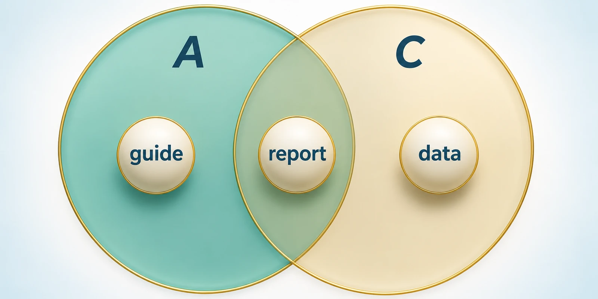
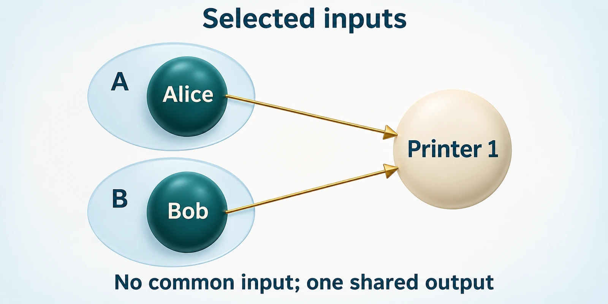

---
{
  "title": "Chapter 4: Sets and mappings",
  "subtitle": "Discrete Mathematics · Rey Joseph Nieto",
  "description": "Chapter 4: Sets and mappings. HTML edition of Lecture Notes in Discrete Mathematics.",
  "canonical-url": "https://rjnieto.com/teaching/notes/chapter-04/",
  "header-includes": "<meta name=\"robots\" content=\"index, follow, max-image-preview:large\">\n<meta property=\"og:url\" content=\"https://rjnieto.com/teaching/notes/chapter-04/\">\n<meta property=\"og:type\" content=\"article\">",
  "image": "/teaching/bulsu/discrete-math/images/thumbnails/chapter_04.webp",
  "body-classes": "ds-lecture-notes",
  "toc": true,
  "toc-depth": 2,
  "number-sections": false,
  "format": {
    "html": {
      "css": [
        "/assets/css/discrete-notes.css"
      ]
    }
  },
  "execute": {
    "eval": false
  }
}
---

<!-- Generated from the corresponding chapter LaTeX. Run scripts/build-discrete-html.py to refresh. -->

[Course page](/teaching/){.btn .btn-outline-secondary .btn-sm} [PDF](/teaching/bulsu/discrete-math/lecture-notes/chapter_04.pdf){.btn .btn-outline-primary .btn-sm aria-label="Open Chapter 4: Sets and mappings as PDF"}

[]{#ch4:chapter label="ch4:chapter"}

Suppose a system replaces its old list of users permitted to enter a laboratory with a new list. What would establish that nobody loses access? Every user on the old list would have to appear on the new one. What would establish that access is unchanged? We would also have to check that the new list admits nobody who was absent from the old one.

These requirements already have the logical forms studied in Chapters 1 and 2: a claim about every user, and two directions when we want an exact match. Chapter 3 supplied methods for proving such claims. We now apply those methods to sets, functions and relations.

The objects change, but the starting question remains useful: what does the definition require us to show? A statement about one set containing another becomes an argument about an arbitrary element. A statement about distinct inputs becomes an argument about a function's outputs. A statement about a relation becomes an argument about the pairs it contains. We will develop each translation before using it in a proof.

:::: {.ds-box .ds-learningoutcomes}
::: {#what-you-should-be-able-to-do .ds-box-title}
**What you should be able to do**
:::

After working through this chapter, you should be able to:

- interpret subsets, set equality, union, intersection and difference;

- prove a set inclusion by following an arbitrary element;

- establish set equality by proving both inclusions;

- prove or refute injectivity using the stated function domain;

- calculate images of subsets and justify claims about their elements;

- prove transitivity or give a complete counterexample to it;

- identify and repair arguments that use the wrong direction or an unjustified assumption.
::::

## 4.1 Subsets and set operations {#ch4:sets}

Chapter 1 introduced $x\in A$: one object belongs to a set. We now need notation for a claim about every element of one set.

:::: {.ds-box .ds-definition}
::: {#definition-4.1-subsets-and-the-empty-set .ds-box-title}
**Definition 4.1: Subsets and the empty set**
:::

A set $A$ is a **subset** of a set $B$, written $A\subseteq B$, if every element of $A$ is also an element of $B$. Thus $$A\subseteq B\quad\text{means}\quad
 \text{for every }x,\ \text{if }x\in A,\text{ then }x\in B.$$ Write $A\nsubseteq B$ if this fails. A **proper subset**, written $A\subsetneq B$, satisfies $A\subseteq B$ and $A\ne B$. The **empty set**, written $\varnothing$, has no elements.
::::

The symbol $\subseteq$ allows equality: $A\subseteq A$ because an element of $A$ is certainly an element of $A$. To refute $A\subseteq B$, we need one object that belongs to $A$ and does not belong to $B$. An object outside both sets does not refute this claim.

[**Example 4.1.**]{#example-4.1.} Suppose Alice may read exactly the files in $A=\{\text{guide},\text{report}\}$, and Bob may read exactly the files in $B=\{\text{guide},\text{report},\text{data}\}$. Every file in $A$ is in $B$, so $A\subseteq B$. The file data belongs to $B$ but not $A$, so $B\nsubseteq A$ and $A\ne B$. Consequently, $A\subsetneq B$.

Here $\text{report}\in A$ says that one file belongs to Alice's permission set. The statement $\{\text{report}\}\subseteq A$ says that every element of the one-file set belongs to $A$. These statements are both true, but their left-hand objects are different: a file in the first, a set of files in the second.

Recall that two sets are equal when they have exactly the same elements. Therefore $$A=B\quad\text{if and only if}\quad
 A\subseteq B\ \text{and}\ B\subseteq A.$$ The first inclusion prevents $A$ from having an element missing from $B$. The second prevents $B$ from having an element missing from $A$. Equal numbers of elements alone do not establish either inclusion.

:::: {.ds-box .ds-definition}
::: {#definition-4.2-union-intersection-and-difference .ds-box-title}
**Definition 4.2: Union, intersection and difference**
:::

For sets $A$ and $B$:

- $A\cup B$, their **union**, contains the objects in $A$ or $B$, including those in both;

- $A\cap B$, their **intersection**, contains the objects in both $A$ and $B$;

- $A\setminus B$, their **difference**, contains the objects in $A$ that are not in $B$.

Equivalently, $$\begin{aligned}
 x\in A\cup B&\quad\Longleftrightarrow\quad x\in A\text{ or }x\in B,\\
 x\in A\cap B&\quad\Longleftrightarrow\quad x\in A\text{ and }x\in B,\\
 x\in A\setminus B&\quad\Longleftrightarrow\quad x\in A\text{ and }x\notin B.
\end{aligned}$$ Each $\Longleftrightarrow$ reads "if and only if".
::::

These definitions connect set notation to the connectives of Chapter 2. Membership in a union uses inclusive "or"; membership in an intersection requires both conditions. In $A\setminus B$, the order of the sets specifies which elements to retain and which to remove.

[**Example 4.2.**]{#example-4.2.} Let $A=\{\text{guide},\text{report}\}$ and $C=\{\text{report},\text{data}\}$. Then $$\begin{aligned}
 A\cup C&=\{\text{guide},\text{report},\text{data}\},\\
 A\cap C&=\{\text{report}\},\\
 A\setminus C&=\{\text{guide}\},&
 C\setminus A&=\{\text{data}\}.
\end{aligned}$$ For instance, guide belongs to $A\setminus C$ because it belongs to $A$ and not to $C$. Report is excluded from that difference because it is in $C$, even though it is also in $A$. These two differences are not equal. Also, $A\setminus A=\varnothing$: no file can both belong and fail to belong to the same set.

{.ds-note-image fig-alt="Permission sets illustrating union, intersection and set difference." loading="lazy" decoding="async"}

Report belongs to both sets; guide belongs only to $A$, and data only to $C$.

:::: {.ds-box .ds-python}
::: {#python-non-examinable .ds-box-title}
**Python (non-examinable)**
:::

Python can carry out these operations on the same finite sets. Braces enclose the sets, and quotation marks enclose the file names. The operators `|`, `&` and `-` give union, intersection and difference, respectively.

``` python
A = {"guide", "report"}
C = {"report", "data"}
print(sorted(A | C))
print(sorted(A & C))
print(sorted(A - C))
print(sorted(C - A))
```

**Output.**

``` text
['data', 'guide', 'report']
['report']
['guide']
['data']
```

Python sets have no required display order. The function `sorted` makes an alphabetical list for a fixed display; its square brackets denote that list. The four lines match the union, intersection and two differences above.
::::

## 4.2 Set inclusion {#ch4:inclusions}

To prove $A\subseteq B$, begin with an arbitrary element of $A$ and show that it belongs to $B$. The definition of $A$ supplies the hypothesis; the definition of $B$ tells us what the conclusion needs. This is the direct-proof method of Chapter 3 applied to membership. Such an argument is often called **element chasing**.

Choosing one convenient element, such as guide, would show only what happens to that element. Writing "Let $x\in A$" leaves $x$ arbitrary: the argument must use only its stated membership and the hypotheses.

[**Example 4.3.**]{#ch4:intersection-subset} Prove that $A\cap B\subseteq A$ for any sets $A,B$.

*Proof.* Let $x\in A\cap B$. By the definition of intersection, $x\in A$ and $x\in B$. In particular, $x\in A$. Thus every element of $A\cap B$ belongs to $A$, so $A\cap B\subseteq A$. $\square$

The same argument gives $A\cap B\subseteq B$ by retaining the other membership statement. We do not have to show that every element of $A$ lies in the intersection; that would be the reverse inclusion.

The inclusion $\varnothing\subseteq B$ holds for every set $B$. A counterexample would have to belong to $\varnothing$, which is impossible. In the implication "if $x\in\varnothing$, then $x\in B$", the antecedent is false for every $x$, so there is no failed case. Likewise, the proof above does not require $A\cap B$ to be nonempty. It explains what follows if an element belongs to that intersection.

[**Example 4.4.**]{#ch4:subset-chain} Suppose $A\subseteq B$ and $B\subseteq C$. Prove that $A\subseteq C$.

*Proof.* Take an arbitrary $x\in A$. The inclusion $A\subseteq B$ gives $x\in B$. The inclusion $B\subseteq C$ then gives $x\in C$. Hence $A\subseteq C$. $\square$

Both hypotheses concern the same element $x$. We have followed it through the sets rather than selected different elements at each step. The argument has the chaining form from Chapter 2.

[**Example 4.5.**]{#example-4.5.} Suppose $A\subseteq B$. Prove that $A\cup C\subseteq B\cup C$.

*Proof.* Let $x\in A\cup C$. Then $x\in A$ or $x\in C$. If $x\in A$, the hypothesis gives $x\in B$, so $x\in B\cup C$. If $x\in C$, we have $x\in B\cup C$ directly. The alternatives cover every element of $A\cup C$, including an element that belongs to both sets. Therefore $A\cup C\subseteq B\cup C$. $\square$

We have used a short **proof by cases**: each permitted alternative leads to the required conclusion. The alternatives need not be mutually exclusive. It would be wrong to begin by assuming that an element of the union belongs to both sets.

[**Example 4.6.**]{#example-4.6.} Define $$A=\{n\in\mathbb{Z}:6\mid n\},\qquad B=\{n\in\mathbb{Z}:3\mid n\}.$$ Prove that $A\subseteq B$.

*Proof.* Let $n\in A$. Then $n\in\mathbb{Z}$ and $6\mid n$. By the definition of divisibility, $n=6k$ for some $k\in\mathbb{Z}$. Consequently $n=3(2k)$. Since $2k$ is an integer, $3\mid n$, so $n\in B$. Hence $A\subseteq B$. $\square$

The set notation has packaged the claim "every multiple of $6$ is a multiple of $3$". The algebra and integer witness are the same tools used in Chapter 3.

## 4.3 Set equality {#ch4:equality}

For $A=B$, one inclusion is only half the task. The other inclusion may use different hypotheses or need a different argument. State the direction being proved so that a reader can check both.

[**Example 4.7.**]{#example-4.7.} Suppose $A\subseteq B$. Prove that $A\cap B=A$.

*Proof.* First, $A\cap B\subseteq A$ by Example [4.3](#ch4:intersection-subset).

For the other inclusion, let $x\in A$. Since $A\subseteq B$, we also have $x\in B$. Thus $x$ belongs to both sets, giving $x\in A\cap B$. Therefore $A\subseteq A\cap B$. Both inclusions hold, so $A\cap B=A$. $\square$

The first direction needs no assumption about $A\subseteq B$. The second does: without it, an element of $A$ might be missing from $B$.

[**Example 4.8.**]{#ch4:set-distributivity} Prove that for any sets $A,B,C$, $$A\cap(B\cup C)=(A\cap B)\cup(A\cap C).$$ An object belongs to the left side when it belongs to $A$ and to at least one of $B,C$. This suggests the distributive law for "and" and "or" from Chapter 2.

*Proof.* Let $x$ be arbitrary. Unpacking the definitions gives $$\begin{aligned}
 x\in A\cap(B\cup C)
 &\Longleftrightarrow (x\in A)\text{ and }(x\in B\text{ or }x\in C)\\
 &\Longleftrightarrow
   (x\in A\text{ and }x\in B)\text{ or }(x\in A\text{ and }x\in C)\\
 &\Longleftrightarrow x\in(A\cap B)\cup(A\cap C).
\end{aligned}$$ The middle step is logical distributivity. Every step is reversible, so an element belongs to either side exactly when it belongs to the other. The two sets are equal. $\square$

This chain establishes both inclusions at once. Reading it forwards gives the left-to-right inclusion; reading it backwards gives the right-to-left inclusion. A chain of one-way implications would require separately checking the missing direction.

[**Example 4.9.**]{#example-4.9.} A proposed identity is $$(A\cup B)\setminus C=(A\setminus C)\cup B.$$ Take $A=\{\text{guide}\}$ and $B=C=\{\text{report}\}$. Then $$(A\cup B)\setminus C=\{\text{guide}\},\qquad
 (A\setminus C)\cup B=\{\text{guide},\text{report}\}.$$ Report is a counterexample to equality: it belongs to the right side and not to the left. On the left, removing $C$ affects elements from both alternatives. On the right, the untouched set $B$ puts report back into the result. A general identity must hold for every permitted choice of sets; this one choice refutes it.

## 4.4 Injectivity {#ch4:injectivity}

Recall that a function $f:X\to Y$ assigns each input in its domain $X$ exactly one output in its codomain $Y$. Several inputs may share an output without violating this definition. Injectivity imposes an additional requirement.

:::: {.ds-box .ds-definition}
::: {#definition-4.3-injectivity .ds-box-title}
**Definition 4.3: Injectivity**
:::

A function $f:X\to Y$ is **injective**, or **one-to-one**, if distinct inputs always have distinct outputs: $$\text{for all }a,b\in X,\quad a\ne b\ \Longrightarrow\ f(a)\ne f(b).$$ Equivalently, using the contrapositive, $$\text{for all }a,b\in X,\quad f(a)=f(b)\ \Longrightarrow\ a=b.$$ To refute injectivity, exhibit two distinct elements of $X$ with the same output.
::::

[**Example 4.10. Identifiers and printers.**]{#ch4:printer-data} Let $U=\{\text{Alice},\text{Bob},\text{Charlie}\}$, $I=\{104,108,112,116\}$ and $P=\{\text{Printer 1},\text{Printer 2},\text{Printer 3}\}$. Define an identifier function $i:U\to I$ and a default-printer function $d:U\to P$ by the following complete table.

::: ds-table
  User $u$                    Alice        Bob       Charlie
  ------------------------ ----------- ----------- -----------
  Identifier $i(u)$           $104$       $108$       $112$
  Default printer $d(u)$    Printer 1   Printer 1   Printer 2
:::

Both assignments are functions: each user has exactly one permitted output. The identifier function is injective because its three outputs are distinct. The unused identifier $116$ does not prevent injectivity. The printer function is not injective because Alice and Bob are distinct users but $d(\text{Alice})=d(\text{Bob})=\text{Printer 1}$.

For a function described by a formula on an infinite domain, a short list of distinct outputs does not settle injectivity. A useful opening is "Let $a,b$ belong to the domain and suppose $f(a)=f(b)$". Use the function rule to show that this forces $a=b$. We do not assume that $a,b$ are distinct in this version of the proof.

[**Example 4.11.**]{#ch4:linear-injective} Define $f:\mathbb{Z}\to\mathbb{Z}$ by $f(n)=4n-3$. The output is an integer for every integer input, so this is a function with the stated domain and codomain. Prove that it is injective.

*Proof.* Let $a,b\in\mathbb{Z}$ and suppose $f(a)=f(b)$. Then $4a-3=4b-3$. Adding $3$ and dividing by the nonzero number $4$ gives $a=b$. Thus equal outputs require equal inputs, so $f$ is injective. $\square$

The equality $f(a)=f(b)$ was the starting assumption; $a=b$ was the conclusion. Reversing those roles would not prove injectivity.

[**Example 4.12.**]{#example-4.12.} The function $q:\mathbb{Z}\to\mathbb{Z}$ given by $q(n)=n^2$ is not injective: $-3\ne3$, but $q(-3)=q(3)=9$.

Now keep the same squaring rule but restrict its domain to $D=\{0,1,2,3\}$. The outputs are $0,1,4,9$, respectively. All are distinct, and every input in $D$ has been considered. Thus the function $q_D:D\to\mathbb{Z}$, $q_D(n)=n^2$, is injective. The earlier pair $-3,3$ cannot refute this statement because $-3\notin D$. This finite check establishes injectivity on $D$; it does not check every input in $\mathbb{N}$ or $\mathbb{Z}$.

## 4.5 Images of subsets {#ch4:images}

A function sends individual inputs to outputs, but we can also collect the outputs obtained from a whole set of inputs. This produces a new set to which our inclusion and equality methods apply.

:::: {.ds-box .ds-definition}
::: {#definition-4.4-image-of-a-subset .ds-box-title}
**Definition 4.4: Image of a subset**
:::

Let $f:X\to Y$ and $A\subseteq X$. The **image** of $A$ under $f$ is $$f(A)=\{f(a):a\in A\}.$$ Thus $f(A)\subseteq Y$, and $$y\in f(A)\quad\Longleftrightarrow\quad
 \text{there is an }a\in A\text{ such that }f(a)=y.$$
::::

Here $a$ is an element of $X$, while $A$ is a subset of $X$. Thus $f(a)$ is one output and $f(A)$ is the set of outputs obtained from $A$.

[**Example 4.13.**]{#example-4.13.} Use the printer function $d$ from Example [4.10](#ch4:printer-data). For $A=\{\text{Alice},\text{Bob}\}$, $$d(A)=\{d(\text{Alice}),d(\text{Bob})\}
     =\{\text{Printer 1}\}.$$ The image is a set, so the shared output is listed only once. For $B=\{\text{Alice},\text{Charlie}\}$, the image is $d(B)=\{\text{Printer 1},\text{Printer 2}\}$. No input is sent to Printer 3, although it is in the codomain $P$. The image of the full domain, $d(U)$, is the range recalled in Chapter 1.

For any function, $f(\varnothing)=\varnothing$: there is no input in the empty set that could supply an output for its image.

[**Example 4.14.**]{#ch4:image-inclusion} Let $f:X\to Y$ and $A,B\subseteq X$. Prove that if $A\subseteq B$, then $f(A)\subseteq f(B)$.

An element of $f(A)$ is an output. To use the hypothesis $A\subseteq B$, we must identify an input in $A$ that produced it.

*Proof.* Assume $A\subseteq B$ and take $y\in f(A)$. The definition of image supplies an $a\in A$ with $y=f(a)$. Since $A\subseteq B$, this same input $a$ belongs to $B$. It therefore supplies $y=f(a)\in f(B)$. We have proved $f(A)\subseteq f(B)$. $\square$

We did not need $f$ to be injective. The output only needed one input witness in the larger set.

[**Example 4.15.**]{#ch4:image-union} For $f:X\to Y$ and $A,B\subseteq X$, prove that $$f(A\cup B)=f(A)\cup f(B).$$

*Proof.* First let $y\in f(A\cup B)$. There is an $x\in A\cup B$ with $f(x)=y$. If $x\in A$, then $y\in f(A)$; if $x\in B$, then $y\in f(B)$. In either case, $y\in f(A)\cup f(B)$, proving the first inclusion.

Conversely, let $y\in f(A)\cup f(B)$. If $y\in f(A)$, choose $a\in A$ with $f(a)=y$. Since $a\in A\cup B$, we have $y\in f(A\cup B)$. If $y\in f(B)$, an input $b\in B$ with $f(b)=y$ gives the same conclusion. This proves the reverse inclusion, hence the equality. $\square$

Each inclusion starts with an output and finds an appropriate input. The "or" in the union lets either input-set alternative do the work.

[**Example 4.16.**]{#example-4.16.} It is tempting to replace union by intersection in the last equality. For an arbitrary function, the resulting equality can fail. Using the printer function again, take $A=\{\text{Alice}\}$ and $B=\{\text{Bob}\}$. Then $$A\cap B=\varnothing,\qquad d(A\cap B)=\varnothing,$$ but $$d(A)\cap d(B)=\{\text{Printer 1}\}.$$ The output is shared, but the two input sets have no shared user.

{.ds-note-image fig-alt="Disjoint input sets whose images share an output." loading="lazy" decoding="async"}

$A$ and $B$ are disjoint, but their images share Printer 1.

There is always an inclusion in one direction: $$f(A\cap B)\subseteq f(A)\cap f(B).$$ *Proof.* If $y\in f(A\cap B)$, choose $x\in A\cap B$ with $f(x)=y$. Then $x\in A$ and $x\in B$, so this same $x$ witnesses both $y\in f(A)$ and $y\in f(B)$. Therefore $y\in f(A)\cap f(B)$, as required. $\square$

For the reverse direction, $y\in f(A)$ and $y\in f(B)$ may have different input witnesses. We cannot assume they are one shared input. Alice and Bob demonstrate the obstruction.

## 4.6 Relations and transitivity {#ch4:relations}

Chapter 1 used predicates with two inputs, such as "user $u$ may access file $f$". We now consider relationships between objects from one specified set. Recording which pairs satisfy a predicate gives a set of ordered pairs.

An **ordered pair** $(a,b)$ records a first entry and a second entry. Two ordered pairs are equal exactly when their first entries agree and their second entries agree. In particular, $(\text{Alice},\text{Bob})$ and $(\text{Bob},\text{Alice})$ are different. Braces would instead describe the unordered set $\{\text{Alice},\text{Bob}\}$.

:::: {.ds-box .ds-definition}
::: {#definition-4.5-relation-on-a-set .ds-box-title}
**Definition 4.5: Relation on a set**
:::

A **relation** $R$ on a set $S$ is a set of ordered pairs $(a,b)$ with $a,b\in S$. We write $$aRb\quad\text{or}\quad(a,b)\in R$$ to say that the pair belongs to the relation. A condition on two inputs defines a relation by specifying exactly which pairs it contains.
::::

For instance, on $\mathbb{Z}$ we could define $aRb$ to mean $a<b$. Then $2R5$ holds and $5R2$ does not. A relation need not assign exactly one second entry to each first entry: one integer is less than many others. The exactly-one-output requirement belongs to functions, not to arbitrary relations.

:::: {.ds-box .ds-definition}
::: {#definition-4.6-transitivity .ds-box-title}
**Definition 4.6: Transitivity**
:::

A relation $R$ on $S$ is **transitive** if, for all $x,y,z\in S$, $$(xRy\text{ and }yRz)\ \Longrightarrow\ xRz.$$ The elements $x,y,z$ need not be distinct.
::::

To prove transitivity, take arbitrary $x,y,z\in S$, assume both $xRy$ and $yRz$, and deduce $xRz$ using the relation's definition. The middle element must be the same in the two premises. To refute transitivity, find allowed $x,y,z$ for which $xRy$ and $yRz$ hold but $xRz$ fails.

[**Example 4.17.**]{#example-4.17.} Let $S=\{\text{Alice},\text{Bob},\text{Charlie}\}$ and $$R=\{(\text{Alice},\text{Bob}),(\text{Bob},\text{Charlie})\}.$$ These are all the pairs in $R$. The relation is not transitive: Alice $R$ Bob and Bob $R$ Charlie hold, but Alice $R$ Charlie does not. The ordered pair $(\text{Alice},\text{Charlie})$ is absent. The triple Alice, Bob, Charlie therefore makes both premises true and the conclusion false.

We did not refute transitivity merely by pointing to an absent pair. The two present pairs provide the premises that would require it.

[**Example 4.18.**]{#example-4.18.} Let $d:U\to P$ be any fixed default-printer function. Define a relation $R$ on $U$ by $$uRv\quad\Longleftrightarrow\quad d(u)=d(v).$$ Prove that $R$ is transitive.

*Proof.* Let $u,v,w\in U$ and suppose $uRv$ and $vRw$. Unpacking the definition gives $d(u)=d(v)$ and $d(v)=d(w)$. Equality then gives $d(u)=d(w)$, which is precisely $uRw$. Thus $R$ is transitive. $\square$

The function is fixed throughout the argument, so the two occurrences of $d(v)$ refer to the same output. No table of particular printer assignments was needed.

[**Example 4.19.**]{#example-4.19.} On $\mathbb{Z}$, define $aRb$ to mean $3\mid(a-b)$. Prove that this relation is transitive.

*Proof.* Let $a,b,c\in\mathbb{Z}$ and assume $aRb$ and $bRc$. There are integers $r,s$ such that $a-b=3r$ and $b-c=3s$. Adding these equations gives $$a-c=(a-b)+(b-c)=3r+3s=3(r+s).$$ Since $r+s\in\mathbb{Z}$, we have $3\mid(a-c)$, so $aRc$. Therefore $R$ is transitive. $\square$

The definition of the relation tells us which arithmetic claim to prove. Chapter 3's integer-witness method supplies the proof.

[**Example 4.20.**]{#example-4.20.} On $\mathbb{Z}$, define $aTb$ to mean $b=a+1$. We have $0T1$ and $1T2$, since $1=0+1$ and $2=1+1$. However, $0T2$ is false: $2\ne0+1$. Thus $T$ is not transitive.

Substituting the two premises into the rule gives $c=b+1=(a+1)+1=a+2$. That calculation does not give the required conclusion $c=a+1$. Following a two-step chain is insufficient unless it yields exactly what the definition requires.

## 4.7 Proof checking {#ch4:checking}

Before checking individual algebraic steps, identify the kind of claim being proved. Its definition determines the opening assumptions and the required endpoint.

::: ds-table
  Claim               Starting point                               Required conclusion
  ------------------- -------------------------------------------- -----------------------------------------
  $A\subseteq B$      Take $x\in A$.                               Show $x\in B$.
  $A=B$               Prove an inclusion in each direction.        Account for every element of both sets.
  $f$ is injective    Take $a,b$ in the domain with $f(a)=f(b)$.   Show $a=b$.
  $R$ is transitive   Take $x,y,z\in S$ with $xRy$ and $yRz$.      Show $xRz$.
:::

For an image claim, also track which symbols name inputs and which name outputs. Membership $y\in f(A)$ supplies an input witness $a\in A$ with $f(a)=y$. Two uses of that definition need not supply the same input.

[**Example 4.21.**]{#example-4.21.} Faith argues that $A\cap B=A$ for all sets $A,B$ because an element of $A\cap B$ belongs to $A$. Her argument correctly proves $A\cap B\subseteq A$. It does not prove $A\subseteq A\cap B$.

For $A=\{1,2\}$ and $B=\{2\}$, the intersection is $\{2\}$, which is not $A$. The element $1\in A$ is missing from the intersection. If the hypothesis $A\subseteq B$ were added, the reverse inclusion would follow as in Section [4.3](#ch4:equality). Adding that hypothesis would change the claim, so it must be stated.

[**Example 4.22.**]{#example-4.22.} Grace proposes that $q:\mathbb{Z}\to\mathbb{Z}$, $q(n)=n^2$, is injective because $a=b$ implies $a^2=b^2$. Her implication is true, but it starts with equal inputs. The injectivity criterion starts with equal outputs and asks whether the inputs must agree.

The distinct inputs $-3,3$ already refute the claim for this domain. Indeed, every function assigns the same output to two occurrences of the same input. That fact alone cannot establish injectivity.

[**Example 4.23.**]{#example-4.23.} Let $S=\{\text{Alice},\text{Bob},\text{Charlie}\}$ and $R=\{(\text{Alice},\text{Bob})\}$. Mike says $R$ is not transitive because $(\text{Alice},\text{Charlie})\notin R$.

His proposed counterexample lacks the second premise: Bob $R$ Charlie is false. In fact, this $R$ is transitive. For $xRy$ to hold, we must have $x=\text{Alice}$ and $y=\text{Bob}$. But no pair in $R$ begins with Bob, so $yRz$ cannot then hold. There is no triple with both premises true, and hence no triple violating the transitivity implication.

## 4.8 Exercises {#ch4:exercises}

::: {.ds-exercises style="--ds-chapter: '4';"}
1.  []{#ch4ex:subsets label="ch4ex:subsets"} Let $A=\{1,3,5\}$ and $B=\{1,2,3,5\}$. Decide each statement. For a failed inclusion, give an element that refutes it.

    a)  $3\in A$.

    b)  $\{3\}\subseteq A$.

    c)  $A\subseteq B$.

    d)  $B\subseteq A$.

    e)  $A\subsetneq B$.

    f)  $\varnothing\subseteq A$.

2.  []{#ch4ex:operations label="ch4ex:operations"} Let $A=\{0,2,4\}$ and $B=\{2,3,4\}$. List the elements of each set.

    a)  $A\cup B$.

    b)  $A\cap B$.

    c)  $A\setminus B$.

    d)  $B\setminus A$.

    e)  $A\cap\varnothing$.

    f)  $A\cup\varnothing$.

3.  []{#ch4ex:translations label="ch4ex:translations"} Let $A,B\subseteq S$. Write each claim using quantifiers over $S$ and membership statements. For equality, write both required directions.

    a)  $A\subseteq B$.

    b)  $A=B$.

    c)  $A\nsubseteq B$.

4.  []{#ch4ex:guided-inclusion label="ch4ex:guided-inclusion"} Fill the gaps to prove $A\cap B\subseteq B$ for arbitrary sets $A,B$.

    > Let $x\in\underline{\hspace{1.5cm}}$. By the definition of intersection, $x\in\underline{\hspace{1cm}}$ and $x\in\underline{\hspace{1cm}}$. In particular, $x\in\underline{\hspace{1cm}}$. Since $x$ was arbitrary, $\underline{\hspace{2.5cm}}$.

    Explain why selecting only one particular element would not establish the claim for arbitrary sets.

5.  []{#ch4ex:basic-inclusions label="ch4ex:basic-inclusions"} Prove each claim for arbitrary sets $A,B$.

    a)  $A\subseteq A\cup B$.

    b)  $A\setminus B\subseteq A$.

6.  []{#ch4ex:integer-subset label="ch4ex:integer-subset"} Let $A=\{n\in\mathbb{Z}:10\mid n\}$ and $B=\{n\in\mathbb{Z}:5\mid n\}$.

    a)  Prove $A\subseteq B$ using an integer witness.

    b)  Prove that the inclusion is proper by finding an element of $B$ that is not in $A$.

7.  []{#ch4ex:intersection-monotone label="ch4ex:intersection-monotone"} Prove that if $A\subseteq B$, then $A\cap C\subseteq B\cap C$. Identify where you use the hypothesis $A\subseteq B$.

8.  []{#ch4ex:union-equality label="ch4ex:union-equality"} Suppose $A\subseteq B$. Prove $A\cup B=B$. State separately the two inclusions you establish.

9.  []{#ch4ex:difference-identity label="ch4ex:difference-identity"} Prove that $$A\setminus(B\cup C)=(A\setminus B)\cap(A\setminus C)$$ for arbitrary sets $A,B,C$. Either prove both inclusions or use a chain of reversible membership conditions. Explain the logical law used when a union is excluded.

10. []{#ch4ex:flawed-equality label="ch4ex:flawed-equality"} A student proves $A\cap B\subseteq A$ and $A\cap B\subseteq B$, then concludes $A=B$.

    a)  Explain why those are not the two inclusions needed for $A=B$.

    b)  Give explicit sets for which both proved inclusions are true but $A\ne B$.

11. []{#ch4ex:function-table label="ch4ex:function-table"} Let $D=\{\text{Eve},\text{Faith},\text{Grace}\}$, $C=\{10,20,30,40\}$ and $P=\{1,2,3\}$. Define $f:D\to C$ and $g:D\to P$ by the complete table.

    ::: ds-table
      Input         Eve    Faith   Grace
      ------------ ------ ------- -------
      $f$ output    $10$   $30$    $20$
      $g$ output    $2$     $2$     $1$
    :::

    a)  Which functions are injective? Justify each answer.

    b)  Find $f(\{\text{Eve},\text{Grace}\})$ and $g(\{\text{Eve},\text{Faith}\})$.

    c)  Does the unused output $40$ prevent $f$ from being injective? Explain from the definition.

12. []{#ch4ex:linear-injective label="ch4ex:linear-injective"} Prove that each function is injective. State the domain of your arbitrary inputs and justify the algebra.

    a)  $f:\mathbb{Z}\to\mathbb{Z}$, $f(n)=5n+4$.

    b)  $h:\mathbb{R}\to\mathbb{R}$, $h(x)=1-2x$.

13. []{#ch4ex:domain-restriction label="ch4ex:domain-restriction"} Let $f:\mathbb{Z}\to\mathbb{Z}$ be given by $f(n)=n(n-1)$.

    a)  Find two distinct integer inputs with the same output.

    b)  Keep the same rule but use the domain $D=\{1,2,3\}$. List every output and decide whether $f_D:D\to\mathbb{Z}$ is injective.

    c)  Why must a counterexample to injectivity use inputs in the stated domain?

14. []{#ch4ex:images label="ch4ex:images"} Let $q:\mathbb{Z}\to\mathbb{Z}$, $q(n)=n^2$, and take $A=\{-2,0,1\}$ and $B=\{0,2\}$. Find each set.

    a)  $q(A)$.

    b)  $q(B)$.

    c)  $q(A\cap B)$.

    d)  $q(A)\cap q(B)$.

    e)  $q(A\cup B)$.

    f)  $q(A)\cup q(B)$.

    Compare the sets in parts (c) and (d), then those in parts (e) and (f). For each comparison, state whether the sets are equal or one is a proper subset of the other.

15. []{#ch4ex:image-converse label="ch4ex:image-converse"} For $q:\mathbb{Z}\to\mathbb{Z}$, $q(n)=n^2$, construct nonempty finite sets $A,B\subseteq\mathbb{Z}$ such that $q(A)\subseteq q(B)$ but $A\nsubseteq B$. Verify both conditions explicitly.

16. []{#ch4ex:image-proof label="ch4ex:image-proof"} Let $f:X\to Y$ and $A,B,C\subseteq X$. Suppose $A\subseteq C$ and $B\subseteq C$. Prove that $f(A)\cup f(B)\subseteq f(C)$. Begin with an arbitrary output in the left-hand union and account for both alternatives.

17. []{#ch4ex:image-difference label="ch4ex:image-difference"} The proposed identity is $f(A\setminus B)=f(A)\setminus f(B)$ for every function and every two subsets of its domain. Refute it using $q:\mathbb{Z}\to\mathbb{Z}$, $q(n)=n^2$, and suitably chosen nonempty finite sets $A,B$. Calculate both sides.

18. []{#ch4ex:finite-relation label="ch4ex:finite-relation"} On $S=\{\text{Alice},\text{Bob},\text{Charlie}\}$, let $$R=\{(\text{Alice},\text{Bob}),(\text{Bob},\text{Charlie}),
           (\text{Alice},\text{Charlie})\}.$$ These are all its pairs.

    a)  Decide whether Bob $R$ Alice and Alice $R$ Charlie hold.

    b)  Prove that $R$ is transitive by identifying every possible two-step chain and checking its required conclusion.

    c)  Remove $(\text{Alice},\text{Charlie})$ and call the new relation $T$. Give a complete counterexample to transitivity of $T$.

19. []{#ch4ex:repeated-triple label="ch4ex:repeated-triple"} On $S=\{\text{Alice},\text{Bob}\}$, let $R=\{(\text{Alice},\text{Bob}),(\text{Bob},\text{Alice})\}$. Show that $R$ is not transitive. State a triple and check all three facts needed for the counterexample.

20. []{#ch4ex:numerical-relations label="ch4ex:numerical-relations"} For each relation on $\mathbb{Z}$, either prove transitivity or give a triple making both premises true and the conclusion false.

    a)  $aRb$ means $a\leq b$.

    b)  $aTb$ means $b=a+2$.

21. []{#ch4ex:priority label="ch4ex:priority"} Let $S$ be a set of tasks and let $p:S\to\mathbb{Z}$ assign each task a fixed numerical priority. Define $xRy$ to mean $p(x)\leq p(y)$. Prove that $R$ is transitive, identifying the numerical fact used after unpacking its two premises.

22. []{#ch4ex:divisibility-relation label="ch4ex:divisibility-relation"} Let $S$ be the positive integers, and define $aRb$ to mean $a\mid b$. Prove that $R$ is transitive. You may adapt the integer-witness argument from Chapter 3, but write the argument for the relation and check why its divisors meet the nonzero requirement.

23. []{#ch4ex:flawed-injectivity label="ch4ex:flawed-injectivity"} For $f:\mathbb{Z}\to\mathbb{Z}$, $f(n)=2n+5$, a proposed injectivity proof says:

    > Let $a,b\in\mathbb{Z}$ and suppose $a=b$. Then $2a+5=2b+5$, so $f(a)=f(b)$. Therefore $f$ is injective.

    a)  Identify the direction proved and the direction required.

    b)  Replace the argument with a valid injectivity proof.

24. []{#ch4ex:flawed-transitivity label="ch4ex:flawed-transitivity"} On $S=\{0,1,2\}$, let $R=\{(0,0),(0,1),(1,1)\}$. A student says $R$ is not transitive because $(1,0)\notin R$.

    a)  Explain what additional facts a counterexample involving the missing pair $(1,0)$ would need.

    b)  Decide whether this $R$ is transitive, giving a complete argument from its listed pairs.

25. []{#ch4ex:criterion label="ch4ex:criterion"} Prove that for any sets $A,B$, $$A\subseteq B\quad\Longleftrightarrow\quad A\setminus B=\varnothing.$$ Write both directions. In the direction starting from the empty difference, explain why an element of $A$ cannot be outside $B$.
:::

::: {.ds-chapter-navigation}

[← Chapter 3](../chapter-03/index.qmd) · [Chapter 5 →](../chapter-05/index.qmd)

:::
