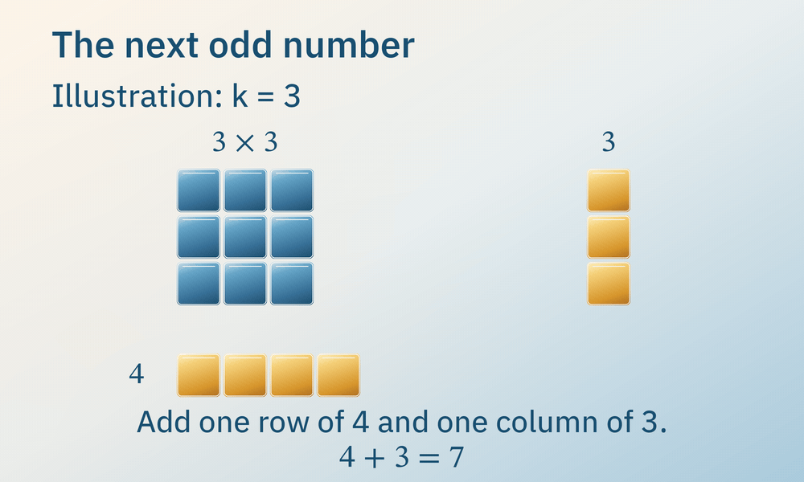
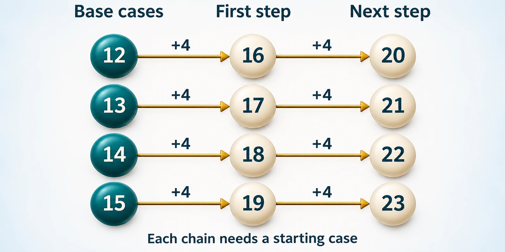

---
{
  "title": "Chapter 5: Induction",
  "subtitle": "Discrete Mathematics · Rey Joseph Nieto",
  "description": "Chapter 5: Induction. HTML edition of Lecture Notes in Discrete Mathematics.",
  "canonical-url": "https://rjnieto.com/teaching/notes/chapter-05/",
  "header-includes": "<meta name=\"robots\" content=\"index, follow, max-image-preview:large\">\n<meta property=\"og:url\" content=\"https://rjnieto.com/teaching/notes/chapter-05/\">\n<meta property=\"og:type\" content=\"article\">",
  "image": "/teaching/bulsu/discrete-math/images/thumbnails/chapter_05.webp",
  "body-classes": "ds-lecture-notes",
  "toc": true,
  "toc-depth": 2,
  "number-sections": false,
  "format": {
    "html": {
      "css": [
        "/assets/css/discrete-notes.css"
      ]
    }
  },
  "execute": {
    "eval": false
  },
  "resources": [
    "../assets/chapter-05/01-next-odd-border.gif",
    "../assets/chapter-05/01-next-odd-border-poster.png",
    "../assets/chapter-05/01-next-odd-border.webp"
  ]
}
---

<!-- Generated from the corresponding chapter LaTeX. Run scripts/build-discrete-html.py to refresh. -->

[Course page](/teaching/){.btn .btn-outline-secondary .btn-sm} [PDF](/teaching/bulsu/discrete-math/lecture-notes/chapter_05.pdf){.btn .btn-outline-primary .btn-sm aria-label="Open Chapter 5: Induction as PDF"}

[]{#ch5:chapter label="ch5:chapter"}

Add the first few positive odd integers: $$1=1^2,\qquad 1+3=2^2,\qquad 1+3+5=3^2.$$ The next sum is $1+3+5+7=16=4^2$. These calculations suggest that the sum of the first $n$ positive odd integers is always $n^2$. How could we prove a claim about a sum whose number of terms changes with $n$?

Suppose the sum of the first $k$ odd integers really is $k^2$. The next odd integer is $2k+1$. Adding it would give $k^2+(2k+1)=(k+1)^2$, exactly the next square. We have found a way to pass from one case to the next. We also know where to begin: the one-term sum is $1=1^2$.

This is the idea of **mathematical induction**. Chapters 3 and 4 taught us to state assumptions carefully and justify a conclusion from them. In an induction proof, the main implication explains how an established case leads to a later one. A starting case allows that implication to begin doing its work.

We will study ordinary, or weak, induction and strong induction together. They differ in which earlier cases the inductive hypothesis makes available. Both have the same proving power. Choosing a useful hypothesis and checking its range will matter more than the name.

:::: {.ds-box .ds-learningoutcomes}
::: {#what-you-should-be-able-to-do .ds-box-title}
**What you should be able to do**
:::

After working through this chapter, you should be able to:

- state the claim $P(n)$ and its first permitted index;

- distinguish a base case, an inductive hypothesis and the next target;

- construct ordinary induction proofs of elementary identities, divisibility claims and inequalities;

- use strong induction when a proof needs earlier cases beyond the immediately preceding one;

- justify every earlier index used and check enough starting cases;

- explain why the two induction principles have equivalent proving power;

- diagnose missing bases, circular assumptions and steps that skip required indices.
::::

## 5.1 Indexed claims {#ch5:indexed}

We use $P(n)$ for a statement depending on an integer index $n$. The goal is to prove $P(n)$ for every integer $n\geq n_0$, where $n_0\in\mathbb{N}$ is a stated starting index. Recall that $\mathbb{N}=\{0,1,2,\ldots\}$ in these notes. A particular claim may begin at $1$, $3$ or another index without changing this convention.

For the opening claim, $P(n)$ is $$1+3+\cdots+(2n-1)=n^2,\qquad n\geq1.$$ The left side means the sum of the first $n$ positive odd integers. For $n=1$, it has just the term $1$. The dots indicate the intervening odd integers when there are more terms.

[**Example 5.1.**]{#example-5.1.} For this $P(n)$, the statements at $k$ and $k+1$ are $$\begin{aligned}
 P(k):\quad &1+3+\cdots+(2k-1)=k^2,\\
 P(k+1):\quad &1+3+\cdots+(2k-1)+(2k+1)=(k+1)^2.
\end{aligned}$$ Both sides change when the index changes. The last term at index $k+1$ is $2(k+1)-1=2k+1$, and the proposed value of that longer sum is $(k+1)^2$.

Writing down $P(k+1)$ identifies the target. It does not give us permission to assume that the displayed equation is true. In the proof, we will start with the shorter sum whose value the hypothesis supplies, then add the new term.

## 5.2 Ordinary (weak) induction {#ch5:weak}

:::: {.ds-box .ds-definition}
::: {#definition-5.1-the-principle-of-ordinary-induction .ds-box-title}
**Definition 5.1: The principle of ordinary induction**
:::

Let $P(n)$ be a claim for integer indices $n\geq n_0$, with $n_0\in\mathbb{N}$. To prove it for all these indices, establish:

1.  **Base case:** prove $P(n_0)$.

2.  **Inductive step:** for an arbitrary integer $k\geq n_0$, assume $P(k)$ and prove $P(k+1)$.

Then $P(n)$ holds for every integer $n\geq n_0$. The assumption $P(k)$ within the step is the **inductive hypothesis**. This method is also called **weak induction**.
::::

The step proves an implication $P(k)\to P(k+1)$ for every permitted $k$. It uses the same direct-proof logic as earlier chapters: assume the antecedent within that argument and establish its consequence. The base case supplies an actual true statement to which this implication can first be applied.

For instance, if $n_0=1$, the base gives $P(1)$; the step with $k=1$ gives $P(2)$; the step with $k=2$ then gives $P(3)$. Any fixed later index is reached after finitely many such steps. The proof gives one argument for every transition, so we do not have to write each transition separately.

:::: {.ds-box .ds-caution}
::: {#assume-one-case-within-the-step .ds-box-title}
**Assume one case within the step**
:::

Assuming $P(k)$ to prove $P(k+1)$ does not assume that $P(n)$ already holds for every $n$. The step is a conditional argument. The base case and the proved implication together establish the universal conclusion. Assuming that conclusion at the outset would leave nothing proved.
::::

[**Example 5.2.**]{#ch5:odd-sum} Prove that $1+3+\cdots+(2n-1)=n^2$ for every integer $n\geq1$.

*Proof.* Let $P(n)$ be the stated identity.

*Base case.* At $n=1$, the sum is $1$, which equals $1^2$. Thus $P(1)$ holds.

*Inductive step.* Fix an arbitrary integer $k\geq1$ and assume $P(k)$: $1+3+\cdots+(2k-1)=k^2$. Adding the next odd integer gives $$\begin{aligned}
 1+3+\cdots+(2k-1)+(2k+1)
 &=k^2+(2k+1) &&\text{by the inductive hypothesis}\\
 &=(k+1)^2.
\end{aligned}$$ This is $P(k+1)$. By ordinary induction, the identity holds for every integer $n\geq1$. $\square$

The hypothesis was used only to replace the shorter sum by $k^2$. The remaining algebra established the new target. We did not assume the value of the longer sum.

<figure id="ch05-next-odd-border" class="ds-animation">
  <picture>
    <source media="print, (prefers-reduced-motion: reduce)" srcset="/teaching/notes/assets/chapter-05/01-next-odd-border-poster.png">
    
  </picture>
  <figcaption>At $k=3$, the next odd number supplies the seven tiles that enlarge a $3\times3$ square to $4\times4$.</figcaption>
</figure>

Choosing $k=100$ and proving one implication about that case would not establish the required step for every $k$. In the proof above, no property of $k$ was used beyond $k\geq1$ and the stated inductive hypothesis. The same step therefore works wherever it is needed.

:::: {.ds-box .ds-python}
::: {#python-non-examinable .ds-box-title}
**Python (non-examinable)**
:::

We can calculate the first five odd-integer sums alongside the proposed squares. The variable `total` stores the running sum; `range(1, 6)` supplies the indices $1,2,3,4,5$, stopping before $6$. In Python, `**` denotes a power.

``` python
total = 0
for n in range(1, 6):
    total = total + (2 * n - 1)
    print(n, total, n ** 2)
```

**Output.**

``` text
1 1 1
2 4 4
3 9 9
4 16 16
5 25 25
```

The columns give $n$, the calculated sum and $n^2$. These five checks illustrate the identity. The induction proof above establishes it for every permitted $n$; the finite calculation does not.
::::

## 5.3 Sums, divisibility and inequalities {#ch5:applications}

Induction becomes useful when the expression at the next index can be related to the current one. A sum gains a term; a power gains a factor; a polynomial can be expanded to expose the previous expression.

:::: {.ds-box .ds-definition}
::: {#definition-5.2-finite-summation-notation .ds-box-title}
**Definition 5.2: Finite summation notation**
:::

The symbol $\sum$ means that the indicated terms are added. For integers $0\leq r\leq s$, if $a_j$ denotes the term labelled by the index $j$, then $$\sum_{j=r}^{s}a_j=a_r+a_{r+1}+\cdots+a_s.$$ The lower limit gives the first index and the upper limit the last. If $r=s$, there is just one term. Throughout these examples the limits include both endpoints.
::::

[**Example 5.3.**]{#example-5.3.} We have $$\sum_{j=1}^{4}(2j+1)=3+5+7+9=24.$$ The first three terms give $\sum_{j=1}^{3}(2j+1)=15$; the term added when the upper limit becomes $4$ is $2(4)+1=9$. In general, for $k\geq1$, $$\sum_{j=1}^{k+1}(2j+1)
 =\sum_{j=1}^{k}(2j+1)+\bigl(2(k+1)+1\bigr).$$ The summation index is $j$, leaving $k$ to name the current upper limit. In contrast, $\sum_{j=0}^{0}2^j$ has one term, $2^0=1$; it is not an empty sum.

[**Example 5.4.**]{#ch5:power-sum} Prove that, for every $n\in\mathbb{N}$, $$\sum_{j=0}^{n}2^j=2^{n+1}-1.$$

*Proof.* Let $P(n)$ be this identity.

*Base case.* At $n=0$, the left side is $2^0=1$ and the right side is $2^1-1=1$.

*Inductive step.* Let $k\geq0$ be an integer and suppose $\sum_{j=0}^{k}2^j=2^{k+1}-1$. Then $$\begin{aligned}
 \sum_{j=0}^{k+1}2^j
 &=\left(\sum_{j=0}^{k}2^j\right)+2^{k+1}\\
 &=(2^{k+1}-1)+2^{k+1} &&\text{by the inductive hypothesis}\\
 &=2\cdot2^{k+1}-1\\
 &=2^{k+2}-1.
\end{aligned}$$ Since $k+2=(k+1)+1$, this is the right side required by $P(k+1)$. Induction proves the claim for all $n\in\mathbb{N}$. $\square$

At index $n$, this sum has $n+1$ terms because it starts at $0$. Writing the next target first helps prevent replacing its exponent by the wrong expression.

[**Example 5.5.**]{#ch5:power-divisibility} Prove that $7\mid(8^n-1)$ for every $n\in\mathbb{N}$. Recall that divisibility requires an integer witness, and that $7\mid0$ is allowed.

*Proof.* Let $P(n)$ be the claim $7\mid(8^n-1)$.

*Base case.* For $n=0$, $8^0-1=0=7(0)$.

*Inductive step.* Fix an integer $k\geq0$ and assume $P(k)$. Then $8^k-1=7q$ for some $q\in\mathbb{Z}$. Rewrite the next expression as $$\begin{aligned}
 8^{k+1}-1
 &=8(8^k-1)+7\\
 &=8(7q)+7\\
 &=7(8q+1).
\end{aligned}$$ The number $8q+1$ is an integer, so $7\mid(8^{k+1}-1)$. This proves $P(k+1)$. Hence $P(n)$ holds for every $n\in\mathbb{N}$ by induction. $\square$

The first rewrite made $8^k-1$ appear, allowing the hypothesis to be used. The witness for the next case was then constructed from the witness for the current one.

[**Example 5.6.**]{#example-5.6.} Prove that $3\mid(n^3-n)$ for all $n\in\mathbb{N}$.

*Proof.* Let $P(n)$ be the stated divisibility claim. At $n=0$, $n^3-n=0$, which is divisible by $3$.

For the inductive step, fix $k\geq0$ and suppose $k^3-k=3q$ for an integer $q$. Expanding gives $$\begin{aligned}
 (k+1)^3-(k+1)
 &=k^3+3k^2+3k+1-k-1\\
 &=(k^3-k)+3k(k+1)\\
 &=3\bigl(q+k(k+1)\bigr).
\end{aligned}$$ Since $q+k(k+1)$ is an integer, the next expression is divisible by $3$. The base case and step establish $P(n)$ for every $n\in\mathbb{N}$. $\square$

Here the expression supplied by the hypothesis was obtained by expanding and regrouping. There is no requirement that it appear unchanged before we begin the algebra.

[**Example 5.7.**]{#example-5.7.} Prove that $3^n\geq2n+1$ for all $n\in\mathbb{N}$.

*Proof.* The base case $n=0$ gives $1\geq1$. For an arbitrary integer $k\geq0$, assume $3^k\geq2k+1$. Then $$\begin{aligned}
 3^{k+1}
 &=3\cdot3^k\\
 &\geq3(2k+1) &&\text{by the hypothesis, multiplying by }3>0\\
 &=6k+3\\
 &\geq2k+3 &&\text{since }4k\geq0\\
 &=2(k+1)+1.
\end{aligned}$$ This is the required next inequality. By induction, the claim holds for all $n\in\mathbb{N}$. $\square$

We did not need equality at the intermediate steps. We needed estimates in the direction that gives the target lower bound.

[**Example 5.8.**]{#example-5.8.} Prove that $2^n>n+2$ for every integer $n\geq3$. The claim is false at $n=2$, where it would say $4>4$.

*Proof.* Let $P(n)$ be $2^n>n+2$, with domain $n\geq3$. The base case is $P(3)$: $8>5$.

Fix an integer $k\geq3$ and assume $2^k>k+2$. Then $$2^{k+1}=2\cdot2^k>2(k+2)=2k+4>k+3=(k+1)+2,$$ where $2k+4>k+3$ follows from $k+1>0$. Thus $P(k+1)$ holds. Induction proves the claim for all integers $n\geq3$. $\square$

The proof starts at $3$ because that is the first index in its claim. It does not need $P(0)$, $P(1)$ or $P(2)$.

## 5.4 Strong induction {#ch5:strong}

Ordinary induction makes $P(k)$ available when proving $P(k+1)$. Sometimes the useful reduction leads to a case further back. Strong induction allows all the earlier cases within the claimed range to be used.

:::: {.ds-box .ds-definition}
::: {#definition-5.3-the-principle-of-strong-induction .ds-box-title}
**Definition 5.3: The principle of strong induction**
:::

Let $P(n)$ be a claim for integers $n\geq n_0$, with $n_0\in\mathbb{N}$. Choose a final base index $r\geq n_0$ and establish:

1.  **Base case or cases:** prove every case $P(n_0),P(n_0+1),\ldots,P(r)$.

2.  **Inductive step:** for an arbitrary integer $k\geq r$, assume $P(j)$ for every integer $j$ with $n_0\leq j\leq k$, and prove $P(k+1)$.

Then $P(n)$ holds for every integer $n\geq n_0$. If only one base case is needed, take $r=n_0$.
::::

The stronger hypothesis still stops before the target. It includes $P(k)$ and any earlier case in the range; it does not include $P(k+1)$. The base cases must make the first use of the general step possible. Their number depends on which earlier indices the argument needs.

[**Example 5.9.**]{#example-5.9.} Suppose the strong inductive hypothesis is that $P(j)$ holds for every integer $j$ with $3\leq j\leq k$, where $k\geq5$. Then $P(3)$ and $P(k)$ are available. So is $P(k-2)$: the inequality $k\geq5$ gives $k-2\geq3$, and certainly $k-2\leq k$.

The hypothesis does not supply $P(2)$, which is below its range. It does not supply $P(k+1)$, which is the target beyond that range. These statements might have truth values for other reasons, but they are not assumptions licensed by this hypothesis.

[**Example 5.10.**]{#ch5:blocks} In a mathematical model of message construction, a block has length $4$ or $5$ units. Blocks can be joined, but not split. Prove that every integer length $n\geq12$ can be formed. Equivalently, prove that $n=4a+5b$ for some $a,b\in\mathbb{N}$.

Adding a $4$-unit block constructs the target from a length $4$ smaller. This suggests using an earlier case and checking enough starting lengths to leave no gap.

*Proof.* Let $P(n)$ mean that $n=4a+5b$ for some $a,b\in\mathbb{N}$.

*Base cases.* The four lengths $12,13,14,15$ can be formed: $$\begin{aligned}
 12&=4(3)+5(0),&13&=4(2)+5(1),\\
 14&=4(1)+5(2),&15&=4(0)+5(3).
\end{aligned}$$

*Inductive step.* Fix an arbitrary integer $k\geq15$ and assume $P(j)$ for every integer $12\leq j\leq k$. To form length $k+1$, consider the earlier length $k-3$. Its index satisfies $12\leq k-3\leq k$, so the hypothesis gives $k-3=4a+5b$ for some $a,b\in\mathbb{N}$. Adding a $4$-unit block yields $$k+1=(k-3)+4=4(a+1)+5b.$$ Both $a+1$ and $b$ are natural numbers. Thus $P(k+1)$ holds. Strong induction proves the claim for every integer $n\geq12$. $\square$

The first new length covered by the step is $16$, obtained from $12$. The same step gives $17$ from $13$, $18$ from $14$ and $19$ from $15$. Checking only $12$ would start one of these chains and leave the others without a starting case. For a later target such as $23$, the proof can use the already available length $19$.

{.ds-note-image fig-alt="Four starting cases extending along separate chains, illustrating an induction step of size four." loading="lazy" decoding="async"}

Adding $4$ advances each chain; the bases $12$, $13$, $14$ and $15$ start all four.

## 5.5 Recursive rules {#ch5:recursive}

A **sequence** is a list of values labelled by integer indices. Here $a_n$ means the value at index $n$; it does not mean $a$ multiplied by $n$. A **recursive rule** specifies a new value using earlier values. Initial values tell us where to start. We will study sequences systematically in Chapter 11; the particular rule below needs only these conventions.

Define integer values by $$a_0=1,\qquad a_1=3,\qquad
 a_{n+2}=2a_{n+1}-a_n\quad(n\geq0).$$ The first two values are specified separately. The rule gives $a_2=2(3)-1=5$ and then $a_3=2(5)-3=7$. It uses two earlier values each time. Twice one earlier integer minus the other is again an integer.

[**Example 5.11.**]{#ch5:two-term} Prove that the values defined above satisfy $a_n=2n+1$ for every $n\in\mathbb{N}$.

*Proof.* Let $P(n)$ be $a_n=2n+1$.

*Base cases.* At $n=0$, $a_0=1=2(0)+1$. At $n=1$, $a_1=3=2(1)+1$.

*Inductive step.* Fix an integer $k\geq1$ and assume $P(j)$ for every $0\leq j\leq k$. In particular, $a_k=2k+1$ and $a_{k-1}=2(k-1)+1$. Both uses are permitted because $0\leq k-1\leq k$. Substituting $n=k-1\geq0$ into the recursive rule gives $$\begin{aligned}
 a_{k+1}
 &=2a_k-a_{k-1}\\
 &=2(2k+1)-\bigl(2(k-1)+1\bigr)\\
 &=4k+2-(2k-1)\\
 &=2k+3\\
 &=2(k+1)+1.
\end{aligned}$$ Thus $P(k+1)$ holds. Strong induction proves $a_n=2n+1$ for all $n\in\mathbb{N}$. $\square$

The step uses $P(k)$ and $P(k-1)$, although the hypothesis makes every earlier case available. It need not use all of them. At its first permitted value $k=1$, the step establishes $P(2)$ from the two checked bases. No value at index $-1$ is needed.

## 5.6 Choice of hypothesis {#ch5:choosing}

The names "weak" and "strong" describe the hypotheses used in the step. Strong induction gives more earlier cases at once, but does not prove a larger collection of statements about the natural numbers. Both principles can be used to obtain the other.

Ordinary induction is available within strong induction because the strong hypothesis includes $P(k)$. If that is all the step needs, the other earlier cases may simply remain unused.

For the other direction, suppose we have the bases and step of a strong induction argument, with indices beginning at $n_0$ and last base index $r$. Define $Q(k)$ to say: $$P(j)\text{ holds for every integer }j\text{ with }n_0\leq j\leq k.$$ The checked bases establish $Q(r)$. For an arbitrary integer $k\geq r$, assuming $Q(k)$ supplies exactly the earlier cases needed by the strong step, so that step proves $P(k+1)$. Together with $Q(k)$, the new case gives $Q(k+1)$. Ordinary induction applied to $Q$ therefore establishes all the required $P$ cases. This is why strengthening the claim used in ordinary induction can reproduce a strong induction proof.

[**Example 5.12.**]{#example-5.12.} Use the same values $a_n$ from Example [5.11](#ch5:two-term). Instead of assuming only one formula, let $Q(k)$ be the paired claim $$a_k=2k+1\quad\text{and}\quad a_{k+1}=2k+3.$$ We can prove $Q(k)$ by ordinary induction.

*Proof.* At $k=0$, both parts hold because $a_0=1$ and $a_1=3$. For an arbitrary $k\geq0$, suppose $Q(k)$ holds. Then $$a_{k+2}=2a_{k+1}-a_k
        =2(2k+3)-(2k+1)=2k+5.$$ We already know $a_{k+1}=2k+3=2(k+1)+1$. The new equality is $a_{k+2}=2(k+1)+3$. These are precisely the two parts of $Q(k+1)$. Ordinary induction proves $Q(k)$ for every $k\in\mathbb{N}$, and hence $a_n=2n+1$ for every $n\in\mathbb{N}$. $\square$

The paired claim carries forward the old second value and establishes the new second value. The arithmetic has not become more powerful; we have organised the information differently.

For a sum whose next term is added to the previous sum, ordinary induction usually provides enough information. For the two-value rule, we needed two earlier formulas. For the block construction, we needed a case four indices before the target.

::: ds-table
  Example              Earlier information used                        Convenient approach
  -------------------- ----------------------------------------------- -----------------------------------------------------------
  Odd-integer sum      The sum at $k$.                                 Ordinary induction.
  Two-value rule       The formulas at $k$ and $k-1$.                  Strong induction, or an ordinary proof of a paired claim.
  Block construction   The representation at $k-3$ for target $k+1$.   Strong induction with four starting cases.
:::

Whichever version we choose, write the target first, identify the earlier indices needed and verify that the hypothesis actually includes them.

[**Example 5.13.**]{#example-5.13.} For $n\in\mathbb{N}$, the number $n(n+1)$ is even. If $n$ is even, its product with the integer $n+1$ is even. If $n$ is odd, write $n=2q+1$ with $q\in\mathbb{Z}$. Then $n+1=2(q+1)$ is even, so the product is again even. The parity alternatives cover every permitted $n$, establishing the claim directly.

Induction is useful when a transition between indices supplies a manageable proof. It is one method to consider alongside the direct and indirect methods of the earlier chapters.

## 5.7 Errors in induction {#ch5:checking}

Check the base cases and the step as separate obligations. Within the step, check its direction, the exact hypothesis used and the index of the case it first establishes.

[**Example 5.14.**]{#example-5.14.} Consider $P(n)$: $n+1\leq n$, for $n\in\mathbb{N}$. If we temporarily assume $P(k)$, adding $1$ to both sides gives $k+2\leq k+1$, which is $P(k+1)$. Thus the transition implication is valid.

The universal claim is still false. Its proposed base $P(0)$ would be $1\leq0$, which is false. A proved implication does not establish its antecedent. There is no true starting case here from which the argument can begin.

[**Example 5.15.**]{#example-5.15.} David claims that every natural number is even. He checks that $0$ is even and observes that if $k$ is even, then $k+2$ is even.

Both facts are correct, but the step advances from $k$ to $k+2$, not to $k+1$. Starting from $0$, it reaches $0,2,4,6,\ldots$, leaving the odd indices untouched. The permitted input $1$ refutes David's universal claim. An induction argument must cover all the indices in its conclusion.

[**Example 5.16.**]{#example-5.16.} While trying to prove $7\mid(8^{k+1}-1)$, Grace writes: "Let $8^{k+1}-1=7r$ for an integer $r$. Therefore $7\mid(8^{k+1}-1)$."

The supposed integer $r$ already asserts exactly the target divisibility claim. Its existence has not been established. The available hypothesis supplies an integer $q$ with $8^k-1=7q$, not a witness for the next exponent. Example [5.5](#ch5:power-divisibility) repairs the argument by constructing $r=8q+1$ and checking the required equation.

[**Example 5.17.**]{#example-5.17.} In Example [5.11](#ch5:two-term), the step uses $P(k-1)$. Starting that step at $k=0$ would require $P(-1)$, outside the range of the claim and of the defined values. Checking $P(0)$ alone would not fix this.

Instead, we checked $P(0)$ and $P(1)$, then began the general step at $k=1$. Its first target is $P(2)$, and both cases it uses are available. For any proposed step, substitute its smallest permitted $k$ before relying on the general notation.

## 5.8 Exercises {#ch5:exercises}

::: {.ds-exercises style="--ds-chapter: '5';"}
1.  []{#ch5ex:claim label="ch5ex:claim"} Let $P(n)$ be the claim $2+4+\cdots+2n=n(n+1)$, for integers $n\geq1$.

    a)  State and verify its first case.

    b)  Write $P(k)$ and $P(k+1)$, including the last term and right side in each.

    c)  Which equation is assumed and which must be proved in an ordinary inductive step?

2.  []{#ch5ex:samples label="ch5ex:samples"} Eve checks $n=0,1,\ldots,9$ in the claim $n<10$ and concludes that it holds for every $n\in\mathbb{N}$.

    a)  Give a counterexample to her conclusion.

    b)  Has she proved a transition from an arbitrary permitted index to the next one? Explain.

3.  []{#ch5ex:reach label="ch5ex:reach"} Suppose $P(3)$ has been proved, together with $P(k)\to P(k+1)$ for every integer $k\geq3$. Which statements below are guaranteed by these facts? Explain the range of the conclusion.

    a)  $P(2)$.

    b)  $P(3)$.

    c)  $P(8)$.

    d)  $P(100)$.

4.  []{#ch5ex:guided-sum label="ch5ex:guided-sum"} Prove the claim from Exercise [5.1](#ch5ex:claim). After stating the hypothesis for an arbitrary integer $k\geq1$, complete the calculation $$\begin{aligned}
     2+4+\cdots+2k+2(k+1)
     &=\underline{\hspace{2cm}}+2(k+1)\\
     &=(k+1)\bigl(\underline{\hspace{1.3cm}}\bigr)\\
     &=(k+1)(k+2).
    \end{aligned}$$ Identify the line using the hypothesis, check the base case and state the final conclusion.

5.  []{#ch5ex:sums label="ch5ex:sums"} Use ordinary induction in each part. Write the next target before beginning the step.

    a)  For integers $n\geq1$, $\displaystyle\sum_{j=1}^{n}(3j-1)=\frac{n(3n+1)}2$.

    b)  For $n\in\mathbb{N}$, $\displaystyle\sum_{j=0}^{n}3^j=\frac{3^{n+1}-1}{2}$.

6.  []{#ch5ex:power-divisibility label="ch5ex:power-divisibility"} Prove by ordinary induction that $4\mid(9^n-1)$ for all $n\in\mathbb{N}$. In the step, construct the new witness explicitly from the integer supplied by the inductive hypothesis.

7.  []{#ch5ex:polynomial label="ch5ex:polynomial"} Prove by ordinary induction that $2\mid(n^2-n)$ for every $n\in\mathbb{N}$. Show how $(k+1)^2-(k+1)$ can be written using $k^2-k$ and an additional even quantity.

8.  []{#ch5ex:inequality label="ch5ex:inequality"} Prove by ordinary induction that $2^n\geq n+1$ for every $n\in\mathbb{N}$. Justify the estimate used after applying the hypothesis.

9.  []{#ch5ex:later-start label="ch5ex:later-start"} Show that $2^n>2n$ fails at $n=2$ but holds at $n=3$. Then prove by ordinary induction that it holds for every integer $n\geq3$. State the permitted range of $k$ in the step.

10. []{#ch5ex:next-sum label="ch5ex:next-sum"} Suppose the inductive hypothesis is $\sum_{j=0}^{k}3^j=(3^{k+1}-1)/2$.

    a)  Write the exact equation required at index $k+1$.

    b)  Which single term is added to the sum in the hypothesis?

    c)  How many terms occur in the sum at index $k+1$?

11. []{#ch5ex:available label="ch5ex:available"} Assume $P(j)$ for every integer $4\leq j\leq k$, with $k\geq7$. Let $m$ be an integer satisfying $4\leq m<k$. Which statements below are guaranteed to be within the hypothesis for every permitted choice of $k,m$? Justify the index bounds.

    a)  $P(m)$.

    b)  $P(m+1)$.

    c)  $P(k-4)$.

    d)  $P(k+1)$.

12. []{#ch5ex:bases label="ch5ex:bases"} You want to prove $P(n)$ for every integer $n\geq4$. Your proposed strong-induction step proves $P(k+1)$ using $P(k-2)$.

    a)  What is the smallest value of $k$ for which $k-2$ is in the claimed range?

    b)  Which consecutive base cases must be checked before that step begins?

    c)  Identify the first three new target indices and the earlier index used for each.

13. []{#ch5ex:blocks label="ch5ex:blocks"} A model allows blocks of length $3$ or $5$ units, joined without splitting. Prove by strong induction that every integer length $n\geq8$ can be formed.

    a)  Express $8,9,10$ as $3a+5b$ with $a,b\in\mathbb{N}$.

    b)  For target $k+1$ with $k\geq10$, identify the earlier length obtained by subtracting $3$, and check its index range.

    c)  Complete the inductive step and state why the three base cases cover the first uses of your construction.

14. []{#ch5ex:recursive-formula label="ch5ex:recursive-formula"} Define $$b_0=0,\qquad b_1=2,\qquad
     b_{n+2}=3b_{n+1}-2b_n\quad(n\geq0).$$ Prove by strong induction that $b_n=2^{n+1}-2$ for all $n\in\mathbb{N}$.

    a)  Check the two starting cases.

    b)  State a hypothesis that supplies the formulas for $b_k$ and $b_{k-1}$, with a valid lower bound on $k$.

    c)  Use the recursive rule to establish the formula for $b_{k+1}$ and conclude the proof.

15. []{#ch5ex:recursive-bound label="ch5ex:recursive-bound"} Let $c_0=c_1=1$ and $c_{n+2}=c_{n+1}+c_n$ for $n\geq0$. Prove by strong induction that $c_n\leq2^n$ for all $n\in\mathbb{N}$. Check both bases and show why the two earlier bounds imply the bound at $k+1$.

16. []{#ch5ex:recursive-parity label="ch5ex:recursive-parity"} Define integers by $d_0=1$, $d_1=3$ and $d_{n+2}=d_{n+1}+d_n+1$ for $n\geq0$. Prove by strong induction that every $d_n$ is odd. In the step, use separate integer witnesses for the two earlier odd values and identify the new witness.

17. []{#ch5ex:equivalence label="ch5ex:equivalence"}

    a)  Compare the hypotheses available when proving $P(k+1)$ by ordinary and strong induction.

    b)  Explain why a stronger hypothesis does not give the principle greater proving power here. Describe the combined claim $Q(k)$ that lets ordinary induction retain all earlier $P$ cases.

    c)  Does a strong-induction proof have to use every earlier case in its hypothesis? Explain.

18. []{#ch5ex:paired label="ch5ex:paired"} For the values $b_n$ in Exercise [5.14](#ch5ex:recursive-formula), let $Q(k)$ state both $b_k=2^{k+1}-2$ and $b_{k+1}=2^{k+2}-2$. Describe an ordinary induction proof of $Q(k)$ for $k\in\mathbb{N}$. Give its base, its hypothesis and its next target, and explain which equality is retained and which must be newly established. A full algebraic calculation is not required.

19. []{#ch5ex:no-base label="ch5ex:no-base"} A student claims $5\mid2^n$ for every $n\in\mathbb{N}$. In the step, they assume $2^k=5q$ for an integer $q$ and derive $2^{k+1}=5(2q)$.

    a)  Is the step's conditional argument valid?

    b)  Check the proposed base $n=0$. Is the universal claim true?

    c)  Explain why the valid conditional does not establish the claim by induction.

20. []{#ch5ex:skipped label="ch5ex:skipped"} For a family of claims $P(n)$ on $\mathbb{N}$, a student establishes $P(0)$ and $P(k)\to P(k+2)$ for all $k\in\mathbb{N}$.

    a)  Which indices can be reached from the proved base?

    b)  What additional base would be needed to reach the remaining indices using the same step?

    c)  Suppose $P(n)$ means "$n$ is even". Can that additional base be verified? What conclusion is actually justified?

21. []{#ch5ex:circular label="ch5ex:circular"} In a proposed step for $4\mid(9^n-1)$, the hypothesis is $9^k-1=4q$ for an integer $q$. The student writes:

    > Let $r=(9^{k+1}-1)/4$. Then $9^{k+1}-1=4r$, so the target is divisible by $4$.

    a)  What property of $r$ remains unjustified?

    b)  Use the hypothesis to construct an integer witness for the next case and repair the step.

22. []{#ch5ex:gap label="ch5ex:gap"} Let $u_0=2$, $u_1=4$ and $u_{n+2}=u_{n+1}+2u_n$ for $n\geq0$. To prove $u_n=2^{n+1}$, a proposed argument checks $n=0,1$, then begins its general step at $k\geq2$:

    > Assume $u_j=2^{j+1}$ for all $0\leq j\leq k$. Then $u_{k+1}=u_k+2u_{k-1}
    >  =2^{k+1}+2\cdot2^k=2^{k+2}$.

    a)  What is the first target index covered by the stated step? Which case between the bases and that target has not been checked?

    b)  Show that the general step can start earlier. Check the indices it uses at its first permitted value.

    c)  Complete the corrected induction proof.

23. []{#ch5ex:choose label="ch5ex:choose"} For each claim, choose ordinary induction, strong induction or a short direct proof. Give a reason and the useful starting assumption or assumptions. More than one method may work.

    a)  $3\mid(6n+9)$ for every $n\in\mathbb{N}$.

    b)  $\sum_{j=1}^{n}2j=n(n+1)$ for every integer $n\geq1$.

    c)  The formula for $b_n$ in Exercise [5.14](#ch5ex:recursive-formula).

24. []{#ch5ex:score label="ch5ex:score"} A model begins with total $t_0=3$. At step $n+1$ it adds $2(n+1)$, so $$t_{n+1}=t_n+2(n+1)\qquad(n\geq0).$$ Prove that $t_n=n(n+1)+3$ for all $n\in\mathbb{N}$. State your induction method, verify its base and show how the update rule turns the hypothesis into the next target.
:::

::: {.ds-chapter-navigation}

[← Chapter 4](../chapter-04/index.qmd)
[Next chapter →](../chapter-06/index.qmd){.btn .btn-primary rel="next" aria-label="Next chapter: Chapter 6 (HTML)"}

:::
