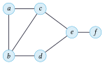
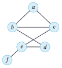
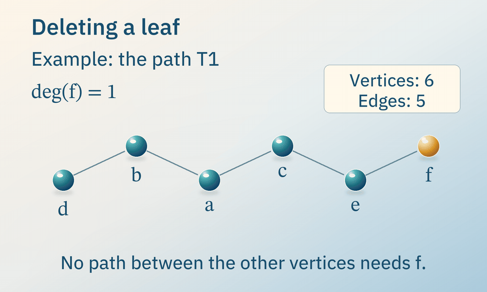
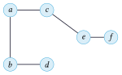
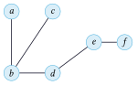
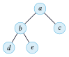
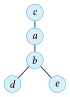

---
{
  "title": "Chapter 6: Graphs",
  "subtitle": "Discrete Mathematics · Rey Joseph Nieto",
  "description": "Chapter 6: Graphs. HTML edition of Lecture Notes in Discrete Mathematics.",
  "canonical-url": "https://rjnieto.com/teaching/notes/chapter-06/",
  "header-includes": "<meta name=\"robots\" content=\"index, follow, max-image-preview:large\">\n<meta property=\"og:url\" content=\"https://rjnieto.com/teaching/notes/chapter-06/\">\n<meta property=\"og:type\" content=\"article\">",
  "image": "/teaching/bulsu/discrete-math/images/thumbnails/chapter_06.webp",
  "body-classes": "ds-lecture-notes",
  "toc": true,
  "toc-depth": 2,
  "number-sections": false,
  "format": {
    "html": {
      "css": [
        "/assets/css/discrete-notes.css"
      ]
    }
  },
  "execute": {
    "eval": false
  },
  "resources": [
    "../assets/chapter-06/01-leaf-deletion.gif",
    "../assets/chapter-06/01-leaf-deletion-poster.png",
    "../assets/chapter-06/01-leaf-deletion.webp"
  ]
}
---

<!-- Generated from the corresponding chapter LaTeX. Run scripts/build-discrete-html.py to refresh. -->

[Course page](/teaching/){.btn .btn-outline-secondary .btn-sm} [PDF](/teaching/bulsu/discrete-math/lecture-notes/chapter_06.pdf){.btn .btn-outline-primary .btn-sm aria-label="Open Chapter 6: Graphs as PDF"}

[]{#ch6:chapter label="ch6:chapter"}

A message can travel between two computers even when they have no direct link: other computers may pass it along. If one link fails, another route might remain. Which connections are essential, and which provide an alternative route?

To study these questions, we can represent each computer by a vertex and each direct two-way link by an edge. The resulting mathematical object is a **graph**. We record which pairs are linked; the positions of the computers on a page do not determine their connections.

This uses Chapter 4's sets and relationships in a concrete setting. It also gives Chapter 5's induction a new job. Instead of proving a formula about one number at each index, we will prove a claim about every tree with a given number of vertices. The inductive step will depend on reducing an arbitrary tree to a smaller one.

:::: {.ds-box .ds-learningoutcomes}
::: {#what-you-should-be-able-to-do .ds-box-title}
**What you should be able to do**
:::

After working through this chapter, you should be able to:

- specify a simple graph and read its drawings and neighbour lists;

- calculate degrees and use the degree-sum formula;

- distinguish walks, paths and cycles, and justify connectedness;

- recognise trees and explain their unique-path property;

- use leaf deletion and induction to prove the tree edge count;

- construct and check spanning trees;

- interpret roots, parents, children, depths and rooted leaves.
::::

## 6.1 Graph representations {#ch6:graphs}

:::: {.ds-box .ds-definition}
::: {#definition-6.1-finite-simple-undirected-graph .ds-box-title}
**Definition 6.1: Finite simple undirected graph**
:::

A **graph** $G=(V,E)$ consists of a finite nonempty set $V$ of **vertices** and a set $E$ of **edges**, each a two-element subset of $V$. Two vertices are **adjacent**, or **neighbours**, when their pair is an edge. An edge is **incident** to each of its two endpoints.
::::

All graphs in this chapter are of this kind. An edge $\{u,v\}$ has no direction because $\{u,v\}=\{v,u\}$. Its endpoints are distinct: $\{u,u\}=\{u\}$ has only one element and is not allowed as an edge. Since $E$ is a set, listing the same pair twice does not create a second edge.

For a finite set $S$, the notation $|S|$ means its number of elements. We will often write $n=|V|$ for the number of vertices and $m=|E|$ for the number of edges. The set $E$ may be empty even though $V$ must be nonempty.

[**Example 6.1.**]{#ch6:network} Use the following fixed graph $G$ in the worked examples unless another graph is specified: $$\begin{aligned}
 V&=\{a,b,c,d,e,f\},\\
 E&=\{\{a,b\},\{a,c\},\{b,c\},\{b,d\},\{c,e\},\{d,e\},\{e,f\}\}.
\end{aligned}$$ There are six vertices and seven edges. Each drawing below represents exactly these sets.

{.ds-note-image fig-alt="Drawing 1: a graph on vertices a to f with edges ab, ac, bc, bd, ce, de and ef." loading="lazy" decoding="async"}

*Drawing 1*

{.ds-note-image fig-alt="Drawing 2: the same labelled graph rearranged; a crossing of edges does not create a vertex." loading="lazy" decoding="async"}

*Drawing 2*

In Drawing 2, the edges $\{b,d\}$ and $\{c,e\}$ cross at a point with no vertex marked there. The crossing supplies no extra vertex and no extra connection. A message following $\{b,d\}$ cannot switch to $\{c,e\}$ at that unmarked point in this model.

Moving a labelled vertex or bending an edge does not change $G$ as long as every edge keeps the same endpoints. Conversely, two drawings with six vertices and seven edges need not represent the same graph: their actual vertex and edge sets must agree.

## 6.2 Vertex degrees {#ch6:degrees}

:::: {.ds-box .ds-definition}
::: {#definition-6.2-degree-and-isolated-vertex .ds-box-title}
**Definition 6.2: Degree and isolated vertex**
:::

The **degree** $\deg(v)$ of a vertex $v$ is the number of edges incident to it. In a simple graph, this is also the number of its neighbours. A vertex of degree $0$ is **isolated**.
::::

[**Example 6.2.**]{#example-6.2.} For the graph in Example [6.1](#ch6:network), its neighbour lists give another complete representation.

::: ds-table
   Vertex   Neighbours   Degree
  -------- ------------ --------
    $a$       $b,c$       $2$
    $b$      $a,c,d$      $3$
    $c$      $a,b,e$      $3$
    $d$       $b,e$       $2$
    $e$      $c,d,f$      $3$
    $f$        $e$        $1$
:::

For example, $c$ has degree $3$ because it is incident to $\{a,c\},\{b,c\},\{c,e\}$. The crossing in Drawing 2 does not increase its degree. Every neighbour entry must be reciprocated: if $c$ lists $e$, then $e$ lists $c$.

Adding a new vertex $g$ with no incident edges would produce a different graph. Its neighbour list would be empty and $\deg(g)=0$. A drawing or list must retain such a vertex even though it contributes no edges.

[**The degree-sum formula.**]{#the-degree-sum-formula.} Each edge has two distinct endpoints. When we add all vertex degrees, that edge is counted once at each endpoint. It therefore contributes exactly $2$ to the sum. This proves the **degree-sum formula**, also called the **handshake lemma**: $$\sum_{v\in V}\deg(v)=2|E|=2m.$$ Here $\sum_{v\in V}$ means that we add one degree for each vertex in the finite set $V$. The sum of the degrees is therefore always even.

[**Example 6.3.**]{#example-6.3.} The six degrees in the table have sum $2+3+3+2+3+1=14$. Thus $2m=14$ and $m=7$. Adding the degrees without dividing by $2$ would count each edge twice.

:::: {.ds-box .ds-python}
::: {#python-non-examinable .ds-box-title}
**Python (non-examinable)**
:::

A Python **dictionary** can associate each vertex label with its list of neighbours. The entry `"a": ["b", "c"]`, for example, records the two neighbours of $a$. Square brackets select the list for a label, and `len` counts its entries. The loop visits the labels in the order entered and adds their degrees to `total`.

``` python
neighbours = {
    "a": ["b", "c"],
    "b": ["a", "c", "d"],
    "c": ["a", "b", "e"],
    "d": ["b", "e"],
    "e": ["c", "d", "f"],
    "f": ["e"]
}
total = 0
for vertex in neighbours:
    degree = len(neighbours[vertex])
    print(vertex, degree)
    total = total + degree
print("Degree sum:", total)
```

**Output.**

``` text
a 2
b 3
c 3
d 2
e 3
f 1
Degree sum: 14
```

The lists record the same six vertices and seven edges as the drawing. Every edge occurs in both endpoints' lists, giving the degree sum $14$. This representation assumes the reciprocal, duplicate-free neighbour lists required by our simple undirected graph.
::::

[**Example 6.4.**]{#example-6.4.} Alice proposes a simple network with seven vertices, each having exactly three neighbours. The degree sum would be $7(3)=21$, but it must equal twice an integer number of edges. The proposal is impossible.

This conclusion follows from the stated connections, so no choice of positions in a drawing can repair it.

[**Example 6.5.**]{#example-6.5.} Could a simple graph on four vertices have degrees $3,3,1,1$? Their sum is $8$, which passes the parity check. However, each degree-$3$ vertex must be adjacent to all three other vertices. In particular, each proposed degree-$1$ vertex would be adjacent to both degree-$3$ vertices, giving it degree at least $2$. This is a contradiction.

The degree-sum formula rules out some proposals. Passing that check alone does not construct a graph or prove one exists.

[**Example 6.6.**]{#example-6.6.} Prove that every graph has an even number of vertices of odd degree.

*Proof.* Suppose instead that an odd number of its vertex degrees were odd. Pair all but one of those odd degrees. Each pair has an even sum, and all the even degrees also have an even sum. The single unpaired odd degree would make the total degree sum odd. This contradicts the degree-sum formula. Therefore the number of odd-degree vertices is even. $\square$

Zero is an allowed even number here. A graph can have no odd-degree vertices.

## 6.3 Paths and connectedness {#ch6:routes}

Adjacency concerns one edge. To describe travel through several edges, we need a list of the vertices visited in order.

:::: {.ds-box .ds-definition}
::: {#definition-6.3-walk-path-and-cycle .ds-box-title}
**Definition 6.3: Walk, path and cycle**
:::

A **walk** in $G=(V,E)$ is a finite list $v_0,v_1,\ldots,v_\ell$ of vertices in $V$ in which each consecutive pair is an edge. Its **length** is the number $\ell$ of edges traversed. Vertices and edges may repeat in a walk.

A **path** is a walk with no repeated vertices. The one-vertex list $v_0$ is a path of length $0$.

A **cycle** is a closed walk of length at least $3$: its last vertex is its first, and all the vertices before that final entry are distinct.
::::

These notes reserve "path" for the no-repetition convention. A cycle is recorded separately, with its starting vertex repeated at the end. Counting the entries in a route gives one more than its length. Choosing a different starting vertex or going around in the opposite direction describes the same cycle.

[**Example 6.7.**]{#example-6.7.} In the fixed graph $G$, the list $a,b,c,a,c,e$ is a walk of length $5$. Each of its five steps follows an edge, but it is not a path because $a$ and $c$ repeat.

Remove the closed portion $a,b,c,a$ except for one occurrence of $a$. The remaining list is $a,c,e$, a path of length $2$ with the same endpoints. More generally, whenever a walk repeats a vertex, the part between two occurrences can be removed. Repeating this shortening process leaves a path between its endpoints.

[**Example 6.8.**]{#example-6.8.} The list $a,b,d,e,f$ is a path in $G$, of length $4$. The list $a,d,e$ is not even a walk because $\{a,d\}\notin E$. The list $a,b,c,a$ is a cycle of length $3$.

By contrast, $a,b,a$ is a closed walk but not a cycle: it has length $2$ and traverses the same edge out and back. Returning to the starting point alone does not establish the presence of a cycle.

:::: {.ds-box .ds-definition}
::: {#definition-6.4-connected-graph .ds-box-title}
**Definition 6.4: Connected graph**
:::

A graph is **connected** if there is a path between every pair of its vertices. Otherwise it is **disconnected**. A **connected component** is one connected piece: it contains all the vertices reachable from any one of its vertices, together with the edges between them.
::::

A single vertex with no edges is connected: its length-$0$ path connects it to itself. In a larger graph, an isolated vertex forms a component by itself.

[**Example 6.9.**]{#example-6.9.} The fixed graph $G$ is connected. From $a$, we can reach $b,c,d,e,f$ using the paths $$a,b;\quad a,c;\quad a,b,d;\quad a,c,e;\quad a,c,e,f.$$ Since edges have no direction, paths can be traversed backwards. To travel between any two vertices, we can first travel to $a$ and then to the other vertex. This gives a walk, from which repetitions can be removed to obtain a path.

Now consider instead the graph on the same six vertices with edge set $\{\{a,b\},\{c,d\},\{e,f\}\}$. Every vertex has degree $1$, but the graph has three components. There is no path from $a$ to $c$. Having a neighbour does not imply being connected to every other vertex.

## 6.4 Trees and unique paths {#ch6:trees}

:::: {.ds-box .ds-definition}
::: {#definition-6.5-tree-forest-and-degree-one-leaf .ds-box-title}
**Definition 6.5: Tree, forest and degree-one leaf**
:::

A graph is **acyclic** if it has no cycles. A **tree** is a connected acyclic graph. A **forest** is an acyclic graph; it need not be connected. In an unrooted tree, a **leaf** is a vertex of degree $1$.
::::

A graph with one vertex and no edges is a tree. Under the degree-one convention, it has no leaves. Any tree with at least two vertices has a different behaviour, which we will prove below.

[**Example 6.10.**]{#example-6.10.} Keep all six vertices of $G$, but retain only the edges $$F_1=\{\{a,b\},\{a,c\},\{b,d\},\{c,e\},\{e,f\}\}.$$ Call this graph $T_1$. Its vertices occur along the path $d,b,a,c,e,f$, and its edges are exactly the consecutive pairs in that list. Thus it is connected and has no cycle: it is a tree. Its degree-one leaves are $d$ and $f$.

[**Example 6.11.**]{#example-6.11.} On $\{a,b,c,d,e,f\}$, take the edges $\{a,b\},\{b,c\},\{d,e\},\{e,f\}$. There are two separate paths, $a,b,c$ and $d,e,f$. The graph has no cycle, so it is a forest. It is not a tree because the two components are not connected to each other.

[**Example 6.12.**]{#ch6:unique-paths} Prove that a graph is a tree if and only if every pair of distinct vertices has exactly one path between them.

*Proof.* First suppose $T$ is a tree. Connectedness provides a path between any two distinct vertices $u,v$. If there were two different paths, follow their common beginning until they first separate. The paths eventually meet again because they both end at $v$. The two branches between a separation and their next meeting give a cycle, contradicting the definition of a tree. Therefore the path is unique.

Conversely, suppose every pair of distinct vertices has exactly one path. The existence of these paths makes the graph connected. If it contained a cycle, choose two adjacent vertices on that cycle. Its edge gives one path between them, while going the other way around the cycle gives another. This contradicts uniqueness. Thus the graph has no cycles and is a tree. $\square$

For a one-vertex graph there are no distinct vertex pairs to check, and the graph is indeed a tree. For larger graphs, "exactly one" requires both existence and uniqueness.

[**Example 6.13.**]{#example-6.13.} In $G$, the paths $a,c,e$ and $a,b,d,e$ join the same endpoints. Their branches give the cycle $a,c,e,d,b,a$. The graph remains connected, but it cannot be a tree. An extra edge such as $\{b,c\}$ does not stop the listed cycle from being a cycle; its own steps and vertices satisfy the definition.

## 6.5 Leaves and induction {#ch6:edge-count}

The edge count of a tree will follow by induction on its number of vertices. Before using an inductive hypothesis, we must justify how an arbitrary tree can be reduced to a smaller tree.

[**Example 6.14.**]{#ch6:leaves} Let $T$ be a tree with at least two vertices. Prove that $T$ has at least two degree-one leaves.

*Proof.* Because $T$ is finite, there are only finitely many paths. Choose one of greatest length. It has at least one edge because $T$ is connected and has at least two vertices.

Let $u$ be one endpoint. It has the neighbour that is next along the path. Suppose it had another neighbour $w$. If $w$ were elsewhere on the path, that edge and the path back to $u$ would form a cycle. If $w$ were outside the path, we could extend the path through $w$, contradicting its greatest length. Both alternatives are impossible, so $\deg(u)=1$. The same argument applies to the other endpoint. These are two distinct leaves. $\square$

Absence of cycles ruled out an extra neighbour on the path; choosing a path of greatest length ruled out an extra neighbour outside it.

[**Example 6.15.**]{#ch6:leaf-deletion} Let $\ell$ be a leaf of a tree $T$ with at least two vertices. Delete $\ell$ and its single incident edge, obtaining $T'$.

The remaining graph is nonempty and contains no cycle, because any cycle in it would already have been in $T$. For any two remaining vertices, their path in $T$ cannot pass through $\ell$ between its endpoints: doing so would require two different incident path edges, whereas $\ell$ has degree $1$. Thus their path survives in $T'$. The remaining graph is connected and acyclic, hence a tree.

This removes exactly one vertex and one edge. Deleting an arbitrary vertex of higher degree need not preserve connectedness.

<figure id="ch06-leaf-deletion" class="ds-animation">
  <picture>
    <source media="print, (prefers-reduced-motion: reduce)" srcset="/teaching/notes/assets/chapter-06/01-leaf-deletion-poster.png">
    
  </picture>
  <figcaption>Deleting leaf $f$ from the example path removes one vertex and one edge; all remaining vertices stay connected.</figcaption>
</figure>

[**Example 6.16.**]{#ch6:tree-count} Prove that a tree with $n$ vertices has $n-1$ edges.

*Proof.* For each integer $n\geq1$, let $P(n)$ say: every tree with $n$ vertices has $n-1$ edges.

*Base case.* A one-vertex graph has no edges under our simple-graph definition. Thus every one-vertex tree has $0=1-1$ edges.

*Inductive step.* Fix an integer $k\geq1$ and assume every tree with $k$ vertices has $k-1$ edges. Let $T$ be an arbitrary tree with $k+1$ vertices. It has at least two vertices, so Example [6.14](#ch6:leaves) supplies a leaf. Delete that leaf and its incident edge. By Example [6.15](#ch6:leaf-deletion), the resulting $T'$ is a tree with $k$ vertices.

The inductive hypothesis applies to $T'$, giving it $k-1$ edges. Restoring the deleted edge gives $T$ exactly $(k-1)+1=k$ edges. This is $(k+1)-1$, as required. Ordinary induction proves $P(n)$ for every integer $n\geq1$. $\square$

The hypothesis concerned every tree of the smaller size. We did not assume that all trees have the shape of one particular drawing. The leaf argument made the reduction available for an arbitrary $T$.

[**Example 6.17.**]{#example-6.17.} A tree has exactly three vertices of degree $3$, and every other vertex has degree $1$. How many leaves does it have?

Let $L$ be the number of leaves. There are $L+3$ vertices, so the tree has $L+2$ edges. The degree sum is $L+9$. Hence $$L+9=2(L+2),\qquad L=5.$$ It therefore has eight vertices and seven edges. The degree-sum formula and the tree edge count have supplied different equations about the same graph.

[**Example 6.18.**]{#example-6.18.} Take five vertices $a,b,c,d,e$ and edges $\{a,b\},\{b,c\},\{c,a\},\{d,e\}$. There are $5$ vertices and $4=5-1$ edges, but the graph contains a triangle and a separate edge. It is disconnected and is not a tree.

The statement proved in Example [6.16](#ch6:tree-count) is an implication from being a tree to having the specified count. Its converse needs an additional condition.

## 6.6 Spanning trees {#ch6:spanning}

:::: {.ds-box .ds-definition}
::: {#definition-6.6-subgraph-and-spanning-tree .ds-box-title}
**Definition 6.6: Subgraph and spanning tree**
:::

A graph $H=(W,F)$ is a **subgraph** of $G=(V,E)$ if $W\subseteq V$ and $F\subseteq E$. As $H$ is itself a graph, each edge of $F$ must have both endpoints in $W$.

A **spanning tree** of $G$ is a subgraph that is a tree and retains every vertex of $G$. Thus it has the form $(V,F)$ with $F\subseteq E$.
::::

Keeping a connected part while discarding a troublesome vertex does not produce a spanning tree.

[**Example 6.19.**]{#ch6:spanning-examples} For the fixed graph $G$, take $$\begin{aligned}
 F_1&=\{\{a,b\},\{a,c\},\{b,d\},\{c,e\},\{e,f\}\},\\
 F_2&=\{\{a,b\},\{b,c\},\{b,d\},\{d,e\},\{e,f\}\}.
\end{aligned}$$ The drawings retain every vertex.

{.ds-note-image fig-alt="Spanning tree T1, with edges ab, ac, bd, ce and ef." loading="lazy" decoding="async"}

*$T_1=(V,F_1)$*

{.ds-note-image fig-alt="Spanning tree T2, with edges ab, bc, bd, de and ef." loading="lazy" decoding="async"}

*$T_2=(V,F_2)$*

Every listed edge belongs to $G$. The first tree is the path already checked in Section [6.4](#ch6:trees). The second can be built from $b$ by attaching $a,c,d$, then attaching $e$ to $d$ and $f$ to $e$. Each new vertex has exactly one connection to the existing graph, preserving connectedness without creating a cycle. Both are spanning trees, with five edges each.

Any spanning tree of $G$ must retain $\{e,f\}$. It is the only edge incident to $f$; omitting it would leave $f$ isolated from the other five vertices.

[**Example 6.20.**]{#ch6:spanning-existence} Every connected graph has a spanning tree.

Start with a connected graph. If it has no cycle, it is already a tree. Otherwise, select an edge on a cycle and delete it, keeping every vertex.

The remaining graph is still connected. The rest of the cycle supplies an alternative path between the deleted edge's endpoints. In any route that used that edge, we can use this alternative instead. The result is a walk; removing repetitions gives a path with the required endpoints.

Repeat whenever a cycle remains. Only finitely many edges were present, and each deletion removes one. The process therefore ends with a connected graph having no cycles and all the original vertices. This is a spanning tree.

The edge selected for deletion must lie on a cycle. Deleting $\{e,f\}$ from $G$ would disconnect it, so arbitrary deletion does not have the same guarantee.

[**Example 6.21.**]{#example-6.21.} Let $G$ be connected with $n$ vertices and $m$ edges. By Example [6.20](#ch6:spanning-existence), it contains a spanning tree with $n-1$ edges. Those edges are part of $G$, so $m\geq n-1$.

If $m=n-1$, the spanning tree uses as many edges as $G$ has. Its edge set must therefore be the whole edge set of $G$. Consequently, $G$ itself is a tree. We have established the criterion: $$G\text{ is a tree}\quad\Longleftrightarrow\quad
 G\text{ is connected and }|E|=|V|-1.$$ Connectedness is the condition missing from the five-vertex counterexample in Section [6.5](#ch6:edge-count).

## 6.7 Rooted trees {#ch6:rooted}

A tree's definition does not select a top or a starting vertex. A hierarchy needs that extra choice.

:::: {.ds-box .ds-definition}
::: {#definition-6.7-root-parent-child-and-depth .ds-box-title}
**Definition 6.7: Root, parent, child and depth**
:::

A **rooted tree** is a tree with one vertex designated as its **root**. For a non-root vertex $v$, its **parent** is the vertex immediately before $v$ on the unique path from the root to $v$; $v$ is a **child** of that parent. The root has no parent.

The **depth** of a vertex is the length of its unique path from the root. The root has depth $0$. Distinct children of the same parent are **siblings**.
::::

Unique paths make the parent unambiguous. Every non-root vertex has exactly one parent, although a parent may have several children.

:::: {.ds-box .ds-definition}
::: {#definition-6.8-rooted-leaves-and-full-binary-trees .ds-box-title}
**Definition 6.8: Rooted leaves and full binary trees**
:::

In a rooted tree, a **leaf** is a vertex with no children. An **internal vertex** has at least one child. A **full binary tree** is a rooted tree in which every internal vertex has exactly two children.
::::

The rooted leaf convention agrees with degree $1$ at a non-root vertex. The root needs separate care: a root of degree $1$ has one child, so is not a rooted leaf. A one-vertex rooted tree has no children, so its root is a leaf despite having degree $0$.

[**Example 6.22.**]{#example-6.22.} Consider the tree on $\{a,b,c,d,e\}$ with edges $\{a,b\},\{a,c\},\{b,d\},\{b,e\}$. Designate $a$ as root, as in the left drawing. The right drawing shows the same edges with root $c$.

{.ds-note-image fig-alt="A tree rooted at a: a has children b and c, and b has children d and e." loading="lazy" decoding="async"}

*Root $a$*

{.ds-note-image fig-alt="The same tree rooted at c: a is below c, b is below a, and d and e are below b." loading="lazy" decoding="async"}

*Root $c$*

With root $a$, the hierarchy is

::: ds-table
   Vertex   Parent   Children   Depth
  -------- -------- ---------- -------
    $a$      none     $b,c$      $0$
    $b$      $a$      $d,e$      $1$
    $c$      $a$       none      $1$
    $d$      $b$       none      $2$
    $e$      $b$       none      $2$
:::

The rooted leaves are $c,d,e$, while $a,b$ are internal vertices. Both internal vertices have two children, so this is a full binary tree. Its leaves need not all have the same depth.

[**Example 6.23.**]{#example-6.23.} Now use root $c$ in the right drawing. The vertex $c$ has child $a$, $a$ has child $b$, and $b$ has children $d,e$. The depths are $0,1,2,3,3$ for $c,a,b,d,e$, respectively. The rooted leaves are now $d,e$.

The vertex $c$ still has graph degree $1$, but it has a child under this rooting. It is not a rooted leaf. The rooted tree is not full binary because $c$ and $a$ each have only one child. No edge or graph degree changed when the root changed.

The single-vertex rooted tree is also full binary: it has one leaf and no internal vertices. We will use such base objects when studying recursive structures in Chapter 12.

## 6.8 Exercises {#ch6:exercises}

::: {.ds-exercises style="--ds-chapter: '6';"}
1.  []{#ch6ex:edges label="ch6ex:edges"} Let $V=\{a,b,c\}$. Decide each statement using the simple-graph definition.

    a)  Can $\{a,a\}$ be an edge?

    b)  Can $\{a,b,c\}$ be an edge?

    c)  Are $\{a,b\}$ and $\{b,a\}$ different edges?

    d)  How many edges are in $\{\{a,b\},\{b,a\},\{b,c\}\}$?

2.  []{#ch6ex:H label="ch6ex:H"} Use this new graph $H$ throughout the exercises that name it: $$V_H=\{a,b,c,d,e\},\qquad
     E_H=\{\{a,b\},\{a,c\},\{b,d\},\{c,d\},\{d,e\}\}.$$

    a)  Draw $H=(V_H,E_H)$.

    b)  Give every neighbour list and degree.

    c)  Verify the degree-sum formula using the degrees and the edge count.

3.  []{#ch6ex:redraw label="ch6ex:redraw"} Draw $H$ again with different vertex positions, keeping the same labels. Explain how its edge set lets you check that the new picture represents exactly the same graph, even if some edges cross.

4.  []{#ch6ex:degrees label="ch6ex:degrees"} Suppose a graph has degrees $2,2,2,1,1$.

    a)  How many vertices and edges does it have?

    b)  Draw a connected graph with those degrees.

    c)  Draw a disconnected graph with the same degrees. What does this show about inferring connectedness from the degree list alone?

5.  []{#ch6ex:routes label="ch6ex:routes"} In $H$, decide whether each list is a walk. For every valid walk, give its length and say whether it is a path, a cycle or neither.

    a)  $a,b,d,c,a$.

    b)  $a,b,d,b,a$.

    c)  $a,c,d,e$.

    d)  $a,d,e$.

6.  []{#ch6ex:deletions label="ch6ex:deletions"} Start from $H$ separately in each part.

    a)  Delete $\{a,b\}$, keeping every vertex. Is the remaining graph connected? Give paths that justify your answer.

    b)  Instead delete $\{d,e\}$. Identify the components and explain why no path joins them.

7.  []{#ch6ex:isolated label="ch6ex:isolated"} Add a new isolated vertex $f$ to $H$ without adding an edge. State the new numbers of vertices and edges, the degree of $f$ and the number of components. Is the new graph connected?

8.  []{#ch6ex:impossible label="ch6ex:impossible"} Explain why each proposal is impossible for a simple graph.

    a)  Nine vertices, each of degree $3$.

    b)  Five vertices with degrees $4,4,1,1,0$.

    In part (b), the degree sum is even. Identify a different obstruction.

9.  []{#ch6ex:odd-degrees label="ch6ex:odd-degrees"}

    a)  A report lists exactly three vertices of odd degree. Why can it not describe a graph?

    b)  Draw a graph with four vertices of odd degree.

    c)  Draw a graph with no vertices of odd degree. Explain why this does not contradict the even-number result.

10. []{#ch6ex:classify label="ch6ex:classify"} Each graph below has vertex set $\{a,b,c,d\}$.

    ::: ds-table
       Graph  Edge set
      ------- -------------------------------
        $T$   $\{\{a,b\},\{b,c\},\{c,d\}\}$
        $J$   $\{\{a,b\},\{b,c\},\{c,a\}\}$
        $F$   $\{\{a,b\},\{c,d\}\}$
        $Z$   $\varnothing$
    :::

    For each graph, determine which of the following properties hold: connected, contains a cycle, tree, forest. List its degree-one vertices.

11. []{#ch6ex:unique label="ch6ex:unique"} Using $H$, refute the claim that every connected graph has exactly one path between each pair of distinct vertices. State two different paths with the same endpoints and identify the cycle they produce.

12. []{#ch6ex:longest label="ch6ex:longest"} A student says that the endpoints of a longest path have degree $1$ in every finite connected graph. Give a counterexample. Explain which alternative in the proof of Example [6.14](#ch6:leaves) can occur when cycles are permitted.

13. []{#ch6ex:leaf-removal label="ch6ex:leaf-removal"} Let $T$ have vertices $\{a,b,c,d\}$ and edges $\{a,b\},\{a,c\},\{a,d\}$.

    a)  Show that $T$ is a tree.

    b)  Delete $d$ and its incident edge. Explain why the remaining graph is a tree.

    c)  Start again from $T$ and delete $a$ and all its incident edges. Is the remaining graph a tree? Identify its components.

14. []{#ch6ex:induction label="ch6ex:induction"} Complete an induction proof that every tree with $n\geq1$ vertices has $n-1$ edges.

    a)  State the base case and the full inductive hypothesis, including which trees it covers.

    b)  For an arbitrary tree with $k+1$ vertices, justify the existence of a leaf and explain why removing it leaves a tree.

    c)  Give the numbers of vertices and edges in the smaller tree, restore the deleted edge and state the conclusion.

15. []{#ch6ex:count-converse label="ch6ex:count-converse"}

    a)  How many edges does a tree with $12$ vertices have?

    b)  Construct a graph with six vertices and five edges that is not a tree. Verify its count and explain which tree condition fails.

16. []{#ch6ex:leaf-count label="ch6ex:leaf-count"} A tree has exactly four vertices of degree $3$, and all its other vertices have degree $1$. Find its number of leaves, vertices and edges. Then draw one such tree or specify its vertex and edge sets to show that these counts are attainable.

17. []{#ch6ex:H-spanning label="ch6ex:H-spanning"} Give two different spanning trees of $H$ by listing their edge sets and keeping all five vertices. Justify connectedness and absence of cycles for each. Explain why $\{d,e\}$ must be retained in every spanning tree of $H$.

18. []{#ch6ex:spanning-counts label="ch6ex:spanning-counts"}

    a)  Can a graph with eight vertices and six edges be connected? Give a mathematical reason.

    b)  A connected graph has eight vertices and seven edges. Must it be a tree? Justify your answer.

    c)  In the fixed six-vertex graph $G$ from Example [6.1](#ch6:network), how many edges must be omitted to obtain a spanning tree? Does every choice of that many edges work? Exhibit a choice that fails.

19. []{#ch6ex:cycle-deletion label="ch6ex:cycle-deletion"} Let $G$ be connected and let $\{u,v\}$ lie on a cycle. Prove that deleting this edge while retaining all vertices leaves a connected graph. Explain how an old path using the deleted edge can be replaced, including how to handle repeated vertices in the replacement route.

20. []{#ch6ex:rooted label="ch6ex:rooted"} On $\{r,a,b,c,d,e,f\}$, take edges $$\{r,a\},\{r,b\},\{a,c\},\{a,d\},\{b,e\},\{b,f\}.$$

    a)  With root $r$, draw the hierarchy and give every parent and depth.

    b)  List its rooted leaves and internal vertices. Is it full binary?

    c)  Now use root $a$. Give the children of $a$ and decide whether the rooted tree is full binary. Explain why the graph's edge count has not changed.

21. []{#ch6ex:leaf-conventions label="ch6ex:leaf-conventions"}

    a)  For the one-vertex rooted tree, give the degree of its root. Is it a rooted leaf? Is it a full binary tree?

    b)  Construct a rooted tree whose root has graph degree $1$ but is not a rooted leaf. Identify all degree-one vertices and all rooted leaves.

22. []{#ch6ex:parent-function label="ch6ex:parent-function"} Let $T$ be a rooted tree with vertex set $V$, root $r$, and at least two vertices. Define $p:V\setminus\{r\}\to V$ to assign each non-root vertex its parent.

    a)  Explain why this is a function on its stated domain and why the root is excluded.

    b)  Must $p$ be injective? Prove it or give an explicit rooted-tree counterexample.

    c)  What happens to depth each time $p$ is applied? Explain why repeatedly moving to a parent eventually reaches the root.

23. []{#ch6ex:siblings label="ch6ex:siblings"} Prove that two distinct siblings in a rooted tree cannot be adjacent. Identify the cycle that an edge between them would create.

24. []{#ch6ex:flawed-induction label="ch6ex:flawed-induction"} A proposed edge-count proof starts with one vertex and repeatedly attaches a new vertex to an endpoint of the current path. It obtains $n$ vertices and $n-1$ edges, then concludes that every tree has this count.

    a)  What has the construction failed to justify? Give a four-vertex tree with a shape it cannot produce.

    b)  Explain how beginning with an arbitrary tree and deleting a leaf addresses that problem.

25. []{#ch6ex:essential-edge label="ch6ex:essential-edge"} Let $T$ be a tree with at least two vertices and let $\{u,v\}$ be one of its edges. Prove that deleting this edge disconnects the graph. Use the unique-path property to explain why an alternative surviving path cannot exist.

26. []{#ch6ex:add-edge label="ch6ex:add-edge"} Let $u,v$ be distinct nonadjacent vertices of a tree $T$. Add the new edge $\{u,v\}$.

    a)  Explain why the new graph contains a cycle.

    b)  Prove that it has exactly one cycle, by considering which edge any new cycle must use and the unique old path between $u$ and $v$.
:::

::: {.ds-chapter-navigation}

[← Chapter 5](../chapter-05/index.qmd)
[Next chapter →](../chapter-07/index.qmd){.btn .btn-primary rel="next" aria-label="Next chapter: Chapter 7 (HTML)"}

:::
