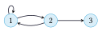
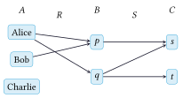
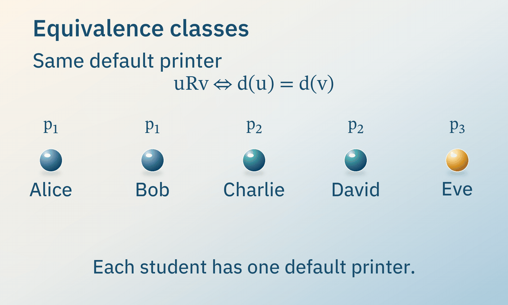

---
{
  "title": "Chapter 7: Equivalence relations",
  "subtitle": "Discrete Mathematics · Rey Joseph Nieto",
  "description": "Chapter 7: Equivalence relations. HTML edition of Lecture Notes in Discrete Mathematics.",
  "canonical-url": "https://rjnieto.com/teaching/notes/chapter-07/",
  "header-includes": "<meta name=\"robots\" content=\"index, follow, max-image-preview:large\">\n<meta property=\"og:url\" content=\"https://rjnieto.com/teaching/notes/chapter-07/\">\n<meta property=\"og:type\" content=\"article\">",
  "image": "/teaching/bulsu/discrete-math/images/thumbnails/chapter_07.webp",
  "body-classes": "ds-lecture-notes",
  "toc": true,
  "toc-depth": 2,
  "number-sections": false,
  "format": {
    "html": {
      "css": [
        "/assets/css/discrete-notes.css"
      ]
    }
  },
  "execute": {
    "eval": false
  },
  "resources": [
    "../assets/chapter-07/01-printer-equivalence-classes.gif",
    "../assets/chapter-07/01-printer-equivalence-classes-poster.png",
    "../assets/chapter-07/01-printer-equivalence-classes.webp"
  ]
}
---

<!-- Generated from the corresponding chapter LaTeX. Run scripts/build-discrete-html.py to refresh. -->

[Course page](/teaching/){.btn .btn-outline-secondary .btn-sm} [PDF](/teaching/bulsu/discrete-math/lecture-notes/chapter_07.pdf){.btn .btn-outline-primary .btn-sm aria-label="Open Chapter 7: Equivalence relations as PDF"}

[]{#ch7:chapter label="ch7:chapter"}

Suppose every student has one assigned default printer. Alice and Bob have the same default printer, and Bob and Charlie have the same default printer. We can conclude that Alice and Charlie do too. The assignment groups the students without ambiguity.

Now change the rule: two students are related when there is at least one printer they can both use. Alice may share one printer with Bob, while Bob shares a different printer with Charlie. Alice and Charlie need not share any printer. The new rule does not support the same conclusion.

Chapter 4 introduced relations as sets of ordered pairs and used transitivity to examine a two-step argument. Here we develop that language further: we reverse relations, combine them and test their properties. Chapter 6's drawings will help us see the pairs, with arrows to record direction. We will then identify the conditions under which a relation really does divide a set into separate groups.

:::: {.ds-box .ds-learningoutcomes}
::: {#what-you-should-be-able-to-do .ds-box-title}
**What you should be able to do**
:::

After working through this chapter, you should be able to:

- specify a relation using pairs, a table, a rule or a directed diagram;

- find inverse relations and compute compositions using a middle element;

- test reflexivity, symmetry, antisymmetry and transitivity;

- give proofs of properties and complete counterexamples to failures;

- recognise equivalence relations and determine their classes;

- check a partition and explain its connection with equivalence relations.
::::

## 7.1 Relations {#ch7:relations}

An ordered pair $(a,b)$ records a first entry and a second entry. Equality of ordered pairs requires equality in each position. Thus $(1,2)\ne(2,1)$, although the unordered sets $\{1,2\}$ and $\{2,1\}$ are equal.

:::: {.ds-box .ds-definition}
::: {#definition-7.1-cartesian-product-and-relation .ds-box-title}
**Definition 7.1: Cartesian product and relation**
:::

The **Cartesian product** of sets $A$ and $B$ is $$A\times B=\{(a,b):a\in A\text{ and }b\in B\}.$$ A **relation from $A$ to $B$** is a subset $R\subseteq A\times B$. A **relation on $A$** is a relation from $A$ to itself, so $R\subseteq A\times A$.

We write $aRb$ to mean $(a,b)\in R$.
::::

The Cartesian product lists all allowed ordered pairs; the relation selects the pairs for which its rule holds. The sets $A$ and $B$ are part of the specification. A relation can leave some elements of $A$ unrelated to anything in $B$, or relate one element to several others. A function from $A$ to $B$ has the additional requirement of exactly one output in $B$ for every input in $A$.

[**Example 7.1.**]{#ch7:permissions} Let $A=\{\text{Alice},\text{Bob},\text{Charlie}\}$ be a set of users, and let $B=\{p,q\}$ be a set of folders. Define $R$ by $$R=\{(\text{Alice},p),(\text{Alice},q),(\text{Bob},p)\}.$$ The pair $(\text{Alice},q)$ means that Alice can access folder $q$. It does not mean that $q$ can access Alice. The six possible user--folder pairs belong to $A\times B$; only three belong to $R$.

The same data can be recorded in a table. A entry means that the row element is related to the column element.

::: ds-table
    User         Folder $p$            Folder $q$
  --------- --------------------- ---------------------
    Alice    $\text{\texttt{T}}$   $\text{\texttt{T}}$
     Bob     $\text{\texttt{T}}$   $\text{\texttt{F}}$
   Charlie   $\text{\texttt{F}}$   $\text{\texttt{F}}$
:::

Here $R$ is a relation from $A$ to $B$, but not a function from $A$ to $B$. Alice has two related folders, and Charlie has none. Each feature violates the exactly-one-output requirement.

[**Example 7.2.**]{#ch7:diagram} On $D=\{1,2,3\}$, let $$T=\{(1,1),(1,2),(2,1),(2,3)\}.$$ In a **directed diagram**, draw an arrow from $x$ to $y$ exactly when $(x,y)\in T$. A pair $(x,x)$ is drawn as a **loop** from a vertex back to itself.

::: ds-table
   $T$           $1$                   $2$                   $3$
  ----- --------------------- --------------------- ---------------------
   $1$   $\text{\texttt{T}}$   $\text{\texttt{T}}$   $\text{\texttt{F}}$
   $2$   $\text{\texttt{T}}$   $\text{\texttt{F}}$   $\text{\texttt{T}}$
   $3$   $\text{\texttt{F}}$   $\text{\texttt{F}}$   $\text{\texttt{F}}$
:::

{.ds-note-image fig-alt="Directed relation on 1, 2 and 3: a loop at 1, arrows both ways between 1 and 2, and an arrow from 2 to 3." loading="lazy" decoding="async"}

There are two arrows between $1$ and $2$, one for each ordered pair. The arrow $2\to3$ has no reverse arrow because $(3,2)\notin T$. Vertex $3$ remains in the diagram even though no arrow starts there. Read a table entry from its row to its column; the entry in row $2$, column $3$ records $2T3$.

These diagrams allow directions and loops. Chapter 6's simple undirected graphs did not allow loops and used unordered pairs as edges. We are now using a different kind of diagram to represent ordered pairs.

## 7.2 Inverse relations and composition {#ch7:operations}

Two useful operations ask different questions: what happens when we reverse a pair, and what happens when we follow one relation by another?

:::: {.ds-box .ds-definition}
::: {#definition-7.2-inverse-relation .ds-box-title}
**Definition 7.2: Inverse relation**
:::

If $R\subseteq A\times B$, its **inverse relation** is $$R^{-1}=\{(b,a):(a,b)\in R\}\subseteq B\times A.$$ Thus $bR^{-1}a$ holds exactly when $aRb$ holds.
::::

[**Example 7.3.**]{#example-7.3.} For the permission relation in Example [7.1](#ch7:permissions), $$R^{-1}=\{(p,\text{Alice}),(q,\text{Alice}),(p,\text{Bob})\}.$$ The inverse relates a folder to the users who can access it. For example, $pR^{-1}\text{Bob}$ because Bob $R\,p$. This reversal always defines a relation, even though it need not define a function. Folder $p$ is related to two users. Reversing the pairs a second time gives $(R^{-1})^{-1}=R$. In a directed diagram on one set, inversion reverses every arrow; a loop remains a loop.

:::: {.ds-box .ds-definition}
::: {#definition-7.3-composition-of-relations .ds-box-title}
**Definition 7.3: Composition of relations**
:::

Let $R\subseteq A\times B$ and $S\subseteq B\times C$. Their **composition** $S\circ R$ is the relation from $A$ to $C$ defined by $$a(S\circ R)c
 \quad\Longleftrightarrow\quad
 \exists b\in B\;(aRb\text{ and }bSc).$$ The same middle element $b$ must satisfy both conditions.
::::

In $S\circ R$, follow $R$ first and $S$ second. The symbol on the right is used first. A pair $(a,c)$ belongs to the composition when there is at least one suitable middle element. Several middle elements can produce the same pair, but a set records that pair only once.

[**Example 7.4.**]{#ch7:composition} Keep the sets $A,B$ and permission relation $R$ from Example [7.1](#ch7:permissions). Let $C=\{s,t\}$ be a set of servers and define $$S=\{(p,s),(q,s),(q,t)\}.$$ Here $bSc$ means that folder $b$ is stored on server $c$. The composition records user--server pairs connected through an accessible folder. It describes these given relations; it does not grant access to every folder on a server.

{.ds-note-image fig-alt="Composing relations: Alice reaches p and q, Bob reaches p, p reaches s, and q reaches s and t; Charlie has no first step." loading="lazy" decoding="async"}

Alice reaches $s$ through either $p$ or $q$, and reaches $t$ through $q$. Bob reaches $s$ through $p$. Charlie has no first step in $R$. Consequently, $$S\circ R=\{(\text{Alice},s),(\text{Alice},t),(\text{Bob},s)\}.$$ The two witnesses for $(\text{Alice},s)$ do not create two copies of that pair. The pair $(\text{Bob},t)$ is absent: Bob's only accessible folder is $p$, and $(p,t)\notin S$.

[**Example 7.5.**]{#example-7.5.} On $A=\{0,1,2\}$, let $R=\{(0,1)\}$ and $S=\{(1,2)\}$. For $S\circ R$, the middle element $1$ connects $0R1$ to $1S2$, so $$S\circ R=\{(0,2)\}.$$ For $R\circ S$, we must follow $S$ first. Its only arrow ends at $2$, where no $R$-arrow starts. Hence $R\circ S=\varnothing$. Both compositions are defined on the stated sets, but they are different relations.

[**Example 7.6.**]{#ch7:shared-output} For the permission relation $R$ in Example [7.1](#ch7:permissions), $R^{-1}\circ R$ is a relation on the user set $A$. A user first reaches an accessible folder; the inverse then reaches a user who can access that same folder. It therefore relates two users exactly when they share at least one accessible folder.

Folder $p$ gives all four ordered pairs between Alice and Bob, including their self-pairs. Folder $q$ adds no new pair, because only Alice can access it. Thus $$\begin{aligned}
 R^{-1}\circ R=\{&
 (\text{Alice},\text{Alice}),(\text{Alice},\text{Bob}),\\
 &(\text{Bob},\text{Alice}),(\text{Bob},\text{Bob})\}.
\end{aligned}$$ Charlie is not even related to himself, since he cannot access a folder. Composing a relation with its inverse need not produce just the pairs $(a,a)$, or include every such pair.

## 7.3 Reflexivity, symmetry and antisymmetry {#ch7:first-properties}

From now on, the properties concern a relation on one specified nonempty set $A$. Each property makes a claim about all the appropriate elements of $A$.

:::: {.ds-box .ds-definition}
::: {#definition-7.4-reflexivity-symmetry-and-antisymmetry .ds-box-title}
**Definition 7.4: Reflexivity, symmetry and antisymmetry**
:::

A relation $R$ on $A$ is:

- **reflexive** if $xRx$ for every $x\in A$;

- **symmetric** if, for all $x,y\in A$, $xRy\Longrightarrow yRx$;

- **antisymmetric** if, for all $x,y\in A$, $(xRy\text{ and }yRx)\Longrightarrow x=y$.
::::

In a directed diagram, reflexivity requires a loop at every vertex. Symmetry requires the reverse of every arrow. Antisymmetry permits no pair of opposite arrows between distinct vertices. Loops are allowed by antisymmetry: their two endpoints are already equal.

[**Example 7.7.**]{#example-7.7.} The relation $R=\{(1,1),(2,2)\}$ is reflexive on $A=\{1,2\}$: both required self-pairs are present. The same set of pairs also defines a relation on $B=\{1,2,3\}$, but it is not reflexive on $B$, because $(3,3)$ is missing. One missing self-pair is enough to refute reflexivity; having some loops is insufficient to prove it.

[**Example 7.8.**]{#example-7.8.} For $T$ in Example [7.2](#ch7:diagram), the pairs $(1,2)$ and $(2,1)$ reverse each other. However, $(2,3)\in T$ while $(3,2)\notin T$. This pair is a complete counterexample to symmetry. The loop at $1$ is its own reverse, so it creates no problem for symmetry.

Reversing all pairs shows a useful test: $R$ is symmetric if and only if $R^{-1}=R$. Indeed, symmetry puts every reversed pair back in $R$; and equality with the inverse ensures that every pair has its reverse.

[**Example 7.9.**]{#example-7.9.} On $\mathbb{Z}$, let $aRb$ mean $a\leq b$. If both $aRb$ and $bRa$ hold, then $a\leq b$ and $b\leq a$, which force $a=b$. This proves antisymmetry. It also has every self-pair, since $a\leq a$. It is not symmetric: $0\leq1$, but $1\leq0$ is false.

To refute antisymmetry, we would need two *distinct* elements related in both directions. A self-pair such as $(0,0)$ does not meet that requirement.

[**Example 7.10.**]{#example-7.10.} Each row below specifies a relation on $A=\{1,2,3\}$.

::: ds-table
  Relation                         Symmetric?          Antisymmetric?
  --------------------------- --------------------- ---------------------
  $I=\{(1,1),(2,2),(3,3)\}$    $\text{\texttt{T}}$   $\text{\texttt{T}}$
  $J=\{(1,2),(2,1)\}$          $\text{\texttt{T}}$   $\text{\texttt{F}}$
  $K=\{(1,2)\}$                $\text{\texttt{F}}$   $\text{\texttt{T}}$
  $L=\{(1,2),(2,1),(2,3)\}$    $\text{\texttt{F}}$   $\text{\texttt{F}}$
:::

In $I$, every pair is its own reverse, and no distinct elements are related both ways. In $J$, every reverse is present, but $1$ and $2$ violate antisymmetry. In $K$, $(2,1)$ is missing, so symmetry fails; there is no distinct pair related both ways, so antisymmetry holds. Finally, $L$ violates symmetry at $(2,3)$ and violates antisymmetry at $1,2$.

:::: {.ds-box .ds-caution}
::: {#antisymmetric-does-not-mean-not-symmetric .ds-box-title}
**Antisymmetric does not mean "not symmetric"**
:::

The two properties have separate definitions. A relation can have both, one, or neither. To disprove antisymmetry, exhibit $x\ne y$ with both $xRy$ and $yRx$.
::::

## 7.4 Transitivity {#ch7:transitivity}

:::: {.ds-box .ds-definition}
::: {#definition-7.5-transitivity .ds-box-title}
**Definition 7.5: Transitivity**
:::

A relation $R$ on $A$ is **transitive** if, for all $x,y,z\in A$, $$(xRy\text{ and }yRz)\Longrightarrow xRz.$$ The elements $x,y,z$ need not be distinct.
::::

The middle element must match in the two premises. To refute the property, give $x,y,z$ for which both premises hold and the conclusion fails. To prove it, show that every two-step chain has the required direct pair. The direct pair may be a loop.

[**Example 7.11.**]{#example-7.11.} In $T$ from Example [7.2](#ch7:diagram), $1T2$ and $2T3$ hold, but $1T3$ does not. Thus $T$ is not transitive. There is a directed two-step route from $1$ to $3$, but the relation does not contain $(1,3)$. Transitivity requires that pair itself, rather than only a route connecting its entries.

[**Example 7.12.**]{#ch7:repeated} On $\{a,b\}$, let $R=\{(a,b),(b,a)\}$. The relation is symmetric, but it is not transitive. Taking $x=a$, $y=b$ and $z=a$ gives $aRb$ and $bRa$, while $aRa$ is false. The other two-step chain would likewise require $(b,b)$.

There are no three distinct elements in this set. Checking only triples of distinct elements would miss both failures.

[**Example 7.13.**]{#example-7.13.} On $A=\{1,2,3\}$, let $R=\{(1,2)\}$. For the first premise $xRy$ to hold, we must have $x=1$ and $y=2$. But no pair of $R$ starts at $2$, so $yRz$ cannot also hold. There is no triple making both premises true. The transitivity implication is therefore true for every triple, and $R$ is transitive.

The empty relation on this nonempty set is also transitive. It is symmetric and antisymmetric for the same logical reason: none of the relevant premises holds. It is not reflexive, because all required self-pairs are missing. These are applications of Chapter 2's truth rule for an implication with a false premise.

[**Example 7.14.**]{#example-7.14.} Let $R$ on $\mathbb{Z}$ be given by $aRb$ exactly when $a\leq b$. Take arbitrary $a,b,c\in\mathbb{Z}$ and suppose $aRb$ and $bRc$. Then $a\leq b$ and $b\leq c$, so $a\leq c$, which is $aRc$. Thus $R$ is transitive.

Together with the earlier checks, $\leq$ is reflexive, antisymmetric and transitive, and is not symmetric. These properties do not all have to occur together.

## 7.5 Equivalence relations {#ch7:equivalence}

For a grouping rule, we want each object related to itself, the relationship to work in both directions, and two successive relationships to keep us in the same group.

:::: {.ds-box .ds-definition}
::: {#definition-7.6-equivalence-relation .ds-box-title}
**Definition 7.6: Equivalence relation**
:::

A relation on a set is an **equivalence relation** if it is reflexive, symmetric and transitive. Related elements are then called **equivalent** under that relation.
::::

Equivalent objects need not be equal. The relation specifies which feature is being treated as the same.

[**Example 7.15.**]{#ch7:printers} Let $U=\{\text{Alice},\text{Bob},\text{Charlie},\text{David},\text{Eve}\}$ and let $d:U\to\{p_1,p_2,p_3\}$ assign each student exactly one default printer. Define $$uRv\quad\Longleftrightarrow\quad d(u)=d(v).$$ This extends Chapter 4's transitivity example.

*Reflexivity.* For any $u\in U$, $d(u)=d(u)$, so $uRu$.

*Symmetry.* If $uRv$, then $d(u)=d(v)$. Reversing the equality gives $d(v)=d(u)$, so $vRu$.

*Transitivity.* If $uRv$ and $vRw$, then $d(u)=d(v)$ and $d(v)=d(w)$. Hence $d(u)=d(w)$, so $uRw$.

Thus $R$ is an equivalence relation. For a concrete assignment, use the following table.

::: ds-table
   Student   Default printer
  --------- -----------------
    Alice         $p_1$
     Bob          $p_1$
   Charlie        $p_2$
    David         $p_2$
     Eve          $p_3$
:::

Alice and Bob are equivalent under $R$, although they are different students. The proof works for any fixed assignment function $d$, not just the five values in this table. More generally, equality of the values of any fixed function defines an equivalence relation on its input set.

[**Example 7.16.**]{#example-7.16.} On $\mathbb{Z}$, define $aRb$ by $|a-b|\leq1$, where $|a-b|$ is the distance between the integers. This relation is reflexive, since $|a-a|=0$. It is symmetric, since $|b-a|=|a-b|$. However, $0R1$ and $1R2$ hold while $0R2$ fails: $|0-2|=2>1$. It is not transitive and therefore is not an equivalence relation.

[**Example 7.17.**]{#example-7.17.} Suppose Alice can use only $p$, Bob can use $p$ and $q$, and Charlie can use only $q$. On these three students, define $uRv$ when they can both use at least one printer. Every student is related to themselves, because each has an available printer. The relation is symmetric: a printer shared by $u,v$ is also shared by $v,u$.

Yet Alice $R$ Bob through $p$, and Bob $R$ Charlie through $q$, while Alice $R$ Charlie is false. The two premises use different printers. This relation is not transitive. It is the shared-output construction of Example [7.6](#ch7:shared-output), with a different permission assignment.

[**Example 7.18.**]{#ch7:parity} On $\mathbb{Z}$, define $$aRb\quad\Longleftrightarrow\quad
 a-b=2k\text{ for some }k\in\mathbb{Z}.$$ In other words, the difference is even.

*Reflexivity.* For any $a\in\mathbb{Z}$, $a-a=0=2(0)$, so $aRa$.

*Symmetry.* Suppose $aRb$, so $a-b=2k$ for an integer $k$. Then $b-a=2(-k)$. Since $-k\in\mathbb{Z}$, this gives $bRa$.

*Transitivity.* Suppose $aRb$ and $bRc$. For some integers $j,k$, we have $a-b=2j$ and $b-c=2k$. Adding gives $$a-c=(a-b)+(b-c)=2(j+k).$$ Since $j+k\in\mathbb{Z}$, we obtain $aRc$. All three properties hold, so $R$ is an equivalence relation. Each step used Chapter 3's integer-witness method; no finite list of particular integers could check the whole infinite domain.

## 7.6 Equivalence classes {#ch7:classes}

:::: {.ds-box .ds-definition}
::: {#definition-7.7-equivalence-class .ds-box-title}
**Definition 7.7: Equivalence class**
:::

Let $R$ be an equivalence relation on $A$ and let $a\in A$. The **equivalence class** of $a$ is the set $$[a]_R=\{x\in A:aRx\}.$$ We often write $[a]$ when the relation is clear. The element $a$ is called a **representative** of its class.
::::

The brackets describe a set of elements, not one element or a new name for $a$ alone. To find $[a]$, determine every $x$ in the specified set that satisfies $aRx$. Reflexivity guarantees that $a$ itself belongs to $[a]$.

[**Example 7.19.**]{#example-7.19.} For the printer assignment in Example [7.15](#ch7:printers), $$\begin{aligned}
 [\text{Alice}]&=[\text{Bob}]=\{\text{Alice},\text{Bob}\},\\
 [\text{Charlie}]&=[\text{David}]=\{\text{Charlie},\text{David}\},\\
 [\text{Eve}]&=\{\text{Eve}\}.
\end{aligned}$$ For instance, $[\text{Alice}]$ consists of all students whose default printer equals $p_1$, namely Alice and Bob. There are five students but only three distinct classes. The equality $[\text{Alice}]=[\text{Bob}]$ is an equality of sets; it does not identify the two students as one person. Either is a representative of the same class.

<figure id="ch07-printer-equivalence-classes" class="ds-animation">
  <picture>
    <source media="print, (prefers-reduced-motion: reduce)" srcset="/teaching/notes/assets/chapter-07/01-printer-equivalence-classes-poster.png">
    
  </picture>
  <figcaption>Five students form three classes: Alice and Bob belong to the same class, as do Charlie and David; Eve forms a singleton class.</figcaption>
</figure>

:::: {.ds-box .ds-python}
::: {#python-non-examinable .ds-box-title}
**Python (non-examinable)**
:::

Here a dictionary records each student's assigned printer. In `printer[student]`, square brackets look up the printer for that student. For each printer label, we start an empty list `members`; `append` adds a student to that list when the two printer labels agree. Python uses `==` to test equality.

``` python
printer = {
    "Alice": "p1", "Bob": "p1",
    "Charlie": "p2", "David": "p2",
    "Eve": "p3"
}
for label in ["p1", "p2", "p3"]:
    members = []
    for student in printer:
        if printer[student] == label:
            members.append(student)
    print(label, members)
```

**Output.**

``` text
p1 ['Alice', 'Bob']
p2 ['Charlie', 'David']
p3 ['Eve']
```

The three lists contain the three equivalence classes already found. Lists preserve a display order; that order does not form part of the mathematical sets. Each student appears once because each has one assigned printer.
::::

[**Example 7.20.**]{#example-7.20.} For the even-difference relation in Example [7.18](#ch7:parity), $0Rx$ exactly when $0-x=-x$ is even, which is equivalent to $x$ being even. Likewise, $1Rx$ exactly when $x$ is odd: for an integer $k$, $1-x=2k$ is equivalent to $x=2(-k)+1$. Hence $$[0]=\{2k:k\in\mathbb{Z}\},\qquad
 [1]=\{2k+1:k\in\mathbb{Z}\}.$$ These are all the distinct classes: every integer is even or odd. Every even integer represents $[0]$; every odd integer represents $[1]$. Thus $[2]=[0]$ and $[-3]=[1]$, even though $2\ne0$ and $-3\ne1$.

## 7.7 Partitions {#ch7:partitions}

:::: {.ds-box .ds-definition}
::: {#definition-7.8-partition .ds-box-title}
**Definition 7.8: Partition**
:::

A **partition** $\mathcal P$ of a nonempty set $A$ is a collection of subsets of $A$, called **blocks**, such that:

- every block is nonempty;

- every element of $A$ lies in a block;

- two distinct blocks are disjoint.

Thus every element of $A$ belongs to exactly one block.
::::

A partition is a set whose elements are themselves sets. The blocks cover $A$, and no element is shared between different blocks.

[**Example 7.21.**]{#ch7:partition-check} Let $A=\{1,2,3,4,5\}$. The collection $$\mathcal P=\{\{1,4\},\{2,3\},\{5\}\}$$ is a partition: its three blocks are nonempty, together contain all five elements, and do not overlap. Here $1\in\{1,4\}$ and $\{1,4\}\in\mathcal P$. The number $1$ is an element of a block, while the block itself is an element of the partition.

Three changes illustrate separate failures. The collection $\{\{1,2\},\{2,3\},\{4,5\}\}$ fails because $2$ belongs to two distinct blocks. The collection $\{\{1,2\},\{3,4\}\}$ fails because it omits $5$. The collection $\{A,\varnothing\}$ fails because it includes an empty block. In contrast, $\{A\}$ is a valid partition with one block, and $\{\{1\},\{2\},\{3\},\{4\},\{5\}\}$ is a valid partition with five blocks.

[**Example 7.22.**]{#ch7:equal-classes} Let $R$ be an equivalence relation on $A$. We first prove $$aRb\quad\Longleftrightarrow\quad [a]=[b].$$

*Proof.* Suppose $aRb$. If $x\in[a]$, then $aRx$; symmetry gives $bRa$, so transitivity gives $bRx$. Thus $[a]\subseteq[b]$. If $x\in[b]$, then $bRx$; together with $aRb$, transitivity gives $aRx$. Thus $[b]\subseteq[a]$. The two inclusions prove $[a]=[b]$.

Conversely, suppose $[a]=[b]$. Reflexivity gives $b\in[b]$, hence $b\in[a]$. By the class definition, $aRb$. $\square$

Now suppose $[a]$ and $[b]$ have an element $x$ in common. Then $aRx$ and $bRx$. Symmetry changes the latter to $xRb$, and transitivity gives $aRb$. The result just proved yields $[a]=[b]$. Therefore two distinct equivalence classes cannot overlap.

[**Example 7.23.**]{#ch7:classes-partition} Let $R$ be an equivalence relation on a nonempty set $A$. Collect its *distinct* equivalence classes. We check the three partition requirements.

Each class $[a]$ is nonempty because $aRa$ puts $a$ in $[a]$. Every $x\in A$ is covered because $x\in[x]$. Finally, Example [7.22](#ch7:equal-classes) shows that two distinct classes are disjoint. Thus the classes form a partition of $A$.

For the printer assignment, listing Alice's and Bob's classes does not create two blocks: they are the same set. The partition has one block for each distinct class.

[**Example 7.24.**]{#ch7:from-partition} Let $A=\{1,2,3,4,5\}$ and take a different partition $$\mathcal P=\{\{1,3\},\{2,4\},\{5\}\}.$$

{.ds-note-image fig-alt="A partition with three disjoint blocks: {1, 3}, {2, 4}, and {5}." loading="lazy" decoding="async"}

Define $xRy$ when $x$ and $y$ belong to the same block. The first block supplies $(1,1),(1,3),(3,1),(3,3)$. The second supplies $(2,2),(2,4),(4,2),(4,4)$. The singleton block supplies $(5,5)$. Consequently, $$\begin{aligned}
 R=\{&(1,1),(1,3),(3,1),(3,3),\\
     &(2,2),(2,4),(4,2),(4,4),(5,5)\}.
\end{aligned}$$ Self-pairs are included: an element is in the same block as itself. There is no pair between distinct blocks, so, for example, $(1,2)\notin R$. Its classes are $[1]=[3]=\{1,3\}$, $[2]=[4]=\{2,4\}$ and $[5]=\{5\}$.

[**Example 7.25.**]{#ch7:partition-relation} For a partition $\mathcal P$ of $A$, define $xRy$ when $x,y$ belong to the same block.

*Reflexivity.* Every $x\in A$ lies in a block, so it lies in the same block as itself. Hence $xRx$.

*Symmetry.* If $x,y$ lie in the same block, then $y,x$ lie in that block too. Thus $xRy$ implies $yRx$.

*Transitivity.* Suppose $xRy$ and $yRz$. The elements $x,y$ lie together in a block $B$, and $y,z$ lie together in a block $C$. Both blocks contain $y$. Since distinct blocks are disjoint, $B=C$. Therefore $x,z$ lie in that same block, so $xRz$.

Thus $R$ is an equivalence relation. For any $a\in A$, let $B$ be its block. An element $x$ satisfies $aRx$ exactly when $x\in B$, so $[a]=B$. Its distinct classes recover the original partition.

Conversely, if we start with an equivalence relation, form its classes and then relate elements in the same class, we recover the original relation: Example [7.22](#ch7:equal-classes) gives $aRb$ exactly when $[a]=[b]$. The relation records the related pairs; the partition records the groups those pairs determine.

## 7.8 Exercises {#ch7:exercises}

::: {.ds-exercises style="--ds-chapter: '7';"}
1.  []{#ch7ex:product label="ch7ex:product"} Let $A=\{0,1\}$, $B=\{p,q,r\}$ and $R=\{(0,p),(0,r)\}$.

    a)  List $A\times B$ and identify which pairs belong to $R$.

    b)  Is $R$ a relation from $A$ to $B$? Is it a function from $A$ to $B$? Explain both answers.

    c)  Could a relation from $A$ to $B$ contain $(p,0)$? Explain using the specified sets.

2.  []{#ch7ex:H label="ch7ex:H"} Use this relation $H$ in every exercise that names it: $$A=\{a,b,c\},\qquad
     H=\{(a,a),(a,b),(b,c),(c,b),(c,c)\}.$$

    a)  Draw its directed diagram, including every vertex and loop.

    b)  Make a table with rows and columns $a,b,c$, using $\text{\texttt{T}}$ and $\text{\texttt{F}}$ to record membership.

    c)  Which arrows start at $b$? Which end at $b$?

3.  []{#ch7ex:inverse label="ch7ex:inverse"} On $A=\{0,1,2\}$, let $R=\{(0,1),(1,2),(2,2)\}$.

    a)  Find $R^{-1}$ and then $(R^{-1})^{-1}$.

    b)  Does $R$ assign exactly one output to every element of $A$? Does $R^{-1}$? Justify your answers from the pairs.

    c)  What happens to the loop at $2$ under inversion?

4.  []{#ch7ex:compose-context label="ch7ex:compose-context"} Let $A=\{\text{Alice},\text{Bob},\text{Eve}\}$, $B=\{x,y\}$ and $C=\{p,q\}$. Define $$\begin{aligned}
     R&=\{(\text{Alice},x),(\text{Bob},x),(\text{Bob},y),(\text{Eve},y)\},\\
     S&=\{(x,p),(y,p),(y,q)\}.
    \end{aligned}$$ Find $S\circ R$. For each resulting pair, give a middle element witnessing membership. Which pair has two different middle-element witnesses?

5.  []{#ch7ex:order label="ch7ex:order"} On $A=\{0,1,2,3\}$, let $R=\{(0,1),(1,2)\}$ and $S=\{(2,3)\}$. Find $S\circ R$ and $R\circ S$. Explain why both expressions are defined and why their values need not agree.

6.  []{#ch7ex:shared-output label="ch7ex:shared-output"} For $H$ in Exercise [7.2](#ch7ex:H), find $H^{-1}\circ H$ by determining which elements have an $H$-output in common. List all its pairs. Is this composition reflexive, symmetric, antisymmetric or transitive on $\{a,b,c\}$? Support each decision with a proof or counterexample.

7.  []{#ch7ex:carrier label="ch7ex:carrier"} Let $R=\{(0,0),(1,1)\}$. Is $R$ reflexive on $\{0,1\}$? Is it reflexive on $\{0,1,2\}$? Explain why these answers can differ although no pair in $R$ changed.

8.  []{#ch7ex:four-cases label="ch7ex:four-cases"} On $A=\{a,b,c\}$, give a relation with each combination below, and justify its two properties.

    a)  Symmetric and antisymmetric.

    b)  Symmetric, not antisymmetric.

    c)  Antisymmetric, not symmetric.

    d)  Neither symmetric nor antisymmetric.

9.  []{#ch7ex:anti-error label="ch7ex:anti-error"} For $I=\{(a,a),(b,b),(c,c)\}$ on $\{a,b,c\}$, David says that $(a,a)$ violates antisymmetry because it gives an arrow in both directions. Identify the error and prove the correct conclusion.

10. []{#ch7ex:repeat label="ch7ex:repeat"} On $A=\{a,b,c\}$, let $R=\{(a,b),(b,a)\}$.

    a)  Give two triples witnessing failures of transitivity.

    b)  Add as few pairs as possible to obtain a transitive relation on $A$. Prove that your new relation is transitive and explain why fewer additions cannot work.

    c)  Is the new relation reflexive on $A$?

11. []{#ch7ex:vacuity label="ch7ex:vacuity"} On $A=\{0,1,2\}$, consider $R=\{(0,2)\}$.

    a)  Decide all four properties: reflexive, symmetric, antisymmetric and transitive. Explain the implications whose premises never hold.

    b)  Repeat for the empty relation on $A$.

12. []{#ch7ex:numerical label="ch7ex:numerical"} For each relation on $\mathbb{Z}$, decide whether it is reflexive, symmetric, antisymmetric and transitive. Prove each successful property and give explicit witnesses for each failed one.

    a)  $aRb$ means $a\leq b$.

    b)  $aRb$ means $a<b$.

    c)  $aRb$ means $a+b=0$.

13. []{#ch7ex:function label="ch7ex:function"} Let $F$ be a nonempty set of files, let $L$ be a set of labels, and let $\ell:F\to L$ be a function. Define $fRg$ by $\ell(f)=\ell(g)$. Prove that $R$ is an equivalence relation. For a fixed file $f$, describe $[f]_R$ using $\ell$.

14. []{#ch7ex:two-properties label="ch7ex:two-properties"} On $A=\{a,b,c\}$, construct a relation that is:

    a)  reflexive and symmetric, but not transitive;

    b)  reflexive and transitive, but not symmetric;

    c)  symmetric and transitive, but not reflexive.

    Verify the two claimed properties and give a complete counterexample to the third in each part.

15. []{#ch7ex:even-sum label="ch7ex:even-sum"} On $\mathbb{Z}$, define $aRb$ when $a+b$ is even. Prove that this is an equivalence relation and determine its distinct equivalence classes. In the transitivity proof, start with $a+b=2j$ and $b+c=2k$ and express $a+c$ as twice an integer.

16. []{#ch7ex:file-classes label="ch7ex:file-classes"} Five files $a,b,c,d,e$ have the following sizes in a fixed unit.

    ::: ds-table
       File   $a$   $b$   $c$   $d$   $e$
      ------ ----- ----- ----- ----- -----
       Size   $2$   $3$   $2$   $5$   $3$
    :::

    Relate two files exactly when their sizes are equal. List $[a],[b],[c],[d],[e]$, then list the distinct classes. Does $[a]=[c]$ imply $a=c$? Explain.

17. []{#ch7ex:partition-check label="ch7ex:partition-check"} Which collections are partitions of $A=\{0,1,2,3,4,5\}$? For each failure, identify the exact requirement that fails.

    a)  $\{\{0,2,4\},\{1,3,5\}\}$.

    b)  $\{\{0,1,2\},\{2,3\},\{4,5\}\}$.

    c)  $\{\{0,1\},\{2,3\},\{4\}\}$.

    d)  $\{\{0,1,2,3,4,5\},\varnothing\}$.

18. []{#ch7ex:nested label="ch7ex:nested"} Let $U=\{\text{Alice},\text{Bob},\text{Charlie},\text{David},\text{Eve}\}$ and $$\mathcal P=\{\{\text{Alice},\text{Bob}\},\{\text{Charlie}\},
                     \{\text{David},\text{Eve}\}\}.$$ Mark each statement `TRUE` or `FALSE` and explain your answer.

    a)  $\text{Alice}\in\mathcal P$.

    b)  $\text{Alice}\in\{\text{Alice},\text{Bob}\}$.

    c)  $\{\text{Alice},\text{Bob}\}\in\mathcal P$.

    d)  $\{\text{Alice},\text{Bob}\}\subseteq U$.

19. []{#ch7ex:overlap-classes label="ch7ex:overlap-classes"} Let $R$ be an equivalence relation. Suppose $c\in[a]_R$ and $c\in[b]_R$. Prove $aRb$, naming the properties used at each step. Then explain why $[a]_R=[b]_R$.

20. []{#ch7ex:from-partition label="ch7ex:from-partition"} For $A=\{a,b,c,d,e\}$ and $\mathcal P=\{\{a,d\},\{b,c\},\{e\}\}$, define $xRy$ when $x,y$ lie in the same block.

    a)  List every ordered pair in $R$.

    b)  Explain why each self-pair must be included.

    c)  Give $[a]_R,[d]_R,[e]_R$ and explain why different representatives can name the same block.

21. []{#ch7ex:merge label="ch7ex:merge"} Start with the partition $\{\{a,b\},\{c,d\},\{e\}\}$ of $\{a,b,c,d,e\}$ and its same-block relation. Merge its first two blocks, obtaining $\{\{a,b,c,d\},\{e\}\}$. List the ordered pairs added to the relation. Must any old pair be removed? Explain using the two same-block rules.

22. []{#ch7ex:overlap-family label="ch7ex:overlap-family"} The collection $\{\{a,b\},\{b,c\}\}$ covers $\{a,b,c\}$. Define $xRy$ when some set in this collection contains both $x$ and $y$. Prove reflexivity and symmetry, but refute transitivity. Identify the step in Example [7.25](#ch7:partition-relation) that the overlapping sets prevent.

23. []{#ch7ex:inverse-symmetric label="ch7ex:inverse-symmetric"} For a relation $R$ on $A$, prove that $R$ is symmetric if and only if $R^{-1}=R$. In each direction, use the definition of the inverse to justify membership of the required pairs.

24. []{#ch7ex:composition-transitive label="ch7ex:composition-transitive"} For a relation $R$ on $A$, prove $$R\text{ is transitive}\quad\Longleftrightarrow\quad
     R\circ R\subseteq R.$$ Translate membership of $R\circ R$ into a statement about a middle element, then prove both directions.

25. []{#ch7ex:inverse-composition label="ch7ex:inverse-composition"} Let $R\subseteq A\times B$ and $S\subseteq B\times C$. Prove $$(S\circ R)^{-1}=R^{-1}\circ S^{-1}.$$ Begin with an arbitrary pair $(c,a)\in C\times A$ and show that it belongs to one side exactly when it belongs to the other.

26. []{#ch7ex:components label="ch7ex:components"} Let $G$ be a finite simple undirected graph with vertex set $V$. Define $uRv$ when $G$ has a path from $u$ to $v$.

    a)  Prove reflexivity and symmetry. Include the length-$0$ path.

    b)  Prove transitivity. Joining two paths may produce a walk with repeated vertices; explain why a path with the same endpoints still exists.

    c)  Identify the equivalence classes of $R$. What does the partition look like when $G$ is connected?
:::

::: {.ds-chapter-navigation}

[← Chapter 6](../chapter-06/index.qmd)
[Next chapter →](../chapter-08/index.qmd){.btn .btn-primary rel="next" aria-label="Next chapter: Chapter 8 (HTML)"}

:::
