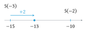
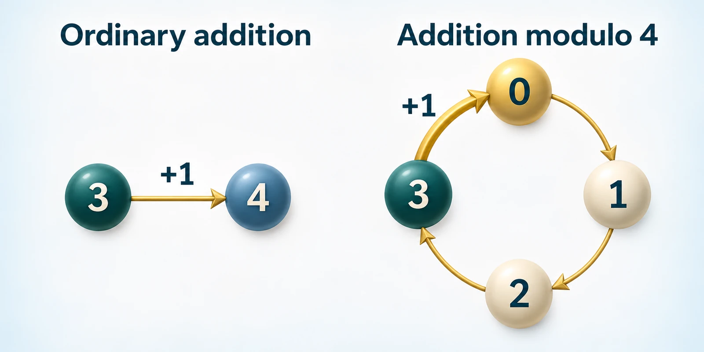

---
{
  "title": "Chapter 8: Modular arithmetic",
  "subtitle": "Discrete Mathematics · Rey Joseph Nieto",
  "description": "Chapter 8: Modular arithmetic. HTML edition of Lecture Notes in Discrete Mathematics.",
  "canonical-url": "https://rjnieto.com/teaching/notes/chapter-08/",
  "header-includes": "<meta name=\"robots\" content=\"index, follow, max-image-preview:large\">\n<meta property=\"og:url\" content=\"https://rjnieto.com/teaching/notes/chapter-08/\">\n<meta property=\"og:type\" content=\"article\">",
  "image": "/teaching/bulsu/discrete-math/images/thumbnails/chapter_08.webp",
  "body-classes": "ds-lecture-notes",
  "toc": true,
  "toc-depth": 2,
  "number-sections": false,
  "format": {
    "html": {
      "css": [
        "/assets/css/discrete-notes.css"
      ]
    }
  },
  "execute": {
    "eval": false
  }
}
---

<!-- Generated from the corresponding chapter LaTeX. Run scripts/build-discrete-html.py to refresh. -->

[Course page](/teaching/){.btn .btn-outline-secondary .btn-sm} [PDF](/teaching/bulsu/discrete-math/lecture-notes/chapter_08.pdf){.btn .btn-outline-primary .btn-sm aria-label="Open Chapter 8: Modular arithmetic as PDF"}

[]{#ch8:chapter label="ch8:chapter"}

Alice, Bob, Charlie and David take turns checking a shared printer, in that order, then the cycle repeats. Number their positions $0,1,2,3$. Starting with Alice at turn $0$, who checks at turn $17$? Listing all the turns would work, but four complete cycles use sixteen turns and return to Alice. One further turn reaches Bob. The remainder after division by four identifies the position in the cycle.

Chapter 3 used integer multiples in proofs; Chapter 7 grouped integers according to an even difference. We now develop remainders systematically and group integers by the same remainder. These groups support arithmetic on a finite set of labels, even though the integers themselves extend without bound.

:::: {.ds-box .ds-learningoutcomes}
::: {#what-you-should-be-able-to-do .ds-box-title}
**What you should be able to do**
:::

After working through this chapter, you should be able to:

- justify divisibility claims using integer witnesses;

- find a quotient and remainder, including for negative integers;

- interpret congruence using remainders and divisibility;

- describe residue classes and their partition of the integers;

- calculate with congruences and diagnose invalid cancellation;

- specify modular addition and multiplication as binary operations;

- check closure and identify two-sided identities in small systems.
::::

## 8.1 Divisibility {#ch8:divisibility}

We work with integers, $\mathbb{Z}=\{\ldots,-2,-1,0,1,2,\ldots\}$. As in Chapter 3, divisors in divisibility statements are nonzero. The integer being divided may be zero.

:::: {.ds-box .ds-definition}
::: {#definition-8.1-divisibility .ds-box-title}
**Definition 8.1: Divisibility**
:::

For $d,a\in\mathbb{Z}$ with $d\ne0$, write $d\mid a$ when $$a=dk\quad\text{for some }k\in\mathbb{Z}.$$ We say that $d$ **divides** $a$, that $d$ is a **divisor** of $a$, or that $a$ is a **multiple** of $d$. Write $d\nmid a$ when no such integer $k$ exists.
::::

The symbol $\mid$ states a relation between two integers; it does not denote the numerical quotient. The order matters: the number on the left is the divisor.

[**Example 8.1.**]{#example-8.1.} We have $4\mid28$ because $28=4(7)$. The witness is $7$. However, $4\nmid30$: the equation $30=4k$ forces $k=15/2$, which is not an integer. Writing $30=4(15/2)$ is an equality of numbers, but it does not establish integer divisibility.

Also, $28\nmid4$. The claim $4\mid28$ cannot be reversed just by reversing the notation.

[**Example 8.2.**]{#example-8.2.} Since $-24=6(-4)$, we have $6\mid-24$. Since $24=(-6)(-4)$, we also have $-6\mid24$. Neither the divisor nor its integer multiplier has to be positive.

For every nonzero integer $d$, $0=d(0)$ gives $d\mid0$. In particular, $1\mid0$, just as $1$ divides every other integer. We do not use zero as a divisor.

[**Example 8.3.**]{#ch8:linear-combination} Let $d\ne0$, and suppose $d\mid a$ and $d\mid b$. Prove that $d\mid(a-2b)$.

*Proof.* There are integers $j,k$ such that $a=dj$ and $b=dk$. Consequently, $$a-2b=dj-2dk=d(j-2k).$$ The multiplier $j-2k$ is an integer. This is the required divisibility witness. $\square$

The argument applies to all integers in the hypotheses. It also explains a useful general rule: integer combinations of multiples of $d$ remain multiples of $d$.

## 8.2 Quotients and remainders {#ch8:division}

Exact divisibility does not always hold, but we can separate an integer into a multiple of a positive divisor and a bounded remainder. We use the following elementary result, often called the **division algorithm**.

:::: {.ds-box .ds-definition}
::: {#definition-8.2-quotient-and-remainder .ds-box-title}
**Definition 8.2: Quotient and remainder**
:::

For each integer $a$ and each positive integer $n$, there are unique integers $q,r$ such that $$a=nq+r,\qquad 0\leq r<n.$$ The integer $q$ is the **quotient** and $r$ the **remainder** when $a$ is divided by $n$. We write $a\bmod n=r$ for this chosen remainder.
::::

The bounds on $r$ are part of the description. They choose the multiple $nq$ at or immediately below $a$, so that $nq\leq a<n(q+1)$. The distance from $nq$ to $a$ is the remainder. For a fixed positive $n$, $n\mid a$ exactly when that remainder is zero.

[**Example 8.4.**]{#example-8.4.} A batch contains $47$ records, grouped in packets of $6$. Since $$47=6(7)+5,\qquad 0\leq5<6,$$ there are seven complete packets and five records left. Thus $47\bmod6=5$ and $6\nmid47$. For comparison, $48=6(8)+0$, so $48\bmod6=0$ and $6\mid48$.

[**Example 8.5.**]{#ch8:negative-remainder} To divide $-13$ by $5$, locate it between the consecutive multiples $-15$ and $-10$: $$-13=5(-3)+2,\qquad 0\leq2<5.$$ The quotient is $-3$ and the remainder is $2$.

{.ds-note-image fig-alt="Number line locating -13 two units after -15, so -13 equals 5 times -3 plus the remainder 2." loading="lazy" decoding="async"}

The equality $-13=5(-2)-3$ is also correct, but its final summand $-3$ is not the chosen remainder: it violates $0\leq r<5$. We move to the preceding multiple of $5$ and add $2$.

:::: {.ds-box .ds-python}
::: {#python-non-examinable .ds-box-title}
**Python (non-examinable)**
:::

For integer inputs and a positive divisor, Python's `divmod` returns the quotient and remainder with the bounds used here. The assignment `q, r = divmod(a, n)` stores the first returned value in `q` and the second in `r`.

``` python
a = -13
n = 5
q, r = divmod(a, n)
print(q, r)
print(n * q + r)
```

**Output.**

``` text
-3 2
-13
```

Thus $q=-3$ and $r=2$, and the second line reconstructs $5(-3)+2=-13$. The positive-divisor condition matters: it ensures that the remainder lies between $0$ and $n-1$.
::::

[**Example 8.6.**]{#example-8.6.} Bob writes $29=6(3)+11$ and calls $11$ the remainder. The equality holds, but $11\geq6$. Move one further group of six into the quotient: $$29=6(4)+5.$$ Now $0\leq5<6$. Similarly, $-12=6(-2)+0$ already has a valid remainder: a negative input can be an exact multiple.

[**Uniqueness of the remainder.**]{#uniqueness-of-the-remainder.} Suppose $a=nq+r=nq'+r'$ with both remainders between $0$ and $n-1$. Then $n(q-q')=r'-r$. The right-hand side lies strictly between $-n$ and $n$. The only multiple of the positive integer $n$ in that interval is $0$. Thus $r'=r$, and then $q'=q$. Without the bounds, many decompositions would be possible.

## 8.3 Congruence {#ch8:congruence}

From now on our modulus $n$ is an integer with $n\geq2$. The quotient-and-remainder result also allows $n=1$, but our modular systems will have at least two labels.

:::: {.ds-box .ds-definition}
::: {#definition-8.3-congruence-modulo-n .ds-box-title}
**Definition 8.3: Congruence modulo $n$**
:::

Integers $a,b$ are **congruent modulo $n$** if they have the same remainder on division by $n$. Write $$a\equiv b\pmod n.$$ If their remainders differ, write $a\not\equiv b\pmod n$. The positive integer $n$ is the **modulus**.
::::

[**Example 8.7.**]{#example-8.7.} We have $$17=5(3)+2,\qquad 7=5(1)+2,\qquad -8=5(-2)+2.$$ Therefore $17\equiv7\pmod5$ and $-8\equiv7\pmod5$. The three integers are distinct; their remainders on division by $5$ are equal. In particular, the congruence $17\equiv7\pmod5$ does not assert $17=7$.

[**Example 8.8.**]{#ch8:congruence-test} For integers $a,b$ and fixed $n\geq2$, we claim $$a\equiv b\pmod n
 \quad\Longleftrightarrow\quad
 n\mid(a-b).$$

*Proof.* First suppose the remainders agree. Write $a=nq+r$ and $b=nt+r$. Then $a-b=n(q-t)$, an integer multiple of $n$.

Conversely, suppose $a-b=nk$ for some integer $k$. Write $b=nt+r$ with $0\leq r<n$. Then $$a=b+nk=n(t+k)+r.$$ This is a valid quotient-and-remainder description of $a$ with the same remainder $r$. Uniqueness of the remainder gives $a\equiv b\pmod n$. $\square$

Equivalently, $a\equiv b\pmod n$ means $a=b+nk$ for some $k\in\mathbb{Z}$. This form turns a congruence into an ordinary integer equation with a witness.

[**Example 8.9.**]{#example-8.9.} We have $23\equiv-1\pmod6$, because $23-(-1)=24=6(4)$. Nevertheless, $23\bmod6=5$, not $-1$. The chosen remainder must lie in $\{0,1,2,3,4,5\}$. Both $23$ and $-1$ have that same remainder $5$.

Thus $\equiv$ compares two integers, whereas $a\bmod n$ names one particular integer in $\{0,\ldots,n-1\}$.

[**Example 8.10.**]{#example-8.10.} The difference $17-7=10$ is divisible by $5$, so $17\equiv7\pmod5$. It is not divisible by $4$, so $17\not\equiv7\pmod4$. Stating that two integers are congruent without specifying a modulus leaves the relation unspecified.

## 8.4 Residue classes {#ch8:classes}

Congruence generalises Chapter 7's even-difference relation. Modulo $2$, equal remainders mean equal parity. For any fixed modulus, the same proof pattern establishes an equivalence relation.

[**Example 8.11.**]{#example-8.11.} Fix $n\geq2$ and let the domain be $\mathbb{Z}$. We use the divisibility test in Example [8.8](#ch8:congruence-test).

*Reflexivity.* For every $a$, $a-a=0=n(0)$, so $a\equiv a\pmod n$.

*Symmetry.* If $a\equiv b\pmod n$, write $a-b=nk$ with $k\in\mathbb{Z}$. Then $b-a=n(-k)$, so $b\equiv a\pmod n$.

*Transitivity.* If $a\equiv b\pmod n$ and $b\equiv c\pmod n$, write $a-b=nj$ and $b-c=nk$ for integers $j,k$. Adding gives $$a-c=(a-b)+(b-c)=n(j+k),$$ so $a\equiv c\pmod n$. All three properties hold on the whole domain.

:::: {.ds-box .ds-definition}
::: {#definition-8.4-residue-class .ds-box-title}
**Definition 8.4: Residue class**
:::

For $a\in\mathbb{Z}$, its **residue class modulo $n$** is $$[a]_n=\{x\in\mathbb{Z}:x\equiv a\pmod n\}
       =\{a+nk:k\in\mathbb{Z}\}.$$ It is also called a **remainder class**. The integer $a$ is a **representative** of the class.
::::

The symbol $[a]_n$ denotes a set of integers. It is not the same object as the integer $a$. The subscript records which equivalence relation is being used.

[**Example 8.12.**]{#ch8:classes-four} The classes modulo $4$ are:

::: ds-table
   Chosen representative  Residue class
  ----------------------- ----------------------------------------
            $0$           $[0]_4=\{\ldots,-8,-4,0,4,8,\ldots\}$
            $1$           $[1]_4=\{\ldots,-7,-3,1,5,9,\ldots\}$
            $2$           $[2]_4=\{\ldots,-6,-2,2,6,10,\ldots\}$
            $3$           $[3]_4=\{\ldots,-5,-1,3,7,11,\ldots\}$
:::

Every integer has exactly one remainder in $\{0,1,2,3\}$. Consequently, every integer belongs to one of these classes and cannot belong to two different ones. The classes are nonempty, disjoint and together cover $\mathbb{Z}$: they form a partition, in Chapter 7's terminology. Each class is infinite, although there are only four classes.

[**Example 8.13.**]{#example-8.13.} Since $-1\equiv3\equiv7\pmod4$, we have $$[-1]_4=[3]_4=[7]_4.$$ For instance, an integer differs from $7$ by a multiple of $4$ exactly when it differs from $3$ by a multiple of $4$: the two differences themselves differ by $4$. The integers $-1,3,7$ are different representatives of one class; they do not name three new classes.

In general, there are exactly $n$ distinct classes modulo $n$, represented once each by $0,\ldots,n-1$. We write $$\mathbb{Z}_n=\{[0]_n,[1]_n,\ldots,[n-1]_n\}$$ for this set of classes. To keep computations short, we will also use the unique representatives as labels.

## 8.5 Arithmetic with congruences {#ch8:arithmetic}

Suppose $a\equiv b\pmod n$ and $c\equiv d\pmod n$, with the same modulus. Then $$\begin{aligned}
 a+c&\equiv b+d\pmod n,\\
 a-c&\equiv b-d\pmod n,\\
 ac&\equiv bd\pmod n.
\end{aligned}$$ These rules allow us to replace an integer by a congruent one inside a sum, difference or product.

Write $a-b=nj$ and $c-d=nk$ for integers $j,k$. The differences of the respective sums and differences are $n(j+k)$ and $n(j-k)$, hence are multiples of $n$. For products, $$ac-bd=(a-b)c+b(c-d)=n(jc+bk).$$ Again the multiplier is an integer. The divisibility test therefore gives each congruence. Repeated multiplication also permits positive integer powers: if $a\equiv b\pmod n$, then $a^m\equiv b^m\pmod n$ for every integer $m\geq1$.

[**Example 8.14.**]{#example-8.14.} Modulo $5$, we have $38\equiv3$ and $27\equiv2$. Therefore $$38+27\equiv3+2=5\equiv0\pmod5,$$ and $$38(27)\equiv3(2)=6\equiv1\pmod5.$$ The sum has remainder $0$ and the product has remainder $1$. The ordinary product is $1026$, but computing that full product was unnecessary for the remainder.

[**Example 8.15.**]{#example-8.15.} Using the same inputs modulo $5$, $$38-27\equiv3-2=1\pmod5.$$ In the reverse order, $$27-38\equiv2-3=-1\equiv4\pmod5.$$ The last step uses $-1=5(-1)+4$. Leaving the answer as a congruence to $-1$ is valid; the remainder itself is $4$.

[**Example 8.16.**]{#example-8.16.} Since $3^2=9\equiv-1\pmod5$, $$3^8=(3^2)^4\equiv(-1)^4=1\pmod5.$$ Thus $3^8$ has remainder $1$ when divided by $5$. We used a small congruent value for $3^2$ and then multiplied it four times. There was no need to expand $3^8$ first.

[**Example 8.17.**]{#ch8:cancellation} We have $2(1)\equiv2(4)\pmod6$, since $2-8=-6$. Cancelling the factor $2$ would give $1\equiv4\pmod6$, which is false: $1-4=-3$ is not divisible by $6$.

The multiplication rule proves a congruence after multiplying; it does not supply the converse. Indeed, from $6\mid2(1-4)$ we cannot conclude $6\mid(1-4)$. Ordinary division by a nonzero number does not automatically preserve a congruence with the same modulus.

[**Example 8.18.**]{#ch8:squares} Every integer $x$ is congruent to one of $0,1,2,3$ modulo $4$. Squaring its representative gives:

::: ds-table
    $x\bmod4$    $0$   $1$   $2$   $3$
  ------------- ----- ----- ----- -----
   $x^2\bmod4$   $0$   $1$   $0$   $1$
:::

For example, $3^2=9\equiv1\pmod4$. The power rule ensures that every integer with representative $3$ has its square in class $[1]_4$. The other columns work the same way. Thus every integer square is congruent to $0$ or $1$ modulo $4$.

This is a proof for all integers, rather than a test of just four integers: every possible remainder is covered, and congruence preserves squaring. In particular, an equation $x^2=4k+2$ has no solution with $x,k\in\mathbb{Z}$, since its right-hand side has remainder $2$.

## 8.6 Modular systems {#ch8:systems}

So far we have used congruence to compare integers. We can also calculate entirely with the finite set of representative labels. To describe this precisely, we must state the set and the operations used on it.

:::: {.ds-box .ds-definition}
::: {#definition-8.5-binary-operation-and-closure .ds-box-title}
**Definition 8.5: Binary operation and closure**
:::

A **binary operation on a set $S$** assigns exactly one element of $S$ to each ordered pair of elements of $S$. In function notation it is a map $S\times S\to S$. For a proposed operation, **closure** means that every permitted pair has its result in $S$.
::::

The word binary refers to two inputs. A **mathematical system** here means a specified set together with specified operations on that set. The set alone does not tell us which calculations are intended.

[**Example 8.19.**]{#example-8.19.} Let $S=\{0,1,2,3\}$. Ordinary addition gives $2+3=5\notin S$. It therefore does not define a binary operation on $S$. Ordinary multiplication also fails closure, since $2(3)=6\notin S$. The fact that some pairs, such as $0+1$, stay in $S$ does not establish closure for all pairs.

:::: {.ds-box .ds-definition}
::: {#definition-8.6-modular-addition-and-multiplication .ds-box-title}
**Definition 8.6: Modular addition and multiplication**
:::

Fix $n\geq2$ and let $S_n=\{0,1,\ldots,n-1\}$. For $a,b\in S_n$, define $$a\oplus_n b=(a+b)\bmod n,\qquad
 a\otimes_n b=(ab)\bmod n.$$ The symbols $\oplus_n$ and $\otimes_n$ denote addition and multiplication followed by reduction to the chosen remainder. Both operations have domain $S_n\times S_n$ and outputs in $S_n$.
::::

Existence and uniqueness of a remainder ensure exactly one output in $S_n$ for every input pair. Thus both are binary operations on $S_n$. The notation $(S_n,\oplus_n,\otimes_n)$ records the set and its two specified operations.

[**Example 8.20.**]{#example-8.20.} In $S_4=\{0,1,2,3\}$, $$2\oplus_4 3=5\bmod4=1,\qquad
 2\otimes_4 3=6\bmod4=2.$$ The ordinary intermediate values $5$ and $6$ lie outside $S_4$; the operation outputs $1$ and $2$ lie inside it. Also, $3\oplus_4 1=0$. This is an equality of representative labels under the defined operation; it does not assert the ordinary integer equality $3+1=0$.

{.ds-note-image fig-alt="Modular arithmetic illustrated by positions wrapping around a cycle." loading="lazy" decoding="async"}

Ordinary addition takes $3$ to $4$; adding $1$ modulo $4$ takes label $3$ back to $0$.

[**Operations on residue classes.**]{#operations-on-residue-classes.} The label $a\in S_n$ represents the class $[a]_n\in\mathbb{Z}_n$. On classes, adding $[a]_n$ to $[b]_n$ means forming $[a+b]_n$; multiplying means forming $[ab]_n$. These results do not depend on which integers represent the two classes.

For example, modulo $4$, $[2]_4=[6]_4$. Adding $[3]_4$ using the first representative gives $[2+3]_4=[5]_4=[1]_4$; using $6$ gives $[6+3]_4=[9]_4=[1]_4$ again.

If $a\equiv a'\pmod n$ and $b\equiv b'\pmod n$, the arithmetic rules give $$a+b\equiv a'+b'\pmod n,\qquad
 ab\equiv a'b'\pmod n.$$ So the resulting classes agree. Our operations on $S_n$ record each resulting class by its unique label in $\{0,\ldots,n-1\}$. We keep brackets for classes and use unbracketed labels when calculating with $\oplus_n,\otimes_n$.

[**Example 8.21.**]{#ch8:tables} Here are both operations on $S_4$. The row gives the first input and the column gives the second.

::: ds-table
   $\oplus_4$   $0$   $1$   $2$   $3$
  ------------ ----- ----- ----- -----
      $0$       $0$   $1$   $2$   $3$
      $1$       $1$   $2$   $3$   $0$
      $2$       $2$   $3$   $0$   $1$
      $3$       $3$   $0$   $1$   $2$
:::

::: ds-table
   $\otimes_4$   $0$   $1$   $2$   $3$
  ------------- ----- ----- ----- -----
       $0$       $0$   $0$   $0$   $0$
       $1$       $0$   $1$   $2$   $3$
       $2$       $0$   $2$   $0$   $2$
       $3$       $0$   $3$   $2$   $1$
:::

For instance, row $3$, column $2$ in the addition table gives $3\oplus_4 2=1$. Row $2$, column $2$ in the multiplication table gives $2\otimes_4 2=0$, because $4\bmod4=0$. Two nonzero labels can therefore have product zero.

Each table covers all $4^2=16$ ordered input pairs, and every output lies in $S_4$. This is a complete finite check of closure. The general argument using bounded remainders already establishes closure for every $S_n$.

:::: {.ds-box .ds-python}
::: {#python-non-examinable-1 .ds-box-title}
**Python (non-examinable)**
:::

The symbol `%` computes a remainder in Python. With the positive modulus $4$, it returns one of the labels $0,1,2,3$. The outer loop chooses a row label $a$; the inner loop visits each column label $b$. Each empty list `row` receives the four outputs of addition modulo $4$, using `append` to add each entry. Each `range(n)` supplies $0,1,\ldots,n-1$, so here both loops use the labels $0,1,2,3$.

``` python
n = 4
for a in range(n):
    row = []
    for b in range(n):
        row.append((a + b) % n)
    print(row)
```

**Output.**

``` text
[0, 1, 2, 3]
[1, 2, 3, 0]
[2, 3, 0, 1]
[3, 0, 1, 2]
```

These are exactly the rows of the addition table above. Replacing `a + b` by `a * b` generates the multiplication table on the same representative labels. The loops cover every ordered input pair in $S_4\times S_4$.
::::

:::: {.ds-box .ds-definition}
::: {#definition-8.7-identity-element .ds-box-title}
**Definition 8.7: Identity element**
:::

For a binary operation $\star$ on $S$, an **identity element** is an element $e\in S$ such that $$e\star a=a\quad\text{and}\quad a\star e=a
 \qquad\text{for every }a\in S.$$ It leaves every element unchanged in either input position.
::::

An identity belongs to a specified operation. There need not be one element that acts as the identity for every operation in a system.

[**Example 8.22.**]{#example-8.22.} For $a\in S_n$, the integer $a$ already satisfies $0\leq a<n$, so $a\bmod n=a$. Consequently, $$0\oplus_n a=a\oplus_n0=a,\qquad
 1\otimes_n a=a\otimes_n1=a.$$ Thus $0$ is the additive identity and $1$ the multiplicative identity for every $n\geq2$. In the tables of Example [8.21](#ch8:tables), row and column $0$ of the addition table reproduce their input labels. Row and column $1$ of the multiplication table do likewise.

Zero is not a multiplicative identity: $0\otimes_n1=0\ne1$. One is not an additive identity: $1\oplus_n0=1\ne0$. Checking just an input that happens to stay unchanged would not establish the identity condition.

[**Example 8.23.**]{#example-8.23.} On $S_4$, define $a\ominus_4 b=(a-b)\bmod4$. This is a binary operation because its reduced output always lies in $S_4$. For every $a\in S_4$, $a\ominus_4 0=a$. But $0\ominus_4 1=(-1)\bmod4=3$, not $1$. So $0$ works on the right but is not a two-sided identity.

No other label can be a two-sided identity either. If $e$ were such an identity, $e\ominus_4 0=0$ would force $e=0$, which we have just ruled out. A set with a binary operation need not have an identity.

[**Example 8.24.**]{#example-8.24.} Use addition modulo $4$, but restrict the allowed labels to $A=\{1,2,3\}$. Since $1\oplus_4 3=0\notin A$, the restricted calculation is not a binary operation on $A$. It remains an operation on $S_4$. Specifying the modulus without the permitted input and output set would miss this change.

## 8.7 Exercises {#ch8:exercises}

::: {.ds-exercises style="--ds-chapter: '8';"}
1.  []{#ch8ex:witnesses label="ch8ex:witnesses"} Decide each divisibility claim, using the nonzero-divisor convention. Justify each answer.

    a)  $7\mid-35$.

    b)  $-4\mid28$.

    c)  $9\mid0$.

    d)  $8\mid30$.

2.  []{#ch8ex:divisibility-proof label="ch8ex:divisibility-proof"}

    a)  For integers $d,a,b$ with $d\ne0$, prove that $d\mid a$ and $d\mid b$ imply $d\mid(2a-3b)$.

    b)  For nonzero integers $d,e$ and an integer $a$, prove that $d\mid e$ and $e\mid a$ imply $d\mid a$.

3.  []{#ch8ex:remainders label="ch8ex:remainders"} For each pair $(a,n)$, find $q,r$ with $a=nq+r$ and $0\leq r<n$.

    a)  $(53,7)$.

    b)  $(-53,7)$.

    c)  $(-42,7)$.

    d)  $(0,6)$.

    e)  $(18,1)$.

4.  []{#ch8ex:repair-division label="ch8ex:repair-division"} The equalities below hold, but the final summand does not satisfy the required remainder bounds. Give a valid quotient and remainder for each.

    a)  $17=5(2)+7$.

    b)  $-17=5(-3)-2$.

    c)  $28=7(3)+7$.

    Explain why the bound is $r<n$, rather than $r\leq n$.

5.  []{#ch8ex:packets label="ch8ex:packets"} There are $1028$ records, packed into full groups of $32$. Find the number of full groups and the number left over. State whether $32\mid1028$ and justify the conclusion from your quotient-and-remainder equation.

6.  []{#ch8ex:congruences label="ch8ex:congruences"} State `TRUE` or `FALSE` for each claim, justifying it by divisibility of the difference.

    a)  $14\equiv-1\pmod5$.

    b)  $18\equiv2\pmod4$.

    c)  $-12\equiv3\pmod5$.

    d)  $7\equiv0\pmod3$.

    e)  $0\equiv6\pmod6$.

    f)  $11\equiv5\pmod4$.

7.  []{#ch8ex:representative label="ch8ex:representative"} Show that $20\equiv-1\pmod7$. Find $20\bmod7$ and $(-1)\bmod7$. Why is $-1$ a valid congruent integer but not a valid chosen remainder modulo $7$?

8.  []{#ch8ex:changed-modulus label="ch8ex:changed-modulus"} Show that $5\equiv8\pmod3$ but $5\not\equiv8\pmod6$. Explain why these conclusions are compatible. Give another pair of distinct integers with the same two properties.

9.  []{#ch8ex:transitivity label="ch8ex:transitivity"} Let $n\geq2$, and suppose $a\equiv b\pmod n$ and $b\equiv c\pmod n$. Use equations $a-b=nj$ and $b-c=nk$ to prove $a\equiv c\pmod n$. Identify which relation property this establishes and why $j+k$ is an allowed witness.

10. []{#ch8ex:classes label="ch8ex:classes"} List the three distinct classes modulo $3$, giving a set-builder description of each. For each class, include two negative and two nonnegative members. Explain why every integer belongs to exactly one class.

11. []{#ch8ex:class-equality label="ch8ex:class-equality"} Decide whether each equality is correct and justify it. For a failed equality, give an integer that belongs to one set but not the other.

    a)  $[2]_5=[12]_5$.

    b)  $[-1]_5=[4]_5$.

    c)  $[0]_4=[2]_4$.

    d)  $[1]_3=[1]_5$.

12. []{#ch8ex:finite-class label="ch8ex:finite-class"} List all integers $x$ with $-15\leq x\leq15$ such that $x\equiv2\pmod5$. Give an equation $x=2+5k$ and identify all integer values of $k$ that produce your list.

13. []{#ch8ex:calculations label="ch8ex:calculations"} Find the chosen remainder in each case, showing congruence steps.

    a)  $(46+39)\bmod7$.

    b)  $(46\cdot39)\bmod7$.

    c)  $(39-46)\bmod7$.

    d)  $(4-19)\bmod6$.

14. []{#ch8ex:known-classes label="ch8ex:known-classes"} Suppose $a\equiv2\pmod5$ and $b\equiv4\pmod5$. Find the chosen remainders of $a+b$, $ab$ and $a^2+b^2$ modulo $5$. Explain why your answers do not depend on the particular integers represented by $a$ and $b$.

15. []{#ch8ex:power label="ch8ex:power"} Show that $2^3\equiv1\pmod7$. Use $20=3(6)+2$ to find $2^{20}\bmod7$, without expanding $2^{20}$. State where repeated multiplication of congruences is used.

16. []{#ch8ex:product-proof label="ch8ex:product-proof"} Suppose $a-b=nj$ and $c-d=nk$, with all letters integer and $n\geq2$. Express $ac-bd$ as $n$ times an integer to prove that $a\equiv b\pmod n$ and $c\equiv d\pmod n$ imply $ac\equiv bd\pmod n$. Explain why this also makes multiplication of residue classes independent of representatives.

17. []{#ch8ex:cancellation label="ch8ex:cancellation"} Check that $4(2)\equiv4(5)\pmod6$. Charlie cancels the nonzero factor $4$ and concludes $2\equiv5\pmod6$. Show that this conclusion is false. Explain which implication the valid multiplication rule supplies and which Charlie has assumed.

18. []{#ch8ex:operations label="ch8ex:operations"} On $S_5=\{0,1,2,3,4\}$, which of the following rules define binary operations? For a failed rule give an input pair whose result lies outside $S_5$; for a successful rule justify all input pairs.

    a)  Ordinary addition $a+b$.

    b)  Ordinary multiplication $ab$.

    c)  $(a+b)\bmod5$.

    d)  $(ab)\bmod5$.

19. []{#ch8ex:tables label="ch8ex:tables"} Construct the addition and multiplication tables on $S_3=\{0,1,2\}$ using $\oplus_3$ and $\otimes_3$. Explain how the entries show closure. Use the tables to identify the additive and multiplicative identities, checking both the relevant row and the relevant column.

20. []{#ch8ex:identity label="ch8ex:identity"} In $S_5$, Eve notes that $2\otimes_5 0=0$ and claims that $2$ is a multiplicative identity. Give an input that disproves her claim. State the full identity condition and identify the actual multiplicative identity.

21. []{#ch8ex:subtraction label="ch8ex:subtraction"} On $S_5$, define $a\ominus_5 b=(a-b)\bmod5$.

    a)  Calculate $1\ominus_5 4$ and $4\ominus_5 1$.

    b)  Explain why the operation is closed.

    c)  Show that $a\ominus_5 0=a$ for every $a\in S_5$, but $0$ is not a two-sided identity.

    d)  Explain why no other element can be a two-sided identity.

22. []{#ch8ex:subset label="ch8ex:subset"} Use addition and multiplication modulo $4$.

    a)  On $A=\{1,2,3\}$, give a pair showing that addition is not closed.

    b)  On $B=\{0,2\}$, check every ordered pair to decide whether addition is closed.

    c)  On the same $B$, check every ordered pair to decide whether multiplication is closed.

23. []{#ch8ex:abstract-table label="ch8ex:abstract-table"} On $S=\{u,v\}$, define $\star$ by the following table, with the first input selecting the row.

    ::: ds-table
       $\star$   $u$   $v$
      --------- ----- -----
         $u$     $u$   $v$
         $v$     $v$   $u$
    :::

    Explain why $\star$ is a binary operation on $S$. Identify its identity and show why the other element is not an identity. The labels $u,v$ are elements of this set; no ordinary numerical addition is being assumed.

24. []{#ch8ex:cycle label="ch8ex:cycle"} The printer-checking order is Alice, Bob, Charlie, David, repeating, with labels $0,1,2,3$ respectively. At turn $0$, Charlie checks.

    a)  Give a formula for the checking label at turn $t\geq0$ using a remainder.

    b)  Who checks at turn $14$?

    c)  If the same repeating allocation is extended backwards to integer turns, who checks at turn $-3$?

    Explain why including the initial label in the formula is necessary.

25. []{#ch8ex:even-product label="ch8ex:even-product"} For any integer $k$, its remainder modulo $2$ is $0$ or $1$. Use these two cases and congruence arithmetic to prove $2\mid k(k+1)$ for every $k\in\mathbb{Z}$. Explain why two remainder cases cover infinitely many integers.

26. []{#ch8ex:no-squares label="ch8ex:no-squares"} Use Example [8.18](#ch8:squares) to find all possible remainders of $x^2+y^2$ modulo $4$, where $x,y\in\mathbb{Z}$. Prove that there are no integers $x,y,m$ satisfying $$x^2+y^2=4m+3.$$ Explain why this is a general impossibility proof rather than a check of a few values of $x$ and $y$.
:::

::: {.ds-chapter-navigation}

[← Chapter 7](../chapter-07/index.qmd) · [Chapter 9 →](../chapter-09/index.qmd)

:::
