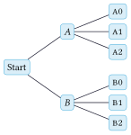
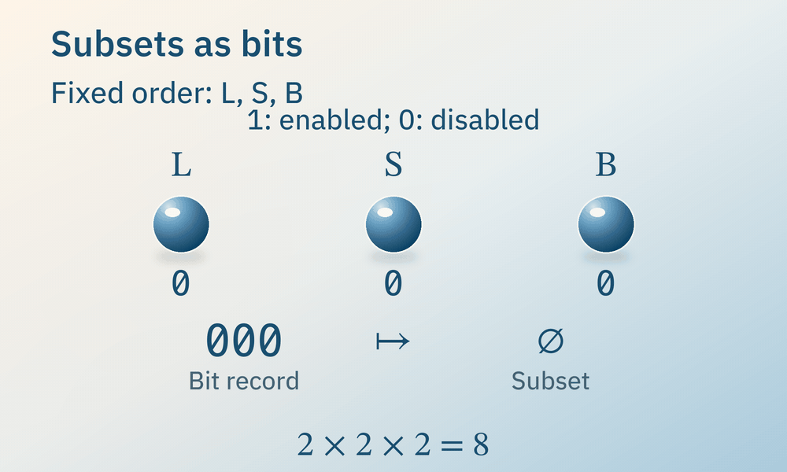
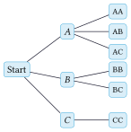
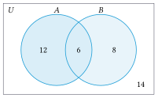
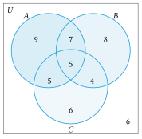

---
{
  "title": "Chapter 9: Counting principles",
  "subtitle": "Discrete Mathematics · Rey Joseph Nieto",
  "description": "Chapter 9: Counting principles. HTML edition of Lecture Notes in Discrete Mathematics.",
  "canonical-url": "https://rjnieto.com/teaching/notes/chapter-09/",
  "header-includes": "<meta name=\"robots\" content=\"index, follow, max-image-preview:large\">\n<meta property=\"og:url\" content=\"https://rjnieto.com/teaching/notes/chapter-09/\">\n<meta property=\"og:type\" content=\"article\">",
  "image": "/teaching/bulsu/discrete-math/images/thumbnails/chapter_09.webp",
  "body-classes": "ds-lecture-notes",
  "toc": true,
  "toc-depth": 2,
  "number-sections": false,
  "format": {
    "html": {
      "css": [
        "/assets/css/discrete-notes.css"
      ]
    }
  },
  "execute": {
    "eval": false
  },
  "resources": [
    "../assets/chapter-09/01-subsets-as-bits.gif",
    "../assets/chapter-09/01-subsets-as-bits-poster.png",
    "../assets/chapter-09/01-subsets-as-bits.webp"
  ]
}
---

<!-- Generated from the corresponding chapter LaTeX. Run scripts/build-discrete-html.py to refresh. -->

[Course page](/teaching/){.btn .btn-outline-secondary .btn-sm} [PDF](/teaching/bulsu/discrete-math/lecture-notes/chapter_09.pdf){.btn .btn-outline-primary .btn-sm aria-label="Open Chapter 9: Counting principles as PDF"}

[]{#ch9:chapter label="ch9:chapter"}

A workshop organiser has two lists: $18$ students know some Python, and $14$ know some HTML. Does that give $32$ different students? Some names may occur on both lists. Adding their lengths would count those students twice.

Counting becomes more demanding when we must specify what counts as one outcome. A two-person team and an assignment of two people to different roles are different objects. A code may start with $0$, while a four-digit number cannot. These choices change the count before any calculation begins.

Chapter 4 gave us unions, intersections and set difference. Chapter 7 added Cartesian products and partitions. We will use those ideas to count finite sets without always listing every element. The aim is to explain why the chosen method counts each allowed outcome exactly once.

:::: {.ds-box .ds-learningoutcomes}
::: {#what-you-should-be-able-to-do .ds-box-title}
**What you should be able to do**
:::

After working through this chapter, you should be able to:

- specify the outcomes and check small counts by listing;

- add counts from disjoint, exhaustive cases;

- multiply counts of successive choices when each stage has a fixed number of extensions;

- handle restrictions on repetition, leading zeros and available choices;

- count a complement when the unwanted outcomes are easier to describe;

- use inclusion--exclusion for two or three overlapping sets;

- interpret "at least", "exactly", "both" and "neither" in a counting problem.
::::

## 9.1 Counting outcomes {#ch9:outcomes}

:::: {.ds-box .ds-definition}
::: {#definition-9.1-outcome-set-and-cardinality .ds-box-title}
**Definition 9.1: Outcome set and cardinality**
:::

An **outcome** is one complete object allowed by the task. The **outcome set** consists of all such objects. For a finite set $S$, its **cardinality** $|S|$ is the number of its distinct elements. In particular, $|\varnothing|=0$.
::::

We are counting objects, not probabilities. Writing an outcome explicitly helps us see which choices are part of it, which restrictions apply, and when two descriptions refer to the same object.

[**Example 9.1.**]{#ch9:small-codes} A code consists of one letter from $\{A,B\}$ followed by one digit from $\{0,1,2\}$. Its outcome set is $$S=\{\texttt{A0},\texttt{A1},\texttt{A2},
       \texttt{B0},\texttt{B1},\texttt{B2}\}.$$ Thus $|S|=6$. A table organises the same six codes.

::: ds-table
   First character   $0$    $1$    $2$
  ----------------- ------ ------ ------
         $A$         `A0`   `A1`   `A2`
         $B$         `B0`   `B1`   `B2`
:::

Choosing one character from $\{A,B,0,1,2\}$ would instead give five outcomes. That is a different task: each outcome would have one character, rather than a letter and a digit in specified positions.

:::: {.ds-box .ds-python}
::: {#python-non-examinable .ds-box-title}
**Python (non-examinable)**
:::

We can construct the six codes by trying each digit after each letter. Square brackets create a *list*, and `append` adds an item to its end. The indented inner loop runs once for every digit before the outer loop moves to the next letter. Quotation marks make the digits text, so `+` joins the two characters.

``` python
codes = []
for letter in ["A", "B"]:
    for digit in ["0", "1", "2"]:
        codes.append(letter + digit)
print(codes)
print(len(codes))
```

**Output.**

``` text
['A0', 'A1', 'A2', 'B0', 'B1', 'B2']
6
```

Here `len` counts the items in the list. Each permitted letter--digit pair is constructed exactly once.
::::

[**Example 9.2.**]{#example-9.2.} Choose an editor and a reviewer from Alice, Bob and Charlie, with different people in the two roles. An outcome is an ordered pair $(\text{editor},\text{reviewer})$. The six outcomes are $$\begin{aligned}
 &(\text{Alice},\text{Bob}),\quad(\text{Alice},\text{Charlie}),\\
 &(\text{Bob},\text{Alice}),\quad(\text{Bob},\text{Charlie}),\\
 &(\text{Charlie},\text{Alice}),\quad(\text{Charlie},\text{Bob}).
\end{aligned}$$ For example, swapping Alice and Bob changes the assignment. If we only wanted a two-person team with no roles, the outcomes would instead be the three sets $$\{\text{Alice},\text{Bob}\},\quad
 \{\text{Alice},\text{Charlie}\},\quad
 \{\text{Bob},\text{Charlie}\}.$$ The same people are available, but the two tasks have different outcome sets. Chapter 10 will develop systematic methods for these selections and arrangements.

## 9.2 Sum rule {#ch9:sum}

Recall that sets are **disjoint** when their intersection is empty. To add the sizes of cases, those cases must not count the same outcome, and together they must cover every outcome we want.

:::: {.ds-box .ds-definition}
::: {#definition-9.2-sum-rule .ds-box-title}
**Definition 9.2: Sum rule**
:::

For finite disjoint sets $A$ and $B$, $$|A\cup B|=|A|+|B|.$$ More generally, add the sizes of any finite collection of pairwise disjoint cases to count their union.
::::

To justify the formula, list the elements of $A$, then the elements of $B$. No element is repeated because $A\cap B=\varnothing$, and every element of $A\cup B$ occurs on the combined list.

[**Example 9.3.**]{#example-9.3.} A folder contains five PDF files, four PNG files and three TXT files. Each file has exactly one of these formats. Selecting one PDF or PNG file gives $$5+4=9$$ outcomes: the two format categories are disjoint. If TXT files are also allowed, there are $5+4+3=12$ outcomes. An outcome here is one file, not a package containing one file of each format.

[**Example 9.4.**]{#example-9.4.} A system has seven queued records, three processing records and twelve completed records. Each record has exactly one of these statuses, and every record has a status. There are $$7+3+12=22$$ records. The three status sets form a partition: they cover the records and are pairwise disjoint. Chapter 7's partition conditions justify adding the three counts without repeating a record.

## 9.3 Product rule {#ch9:product}

A complete outcome may require several choices. We must count all the possible continuations after each choice.

:::: {.ds-box .ds-definition}
::: {#definition-9.3-product-rule .ds-box-title}
**Definition 9.3: Product rule**
:::

Suppose two successive choices produce each allowed outcome exactly once. There are $m$ possibilities for the first choice, and *each* first choice allows exactly $n$ possibilities for the second. Then there are $mn$ outcomes.

In particular, for finite sets $A,B$, $$|A\times B|=|A|\,|B|.$$
::::

For each first choice, there is a group of $n$ complete outcomes. The groups are disjoint because their first choices differ. Adding their sizes gives $n$ repeated $m$ times, namely $mn$. The requirement of unique specification ensures that we count outcomes rather than several descriptions of the same outcome.

For three stages with $m,n,p$ choices at their respective stages, the count is $mnp$, provided every partial outcome at a stage has the stated number of extensions. The same reasoning works for further stages.

[**Example 9.5. A choice tree.**]{#ch9:code-tree} Return to Example [9.1](#ch9:small-codes). Choose the letter first: there are two choices. For either letter, there are three choices of digit. Thus the product rule gives $2(3)=6$. The following rooted tree records these choices.

{.ds-note-image fig-alt="Choice tree for codes A0, A1, A2, B0, B1 and B2: two first-letter choices, each with three digit choices." loading="lazy" decoding="async"}

The root records no choice yet. Its children record the first character; each leaf records one complete code. Every code reaches one leaf, and different leaves give different codes. Reading away from the root gives the order of the choices.

[**Example 9.6.**]{#example-9.6.} A profile uses one of three icons, one of two colour themes and one of two font sizes. Every combination is allowed. An outcome is the triple $(\text{icon},\text{theme},\text{size})$, so there are $$3(2)(2)=12$$ configurations. After any icon is selected, both themes remain available; after either theme, both sizes remain available.

[**Example 9.7.**]{#ch9:zeros} A four-character digit code uses digits $0$ to $9$; repetition and a leading zero are allowed. Each position has ten choices, giving $$10^4=10(10)(10)(10)=10{,}000$$ codes. For example, `0042` is a valid code. The exponent $4$ records the four factors of $10$.

For a four-digit positive integer, the first digit must be one of $1,\ldots,9$. Repetition is still allowed, and each later digit has ten choices. The count becomes $$9(10)(10)(10)=9{,}000.$$ The integer $42$ has two digits, so writing it with two leading zeros does not create a new four-digit integer.

[**Example 9.8.**]{#example-9.8.} A three-letter code uses $\{A,B,C,D\}$ without repetition. The first position has four choices. Whichever letter is chosen, the second position has three unused letters available. After any pair of distinct letters, the third position has two unused letters available. There are $$4(3)(2)=24$$ codes. The available *letters* change between branches, but the number available at each stage is fixed. The product rule does not require the same letter set to remain available.

[**Example 9.9.**]{#example-9.9.} Let $F=\{p,q,r\}$ be three files and let $S=\{x,y\}$ be two servers. A function $f:F\to S$ assigns each file exactly one server. Different files may use the same server.

Choose $f(p)$, then $f(q)$, then $f(r)$. There are two choices each time, so there are $2^3=8$ functions. Each triple of values defines exactly one function, and two different triples define different functions. Nothing requires both servers to be used.

[**Example 9.10.**]{#example-9.10.} Three optional features are labelled $L,S,B$. Any subset of these features may be enabled, including none. Record three bits in that fixed order: $1$ means enabled and $0$ means disabled. For example, `101` represents $\{L,B\}$, and `000` represents $\varnothing$.

Each of the three positions has two choices, giving $2^3=8$ selections. Writing $\{B,L\}$ instead of $\{L,B\}$ does not give another selection: both have the same bit record. The encoding includes every subset exactly once.

<figure id="ch09-subsets-as-bits" class="ds-animation">
  <picture>
    <source media="print, (prefers-reduced-motion: reduce)" srcset="/teaching/notes/assets/chapter-09/01-subsets-as-bits-poster.png">
    
  </picture>
  <figcaption>In the fixed order $L,S,B$, the bit string <code>101</code> encodes the subset $\{L,B\}$. Three independent binary choices give eight subsets.</figcaption>
</figure>

For a set of $n$ labelled features, the same argument gives $2^n$ subsets. When $n=0$, the empty feature set has one subset, itself, agreeing with $2^0=1$.

## 9.4 Counting by cases {#ch9:cases}

If the number of extensions changes with an earlier choice, a single product of fixed stage counts may not apply. We can often separate the possibilities into disjoint cases and count each case.

[**Example 9.11. Unequal branches.**]{#ch9:unequal} A two-letter code uses $\{A,B,C\}$, with the second letter not earlier than the first in alphabetical order. Repetition is allowed.

{.ds-note-image fig-alt="Unequal branching: A leads to AA, AB and AC; B leads to BB and BC; C leads only to CC." loading="lazy" decoding="async"}

After $A$, the second letter has three choices; after $B$, two; after $C$, one. These cases are disjoint because they have different first letters. The count is therefore $$3+2+1=6.$$ Multiplying $3(3)$ would include the forbidden codes `BA`, `CA` and `CB`.

[**Example 9.12.**]{#example-9.12.} An identifier has either two letters or one letter followed by one digit. Letters come from $\{A,B,C,D\}$, digits from $\{0,1,2\}$, and repetition is allowed.

The two-letter format has $4(4)=16$ possibilities. The letter--digit format has $4(3)=12$. A code cannot have both formats, because its second character cannot be both a letter and a digit. Thus there are $$16+12=28$$ identifiers. Each product counts one case; the sum combines the disjoint cases.

[**Example 9.13.**]{#ch9:exactly-one} How many length-$3$ strings over $\{A,B,C\}$ contain exactly one $A$? A **string** is an ordered list of characters; it need not spell a word.

The unique $A$ can be first, second or third. For each of these three cases, each other position has two choices, $B$ or $C$, giving $2(2)=4$ strings. The cases do not overlap because there is only one $A$. The total is $$4+4+4=3(2^2)=12.$$ Equivalently, choosing the position of the unique $A$ and the remaining two characters specifies each string once.

## 9.5 Counting complements {#ch9:complement}

Sometimes the allowed outcomes have several forms, while their complement has one simple description.

:::: {.ds-box .ds-definition}
::: {#definition-9.4-counting-a-complement .ds-box-title}
**Definition 9.4: Counting a complement**
:::

Let $U$ be a finite set of all outcomes under consideration, and let $A\subseteq U$ be the wanted outcomes. The **complement of $A$ in $U$** is $U\setminus A$. Then $$|A|=|U|-|U\setminus A|.$$
::::

The sets $A$ and $U\setminus A$ are disjoint and together make up $U$. The formula follows by subtracting one term from their sum. Both counts must use the same underlying set $U$.

[**Example 9.14.**]{#ch9:at-least-one} For length-$3$ strings over $\{A,B,C\}$, repetition allowed, count those containing at least one $A$. There are $3^3=27$ strings in total. Those with no $A$ use only $B,C$, so there are $2^3=8$. Hence the required count is $$27-8=19.$$ This includes strings with one, two or three occurrences of $A$. It is larger than the count $12$ for *exactly* one $A$ in Example [9.13](#ch9:exactly-one). For instance, `AAB` belongs to the present outcome set but not the earlier one.

[**Example 9.15.**]{#example-9.15.} A length-$4$ bit string uses $0$ or $1$ at each position. Count those with at least two $1$s. There are $2^4=16$ strings altogether.

The unwanted strings have either no $1$s or exactly one $1$. There is one all-zero string. There are four strings with exactly one $1$, one for each possible position: $$\texttt{1000},\quad\texttt{0100},\quad
 \texttt{0010},\quad\texttt{0001}.$$ These two unwanted cases are disjoint, so their total is $1+4=5$. The wanted count is $16-5=11$.

## 9.6 Two overlapping sets {#ch9:two-sets}

When an outcome belongs to two cases, adding their counts includes it twice. We must remove its extra copy.

:::: {.ds-box .ds-definition}
::: {#definition-9.5-inclusionexclusion-for-two-sets .ds-box-title}
**Definition 9.5: Inclusion--exclusion for two sets**
:::

For finite sets $A,B$, $$|A\cup B|=|A|+|B|-|A\cap B|.$$ The union includes elements in $A$, in $B$, or in both.
::::

An element in exactly one set contributes $1$ to the right-hand side. An element in both contributes $1+1-1=1$. An element in neither contributes $0$. Thus each element of the union is counted once. For disjoint sets, $|A\cap B|=0$, giving the sum rule.

[**Example 9.16.**]{#ch9:workshop} In a group $U$ of $40$ students, let $A$ contain the $18$ who know some Python and $B$ the $14$ who know some HTML. Suppose $6$ students know both. Then $$|A\cup B|=18+14-6=26.$$ We subtract six extra counts, retaining one count for each student who appears on both lists.

The three regions inside the circles have sizes $18-6=12$ for $A$ only, $6$ for both, and $14-6=8$ for $B$ only. Outside both are $40-26=14$.

{.ds-note-image fig-alt="Two-set Venn diagram: 12 in A only, 6 in both sets, 8 in B only, and 14 outside both." loading="lazy" decoding="async"}

Knowing *at least one* of the two topics gives $26$ students. Knowing *exactly one* gives $12+8=20$, excluding the six who know both. Knowing *neither* gives $14$. In mathematical "$A$ or $B$", the word "or" includes the intersection unless the task explicitly excludes it.

[**Example 9.17.**]{#example-9.17.} Count length-$4$ strings over $\{A,B,C\}$ that start with $A$ or end with $A$, with repetition allowed. Let $P$ be the strings starting with $A$, and $Q$ the strings ending with $A$.

Fixing one endpoint leaves three free positions, so $|P|=|Q|=3^3=27$. Fixing both endpoints leaves two free positions, so $|P\cap Q|=3^2=9$. Therefore $$|P\cup Q|=27+27-9=45.$$ For example, `ABBA` appears in both initial counts, but is wanted only once. The middle two characters remain unrestricted in the intersection.

[**Example 9.18.**]{#example-9.18.} Using the groups in Example [9.16](#ch9:workshop), assign a Python helper from $A$ and an HTML helper from $B$. An assignment is an ordered pair $(u,v)$, where $u\in A$ is the Python helper and $v\in B$ the HTML helper. Initially allow the same student to fill both roles. Every one of the $18$ first choices allows all $14$ second choices, so there are $18(14)=252$ assignments.

If the helpers must be different people, remove the six assignments $(u,u)$ with $u\in A\cap B$. The count is $252-6=246$. The overlap of $A$ and $B$ does not prevent counting $A\times B$ by multiplication. By contrast, the six students in $A\cap B$ are single students, not $252$ ordered pairs.

## 9.7 Three overlapping sets {#ch9:three-sets}

With three sets, subtracting the pairwise overlaps removes too much from the common centre.

:::: {.ds-box .ds-definition}
::: {#definition-9.6-inclusionexclusion-for-three-sets .ds-box-title}
**Definition 9.6: Inclusion--exclusion for three sets**
:::

For finite sets $A,B,C$, $$\begin{aligned}
 |A\cup B\cup C|
  ={}&|A|+|B|+|C|\\
     &-|A\cap B|-|A\cap C|-|B\cap C|\\
     &+|A\cap B\cap C|.
\end{aligned}$$ Each pairwise intersection includes the elements that also belong to the third set.
::::

To verify the formula, follow one element. If it lies in exactly one set, it contributes $1$. If it lies in exactly two, it contributes $2-1=1$. If it lies in all three, it contributes $3-3+1=1$: it belongs to three individual sets, three pairwise intersections and the triple intersection. An element outside all three contributes $0$.

[**Example 9.19.**]{#ch9:three-data} In a set $U$ of $50$ computers, let $A$ contain those with backup enabled, $B$ those with file synchronisation enabled, and $C$ those with event logging enabled. The counts are $$\begin{aligned}
 |A|&=26,& |B|&=24,& |C|&=20,\\
 |A\cap B|&=12,& |A\cap C|&=10,& |B\cap C|&=9,\\
 |A\cap B\cap C|&=5.
\end{aligned}$$ The pairwise counts include the five computers with all three features. Inclusion--exclusion gives $$|A\cup B\cup C|=26+24+20-12-10-9+5=44.$$ Thus $50-44=6$ computers have none of the three enabled.

To see all the regions, put $5$ in the common centre. The regions belonging to exactly two sets have sizes $$12-5=7,\qquad10-5=5,\qquad9-5=4$$ for $A,B$ only; $A,C$ only; and $B,C$ only, respectively. For $A$ only, remove the $7$, $5$ and $5$ already placed inside $A$, giving $26-7-5-5=9$. Similarly, $B$ only contains $24-7-4-5=8$, and $C$ only contains $20-5-4-5=6$.

{.ds-note-image fig-alt="Three-set Venn diagram: A only 9, B only 8, C only 6; AB only 7, AC only 5, BC only 4; all three 5; outside 6." loading="lazy" decoding="async"}

The seven disjoint inner regions sum to $9+8+6+7+5+4+5=44$, agreeing with the formula. Including the outside region gives all $50$ computers.

[**Example 9.20.**]{#example-9.20.} For Example [9.19](#ch9:three-data), exactly two features are enabled on $7+5+4=16$ computers. At least two are enabled on $16+5=21$. Exactly one is enabled on $9+8+6=23$.

Adding the pairwise intersection counts gives $12+10+9=31$. Each computer in exactly two sets occurs once in that sum, while each computer in all three occurs three times. To count exactly two, remove all three copies of each central computer: $31-3(5)=16$. To count at least two, retain one central copy: $31-2(5)=21$.

[**Example 9.21.**]{#example-9.21.} Suppose $|A|=15$, $|B|=12$ and $|A\cap B|=18$. These data are impossible: an intersection is a subset of each set, so it cannot have more than $12$ elements.

Now suppose a universe has $30$ elements, $|A|=20$, $|B|=18$ and $|A\cap B|=5$. The intersection size is no larger than either set, but inclusion--exclusion would give $|A\cup B|=20+18-5=33$. A union contained in this universe cannot have $33$ elements. The data are again impossible. A numerical result from a formula must still describe subsets of the stated universe.

## 9.8 Exercises {#ch9:exercises}

::: {.ds-exercises style="--ds-chapter: '9';"}
1.  []{#ch9ex:list label="ch9ex:list"} Let $L=\{A,B,C\}$ and $D=\{0,1\}$.

    a)  List all codes consisting of a letter from $L$ followed by a digit from $D$.

    b)  How many outcomes are there if the task is instead to choose one character from $L\cup D$?

    c)  Explain the two different counts using the objects that constitute an outcome.

2.  []{#ch9ex:roles label="ch9ex:roles"} The available people are Alice, Bob, Charlie and David. List all two-person teams with no roles. Then list all assignments of different people to the roles of coder and tester. Explain why exchanging two people changes an assignment but does not change a team.

3.  []{#ch9ex:formats label="ch9ex:formats"} A folder contains eight PDF files, five SVG files and four TXT files, with each file having exactly one format. How many ways can you select one SVG or TXT file? How many ways can you select one file of any of the three formats? State why addition is valid.

4.  []{#ch9ex:partition label="ch9ex:partition"} An equivalence relation partitions a set into three classes of sizes $4,3,2$. How many elements are in the set, and how many distinct equivalence classes are there? Explain why the class sizes can be added.

5.  []{#ch9ex:config label="ch9ex:config"} A profile uses one of four icons, one of three colours and one of two sizes. Every combination is allowed. Describe an outcome as a triple and count the configurations. Explain what each factor counts.

6.  []{#ch9ex:zeros label="ch9ex:zeros"} Use the digits $0$ to $9$, with repetition allowed. Count:

    a)  three-character digit codes;

    b)  three-digit positive integers;

    c)  three-digit positive integers whose final digit is even.

    Include $0$ among the allowed even final digits.

7.  []{#ch9ex:repetition label="ch9ex:repetition"} How many length-$3$ strings over $\{A,B,C,D,E\}$ are possible in each case?

    a)  Repetition is allowed.

    b)  No character may repeat.

    In part (b), explain why changing the available letters does not invalidate the product rule.

8.  []{#ch9ex:functions label="ch9ex:functions"} Let $F=\{p,q,r,s\}$ and $S=\{x,y,z\}$. Different elements of $F$ may have the same image. Count the functions $f:F\to S$ satisfying:

    a)  no additional restriction;

    b)  $f(p)=x$;

    c)  $f(p)\ne f(q)$, with no other restriction.

9.  []{#ch9ex:subsets label="ch9ex:subsets"} Any subset of four labelled features may be enabled. Count selections with:

    a)  no restriction;

    b)  no feature enabled;

    c)  exactly one feature enabled;

    d)  at least one feature enabled.

    Explain how a four-bit record represents each selection exactly once.

10. []{#ch9ex:branches label="ch9ex:branches"} A two-character code has first character $A,B$ or $C$. Its allowed second characters are given below.

    ::: ds-table
       First character   Allowed second characters
      ----------------- ---------------------------
             $A$                   $0,1$
             $B$                  $0,1,2$
             $C$                    $2$
    :::

    Draw a choice tree, list all codes and give their count. Why would $3(3)$ be an incorrect count?

11. []{#ch9ex:mixed label="ch9ex:mixed"} An identifier has either two letters or one letter followed by a digit. Letters come from $\{A,B,C,D,E\}$, digits from $\{0,1,2,3\}$.

    a)  Count identifiers when repetition is allowed.

    b)  Count identifiers when the two-letter format must use different letters.

    Explain why the two format counts can be added.

12. []{#ch9ex:occurrences label="ch9ex:occurrences"} For length-$4$ strings over $\{A,B,C\}$, with repetition allowed, count strings containing:

    a)  no $A$;

    b)  exactly one $A$;

    c)  at least one $A$;

    d)  at least two $A$s.

    Identify the disjoint cases or complement used for each calculation.

13. []{#ch9ex:binary label="ch9ex:binary"} How many length-$5$ bit strings contain at least two $1$s? Count the unwanted cases separately and explain why their counts can be added.

14. []{#ch9ex:two-sets label="ch9ex:two-sets"} In a universe $U$ of $45$ records, $|A|=24$, $|B|=20$ and $|A\cap B|=9$. Find the number of records in:

    a)  $A$ only;

    b)  $B$ only;

    c)  both sets;

    d)  at least one set;

    e)  exactly one set;

    f)  neither set.

    Draw and label the corresponding Venn diagram.

15. []{#ch9ex:recover-intersection label="ch9ex:recover-intersection"} In a universe of $60$ elements, $|A|=35$, $|B|=28$ and $10$ elements belong to neither set. Find $|A\cup B|$, $|A\cap B|$ and the number belonging to exactly one set. Check that the four disjoint region counts sum to $60$.

16. []{#ch9ex:endpoints label="ch9ex:endpoints"} Consider all length-$5$ bit strings. Let $A$ contain those starting with $1$, and $B$ those ending with $0$. Find:

    a)  $|A|$ and $|B|$;

    b)  $|A\cap B|$;

    c)  $|A\cup B|$;

    d)  the number in exactly one of $A,B$.

    Explain why `10000` is counted twice by $|A|+|B|$.

17. []{#ch9ex:intersection-product label="ch9ex:intersection-product"} In a group of $30$ students, $12$ are in $A$, $15$ are in $B$, and $4$ are in both. Bob says that $12(15)$ counts the students in both sets.

    a)  Explain the error and give the correct count.

    b)  What does $12(15)$ count if an outcome is an ordered pair with first entry in $A$ and second in $B$?

    c)  How many such ordered pairs have different entries?

18. []{#ch9ex:three-sets label="ch9ex:three-sets"} A universe of $60$ elements has subsets with counts $$\begin{aligned}
     |A|&=30,&|B|&=28,&|C|&=25,\\
     |A\cap B|&=14,&|A\cap C|&=12,&|B\cap C|&=11,\\
     |A\cap B\cap C|&=5.
    \end{aligned}$$ The pairwise counts include the triple intersection. Draw a Venn diagram and label all eight disjoint regions, including the outside region. Find the numbers belonging to:

    a)  at least one set;

    b)  no set;

    c)  exactly one set;

    d)  exactly two sets;

    e)  at least two sets.

19. []{#ch9ex:unknown-centre label="ch9ex:unknown-centre"} In a universe of $50$ elements, exactly $5$ belong to none of $A,B,C$. The other data are $$\begin{aligned}
     |A|&=25,&|B|&=22,&|C|&=20,\\
     |A\cap B|&=10,&|A\cap C|&=9,&|B\cap C|&=8.
    \end{aligned}$$ Find $|A\cap B\cap C|$, the number in $A$ only, and the number in exactly two sets.

20. []{#ch9ex:impossible label="ch9ex:impossible"} Explain why each report is impossible.

    a)  $|A|=12$, $|B|=9$, $|A\cap B|=10$.

    b)  A universe has $25$ elements, $|A|=18$, $|B|=15$ and $|A\cap B|=5$.

    c)  A universe has $30$ elements, $|A|=10$, $|B|=12$, $|C|=11$, $|A\cap B|=8$, $|A\cap C|=7$, $|B\cap C|=5$ and $|A\cap B\cap C|=2$. Compute the proposed $A$-only region.

21. []{#ch9ex:flawed label="ch9ex:flawed"} To count length-$3$ strings over $\{A,B,C\}$ containing at least one $A$, Charlie chooses a position for $A$ and then chooses the other two characters freely. He obtains $3(3^2)=27$.

    a)  How many times does this method count `ABA`? How many times does it count `AAA`?

    b)  Explain which requirement of the product rule has failed.

    c)  Give a correct count using a complement.

22. []{#ch9ex:two-proof label="ch9ex:two-proof"} For finite $A,B$, use the disjoint sets $A\setminus B$, $A\cap B$ and $B\setminus A$ to prove $$|A\cup B|=|A|+|B|-|A\cap B|.$$ Express $|A|$, $|B|$ and $|A\cup B|$ in terms of those three region sizes.

23. []{#ch9ex:three-proof label="ch9ex:three-proof"} A proposed three-set formula adds the three set sizes, subtracts the three pairwise intersection sizes, and stops there. Track how many times it counts an element belonging to exactly two sets and an element belonging to all three. Give the missing term and explain why the corrected formula counts every element of the union once.

24. []{#ch9ex:relation-count label="ch9ex:relation-count"} An equivalence relation $R$ partitions a set of $12$ records into three classes of sizes $3,4,5$.

    a)  Count the ordered pairs $(x,y)$ satisfying $xRy$, including self-pairs.

    b)  How many of these pairs have $x=y$?

    c)  How many have $x\ne y$?

    Explain why products within the classes can be added without repeating a pair.

25. []{#ch9ex:graphs label="ch9ex:graphs"} Fix the labelled vertex set $V=\{a,b,c,d\}$. Graphs here are simple and undirected, as in Chapter 6.

    a)  List the six possible edges as two-element subsets.

    b)  Choose independently whether to include each possible edge. How many graphs on this fixed $V$ result?

    c)  How many contain $\{a,b\}$?

    d)  How many have no edges?

    Retain all four labelled vertices in every graph, including any isolated ones.
:::

::: {.ds-chapter-navigation}

[← Chapter 8](../chapter-08/index.qmd)
[Next chapter →](../chapter-10/index.qmd){.btn .btn-primary rel="next" aria-label="Next chapter: Chapter 10 (HTML)"}

:::
