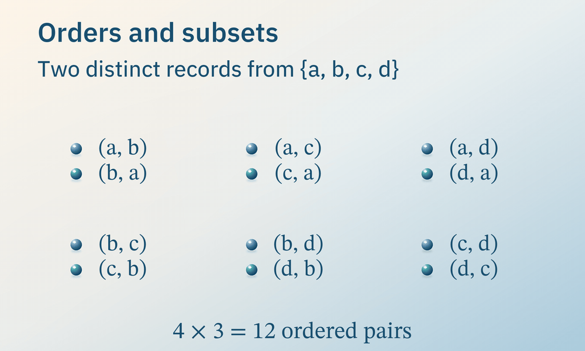

---
{
  "title": "Chapter 10: Permutations and combinations",
  "subtitle": "Discrete Mathematics · Rey Joseph Nieto",
  "description": "Chapter 10: Permutations and combinations. HTML edition of Lecture Notes in Discrete Mathematics.",
  "canonical-url": "https://rjnieto.com/teaching/notes/chapter-10/",
  "header-includes": "<meta name=\"robots\" content=\"index, follow, max-image-preview:large\">\n<meta property=\"og:url\" content=\"https://rjnieto.com/teaching/notes/chapter-10/\">\n<meta property=\"og:type\" content=\"article\">",
  "image": "/teaching/bulsu/discrete-math/images/thumbnails/chapter_10.webp",
  "body-classes": "ds-lecture-notes",
  "toc": true,
  "toc-depth": 2,
  "number-sections": false,
  "format": {
    "html": {
      "css": [
        "/assets/css/discrete-notes.css"
      ]
    }
  },
  "execute": {
    "eval": false
  },
  "resources": [
    "../assets/chapter-10/01-orders-and-subsets.gif",
    "../assets/chapter-10/01-orders-and-subsets-poster.png",
    "../assets/chapter-10/01-orders-and-subsets.webp"
  ]
}
---

<!-- Generated from the corresponding chapter LaTeX. Run scripts/build-discrete-html.py to refresh. -->

[Course page](/teaching/){.btn .btn-outline-secondary .btn-sm} [PDF](/teaching/bulsu/discrete-math/lecture-notes/chapter_10.pdf){.btn .btn-outline-primary .btn-sm aria-label="Open Chapter 10: Permutations and combinations as PDF"}

[]{#ch10:chapter label="ch10:chapter"}

A system selects three of eight distinct records for review. Choosing a first record, a second and a third gives $8(7)(6)=336$ ordered lists. But if the system stores only which three records were selected, different orders name the same selection. How do we remove those repeated descriptions?

If the system instead assigns first, second and third review priorities, changing the order changes the outcome. Chapter 9's instruction to specify one complete outcome therefore remains our starting point.

This chapter develops formulas for arrangements and selections from the sum and product rules. Chapter 7's equivalence classes will explain why a division can remove repeated orders. We will then use counting to prove identities, revisit Chapter 5's induction, and explain the coefficients in binomial expansions.

:::: {.ds-box .ds-learningoutcomes}
::: {#what-you-should-be-able-to-do .ds-box-title}
**What you should be able to do**
:::

After working through this chapter, you should be able to:

- calculate and simplify factorial expressions;

- count ordered arrangements of distinct objects;

- count subsets and justify division by the number of orders;

- handle restrictions using the earlier counting rules;

- recognise when a string is determined by a set of positions;

- prove selected identities by counting and by induction;

- explain and use binomial coefficients in an expansion.
::::

## 10.1 Factorials and arrangements {#ch10:factorials}

When all objects must be used once, each position leaves one fewer object available for the next. We begin with notation for the resulting product.

:::: {.ds-box .ds-definition}
::: {#definition-10.1-factorial .ds-box-title}
**Definition 10.1: Factorial**
:::

For a positive integer $n$, its **factorial** is the product of the positive integers from $1$ through $n$: $$n!=n(n-1)(n-2)\cdots2(1).$$ We also define $0!=1$. The notation is read "$n$ factorial".
::::

[**Example 10.1.**]{#example-10.1.} Alice, Bob and Charlie each give one presentation. Write $A,B,C$ for their names, and record the speaking order as a string using each letter once. There are three choices for the first speaker, two for the second and one for the last, giving $3(2)(1)=3!=6$.

::: ds-table
+---------------+---------------------+
| First speaker | Complete orders     |
+:=============:+:=========+:=========+
| Alice         | `ABC`    | `ACB`    |
+---------------+----------+----------+
| Bob           | `BAC`    | `BCA`    |
+---------------+----------+----------+
| Charlie       | `CAB`    | `CBA`    |
+---------------+----------+----------+
:::

The table lists every outcome once. All three people participate; only their order changes.

[**Example 10.2.**]{#example-10.2.} Expanding the relevant factors gives $$\frac{8!}{5!}
 =\frac{8(7)(6)\,5!}{5!}
 =8(7)(6)=336.$$ We cancel the entire common factor $5!$. The quotient is not $8/5$. Similarly, $5!=5(4)(3)(2)(1)=120$ and $1!=1$.

:::: {.ds-box .ds-definition}
::: {#definition-10.2-permutation-of-all-the-objects .ds-box-title}
**Definition 10.2: Permutation of all the objects**
:::

A **permutation** of $n$ distinct objects is an ordered arrangement using every object exactly once. The number of such arrangements is $n!$.
::::

For $n\geq1$, the product rule gives $n$ choices, then $n-1$, continuing down to one. For $n=0$, there is one arrangement: the empty list. This interpretation agrees with $0!=1$. Having no objects to arrange does not give zero possible empty arrangements.

[**Example 10.3.**]{#example-10.3.} Five distinct test cases must each be run once in a schedule. If any order is allowed, there are $5!=120$ schedules. If one particular case must run first, the remaining four cases can be arranged in $4!=24$ ways. If two particular, different cases must run first and last respectively, the three middle cases have $3!=6$ possible orders.

The fixed positions supply no additional choice. We arrange only the cases whose positions remain free.

[**Example 10.4.**]{#example-10.4.} The printed strings using two $A$s and one $B$ are $$\texttt{AAB},\qquad\texttt{ABA},\qquad\texttt{BAA}.$$ There are three, rather than $3!=6$. If the $A$s were labelled $A_1,A_2$, there would be six orders of three distinct objects. Removing those labels identifies two orders for each printed string. Thus the factorial count for distinct objects cannot be transferred unchanged to indistinguishable symbols.

## 10.2 Permutations {#ch10:permutations}

We may need only $k$ positions from a pool of $n$ distinct objects. In this section an object cannot be reused within an arrangement.

:::: {.ds-box .ds-definition}
::: {#definition-10.3-ordered-arrangements-without-repetition .ds-box-title}
**Definition 10.3: Ordered arrangements without repetition**
:::

For integers $0\leq k\leq n$, let $P(n,k)$ count the ordered lists of $k$ distinct objects chosen from $n$ available objects. Then $$P(n,k)=\frac{n!}{(n-k)!}.$$ Such an arrangement is also called a **$k$-permutation**.
::::

For $k\geq1$, choose the entries successively: $$P(n,k)=n(n-1)\cdots(n-k+1).$$ There are $k$ factors, ending at $n-k+1$. The factorial quotient cancels the remaining factor $(n-k)!$ in $n!$. When $k=0$, there is one empty list, and the quotient is $n!/n!=1$. When $k=n$, it becomes $n!/0!=n!$.

If $k>n$, no list of $k$ distinct objects can be formed from that pool. The count is zero, but the displayed factorial quotient is not applicable: $(n-k)!$ would have a negative argument.

[**Example 10.5.**]{#ch10:records} Assign three different records to first, second and third review priority, from eight distinct records. The positions are labelled, so an outcome is an ordered triple. There are $$P(8,3)=8(7)(6)=\frac{8!}{5!}=336$$ assignments. We stop after three factors. Using $8!$ would also arrange the five records that were not assigned a priority.

[**Example 10.6.**]{#example-10.6.} A three-character digit code uses $0$ to $9$ without repetition. Its positions give $P(10,3)=10(9)(8)=720$ codes. For instance, `017` is a valid code.

A three-digit positive integer cannot start with $0$. There are nine choices for its first digit, nine remaining choices for its second, and eight for its third. Thus there are $9(9)(8)=648$ such integers. The second position may use $0$; it must only avoid the digit already used. The difference $720-648=72$ counts the codes beginning with $0$.

[**Example 10.7.**]{#example-10.7.} Let $F=\{p,q,r\}$ be three tasks and let $S$ be five available servers. An injective function $f:F\to S$ sends different tasks to different servers. Choose $f(p)$ in five ways, then $f(q)$ in four, then $f(r)$ in three. There are $P(5,3)=5(4)(3)=60$ injective functions.

If different tasks may share a server, the count is instead $5^3=125$, as in Chapter 9. An injective assignment here uses only three of the five servers; it need not use every available server.

## 10.3 Combinations {#ch10:combinations}

An unordered selection records which objects are included, rather than assigning them to positions. We can start by counting ordered lists and determine how often each selection is represented.

[**Example 10.8.**]{#ch10:pair-groups} Choose two distinct records from $\{a,b,c,d\}$. The ordered pairs number $P(4,2)=4(3)=12$. Grouping pairs with the same underlying subset gives:

::: ds-table
   Selected subset  Its two orders
  ----------------- -----------------
      $\{a,b\}$     $(a,b),\ (b,a)$
      $\{a,c\}$     $(a,c),\ (c,a)$
      $\{a,d\}$     $(a,d),\ (d,a)$
      $\{b,c\}$     $(b,c),\ (c,b)$
      $\{b,d\}$     $(b,d),\ (d,b)$
      $\{c,d\}$     $(c,d),\ (d,c)$
:::

Every subset has exactly two orders, so there are $12/2=6$ subsets. In Chapter 7's language, two ordered pairs are equivalent when they contain the same records. The six equivalence classes all have size $2!=2$. Their equal size is what justifies this division.

<figure id="ch10-orders-and-subsets" class="ds-animation">
  <picture>
    <source media="print, (prefers-reduced-motion: reduce)" srcset="/teaching/notes/assets/chapter-10/01-orders-and-subsets-poster.png">
    
  </picture>
  <figcaption>The orders $(a,b)$ and $(b,a)$ belong to one group because both select the subset $\{a,b\}$. Each selected pair has $2!$ orders.</figcaption>
</figure>

:::: {.ds-box .ds-python}
::: {#python-non-examinable .ds-box-title}
**Python (non-examinable)**
:::

Python's standard `itertools` module supplies `permutations` for ordered arrangements and `combinations` for unordered selections. The `from ... import ...` line makes those two tools available; `list` collects their results so that `len` can count them. The square-bracketed list `records` holds our four distinct inputs. The argument `2` specifies that we take two records at a time.

``` python
from itertools import permutations, combinations
records = ["a", "b", "c", "d"]
orders = list(permutations(records, 2))
selections = list(combinations(records, 2))
print(len(orders), len(selections))
print(selections)
```

**Output.**

``` text
12 6
[('a', 'b'), ('a', 'c'), ('a', 'd'), ('b', 'c'), ('b', 'd'), ('c', 'd')]
```

The parenthesised pairs are Python's representations of the selections: the tool lists each selected pair once, using the input order. That display order does not give the mathematical subset an order. In contrast, `orders` contains both `(’a’, ’b’)` and `(’b’, ’a’)`. The four input records are distinct, as required by our counting argument.
::::

:::: {.ds-box .ds-definition}
::: {#definition-10.4-combination-and-binomial-coefficient .ds-box-title}
**Definition 10.4: Combination and binomial coefficient**
:::

A **$k$-combination** of $n$ distinct objects is a $k$-element subset of those objects. For integers $0\leq k\leq n$, its count is $$\binom nk=\frac{n!}{k!(n-k)!}.$$ The notation is read "$n$ choose $k$". It is called a **binomial coefficient**; the two stacked numbers do not denote a fraction.
::::

To justify the formula, every $k$-element subset has exactly $k!$ ordered arrangements. Conversely, every ordered list of $k$ distinct objects belongs to exactly one underlying subset. The lists therefore form equal groups of size $k!$: $$P(n,k)=\binom nk\,k!,
 \qquad
 \binom nk=\frac{P(n,k)}{k!}.$$ Substituting the formula for $P(n,k)$ gives the stated factorial expression. The argument also works for $k=0$, with one empty subset and one empty ordering.

[**Example 10.9.**]{#example-10.9.} The system at the start of the chapter selects three of eight distinct records, with no priorities. Each selected set has $3!=6$ possible orders. Thus $$\binom83
 =\frac{8(7)(6)}{3(2)(1)}
 =\frac{336}{6}=56.$$ For the boundary cases, $\binom80=1$ counts the empty subset and $\binom88=1$ counts the full set. Also $\binom00=1$: the empty set has exactly one subset, itself.

We will use a counting convention in identities: for $n\geq0$ and an integer $k$ outside $0\leq k\leq n$, set $\binom nk=0$. There cannot be a subset of negative size, or one larger than the whole set. This convention does not extend factorials to negative integers. Use the factorial formula only in its stated range.

[**Example 10.10.**]{#example-10.10.} Six students are available. Selecting a three-person team with no roles gives $\binom63=20$ teams. Assigning different students to three named roles gives $P(6,3)=6(5)(4)=120$ assignments.

Selecting a three-person team and designating one member as leader gives $20(3)=60$ outcomes. Only the leader is distinguished: the other two members are not ordered. Equivalently, choose the leader in six ways and the other two members from the remaining five: $6\binom52=6(10)=60$.

[**Example 10.11.**]{#example-10.11.} A pool contains four members of Group $H$ and three of Group $S$, with no person in both groups. A three-person team with exactly two from $H$ and one from $S$ can be chosen in $$\binom42\binom31=6(3)=18$$ ways. Each team determines its $H$-subset and its $S$-subset uniquely, so the product counts teams once.

For teams with at least one member from $S$, count all $\binom73=35$ teams and exclude the $\binom43=4$ teams drawn entirely from $H$. The result is $35-4=31$.

[**Example 10.12.**]{#example-10.12.} Alice and Bob are among eight available students. A three-person team containing Alice is determined by selecting its other two members from the remaining seven: $\binom72=21$. If Bob must also be excluded, only six candidates remain for those two places, giving $\binom62=15$.

To contain at least one of Alice and Bob, exclude the teams containing neither: $$\binom83-\binom63=56-20=36.$$ Adding the Alice-containing and Bob-containing counts without correction would count teams containing both twice.

## 10.4 Counting via subsets {#ch10:positions}

A final record may have ordered positions even when a combination is the appropriate count. Identify which set of positions or objects determines it.

[**Example 10.13.**]{#ch10:bit-positions} A length-$5$ bit string with exactly two $1$s is determined by the two positions containing them. For example, $$\{1,2\}\longleftrightarrow\texttt{11000},
 \qquad
 \{2,5\}\longleftrightarrow\texttt{01001}.$$ There are $\binom52=10$ choices of position set, and hence ten strings. Choosing position $2$ and then $5$ produces the same string as choosing $5$ and then $2$. $P(5,2)=20$ would count every string twice.

The string has ordered positions, but the order in which we select its one-positions is not part of the outcome.

[**Example 10.14.**]{#example-10.14.} Form a three-letter string from $\{A,B,C,D,E,F\}$ with distinct letters in strictly increasing alphabetical order. Any three-element subset has exactly one allowed order: $\{B,D,F\}$ produces `BDF`, for instance. Thus the count is $\binom63=20$.

There is no extra factor of $3!$. The other orders of the same three letters fail the alphabetical condition.

[**Example 10.15.**]{#example-10.15.} Fix a labelled set of five vertices. In a simple undirected graph, an edge is a two-element subset of the vertices, so there are $\binom52=10$ possible edges. Each graph with exactly three edges is determined by a three-element subset of those ten possibilities. There are therefore $$\binom{10}{3}=\frac{10(9)(8)}{3(2)(1)}=120$$ such graphs. Retain all five labelled vertices, including any isolated ones. If any number of edges is allowed, Chapter 9's yes-or-no choices give $2^{10}=1{,}024$ graphs.

## 10.5 Combinatorial proofs {#ch10:counting-proofs}

:::: {.ds-box .ds-definition}
::: {#definition-10.5-combinatorial-proof .ds-box-title}
**Definition 10.5: Combinatorial proof**
:::

A **combinatorial proof** establishes a counting identity by counting one finite collection in two ways, or by giving a reversible correspondence between the objects counted by its two sides.
::::

State what the objects are and explain why each expression counts them. A numerical check can illustrate the identity, but a proof must cover the stated range of parameters.

[**Example 10.16. Binomial symmetry.**]{#ch10:symmetry} For integers $0\leq k\leq n$, prove $$\binom nk=\binom n{n-k}.$$ Fix an $n$-element set $U$. Every $k$-element subset $S$ has a unique $(n-k)$-element complement $U\setminus S$. Conversely, complementing an $(n-k)$-element subset produces a $k$-element subset. Taking the complement twice returns the original set. The correspondence pairs every subset on one side with exactly one on the other, proving the identity.

For example, choosing nine of twelve records is equivalent to specifying the three left out: $\binom{12}{9}=\binom{12}{3}=220$. The complement argument, rather than this one value, proves the formula for all allowed $n,k$.

[**Example 10.17. Pascal's identity.**]{#ch10:pascal} For $n\geq0$ and $0\leq k\leq n+1$, prove $$\binom{n+1}{k}=\binom n{k-1}+\binom nk.$$ Consider $k$-element subsets of a set containing Alice and $n$ other people. There are $\binom{n+1}{k}$ such subsets.

If a subset contains Alice, its remaining $k-1$ members are chosen from the $n$ others: $\binom n{k-1}$ choices. If it does not contain Alice, all $k$ members come from those $n$ others: $\binom nk$ choices. The two cases are disjoint and cover all subsets. The sum rule therefore proves the identity.

This is **Pascal's identity**. Our zero convention handles the endpoints. For $k=0$, the Alice-containing case is impossible; for $k=n+1$, the Alice-excluding case is impossible. No negative factorial is used.

[**Example 10.18. Pascal's triangle.**]{#example-10.18.-pascals-triangle.} Arrange $\binom n0,\binom n1,\ldots,\binom nn$ in row $n$, starting with row $0$. The first seven rows are:

{.ds-note-image fig-alt="Pascal's triangle for rows n equals 0 through 6, highlighting 6 and 4 in row 4 and their sum 10 in row 5." loading="lazy" decoding="async"}

The outside entries are $\binom n0=\binom nn=1$. Every interior entry is the sum of the two entries immediately above it, by Pascal's identity. The outlined entries illustrate $\binom53=\binom42+\binom43=6+4=10$. Complement symmetry explains why each row reads the same from either end.

[**Example 10.19. Teams with a leader.**]{#ch10:leader} For $n\geq1$ and $1\leq k\leq n$, prove $$k\binom nk=n\binom{n-1}{k-1}.$$ An outcome is a $k$-person team selected from $n$ people, with one member designated as leader. Choose the team first in $\binom nk$ ways, then its leader in $k$ ways. This gives the left side.

Alternatively, choose the leader in $n$ ways, then the other $k-1$ members from the remaining $n-1$ people. This gives the right side. Each method specifies the same team and leader exactly once, so the counts are equal. For $n=6,k=3$, the two methods give $3\binom63=6\binom52=60$.

[**Example 10.20. Binomial row sum.**]{#ch10:row-sum} For every integer $n\geq0$, prove $$\sum_{j=0}^{n}\binom nj=2^n.$$ The sum adds the counts for sizes $0,1,\ldots,n$. Fix an $n$-element set $U$. Its subsets split into disjoint cases according to their size. Adding the case counts gives the left-hand side.

Alternatively, for each element of $U$, decide whether to include it or exclude it. These $n$ yes-or-no choices specify a subset once and give $2^n$ outcomes, as in Chapter 9. Both counts include every subset, including $\varnothing$, so they are equal. For $n=0$, both sides are $1$.

## 10.6 Row sums by induction {#ch10:induction}

The counting proof explains the subsets. We can also derive the same identity from Pascal's identity using Chapter 5's ordinary induction.

[**Example 10.21.**]{#ch10:row-induction} Let $P(n)$ be the statement $\sum_{j=0}^{n}\binom nj=2^n$, for integers $n\geq0$.

*Base case.* When $n=0$, the sum has one term: $\binom00=1=2^0$.

*Inductive step.* Fix $m\geq0$ and assume $$\sum_{j=0}^{m}\binom mj=2^m.$$ We must prove the corresponding row sum for $m+1$. Pascal's identity, including the zero endpoint terms, gives $$\sum_{j=0}^{m+1}\binom{m+1}{j}
 =
 \sum_{j=0}^{m+1}\binom m{j-1}
 +
 \sum_{j=0}^{m+1}\binom mj.$$ In the first sum on the right, $j=0$ contributes $\binom m{-1}=0$. The remaining terms are exactly $\binom m0,\binom m1,\ldots,\binom mm$. In the second sum, those same row-$m$ terms appear, followed by $\binom m{m+1}=0$. Each sum is therefore $2^m$ by the inductive hypothesis. The new row sum is $$2^m+2^m=2^{m+1},$$ as required. Induction proves the identity for every $n\geq0$. $\square$

The extra endpoint terms were zero counts of impossible subset sizes. The inductive hypothesis was used only for the row indexed by $m$.

## 10.7 Binomial expansions {#ch10:binomial}

A **binomial** is a sum of two terms. When we multiply copies of $x+y$, distribution chooses one term from each copy. A coefficient records how many contributions produce the same powers of $x$ and $y$.

[**Example 10.22.**]{#example-10.22.} Expand $(x+y)^3=(x+y)(x+y)(x+y)$. Label the factors $1,2,3$. Each contribution is determined by the positions from which $y$ is chosen; the other factors supply $x$.

::: ds-table
    Positions supplying $y$   Product    Number of choices
  --------------------------- --------- -------------------
         $\varnothing$        $x^3$             $1$
      $\{1\},\{2\},\{3\}$     $x^2y$            $3$
   $\{1,2\},\{1,3\},\{2,3\}$  $xy^2$            $3$
          $\{1,2,3\}$         $y^3$             $1$
:::

For instance, selecting $y$ from factors $1,3$ and $x$ from factor $2$ contributes $yxy=xy^2$. Collecting all eight contributions gives $$(x+y)^3=x^3+3x^2y+3xy^2+y^3.$$ The coefficients are $\binom30,\binom31,\binom32,\binom33$.

:::: {.ds-box .ds-definition}
::: {#definition-10.6-binomial-theorem .ds-box-title}
**Definition 10.6: Binomial theorem**
:::

For a nonnegative integer $n$, the polynomial identity $$(x+y)^n=\sum_{j=0}^{n}\binom nj x^{n-j}y^j$$ is the **binomial theorem**. The coefficient of $x^{n-j}y^j$ is $\binom nj$. When $n=0$, both sides are the constant polynomial $1$.
::::

For general $n$, choose the $j$ factors supplying $y$. There are $\binom nj$ such position sets. Every one contributes $x^{n-j}y^j$, and every contribution with those powers comes from one of the sets. This proves the coefficient formula. Summing over $j=0,\ldots,n$ accounts for all choices.

[**Example 10.23.**]{#example-10.23.} In $(x+2)^4$, replace $y$ by $2$ in the theorem: $$\begin{aligned}
 (x+2)^4
 &=x^4+4x^3(2)+6x^2(2^2)+4x(2^3)+2^4\\
 &=x^4+8x^3+24x^2+32x+16.
\end{aligned}$$ For the $x^2$ term, choose two factors to supply $2$ and two to supply $x$. Its coefficient is $\binom42\,2^2=6(4)=24$. Using just $\binom42=6$ would omit the contribution from the two selected constants.

[**Example 10.24.**]{#example-10.24.} For $(1+3x)^5$, an $x^2$ contribution must select $3x$ from exactly two factors. Choose those factors in $\binom52=10$ ways. Each contribution supplies $(3x)^2=9x^2$, so the coefficient is $10(9)=90$.

The same method retains signs. For the coefficient of $x^4$ in $(x-2)^5$, choose the one factor supplying $-2$. The other four supply $x$, giving coefficient $\binom51(-2)=-10$. The binomial coefficient counts the position choices. The constants in each selected product supply its additional numerical factor.

## 10.8 Exercises {#ch10:exercises}

::: {.ds-exercises style="--ds-chapter: '10';"}
1.  []{#ch10ex:factorials label="ch10ex:factorials"} Evaluate or simplify. In part (f), $n$ is an integer with $n\geq0$.

    a)  $0!$.

    b)  $1!$.

    c)  $4!$.

    d)  $\dfrac{6!}{3!}$.

    e)  $\dfrac{8!}{6!\,2!}$.

    f)  $\dfrac{(n+1)!}{n!}$.

2.  []{#ch10ex:small label="ch10ex:small"} Alice, Bob and Charlie are available. List all speaking orders using all three people. Then list all two-person teams with no roles. Explain what constitutes one outcome in each task.

3.  []{#ch10ex:complete label="ch10ex:complete"} Six distinct jobs must be scheduled in a line. Count schedules with:

    a)  no restriction;

    b)  one particular job fixed first;

    c)  two particular jobs occupying the first two positions, in either order.

4.  []{#ch10ex:partial label="ch10ex:partial"} Evaluate:

    a)  $P(8,3)$.

    b)  $P(6,2)$.

    c)  $P(5,0)$.

    d)  $P(4,4)$.

    e)  $P(0,0)$.

    How many ordered lists of five distinct objects can be formed from only three available objects? Explain why the factorial quotient cannot be used with $n=3,k=5$.

5.  []{#ch10ex:zeros label="ch10ex:zeros"} Use $\{0,1,2,3,4,5\}$ without repetition.

    a)  Count four-character codes, allowing a leading zero.

    b)  Count four-digit positive integers.

    c)  Count the codes beginning with zero. Explain how the three counts are related.

6.  []{#ch10ex:functions label="ch10ex:functions"} Let $F=\{p,q,r\}$ and $S=\{1,2,3,4,5,6\}$. Count functions $f:F\to S$ with:

    a)  no restriction;

    b)  injectivity;

    c)  injectivity and $f(p)=1$.

    Explain the available choices of image at each stage.

7.  []{#ch10ex:group-pairs label="ch10ex:group-pairs"} List the two-element subsets of $\{a,b,c,d,e\}$. For each, write its two ordered pairs. Use the grouping to justify the relation between $P(5,2)$ and $\binom52$.

8.  []{#ch10ex:coefficients label="ch10ex:coefficients"} Evaluate, using symmetry where convenient. Use the zero convention rather than negative factorials.

    a)  $\binom92$.

    b)  $\binom97$.

    c)  $\binom60$.

    d)  $\binom66$.

    e)  $\binom00$.

    f)  $\binom45$.

    g)  $\binom4{-1}$.

9.  []{#ch10ex:roles label="ch10ex:roles"} Eight students are available. Count outcomes for:

    a)  selecting a three-person team with no roles;

    b)  assigning different students to three named roles;

    c)  selecting a three-person team with one designated leader.

    Describe why the outcomes differ.

10. []{#ch10ex:groups label="ch10ex:groups"} There are five members of Group $A$ and four of Group $B$, with no overlap. Count four-person teams containing:

    a)  exactly two members of each group;

    b)  at least one member of Group $B$;

    c)  at most one member of Group $B$.

    Explain each product, sum or complement used.

11. []{#ch10ex:particular label="ch10ex:particular"} Alice and Bob are among ten available students. Count four-person teams satisfying:

    a)  Alice is included.

    b)  Alice is included and Bob excluded.

    c)  Alice and Bob are both included.

    d)  At least one of Alice and Bob is included.

12. []{#ch10ex:underlying-set label="ch10ex:underlying-set"} Give the count and explain the underlying subset in each case.

    a)  Three distinct letters from $\{A,B,C,D,E,F,G,H\}$ in strictly increasing alphabetical order.

    b)  A length-$6$ bit string with exactly two $1$s.

    Why is a permutation count inappropriate for each task?

13. []{#ch10ex:bit-strings label="ch10ex:bit-strings"} Consider length-$8$ bit strings with exactly three $1$s. Count those:

    a)  with no additional restriction;

    b)  starting with $1$;

    c)  ending with `00`;

    d)  starting with $1$ or ending with `00`.

    In part (d), identify the intersection and state how many positions remain free there.

14. []{#ch10ex:graphs label="ch10ex:graphs"} Fix the labelled vertex set $V=\{a,b,c,d,e,f\}$. Graphs are simple and undirected.

    a)  How many edges are available?

    b)  How many graphs on $V$ have exactly three edges?

    c)  How many of those contain $\{a,b\}$?

    d)  How many of those omit $\{a,b\}$?

    Check that parts (c) and (d) add to part (b). Keep all six labelled vertices in every graph.

15. []{#ch10ex:unequal-classes label="ch10ex:unequal-classes"} Group the four strings $$\texttt{00},\quad\texttt{01},\quad
     \texttt{10},\quad\texttt{11}$$ according to their number of $1$s. Grace divides $4$ by $2$, arguing that `01` and `10` describe the same group. List the actual groups and explain why her division does not count them.

16. []{#ch10ex:symmetry label="ch10ex:symmetry"} For $U=\{a,b,c,d,e\}$, describe the complement correspondence between three-element and two-element subsets, and give the image of $\{a,c,e\}$. Explain its reverse, then use the same argument to prove $\binom nk=\binom n{n-k}$ for all integers $0\leq k\leq n$.

17. []{#ch10ex:pascal label="ch10ex:pascal"} For $n\geq0$ and $0\leq k\leq n+1$, consider all length-$(n+1)$ bit strings with exactly $k$ ones. Classify them by their first bit and prove $$\binom{n+1}{k}=\binom n{k-1}+\binom nk.$$ Explain how the zero convention handles $k=0$ and $k=n+1$.

18. []{#ch10ex:triangle label="ch10ex:triangle"} Use Pascal's identity to construct rows $7$ and $8$ of Pascal's triangle, with the top row numbered $0$. Check the middle entry of row $8$ by computing $\binom84$ from factorials. Explain why every row has matching entries at equal distances from its ends.

19. []{#ch10ex:marked-bit label="ch10ex:marked-bit"} For $1\leq k\leq n$, an outcome consists of a length-$n$ bit string with exactly $k$ ones, and one of those one-positions marked. Count by choosing the string first and by choosing the marked position first. Use the two counts to prove $$k\binom nk=n\binom{n-1}{k-1}.$$ Explain why the marked position is excluded from the later choice of $k-1$ positions.

20. []{#ch10ex:row-sum label="ch10ex:row-sum"} For an $n$-element set, with $n\geq2$:

    a)  Explain why $\sum_{j=0}^{n}\binom nj$ counts all subsets.

    b)  How many nonempty subsets are there? Identify the term omitted from the full sum.

    c)  How many subsets have at least two elements? Explain the additional term removed.

21. []{#ch10ex:induction label="ch10ex:induction"} Prove $\sum_{j=0}^{n}\binom nj=2^n$ for all $n\geq0$ by ordinary induction, using Pascal's identity. State the base case and the inductive hypothesis. In the step from $m$ to $m+1$, identify the two zero endpoint terms before applying the hypothesis.

22. []{#ch10ex:expand label="ch10ex:expand"} Use the binomial theorem to expand:

    a)  $(x+1)^5$.

    b)  $(2x+1)^4$.

    Explain one non-endpoint coefficient in each expansion by describing the choices from the factors.

23. []{#ch10ex:extract label="ch10ex:extract"} Find the coefficient of:

    a)  $x^3$ in $(1+2x)^6$;

    b)  $x^4$ in $(x+3)^7$;

    c)  $x^5$ in $(2x-1)^6$.

    Identify which terms are selected from how many factors, including any constant powers and signs.

24. []{#ch10ex:flawed label="ch10ex:flawed"}

    a)  Mike gives $7!/3!$ for the number of three-element subsets of seven records. What ordered arrangements does that quotient count? Give the correct subset count.

    b)  Judy says that the coefficient of $x^2$ in $(1+2x)^4$ is $\binom42$. Identify the missing factor and give the coefficient.

25. []{#ch10ex:all-graphs label="ch10ex:all-graphs"} Fix a labelled set of five vertices. Use the ten possible edges to explain combinatorially why $$\sum_{j=0}^{10}\binom{10}{j}=2^{10}.$$ Describe the graph outcomes counted by each term and why the cases are disjoint and exhaustive.

26. []{#ch10ex:leader-error label="ch10ex:leader-error"} David proposes $$3\binom83=8\binom73,$$ claiming that both sides count three-person teams with one designated leader. Describe the outcomes actually counted by each side. Correct the identity and explain how the second construction must change.
:::

::: {.ds-chapter-navigation}

[← Chapter 9](../chapter-09/index.qmd)
[Next chapter →](../chapter-11/index.qmd){.btn .btn-primary rel="next" aria-label="Next chapter: Chapter 11 (HTML)"}

:::
