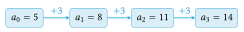
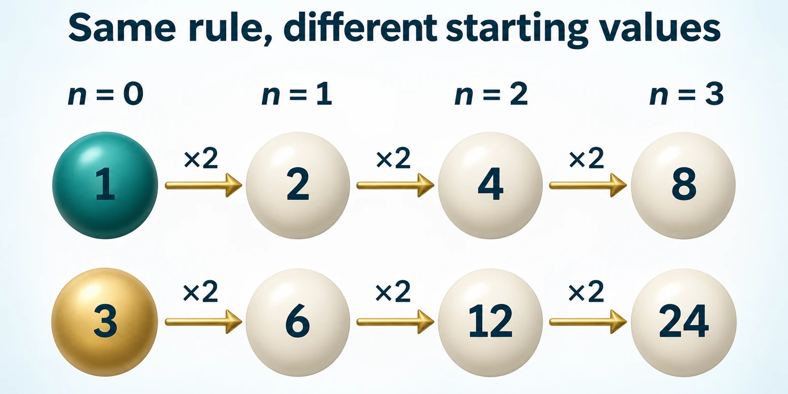

---
{
  "title": "Chapter 11: Sequences",
  "subtitle": "Discrete Mathematics · Rey Joseph Nieto",
  "description": "Chapter 11: Sequences. HTML edition of Lecture Notes in Discrete Mathematics.",
  "canonical-url": "https://rjnieto.com/teaching/notes/chapter-11/",
  "header-includes": "<meta name=\"robots\" content=\"index, follow, max-image-preview:large\">\n<meta property=\"og:url\" content=\"https://rjnieto.com/teaching/notes/chapter-11/\">\n<meta property=\"og:type\" content=\"article\">",
  "image": "/teaching/bulsu/discrete-math/images/thumbnails/chapter_11.webp",
  "body-classes": "ds-lecture-notes",
  "toc": true,
  "toc-depth": 2,
  "number-sections": false,
  "format": {
    "html": {
      "css": [
        "/assets/css/discrete-notes.css"
      ]
    }
  },
  "execute": {
    "eval": false
  }
}
---

<!-- Generated from the corresponding chapter LaTeX. Run scripts/build-discrete-html.py to refresh. -->

[Course page](/teaching/){.btn .btn-outline-secondary .btn-sm} [PDF](/teaching/bulsu/discrete-math/lecture-notes/chapter_11.pdf){.btn .btn-outline-primary .btn-sm aria-label="Open Chapter 11: Sequences as PDF"}

[]{#ch11:chapter label="ch11:chapter"}

Before any import batches run, a database contains five records. Each batch adds three records. To find the count after fifty batches, we could update the count fifty times, or calculate the initial count plus fifty additions of three. These are two ways to describe the same indexed quantity.

The index records how many batches have finished. Index $0$ describes the initial snapshot, before any batch, so the value after three batches is the fourth entry if we list that initial snapshot too.

Chapter 5 used recursive rules and induction; Chapters 9 and 10 counted objects depending on a size parameter. We now study such numbered values as sequences. We will specify their indices, compare direct formulas with rules using earlier values, and prove that a proposed formula describes every term.

:::: {.ds-box .ds-learningoutcomes}
::: {#what-you-should-be-able-to-do .ds-box-title}
**What you should be able to do**
:::

After working through this chapter, you should be able to:

- interpret a sequence as a function of an integer index;

- distinguish a term, its index and the sequence's set of values;

- evaluate explicit formulas and recursive descriptions;

- supply initial values and valid ranges for a recurrence;

- describe arithmetic and geometric sequences with either type of rule;

- translate simple updating processes into mathematical descriptions;

- verify a proposed formula and identify incomplete specifications.
::::

## 11.1 Sequences and indices {#ch11:indices}

:::: {.ds-box .ds-definition}
::: {#definition-11.1-numerical-sequence .ds-box-title}
**Definition 11.1: Numerical sequence**
:::

Fix a starting index $s\in\mathbb{N}$, where $\mathbb{N}=\{0,1,2,\ldots\}$. A numerical sequence $(a_n)_{n\geq s}$ assigns a real number $a_n$ to each index in $I_s=\{s,s+1,s+2,\ldots\}$. It is a function $a:I_s\to\mathbb{R}$, with $a_n=a(n)$. The value $a_n$ is the **term at index $n$**.
::::

We usually start at $0$ or $1$, but state the choice. A subscript labels an input: $a_n$ does not mean $a$ multiplied by $n$. Order and repeated values are retained. A finite sequence similarly uses a finite consecutive set of indices, such as $\{0,1,\ldots,6\}$.

[**Example 11.1.**]{#ch11:imports} For the database in the opening, let $a_n$ be the number of records after $n$ batches. The first five terms are:

::: ds-table
     Index $n$     $0$   $1$   $2$    $3$    $4$
  --------------- ----- ----- ------ ------ ------
   Records $a_n$   $5$   $8$   $11$   $14$   $17$
:::

Thus $a_3=14$ is the count after three batches. It is the fourth displayed term because the list begins with $a_0$. The third displayed term is $a_2=11$.

[**Example 11.2.**]{#example-11.2.} The sequences $$2,5,2,5,\ldots
 \qquad\text{and}\qquad
 5,2,5,2,\ldots$$ both start at index $0$, alternating as shown. Their sets of values are both $\{2,5\}$. Nevertheless, they are different functions: their values at index $0$ differ. Repeating a value is allowed; a sequence need not be injective.

Likewise, the constant sequence $7,7,7,\ldots$ has infinitely many indexed terms but a set of values containing just one element.

[**Example 11.3.**]{#example-11.3.} For $(a_n)_{n\geq0}$ in Example [11.1](#ch11:imports), define $(b_n)_{n\geq1}$ by $b_n=a_{n-1}$. Then $$b_1=5,\quad b_2=8,\quad b_3=11,\quad b_4=14.$$ Both lists display the same values in the same order, but their index sets differ. If $a_n=5+3n$, then $$b_n=5+3(n-1)\qquad(n\geq1).$$ Substituting $n=1$ gives the correct first value $5$. The functions are reindexed descriptions, rather than literally the same function on the same domain.

[**Example 11.4.**]{#example-11.4.} Let $a_n=n^2+1$ for $n\geq0$. Then $a_2=5$ and $a_3=10$. More generally, $$a_{n+1}=(n+1)^2+1=n^2+2n+2,
 \qquad
 a_n+1=n^2+2.$$ For example, $a_{2+1}=10$, whereas $a_2+1=6$. The parentheses around $n+1$ are needed when substituting the new index into the formula.

## 11.2 Explicit and recursive descriptions {#ch11:descriptions}

:::: {.ds-box .ds-definition}
::: {#definition-11.2-explicit-formula .ds-box-title}
**Definition 11.2: Explicit formula**
:::

An **explicit formula** gives $a_n$ directly as a function of its index $n$, without using earlier values of the sequence. Its index domain is part of the description.
::::

For example, $a_n=5+3n$ for $n\geq0$ allows us to calculate a term by substituting its index. A finite list of values alone does not specify which formula or continuing rule is intended.

[**Example 11.5.**]{#ch11:prefix} For $n\geq0$, define $$u_n=n+1,\qquad
 v_n=n+1+n(n-1)(n-2).$$ At $n=0,1,2$, at least one factor of the extra product is zero. The formulas agree there, but they differ at the next index:

::: ds-table
    $n$    $0$   $1$   $2$   $3$
  ------- ----- ----- ----- ------
   $u_n$   $1$   $2$   $3$   $4$
   $v_n$   $1$   $2$   $3$   $10$
:::

Thus the prefix $1,2,3$ does not force the next value to be $4$. A stated arithmetic rule would add information; the three observations by themselves do not. More generally, a finite prefix can be followed by different continuations.

:::: {.ds-box .ds-definition}
::: {#definition-11.3-recursive-description .ds-box-title}
**Definition 11.3: Recursive description**
:::

A **recursive description** specifies initial values and a **recurrence relation**: a rule computing later terms from earlier ones. State the indices on which the sequence is defined and the range on which the rule applies. The initial values and rule must allow every term in the domain to be determined.
::::

The rule describes a transition. The initial values supply the starting information. Earlier here means a smaller index.

[**Example 11.6.**]{#example-11.6.} The complete recursive description for Example [11.1](#ch11:imports) is $$a_0=5,\qquad a_{n+1}=a_n+3\quad(n\geq0).$$ It gives $a_1=5+3=8$, then $a_2=8+3=11$, then $a_3=11+3=14$.

{.ds-note-image fig-alt="Successive sequence terms a0 equals 5, a1 equals 8, a2 equals 11 and a3 equals 14, joined by increments of 3." loading="lazy" decoding="async"}

The explicit formula $a_n=5+3n$ gives $a_{10}=35$ directly. The displayed recursive rule calculates that term by continuing the successive updates from $a_0$. The two descriptions will be justified by the constant-difference reasoning below.

:::: {.ds-box .ds-python}
::: {#python-non-examinable .ds-box-title}
**Python (non-examinable)**
:::

The list `a` starts with $a_0=5$. Python counts list positions from zero, so `a[n]` represents $a_n$ here. The loop uses `n` from $0$ through $9$; each call to `append` adds the next term to the list.

``` python
a = [5]
for n in range(10):
    a.append(a[n] + 3)
print(a)
print(a[10], 5 + 3 * 10)
```

**Output.**

``` text
[5, 8, 11, 14, 17, 20, 23, 26, 29, 32, 35]
35 35
```

The last line compares the term obtained by successive updates with the explicit formula at $n=10$; `*` denotes multiplication. A recursive description can be implemented by a loop: the program need not call itself. This finite calculation does not establish the formula for every index.
::::

[**Example 11.7.**]{#example-11.7.} Both sequences below use the rule "double the previous term", starting at index $0$: $$1,2,4,8,\ldots
 \qquad\text{and}\qquad
 3,6,12,24,\ldots.$$ They satisfy $a_{n+1}=2a_n$, but have different initial values. Specifying $a_0=1$ selects the first; specifying $a_0=3$ selects the second. The recurrence equation alone does not distinguish them.

{.ds-note-image fig-alt="Sequences following the same recurrence from different initial values." loading="lazy" decoding="async"}

Both sequences double the preceding term, but starting at $1$ or $3$ gives different values at every displayed index.

[**Example 11.8. The Fibonacci sequence.**]{#ch11:fibonacci} Define $$f_0=0,\qquad f_1=1,\qquad
 f_{n+2}=f_{n+1}+f_n\quad(n\geq0).$$ This is the Fibonacci sequence with its stated starting indices. First $f_2=f_1+f_0=1$, then $f_3=f_2+f_1=2$, and $f_4=f_3+f_2=3$. Continuing gives:

::: ds-table
    $n$    $0$   $1$   $2$   $3$   $4$   $5$   $6$
  ------- ----- ----- ----- ----- ----- ----- -----
   $f_n$   $0$   $1$   $1$   $2$   $3$   $5$   $8$
:::

At the first allowed step $n=0$, both required inputs $f_1,f_0$ are already known. Each subsequent step uses two values that have already been determined.

:::: {.ds-box .ds-python}
::: {#python-non-examinable-1 .ds-box-title}
**Python (non-examinable)**
:::

The list `f` starts with $f_0=0$ and $f_1=1$. Its positions are numbered from zero, so `f[n]` represents $f_n$. The loop takes `n` from $0$ through $4$, and `append` adds the newly computed term to the end of the list. At each step, the two required entries already exist.

``` python
f = [0, 1]
for n in range(5):
    f.append(f[n + 1] + f[n])
print(f)
print(f[6])
```

**Output.**

``` text
[0, 1, 1, 2, 3, 5, 8]
8
```

The first loop step adds $f_2=f_1+f_0$; the last adds $f_6=f_5+f_4$. Starting with just `[0]` would leave `f[1]` unavailable at the first step.
::::

[**Example 11.9.**]{#example-11.9.} The specification $$c_0=0,\qquad c_{n+2}=c_{n+1}+c_n\quad(n\geq0)$$ leaves $c_1$ unspecified. Choosing $c_1=1$ produces $0,1,1,2,3,\ldots$; choosing $c_1=2$ produces $0,2,2,4,6,\ldots$. Both follow the same stated rule and value of $c_0$. They are different sequences, so more initial information is needed.

There is also an index problem in writing $d_0=2$ and $d_n=3d_{n-1}$ for $n\geq0$, if the domain is $\mathbb{N}$. At $n=0$ it refers to $d_{-1}$, outside that domain. Use the rule for $n\geq1$, or write equivalently $$d_0=2,\qquad d_{n+1}=3d_n\quad(n\geq0).$$ The corrected first step computes $d_1$ from $d_0$.

## 11.3 Arithmetic sequences {#ch11:arithmetic}

:::: {.ds-box .ds-definition}
::: {#definition-11.4-arithmetic-sequence .ds-box-title}
**Definition 11.4: Arithmetic sequence**
:::

A sequence starting at $s$ is **arithmetic** if a fixed real number $d$, its **common difference**, satisfies $$a_{n+1}=a_n+d\qquad(n\geq s).$$ If its initial term is $a_s=A$, its explicit formula is $$a_n=A+(n-s)d\qquad(n\geq s).$$
::::

There are $n-s$ transitions from index $s$ to index $n$. Each adds $d$, so the total change from the initial term is $(n-s)d$. The difference can be positive, negative or zero. For a finite arithmetic sequence, apply the rule only while both consecutive indices are in its domain.

[**Example 11.10.**]{#example-11.10.} For the imports, $a_0=5$ and every batch adds $d=3$. Thus $$a_n=5+3n\qquad(n\geq0).$$ After fifty batches the count is $a_{50}=5+3(50)=155$. The fifty additions occur after the initial snapshot; there is no addition at index $0$.

[**Example 11.11.**]{#example-11.11.} Rows of seats are numbered $1,2,3,\ldots$. Row $1$ has $12$ seats, and each later row has four more than its predecessor. The recursive and explicit descriptions are $$a_1=12,\quad a_{n+1}=a_n+4\ (n\geq1);
 \qquad
 a_n=12+4(n-1)\ (n\geq1).$$ Row $10$ has $12+4(9)=48$ seats. There are nine transitions from row $1$ to row $10$. The formula $12+4n$ would already give the wrong value at $n=1$.

[**Example 11.12.**]{#example-11.12.} A queue begins with $20$ records. Each full round processes exactly three records; such a round runs only when at least three remain. After $n$ full rounds, the count is $$q_n=20-3n\qquad(0\leq n\leq6).$$ The values are $20,17,14,11,8,5,2$. The recursive description is $q_0=20$ and $q_{n+1}=q_n-3$ for $0\leq n\leq5$.

At $n=6$, only two records remain. Extending the formula to $n=7$ would give $-1$, which cannot represent a number of waiting records. Finishing with a partial round would require a different final update. The algebraic formula can extend to negative values; this counting model cannot.

[**Example 11.13.**]{#example-11.13.} Suppose an arithmetic sequence starting at $0$ has $a_2=11$ and $a_5=23$. Three transitions occur between these indices, so $$23-11=3d,\qquad d=4.$$ Then $a_0=a_2-2d=11-8=3$. The complete descriptions are $$a_0=3,\quad a_{n+1}=a_n+4\ (n\geq0);
 \qquad a_n=3+4n\ (n\geq0).$$ We used the stated arithmetic assumption. The two observed values alone would not force the intervening or later values.

## 11.4 Geometric sequences {#ch11:geometric}

:::: {.ds-box .ds-definition}
::: {#definition-11.5-geometric-sequence .ds-box-title}
**Definition 11.5: Geometric sequence**
:::

A sequence starting at $s$ is **geometric** when a fixed real multiplier $r$ satisfies $$a_{n+1}=r a_n\qquad(n\geq s).$$ For $r\ne0$ and $a_s=A$, its explicit formula is $$a_n=A r^{\,n-s}\qquad(n\geq s).$$ Whenever $a_n\ne0$, the multiplier is the **common ratio** $r=a_{n+1}/a_n$.
::::

There are $n-s$ multiplications by $r$ after the initial term. The multiplier definition remains meaningful when terms are zero, even though division by a zero term is not allowed. For $r=0$, retain the stated initial term and write all later terms as zero; we treat that case separately from the displayed power formula.

[**Example 11.14.**]{#example-11.14.} Let $b_n$ count length-$n$ bit strings. There is one length-$0$ string, the empty string, so $b_0=1$. Each length-$n$ string extends in exactly two ways by appending $0$ or $1$. Different prefixes or final bits give different extended strings, and every length-$(n+1)$ string is obtained once. Thus $$b_0=1,\qquad b_{n+1}=2b_n\quad(n\geq0).$$ This is geometric with $r=2$, giving $b_n=2^n$. It agrees with Chapter 9's product-rule count.

[**Example 11.15.**]{#example-11.15.} Let $a_1=81$ and $a_{n+1}=\frac13a_n$ for $n\geq1$. The sequence begins $81,27,9,3,1,\frac13,\ldots$. Its explicit formula is $$a_n=81\left(\frac13\right)^{n-1}\qquad(n\geq1).$$ In particular, $a_5=81/3^4=1$. The exponent counts four multiplications between indices $1$ and $5$. Our numerical sequences may have real values; they are not all counting sequences.

[**Example 11.16.**]{#example-11.16.} Let $a_0=2$ and $a_{n+1}=-3a_n$ for $n\geq0$. The first terms are $$2,-6,18,-54,162,\ldots,
 \qquad a_n=2(-3)^n.$$ The signs alternate because each update multiplies by a negative number. Keep the parentheses: $2(-3)^2=18$. The expression $-2(3^2)=-18$ has a different sign and does not describe the same term.

[**Example 11.17.**]{#example-11.17.} The constant sequence $7,7,7,\ldots$ is arithmetic with difference $0$ and geometric with multiplier $1$. The two types can overlap.

The all-zero sequence is also arithmetic with difference $0$. It satisfies $a_{n+1}=r a_n$ for every fixed real $r$, so it is geometric under our multiplier definition. The quotient $0/0$ does not identify a ratio.

If instead $a_0=7$ and the multiplier is $r=0$, the sequence is $7,0,0,\ldots$. Write its explicit description as $$a_0=7,\qquad a_n=0\quad(n\geq1).$$ No evaluation of a zeroth power of zero is needed. Once a geometric sequence reaches zero, a fixed multiplier keeps every later term at zero.

## 11.5 Further recurrence relations {#ch11:models}

Not every numerical sequence has a fixed difference or a fixed multiplier. A recurrence can still describe a changing update precisely.

[**Example 11.18.**]{#ch11:squares} At stage $n\geq0$, a square array has $n+1$ rows and $n+1$ columns. Let $s_n$ count its cells. The explicit formula is $s_n=(n+1)^2$.

{.ds-note-image fig-alt="Square arrays with side lengths 1, 2 and 3, representing s0 equals 1, s1 equals 4 and s2 equals 9." loading="lazy" decoding="async"}

To grow the side from $n+1$ to $n+2$, add a row of $n+1$ cells, a column of $n+1$ cells and the new corner. The number added is $2n+3$. Thus another description is $$s_0=1,\qquad s_{n+1}=s_n+2n+3\quad(n\geq0).$$ The first terms $1,4,9,16$ have differences $3,5,7$, so the sequence is not arithmetic. It is not geometric either: the first two successive ratios are $4$ and $9/4$, which differ.

[**Example 11.19.**]{#ch11:affine} A process starts with one record. At each round, it replaces each current record by two records and then adds one new record. Let $a_n$ count records after $n$ rounds. The description is $$a_0=1,\qquad a_{n+1}=2a_n+1\quad(n\geq0).$$ It gives $1,3,7,15,31,\ldots$. The factor $2$ describes the replacements; the added $1$ describes the extra record. This is not the geometric rule $a_{n+1}=2a_n$.

The values suggest the explicit formula $a_n=2^{n+1}-1$. It matches the terms just calculated, but we must justify it for every index rather than rely on that finite match.

## 11.6 Verification and comparison {#ch11:verification}

A candidate formula must agree with all prescribed initial values and with each permitted update. Induction connects those checks to a claim about the whole sequence.

[**Example 11.20.**]{#ch11:affine-proof} For Example [11.19](#ch11:affine), prove $a_n=2^{n+1}-1$ for every $n\geq0$.

*Proof.* Let $P(n)$ state this equality.

*Base case.* At $n=0$, $a_0=1=2^{0+1}-1$.

*Inductive step.* Fix $k\geq0$ and assume $a_k=2^{k+1}-1$. The recurrence then gives $$\begin{aligned}
 a_{k+1}
 &=2a_k+1\\
 &=2(2^{k+1}-1)+1\\
 &=2^{k+2}-1\\
 &=2^{(k+1)+1}-1.
\end{aligned}$$ This is $P(k+1)$. Ordinary induction proves the formula for all $n\geq0$. $\square$

We may now use it at an index not checked in the initial list: for example, $a_6=2^7-1=127$.

[**Example 11.21.**]{#example-11.21.} The formula $b_n=2^n-1$ also satisfies the update equation: $$2b_n+1=2(2^n-1)+1=2^{n+1}-1=b_{n+1}.$$ But $b_0=0$, not the required $a_0=1$. Its terms begin $0,1,3,7,\ldots$, so it does not describe the sequence of Example [11.19](#ch11:affine). Checking the update while omitting the initial value would not establish the proposed answer.

[**Example 11.22.**]{#example-11.22.} Chapter 5 studied $$c_0=1,\quad c_1=3,\quad
 c_{n+2}=2c_{n+1}-c_n\quad(n\geq0)$$ and proved $c_n=2n+1$ for every $n\geq0$, using both initial values in the induction. The first terms are $1,3,5,7,\ldots$. The explicit formula shows $$c_{n+1}-c_n=(2n+3)-(2n+1)=2.$$ Consequently, the shorter recursive description $c_0=1$, $c_{n+1}=c_n+2$ for $n\geq0$ gives the same sequence. Having two earlier terms in a rule does not prevent its sequence from being arithmetic.

More generally, the rules considered here determine later terms from known earlier terms. If two candidate descriptions agree on the required initial values and obey the same such update, agreement propagates to every later index. For a rule using two earlier terms, both starting values must be checked.

## 11.7 Exercises {#ch11:exercises}

::: {.ds-exercises style="--ds-chapter: '11';"}
1.  []{#ch11ex:index label="ch11ex:index"} Let $a_n=n^2+2$ for $n\geq0$.

    a)  List the first five terms with their indices.

    b)  Find $a_3$ and $a_5$. Which displayed position does $a_3$ occupy?

    c)  Simplify $a_{n+1}$ and $a_n+1$ separately. Show that they do not denote the same expression.

2.  []{#ch11ex:sets label="ch11ex:sets"} For $n\geq0$, let $a_n=(-1)^n$ and $b_n=(-1)^{n+1}$. Give the first four terms of each and their sets of values. Are the indexed functions equal? Give an index witnessing your answer.

3.  []{#ch11ex:reindex label="ch11ex:reindex"} Let $a_n=4+5n$ for $n\geq0$ and define $b_n=a_{n-1}$ for $n\geq1$.

    a)  Give an explicit formula for $b_n$.

    b)  Find $b_1$ and $b_5$.

    c)  Explain why the two descriptions list the same ordered values but have different domains.

4.  []{#ch11ex:explicit label="ch11ex:explicit"} List the first four terms and their indices:

    a)  $a_n=3(2^n)$, $n\geq0$.

    b)  $b_n=3(2^{n-1})$, $n\geq1$.

    c)  $c_n=10-2n$, $n\geq0$.

    For part (c), the values are real numbers; no nonnegative-count restriction is imposed.

5.  []{#ch11ex:first-rule label="ch11ex:first-rule"} Let $a_0=2$ and $a_{n+1}=a_n+5$ for $n\geq0$. Calculate $a_1,\ldots,a_4$ recursively. Give an explicit formula and use it to find $a_{10}$. Check that it gives the specified initial value.

6.  []{#ch11ex:changing-increment label="ch11ex:changing-increment"} Define $u_0=1$ and $u_{n+1}=u_n+2(n+1)$ for $n\geq0$. Find $u_1,u_2,u_3,u_4$. Is this sequence arithmetic? Explain why a formula based on a constant increment would be inappropriate.

7.  []{#ch11ex:two-values label="ch11ex:two-values"} Let $$c_0=2,\quad c_1=1,\quad
     c_{n+2}=c_{n+1}+c_n\quad(n\geq0).$$ Find $c_2,\ldots,c_6$, displaying the two earlier terms used in each step. Explain why the first allowed step requires no index below $0$.

8.  []{#ch11ex:missing-base label="ch11ex:missing-base"} Someone specifies only $a_0=1$ and $a_{n+2}=a_{n+1}+a_n$ for $n\geq0$. Choose two different possible values of $a_1$, and generate three further terms for each. Use them to show why the given data do not determine a unique sequence.

9.  []{#ch11ex:repair-index label="ch11ex:repair-index"} A sequence has domain $\mathbb{N}$, and is described by $a_0=4$ and $a_n=2a_{n-1}$ for $n\geq0$. Identify the undefined index used at the first permitted step. Give two equivalent repairs, one with $a_n$ on the left and one with $a_{n+1}$. Using the repaired description, find $a_3$.

10. []{#ch11ex:circular label="ch11ex:circular"} Consider these proposed descriptions on $\mathbb{N}$:

    a)  $a_0=1$ and $a_{n+1}=a_{n+1}+1$ for $n\geq0$.

    b)  $b_0=1$ and $b_{n+1}=b_{n+1}$ for $n\geq0$.

    Which is contradictory, and which leaves later terms undetermined? Explain why neither is a rule computing the next value from earlier values.

11. []{#ch11ex:arithmetic label="ch11ex:arithmetic"} The sequences below are assumed arithmetic. For each, give its initial value, common difference, explicit formula and recursive rule, including the valid ranges.

    a)  $7,11,15,\ldots$, with first index $0$.

    b)  $20,17,14,\ldots$, with first index $1$.

    c)  $-2,-2,-2,\ldots$, with first index $0$.

    d)  $9,12,15,\ldots$, with first index $2$.

12. []{#ch11ex:separated label="ch11ex:separated"} An arithmetic sequence starting at $0$ satisfies $a_3=17$ and $a_8=42$. Find its common difference and $a_0$. Give an explicit formula and compute $a_{15}$.

13. []{#ch11ex:finite-count label="ch11ex:finite-count"} A queue starts with $23$ records. Each full round processes exactly four records, and a full round runs only if at least four remain. Describe the count after $n$ full rounds explicitly and recursively. State the largest permitted $n$. If a final partial round then processes all remaining records, does that last step follow the same constant-difference rule? Explain.

14. []{#ch11ex:geometric label="ch11ex:geometric"} For each geometric sequence, give the first four terms and an explicit description on its stated domain.

    a)  $a_0=5$, $r=3$, $n\geq0$.

    b)  $b_1=64$, $r=\tfrac12$, $n\geq1$.

    c)  $c_0=-1$, $r=-2$, $n\geq0$.

    d)  $d_0=9$, $r=0$, $n\geq0$.

15. []{#ch11ex:ratio-choices label="ch11ex:ratio-choices"} A real geometric sequence starting at $0$ has $g_0=3$ and $g_2=12$. Find all possible real multipliers and give the corresponding explicit formulas. Do the two supplied values determine $g_1$ uniquely?

16. []{#ch11ex:zeros label="ch11ex:zeros"}

    a)  Find the sequence with $a_0=0$ and $a_{n+1}=5a_n$ for $n\geq0$.

    b)  Could a geometric sequence begin $1,0,2$? Justify your answer from the fixed-multiplier rule.

    c)  Does the all-zero sequence determine a unique multiplier? Explain why term ratios do not answer that question.

17. []{#ch11ex:classify label="ch11ex:classify"} For $n\geq0$, decide whether each sequence is arithmetic, geometric, both or neither.

    a)  $a_n=6+2n$.

    b)  $b_n=3(-2)^n$.

    c)  $c_n=4$.

    d)  $d_n=n^2$.

    For a claimed property, justify the constant difference or multiplier for every allowed index. For a failed property, give incompatible steps.

18. []{#ch11ex:word-models label="ch11ex:word-models"} In both models, index $0$ is before any cycle.

    a)  There are initially four stored images; each cycle adds six, with none removed. Give both descriptions and the count after eight cycles.

    b)  There are initially four copies; each round replaces every copy by three copies. Give both descriptions and the count after three rounds.

19. []{#ch11ex:rectangle label="ch11ex:rectangle"} At stage $n\geq0$, an array has $n+1$ rows and $n+2$ columns. Let $r_n$ count its cells.

    a)  Give an explicit formula and its first four terms.

    b)  Show that $r_{n+1}-r_n=2n+4$, and give a complete recursive description.

    c)  Is the sequence arithmetic or geometric? Support each decision with differences or multipliers.

20. []{#ch11ex:affine label="ch11ex:affine"} Let $a_0=2$ and $a_{n+1}=2a_n+3$ for $n\geq0$. Compute the first four terms, then prove $$a_n=5(2^n)-3\qquad(n\geq0).$$ State the base case, the hypothesis and the target at index $k+1$.

21. []{#ch11ex:wrong-base label="ch11ex:wrong-base"} For the sequence of Example [11.19](#ch11:affine), someone proposes $b_n=3(2^n)-1$. Show that $b_{n+1}=2b_n+1$, but explain why this formula does not describe the given sequence. Identify the missing part of the proposed verification.

22. []{#ch11ex:prefix label="ch11ex:prefix"} For $n\geq0$, let $$u_n=2n+1,\qquad
     v_n=2n+1+n(n-1)(n-2)(n-3).$$ Show that the first four terms agree, but the terms at index $4$ differ. What does this show about a claim based only on observing $1,3,5,7$?

23. []{#ch11ex:equal-descriptions label="ch11ex:equal-descriptions"} Let $f_n=7+4n$ and $g_n=3+4(n+1)$, both for $n\geq0$. Also let $h_n=7+4(n-1)$ for $n\geq1$.

    a)  Prove that $f$ and $g$ are the same indexed function.

    b)  Explain how $h$ lists the same ordered values with different indices.

    c)  Compare $f_3,g_3,h_3$.

24. []{#ch11ex:two-rules label="ch11ex:two-rules"} Let $$c_0=2,\quad c_1=5,\quad
     c_{n+2}=2c_{n+1}-c_n\quad(n\geq0).$$ Verify that $c_n=3n+2$ matches both initial values and the recurrence equation. Explain, using induction, why those checks establish the formula for every $n\geq0$. Give another complete recursive description that uses only the immediately preceding term.

25. []{#ch11ex:variable-proof label="ch11ex:variable-proof"} For the sequence in Exercise [11.6](#ch11ex:changing-increment), prove by ordinary induction that $$u_n=n^2+n+1\qquad(n\geq0).$$ Show explicitly how the added $2(k+1)$ turns the hypothesis into the target at $k+1$.

26. []{#ch11ex:binary-count label="ch11ex:binary-count"} Let $t_n$ be the number of length-$n$ bit strings with no two adjacent $1$s. Include the empty string when $n=0$.

    a)  Find $t_0,t_1,t_2,t_3$ by listing.

    b)  Classify strings of length $n+2$ by their final bit. If the final bit is $1$, what must the preceding bit be? Use the two cases to justify $t_{n+2}=t_{n+1}+t_n$ for $n\geq0$.

    c)  Give the complete recursive description and use it to find $t_5$.
:::

::: {.ds-chapter-navigation}

[← Chapter 10](../chapter-10/index.qmd) · [Chapter 12 →](../chapter-12/index.qmd)

:::
