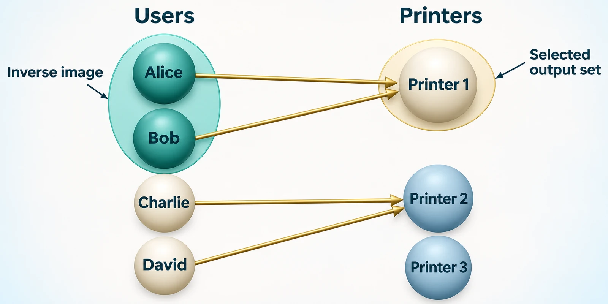
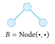
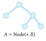
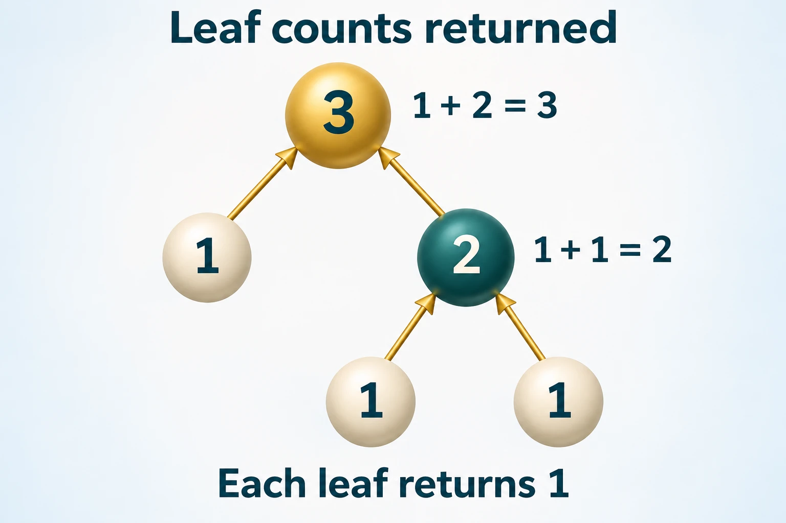

---
{
  "title": "Chapter 12: Recursion",
  "subtitle": "Discrete Mathematics · Rey Joseph Nieto",
  "description": "Chapter 12: Recursion. HTML edition of Lecture Notes in Discrete Mathematics.",
  "canonical-url": "https://rjnieto.com/teaching/notes/chapter-12/",
  "header-includes": "<meta name=\"robots\" content=\"index, follow, max-image-preview:large\">\n<meta property=\"og:url\" content=\"https://rjnieto.com/teaching/notes/chapter-12/\">\n<meta property=\"og:type\" content=\"article\">",
  "image": "/teaching/bulsu/discrete-math/images/thumbnails/chapter_12.webp",
  "body-classes": "ds-lecture-notes",
  "toc": true,
  "toc-depth": 2,
  "number-sections": false,
  "format": {
    "html": {
      "css": [
        "/assets/css/discrete-notes.css"
      ]
    }
  },
  "execute": {
    "eval": false
  }
}
---

<!-- Generated from the corresponding chapter LaTeX. Run scripts/build-discrete-html.py to refresh. -->

[Course page](/teaching/){.btn .btn-outline-secondary .btn-sm} [PDF](/teaching/bulsu/discrete-math/lecture-notes/chapter_12.pdf){.btn .btn-outline-primary .btn-sm aria-label="Open Chapter 12: Recursion as PDF"}

[]{#ch12:chapter label="ch12:chapter"}

A task either finishes immediately or splits into exactly two smaller tasks, each of which follows the same rule. Suppose every resulting task eventually finishes. How does the number of finished end tasks compare with the number of splits? A tree drawing can record one execution, but we want an answer covering every possible finite pattern of splits.

We will define counting functions on these trees and prove a relationship between their values. First we sharpen the function language from Chapters 1 and 4, including what it means to cover every output and how to find all inputs leading to a chosen output. The tree construction then brings together Chapter 6's rooted trees, Chapter 11's recursive descriptions and Chapter 5's induction.

:::: {.ds-box .ds-learningoutcomes}
::: {#what-you-should-be-able-to-do .ds-box-title}
**What you should be able to do**
:::

After working through this chapter, you should be able to:

- distinguish injectivity, surjectivity and bijectivity;

- calculate images and inverse images on stated domains;

- distinguish an inverse image from an inverse function;

- describe full binary trees through a base object and a constructor;

- translate a recursive counting procedure into a mathematical function;

- trace recursive evaluation on a finite tree;

- prove a tree property using both subtree hypotheses in structural induction.
::::

## 12.1 Injectivity and surjectivity {#ch12:functions}

A function $f:X\to Y$ assigns exactly one output in $Y$ to each input in $X$. The **domain** $X$ lists the permitted inputs; the **codomain** $Y$ lists the permitted outputs. Its **range** $f(X)=\{f(x):x\in X\}$ is the set of outputs actually obtained, which may be smaller than $Y$.

Chapter 4 studied injectivity. We now place that property beside surjectivity, which asks whether any element of the codomain is missed.

:::: {.ds-box .ds-definition}
::: {#definition-12.1-injective-surjective-and-bijective .ds-box-title}
**Definition 12.1: Injective, surjective and bijective**
:::

Let $f:X\to Y$. The function is **injective** if equal outputs force equal inputs: $$\text{for all }a,b\in X,\quad f(a)=f(b)\Longrightarrow a=b.$$ It is **surjective**, or **onto**, if $$\text{for every }y\in Y,\ \text{there is an }x\in X
 \text{ with }f(x)=y.$$ It is **bijective** if it is both injective and surjective.
::::

For a particular output in $Y$, injectivity permits at most one input leading to it; surjectivity requires at least one. A bijection gives exactly one. Every function already gives one output per input. That requirement alone does not settle either property.

[**Example 12.1.**]{#ch12:data} Use the following new data. Let $U=\{\text{Alice},\text{Bob},\text{Charlie},\text{David}\}$, $J=\{10,20,30,40,50\}$ and $P=\{\text{Printer 1},\text{Printer 2},\text{Printer 3}\}$. The complete table defines $i:U\to J$ and $d,h:U\to P$.

::: ds-table
  Input      Alice        Bob       Charlie      David
  ------- ----------- ----------- ----------- -----------
  $i$        $10$        $20$        $30$        $40$
  $d$      Printer 1   Printer 1   Printer 2   Printer 3
  $h$      Printer 1   Printer 1   Printer 2   Printer 2
:::

The identifier function $i$ is injective: every input has a different output. It is not surjective onto $J$, because $50\in J$ is not the output of any user. One missed codomain element is enough to refute surjectivity.

[**Example 12.2.**]{#example-12.2.} The function $d$ in Example [12.1](#ch12:data) is surjective: Printer 1 is reached by Alice, Printer 2 by Charlie, and Printer 3 by David. These witnesses account for every element of $P$. But $d$ is not injective, since Alice and Bob are distinct and share Printer 1.

Surjectivity asks whether an output is reached, not whether it is reached only once.

[**Example 12.3.**]{#example-12.3.} Keep the identifier assignments, but define $j:U\to J'$ with $J'=\{10,20,30,40\}$ and $j(u)=i(u)$. The outputs remain distinct, so $j$ is injective. They also cover every element of the stated codomain $J'$, so $j$ is surjective and therefore bijective.

The rules for $i$ and $j$ agree at every input. The codomain change alters the surjectivity question. We have specified a function with a new codomain, not proved that the unused value $50$ was reached.

[**Example 12.4.**]{#example-12.4.} For $h$ in Example [12.1](#ch12:data), Alice and Bob share Printer 1, so $h$ is not injective. No user is assigned Printer 3, so $h$ is not surjective.

Together, $i,d,j,h$ show all four possibilities: injective only, surjective only, both, and neither. Injectivity and surjectivity are not opposites.

[**Example 12.5.**]{#ch12:shift} Let $g:\mathbb{Z}\to\mathbb{Z}$ be given by $g(k)=k+3$. Prove that $g$ is bijective.

*Injectivity.* If $g(a)=g(b)$ for integers $a,b$, then $a+3=b+3$, hence $a=b$.

*Surjectivity.* Let $y$ be an arbitrary integer in the codomain. Choose $x=y-3$, which is an integer and therefore lies in the domain. Then $g(x)=(y-3)+3=y$. Every permitted output has an input witness, so $g$ is onto. Both properties hold. $\square$

For example, the witness for output $-2$ is input $-5$. The general choice $x=y-3$ covers all outputs; the single numerical example would not do so.

## 12.2 Images and inverses {#ch12:inverse-images}

Recall that for $A\subseteq X$, the **image** under $f:X\to Y$ is $$f(A)=\{f(a):a\in A\}\subseteq Y.$$ An image follows inputs forwards. An inverse image instead collects all inputs whose outputs belong to a specified subset of $Y$.

:::: {.ds-box .ds-definition}
::: {#definition-12.2-inverse-image .ds-box-title}
**Definition 12.2: Inverse image**
:::

For $f:X\to Y$ and $B\subseteq Y$, its **inverse image**, or **preimage**, is $$f^{-1}(B)=\{x\in X:f(x)\in B\}\subseteq X.$$ This notation defines a set of inputs for any function, whether or not it is injective or surjective.
::::

To find the inputs leading to one output $y$, use the singleton set $\{y\}$ and write $f^{-1}(\{y\})$. We retain the braces so that a set of inputs is visibly distinguished from an inverse-function value. The superscript $-1$ here does not mean a reciprocal.

[**Example 12.6.**]{#example-12.6.} Use $h:U\to P$ from Example [12.1](#ch12:data). For $A=\{\text{Alice},\text{Bob},\text{Charlie}\}$, $$h(A)=\{\text{Printer 1},\text{Printer 2}\}.$$ Repeated outputs are included only once. For an individual input, $h(\text{Alice})=\text{Printer 1}$, whereas $h(\{\text{Alice}\})=\{\text{Printer 1}\}$. The first is one printer label; the second is a set.

[**Example 12.7.**]{#example-12.7.} For the same function $h$, $$\begin{aligned}
 h^{-1}(\{\text{Printer 1}\})&=\{\text{Alice},\text{Bob}\},\\
 h^{-1}(\{\text{Printer 1},\text{Printer 2}\})&=U.
\end{aligned}$$ In the second calculation, a user is included if their output belongs to either of the two listed categories. Every user satisfies that condition. The result is a subset of the domain, not a set of printers.

{.ds-note-image fig-alt="An inverse image collecting every input whose output belongs to a chosen set." loading="lazy" decoding="async"}

The inverse image of $\{\text{Printer 1}\}$ under $h$ contains both Alice and Bob.

[**Example 12.8.**]{#example-12.8.} No input of $h$ leads to Printer 3, so $h^{-1}(\{\text{Printer 3}\})=\varnothing$. This is not a failure of the inverse-image definition. The set simply has no matching inputs.

Also, $h^{-1}(\varnothing)=\varnothing$: no function output belongs to the empty set. By contrast, $h^{-1}(P)=U$, since every output of the function lies in its codomain.

[**Example 12.9.**]{#example-12.9.} Define $q:\mathbb{Z}\to\mathbb{Z}$ by $q(k)=k^2$. Solving the relevant integer equations gives $$q^{-1}(\{4\})=\{-2,2\},\qquad
 q^{-1}(\{0\})=\{0\},\qquad
 q^{-1}(\{-1\})=\varnothing.$$ Both $-2$ and $2$ square to $4$; only $0$ squares to $0$; no integer square is negative. Even a one-element inverse image is written as a set. The failure of injectivity does not prevent any of these inverse images from being defined.

:::: {.ds-box .ds-definition}
::: {#definition-12.3-inverse-function .ds-box-title}
**Definition 12.3: Inverse function**
:::

If $f:X\to Y$ is bijective, its **inverse function** $f^{-1}:Y\to X$ sends each $y\in Y$ to the unique $x\in X$ with $f(x)=y$. It satisfies $$f^{-1}(f(x))=x\quad(x\in X),\qquad
 f(f^{-1}(y))=y\quad(y\in Y).$$ Surjectivity supplies an input for every $y$; injectivity makes that input unique.
::::

[**Example 12.10.**]{#example-12.10.} For the bijection $g(k)=k+3$ in Example [12.5](#ch12:shift), the inverse function is $g^{-1}:\mathbb{Z}\to\mathbb{Z}$, $g^{-1}(y)=y-3$. In particular, $$g^{-1}(7)=4,\qquad g^{-1}(\{7\})=\{4\}.$$ The first expression evaluates the inverse function at one integer. The second gives the inverse image of a singleton set. Also, $g(g^{-1}(7))=g(4)=7$, as required. The inverse is not $1/g(7)=1/10$.

[**Example 12.11.**]{#example-12.11.} For $h:U\to P$, an attempted inverse $P\to U$ would have two possible users for Printer 1 and no possible user for Printer 3. It cannot assign every printer the unique user required to undo $h$.

The set $h^{-1}(\{\text{Printer 1}\})=\{\text{Alice},\text{Bob}\}$ remains meaningful. It reports both inputs rather than pretending there is one inverse-function value.

## 12.3 Full binary trees {#ch12:trees}

Recall that, in a rooted tree, a leaf has no children and an internal vertex has at least one child. A full binary tree has exactly two children at every internal vertex. Its one-vertex tree has one leaf and no internal vertices.

For the recursive description, distinguish a left child from a right child. This makes our trees **ordered**: swapping different left and right subtrees changes the ordered tree. The counting results below do not depend on that order.

:::: {.ds-box .ds-definition}
::: {#definition-12.4-the-family-mathcal-t-of-finite-full-binary-trees .ds-box-title}
**Definition 12.4: The family $\mathcal T$ of finite full binary trees**
:::

The family $\mathcal T$ is specified by the following rules.

a)  **Base object.** The one-vertex rooted tree $\bullet$ belongs to $\mathcal T$.

b)  **Constructor.** If $S,R\in\mathcal T$, then $\operatorname{Node}(S,R)\in\mathcal T$. It has a new root whose left subtree is a copy of $S$ and whose right subtree is a separate copy of $R$.

c)  **Exclusion.** Only trees obtained by finitely many applications of these rules belong to $\mathcal T$.
::::

Here tree objects record the rooted, left/right shape. Renaming vertices or moving a drawing does not create a different member of $\mathcal T$. The copies have disjoint vertex sets, even if $S$ and $R$ have the same shape. The constructor joins their roots to the new root by two new edges. Every non-leaf tree in the family has a unique left subtree and right subtree at its root, so we can read its construction back from the tree.

[**Example 12.12.**]{#ch12:small-trees} The base object $\bullet$ has one vertex. Using it twice gives $B=\operatorname{Node}(\bullet,\bullet)$.

{.ds-note-image fig-alt="The base tree: a single leaf, denoted by a bullet." loading="lazy" decoding="async"}

{.ds-note-image fig-alt="Tree B equals Node of two leaves: one root with a left leaf and a right leaf." loading="lazy" decoding="async"}

The tree $B$ has two distinct leaves, one in each copy of $\bullet$, and one internal vertex. Using the same base shape twice does not identify its two vertices with one another.

[**Example 12.13.**]{#ch12:unbalanced} Using $B$ from Example [12.12](#ch12:small-trees), form $A=\operatorname{Node}(\bullet,B)$. Its left subtree is a single leaf and its right subtree contains a branch.

{.ds-note-image fig-alt="Tree A equals Node of a leaf and B: a left leaf and a right internal vertex with two leaf children." loading="lazy" decoding="async"}

There are three leaves and two internal vertices. The leaves have different depths, but every internal vertex has exactly two children, so $A$ is full binary. The ordered tree $\operatorname{Node}(B,\bullet)$ has the opposite left/right arrangement and the same counts.

[**Example 12.14.**]{#example-12.14.} A root with exactly one leaf child is not in $\mathcal T$. It is not the base object, and the constructor always gives its new root two children. Likewise, a root with three children cannot be obtained.

An infinite branching tree is also excluded. Every construction allowed here uses finitely many steps. This finiteness will let a recursive evaluation reach base objects rather than continue indefinitely.

## 12.4 Recursive counting functions {#ch12:recursive-functions}

A mathematical function may take a tree as its input. The input need not be a number. Our opening question needs a function that returns the number of leaves of a tree in $\mathcal T$.

[**Example 12.15. Counting leaves.**]{#ch12:procedure} Consider this pseudocode, with input a tree $T\in\mathcal T$. Here `Node(S,R)` means that $S$ and $R$ are its left and right subtrees.

    CountLeaves(T):
        if T is a single leaf:
            return 1
        else:
            write T as Node(S,R)
            return CountLeaves(S) + CountLeaves(R)

To translate it, name its output $L(T)$ and state the function's type: $L:\mathcal T\to\mathbb{N}$, where $\mathbb{N}=\{0,1,2,\ldots\}$. The first branch says $L(\bullet)=1$. The other branch says $$L(\operatorname{Node}(S,R))=L(S)+L(R).$$ Every leaf of the combined tree lies in exactly one child subtree; the new root is not a leaf. Thus the two returned counts are added without including an extra leaf for the root. These rules describe the procedure mathematically, with an input domain, an output set and both cases.

Each recursive call uses a proper child subtree, which has fewer vertices than its parent tree. Since the input tree is finite, successive calls eventually reach the one-vertex base case. The base rule and the unique root decomposition therefore determine one value for every allowed input.

:::: {.ds-box .ds-definition}
::: {#definition-12.5-leaf-and-internal-vertex-counting-functions .ds-box-title}
**Definition 12.5: Leaf and internal-vertex counting functions**
:::

For $T\in\mathcal T$, let $L(T)$ count its rooted leaves and $I(T)$ its internal vertices. Their recursive descriptions are $$\begin{aligned}
 L(\bullet)&=1,
 &L(\operatorname{Node}(S,R))&=L(S)+L(R),\\
 I(\bullet)&=0,
 &I(\operatorname{Node}(S,R))&=1+I(S)+I(R),
\end{aligned}$$ for all $S,R\in\mathcal T$. Both functions have domain $\mathcal T$ and codomain $\mathbb{N}$.
::::

The new root is an internal vertex, which accounts for the added $1$ in the rule for $I$. All other internal vertices occur in the two disjoint child subtrees.

[**Example 12.16. Recursive evaluation.**]{#ch12:trace} For $A=\operatorname{Node}(\bullet,B)$ with $B=\operatorname{Node}(\bullet,\bullet)$, the procedure makes one call on each child of the root. The call on $B$ itself makes two leaf calls. Its numerical evaluation is $$\begin{aligned}
 L(A)
 &=L(\bullet)+L(B)\\
 &=1+\bigl(L(\bullet)+L(\bullet)\bigr)\\
 &=1+(1+1)=3.
\end{aligned}$$ The two leaf calls inside $B$ each return $1$; the call on $B$ returns $2$; the outer call returns $1+2=3$. The matching internal count is $$I(A)=1+I(\bullet)+I(B)=1+0+(1+0+0)=2.$$ The recursive values agree with the drawing.

{.ds-note-image fig-alt="The leaf count of a binary tree obtained by adding the leaf counts of its two subtrees." loading="lazy" decoding="async"}

Each node displays its subtree's leaf count: the right subtree returns $2$ and the root returns $1+2=3$.

:::: {.ds-box .ds-python}
::: {#python-non-examinable .ds-box-title}
**Python (non-examinable)**
:::

To run the procedure, represent a single leaf by `None` and $\operatorname{Node}(S,R)$ by the ordered pair `(S, R)`, called a *tuple* in Python. Here `None` represents one vertex, not an empty tree. The line beginning `def` defines the function; `return` gives its output. The condition `tree is None` recognises the base leaf.

``` python
def count_leaves(tree):
    if tree is None:
        return 1
    left, right = tree
    return count_leaves(left) + count_leaves(right)

B = (None, None)
A = (None, B)
print(count_leaves(B), count_leaves(A))
```

**Output.**

``` text
2 3
```

The assignment `left, right = tree` reads the two child subtrees. Each recursive call applies the same function to a child, and its returned value supplies one of the two counts being added. These are exactly the trees $B$ and $A$ traced above. The code assumes an input built from the stated leaf and two-child rules; it does not check arbitrary Python data. The example computes two values, while the mathematical definitions and proofs describe the whole family.
::::

[**Example 12.17. Repeated subtrees.**]{#example-12.17.-repeated-subtrees.} For $D=\operatorname{Node}(B,B)$, $$L(D)=2+2=4,\qquad I(D)=1+1+1=3.$$ Each occurrence of $B$ supplies a separate subtree. Both must contribute to the count. The whole tree has $4+3=7$ vertices. The formula $L(D)=L(B)$ would omit all leaves in the second copy.

[**Example 12.18.**]{#example-12.18.} Suppose someone writes only $F(\operatorname{Node}(S,R))=F(S)+F(R)$ for $F:\mathcal T\to\mathbb{N}$. There is no rule yet for $F(\bullet)$. Setting that base value to $0$ gives zero at every tree; setting it to $1$ gives the leaf count. Both choices obey the displayed constructor rule.

The function description needs its base case, just as a sequence recurrence in Chapter 11 needs its initial information. The tree domain also excludes the one-child inputs for which the constructor rule supplies no case.

[**Example 12.19.**]{#example-12.19.} Define $W:\mathcal T\to\mathbb{N}$ by $W(\bullet)=1$ and $W(\operatorname{Node}(S,R))=1+W(S)+W(R)$. Then $W(B)=1+1+1=3$, although $B$ has only two leaves. The extra $1$ counts the new root. In fact, this rule counts all vertices rather than leaves. The recurrence can be complete and evaluable while describing a quantity different from the intended one.

## 12.5 Structural induction {#ch12:structural-induction}

Ordinary induction follows the construction of integers from a starting value and a next step. Here an object is built from a leaf or from two already constructed child trees. Our proof can follow those same construction rules.

:::: {.ds-box .ds-definition}
::: {#definition-12.6-structural-induction-on-mathcal-t .ds-box-title}
**Definition 12.6: Structural induction on $\mathcal T$**
:::

To prove a property $Q(T)$ for every $T\in\mathcal T$:

a)  **Base case.** Prove $Q(\bullet)$.

b)  **Constructor case.** Let $S,R\in\mathcal T$ be arbitrary. Assume $Q(S)$ and $Q(R)$, and use them to prove $Q(\operatorname{Node}(S,R))$.

These checks establish $Q$ for every tree generated by the defining rules.
::::

The principle works because every allowed tree has a finite construction. The property starts at each base leaf and is preserved whenever two constructed trees are joined. Following the construction to its root therefore establishes the property of the finished tree. The exclusion clause ensures that no other kinds of object need a separate case.

The two subtree hypotheses may concern trees of different shapes and sizes. We assume the property for the child trees, then prove it for their newly constructed parent. Assuming it for that parent instead would assume the target we are trying to establish.

[**Example 12.20. Leaves and internal vertices.**]{#ch12:main-proof} Prove that for every $T\in\mathcal T$, $$L(T)=I(T)+1.$$

*Proof.* We use structural induction.

*Base case.* For the single-leaf tree, $L(\bullet)=1=0+1=I(\bullet)+1$.

*Constructor case.* Let $S,R\in\mathcal T$ and assume both $$L(S)=I(S)+1,\qquad L(R)=I(R)+1.$$ The target is $L(\operatorname{Node}(S,R))=I(\operatorname{Node}(S,R))+1$. Using the recursive definitions and the two hypotheses, $$\begin{aligned}
 L(\operatorname{Node}(S,R))
 &=L(S)+L(R)\\
 &=(I(S)+1)+(I(R)+1)\\
 &=I(S)+I(R)+2\\
 &=\bigl(1+I(S)+I(R)\bigr)+1\\
 &=I(\operatorname{Node}(S,R))+1.
\end{aligned}$$ The base and constructor cases cover the defining rules of $\mathcal T$, so the claim holds for every $T\in\mathcal T$. $\square$

Each child tree supplies its own extra leaf in the induction hypotheses. The constructor adds one internal root, leaving one extra leaf for the whole tree.

[**Example 12.21.**]{#example-12.21.} If a tree in $\mathcal T$ has $18$ internal vertices, it has $19$ leaves and $18+19=37$ vertices in total. Conversely, $24$ leaves require $23$ internal vertices. We can make these deductions without knowing the particular shape, because the proof covers every tree in the specified family.

In the opening task model, internal vertices record splits and leaves record finished end tasks. There is therefore one more finished end task than split, provided the execution is finite and each split creates exactly two child tasks.

[**Example 12.22.**]{#example-12.22.} A proposed proof handles the base case and then checks only $\operatorname{Node}(S,S)$. That does not establish the claim for $\operatorname{Node}(S,R)$ when $S$ and $R$ differ. For example, $A=\operatorname{Node}(\bullet,B)$ has different child shapes.

The constructor permits any pair of trees from $\mathcal T$. Its proof case must therefore allow arbitrary $S,R$ and use the property of each. The two hypotheses need not be numerically identical.

[**Example 12.23.**]{#example-12.23.} Consider the rooted tree with a root and exactly one leaf child. It has one leaf and one internal vertex, so $L=I+1$ would read $1=2$. This does not refute Example [12.20](#ch12:main-proof): the tree is not full binary and is outside $\mathcal T$.

Its leaf count is still an ordinary count, but our two-child constructor and recursive specification do not describe this input. Changing the family requires changing the rules and checking which conclusions remain valid.

## 12.6 Exercises {#ch12:exercises}

::: {.ds-exercises style="--ds-chapter: '12';"}
1.  []{#ch12ex:finite-functions label="ch12ex:finite-functions"} Let $X=\{0,1,2\}$ and $Y=\{a,b,c\}$. Three functions $X\to Y$ are defined by the complete table.

    ::: ds-table
       Input   $0$   $1$   $2$
      ------- ----- ----- -----
        $f$    $a$   $b$   $c$
        $g$    $a$   $a$   $b$
        $h$    $c$   $b$   $a$
    :::

    For each function, give the range and decide whether it is injective, surjective and bijective. Give witnesses for any failed property.

2.  []{#ch12ex:codomain label="ch12ex:codomain"} Let $i:\{1,2,3\}\to\{10,20,30,40\}$ be $i(k)=10k$. Let $j:\{1,2,3\}\to\{10,20,30\}$ use the same rule. Classify each function as injective, surjective, both or neither. Explain exactly what changed.

3.  []{#ch12ex:construct label="ch12ex:construct"} Use complete tables to give:

    a)  an injective but non-surjective function $\{1,2\}\to\{a,b,c\}$;

    b)  a surjective but non-injective function $\{1,2,3\}\to\{a,b\}$;

    c)  a function $\{1,2,3\}\to\{a,b,c\}$ with neither property.

4.  []{#ch12ex:shift label="ch12ex:shift"} For $f:\mathbb{Z}\to\mathbb{Z}$, $f(k)=k-4$, prove injectivity and surjectivity separately. Give the inverse function, including its domain and codomain, and verify its value at $7$.

5.  []{#ch12ex:parity-image label="ch12ex:parity-image"} Let $f:\mathbb{Z}\to\mathbb{Z}$ be $f(k)=2k$. Prove that $f$ is injective, but give a codomain element showing it is not surjective. David proposes the inverse rule $y\mapsto y/2$ on all of $\mathbb{Z}$. Explain why it does not define an inverse function $\mathbb{Z}\to\mathbb{Z}$.

6.  []{#ch12ex:images label="ch12ex:images"} Let $U=\{\text{Alice},\text{Bob},\text{Charlie},\text{David}\}$ and $P=\{\text{Printer 1},\text{Printer 2},\text{Printer 3}\}$. Define $p:U\to P$ by

    ::: ds-table
       User     Alice        Bob       Charlie      David
      ------ ----------- ----------- ----------- -----------
       $p$    Printer 2   Printer 1   Printer 2   Printer 1
    :::

    Find each set:

    a)  $p(\{\text{Alice},\text{Charlie}\})$;

    b)  $p(\{\text{Bob},\text{Charlie}\})$;

    c)  $p^{-1}(\{\text{Printer 2}\})$;

    d)  $p^{-1}(\{\text{Printer 3}\})$;

    e)  $p^{-1}(\{\text{Printer 1},\text{Printer 3}\})$.

7.  []{#ch12ex:empty-full label="ch12ex:empty-full"} For the function $p$ in Exercise [12.6](#ch12ex:images), find $p(\varnothing)$, $p^{-1}(\varnothing)$, $p^{-1}(P)$ and $p(U)$. For each expression, say whether its definition selects inputs or outputs.

8.  []{#ch12ex:squares label="ch12ex:squares"} Let $q:\mathbb{Z}\to\mathbb{Z}$ be $q(k)=k^2$. Find the following:

    a)  $q(\{-3,0,3\})$.

    b)  $q^{-1}(\{9\})$.

    c)  $q^{-1}(\{0\})$.

    d)  $q^{-1}(\{-4,4\})$.

    Does $q$ have an inverse function $\mathbb{Z}\to\mathbb{Z}$? Justify your answer using the stated domain and codomain.

9.  []{#ch12ex:types label="ch12ex:types"} Let $b:\mathbb{Z}\to\mathbb{Z}$, $b(k)=k-4$. Find $b(7)$, $b(\{7\})$, $b^{-1}(7)$ and $b^{-1}(\{7\})$. Explain the role of the braces in each expression and why $b^{-1}(7)$ is not $1/b(7)$.

10. []{#ch12ex:preimage-error label="ch12ex:preimage-error"} For $p$ in Exercise [12.6](#ch12ex:images), Faith writes $p^{-1}(\{\text{Printer 2}\})=\text{Alice}$. Identify both the omitted input and the type of object that the answer must be. Give the corrected set and explain why its existence does not give $p$ an inverse function.

11. []{#ch12ex:tree-build label="ch12ex:tree-build"} Let $B=\operatorname{Node}(\bullet,\bullet)$. Draw each ordered tree with its root at the top:

    a)  $\bullet$;

    b)  $B$;

    c)  $\operatorname{Node}(B,\bullet)$;

    d)  $\operatorname{Node}(\bullet,B)$;

    e)  $\operatorname{Node}(B,B)$.

    For each drawing, identify its leaves and internal vertices.

12. []{#ch12ex:family label="ch12ex:family"} Which descriptions belong to $\mathcal T$? Justify each answer from the base or constructor rules.

    a)  A single rooted vertex.

    b)  A root with exactly one leaf child.

    c)  A root with two leaf children.

    d)  A root with three leaf children.

    e)  A finite full binary tree whose leaves have different depths.

13. []{#ch12ex:leaf-convention label="ch12ex:leaf-convention"} For $\bullet$, give the root's graph degree, number of children, leaf count and internal count. Why would treating a leaf as only a degree-one vertex give the wrong base value for $L$ on this family?

14. []{#ch12ex:counts label="ch12ex:counts"} Let $B=\operatorname{Node}(\bullet,\bullet)$, $A=\operatorname{Node}(B,\bullet)$ and $C=\operatorname{Node}(A,B)$. Find $L$ and $I$ for $B,A,C$, showing the substitution into each constructor rule. Check the resulting values against $L=I+1$.

15. []{#ch12ex:trace label="ch12ex:trace"} Let $B=\operatorname{Node}(\bullet,\bullet)$ and $T=\operatorname{Node}(B,B)$. Trace `CountLeaves(T)` using Example [12.15](#ch12:procedure). Show the two calls on copies of $B$, the values returned by their leaf calls, and the final output. Why must the second occurrence of $B$ contribute even though it has the same shape as the first?

16. []{#ch12ex:translate label="ch12ex:translate"} The input of this procedure is $T\in\mathcal T$.

        CountInternal(T):
            if T is a single leaf:
                return 0
            else:
                write T as Node(S,R)
                return 1 + CountInternal(S) + CountInternal(R)

    Specify its function domain and codomain, base value and constructor rule. Trace it on the tree $$\operatorname{Node}(\bullet,\operatorname{Node}(\bullet,\bullet)).$$ Explain what the added $1$ counts.

17. []{#ch12ex:missing-base label="ch12ex:missing-base"} Suppose $F:\mathcal T\to\mathbb{N}$ satisfies $F(\operatorname{Node}(S,R))=F(S)+F(R)$, but no base value is supplied. Choose two different base values and calculate $F(B)$ for $B=\operatorname{Node}(\bullet,\bullet)$. Use the two results to explain the missing information.

18. []{#ch12ex:bad-procedure label="ch12ex:bad-procedure"} A proposed leaf-counting procedure returns $1$ at a leaf, but at $\operatorname{Node}(S,R)$ it returns $$1+\texttt{CountLeaves(S)}+\texttt{CountLeaves(R)}.$$ Assume both recursive calls use this same proposed rule. Translate it into a recursive function $W$, evaluate $W(B)$, and compare with the actual leaf count. Explain which quantity the rule counts.

19. []{#ch12ex:termination label="ch12ex:termination"} In the procedure from Example [12.15](#ch12:procedure), what changes when a call passes to a child subtree? Use the finiteness of the input tree to justify termination. Why would replacing the recursive call on a child by another call on the whole unchanged tree fail to provide this justification?

20. []{#ch12ex:proof-parts label="ch12ex:proof-parts"} For a structural-induction proof of $L(T)=I(T)+1$ on $\mathcal T$, state:

    a)  the property of the base object;

    b)  the two subtree hypotheses;

    c)  the target for $\operatorname{Node}(S,R)$;

    d)  the recursive identity that introduces the new internal root.

21. []{#ch12ex:proof-gap label="ch12ex:proof-gap"} In an attempted independent proof of $L(T)=I(T)+1$ by structural induction, a student assumes only $L(S)=I(S)+1$, then writes $$L(\operatorname{Node}(S,R))
     =L(S)+L(R)=(I(S)+1)+(I(R)+1).$$ Which replacement is unsupported by the stated hypothesis? Repair the hypotheses and finish the argument. Explain why restricting to $R=S$ would not repair the proof for all trees in $\mathcal T$.

22. []{#ch12ex:structural-vs-sample label="ch12ex:structural-vs-sample"} Judy checks $L=I+1$ for $\bullet$, $\operatorname{Node}(\bullet,\bullet)$ and $\operatorname{Node}(B,B)$, where $B=\operatorname{Node}(\bullet,\bullet)$. Are these checks a structural-induction proof? Identify the general implication still needed.

23. []{#ch12ex:inference label="ch12ex:inference"} For trees in $\mathcal T$, find the requested counts.

    a)  A tree has $12$ internal vertices. Find its leaves and total vertices.

    b)  A tree has $20$ leaves. Find its internal vertices and total vertices.

    c)  Can a tree have $8$ leaves and $8$ internal vertices?

24. []{#ch12ex:all-vertices label="ch12ex:all-vertices"} Define $V:\mathcal T\to\mathbb{N}$ by $V(\bullet)=1$ and $V(\operatorname{Node}(S,R))=1+V(S)+V(R)$. Use structural induction to prove $V(T)=2I(T)+1$ for every $T\in\mathcal T$. State both subtree hypotheses and show how the new-root contribution enters the algebra.

25. []{#ch12ex:restricted-family label="ch12ex:restricted-family"} Give a finite rooted tree outside $\mathcal T$ for which the ordinary numbers of leaves and internal vertices do not satisfy $L=I+1$. Explain why it does not contradict the proved theorem. Identify which recursive construction rule would need to change to include your example.

26. []{#ch12ex:function-on-trees label="ch12ex:function-on-trees"} Consider the counting function $L:\mathcal T\to\mathbb{N}$.

    a)  Construct two distinct ordered trees with the same leaf count. What does this say about injectivity?

    b)  Show that $0$ is not a leaf count. What does this say about surjectivity onto the stated codomain?

    c)  Describe $L^{-1}(\{2\})$ by identifying every tree in that inverse image.

    Use $L=I+1$ when it helps, and keep inverse images as sets of tree objects.
:::

::: {.ds-chapter-navigation}

[← Chapter 11](../chapter-11/index.qmd)

:::
